# 📘 [제2과목 제1장] SQL 기본 — 2024 개정판 SQLD 마스터북 (오타 3건 완벽 교정본)

> **수록 범위**: 제1장 SQL 기본 (`2-1-1` RDB 개요 ~ `2-1-8` 표준 조인) + `SQLD_2과목_SQL 기본.pdf` 통합 + 원본 도식·실행 결과 82개(`p023`~`p052`) 전수 수록

---

# 2-1-1. 관계형 데이터베이스 개요

> **단원 분류**: `2과목` > `2-1. SQL 기본` > **`2-1-1. 관계형 데이터베이스 개요`**

### 📘 [해리누나 2024 개정판 + 2과목 요약본 완벽 통합] 제1장 제1절. 관계형 데이터베이스 개요 (PDF p.23 ~ p.26)

#### 1. 데이터베이스(DB)와 DBMS, 관계형 데이터베이스(RDB) 구성요소 (PDF p.23)
- **데이터베이스(Database)**: 동시에 복수의 적용 업무를 지원할 수 있도록 복수 이용자의 요구에 대응해서 데이터를 받아들이고 저장·공급하기 위하여 일정한 구조에 따라서 편성된 데이터의 집합.
- **DBMS (Database Management System)**: 이용자와 데이터베이스 사이에서 이용자의 요구에 따라 정보를 생성해주고, 데이터베이스를 관리해주는 소프트웨어.
- **관계형 데이터베이스 (RDB, Relational Database)**:
  - `1970년 E.F. Codd` 박사가 제안한 관계형 모델을 기반으로 구성.
  - 데이터를 **2차원 테이블(Table, 릴레이션)** 형태로 표현하며, 정규화를 통한 합리적인 테이블 모델링을 통해 이상(Anomaly) 현상을 제거하고 데이터 중복을 피할 수 있다.
  - 동시성 관리와 병행 제어를 통해 많은 사용자들이 동시에 데이터를 공유 및 조작할 수 있는 기능을 제공한다.

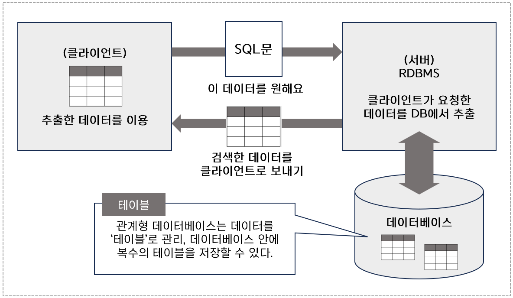

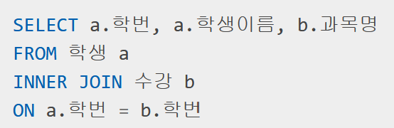

| 관계형 데이터 모델 용어 | 일반 파일 시스템 용어 | 관계형 DB (SQL) 용어 | 의미 및 시험 핵심 포인트 |
| :---: | :---: | :---: | :--- |
| **릴레이션 (Relation)** | 파일 (File) | **테이블 (Table)** | 데이터를 저장하는 2차원 표 형태의 기본 단위 |
| **튜플 (Tuple)** | 레코드 (Record) | **행 (Row, 로우)** | 테이블의 가로 한 줄 (하나의 개체 인스턴스) |
| **속성 (Attribute)** | 필드 (Field) | **열 (Column, 칼럼)** | 테이블의 세로 한 칸 (데이터의 가장 작은 논리적 단위) |
| **도메인 (Domain)** | 값의 범위 | 데이터 타입 + 제약조건 | 하나의 속성(컬럼)이 가질 수 있는 원자값들의 집합(범위) |
| **카디널리티 (Cardinality)** | 레코드 수 | **행(Row)의 개수** | 릴레이션에 포함된 **튜플(행)의 수** (수시로 변함) |
| **디그리 (Degree, 차수)** | 필드 수 | **열(Column)의 개수** | 릴레이션에 포함된 **속성(열)의 수** |

#### 2. 릴레이션(테이블)의 4대 특징 (PDF p.24)
1. **튜플(행)의 유일성**: 한 릴레이션에 포함된 튜플들은 모두 상이하며, 중복된 튜플은 존재할 수 없다.
2. **튜플(행)의 무순서성**: 한 릴레이션에 포함된 튜플 사이에는 순서가 없다.
3. **속성(열)의 무순서성**: 한 릴레이션을 구성하는 속성 사이에는 순서가 없다.
4. **속성값의 원자성**: 모든 속성값은 더 이상 분해할 수 없는 **원자값(Atomic Value)**만을 가진다.

---

#### 3. SQL (Structured Query Language) 문장의 4가지 종류 (★필수 암기!) (PDF p.24)

> 💡 **[핵심 필수 암기]**
> **명령어 소속 구분 암기 팁**:
> - **DML (`"세·인·업·딜·머"`)**: `SELECT`, `INSERT`, `UPDATE`, `DELETE`, `MERGE` ➔ **데이터(행)**를 조작 (Oracle에서는 수동 `COMMIT`/`ROLLBACK` 필요!)
> - **DDL (`"크·알·드·트·리"`)**: `CREATE`, `ALTER`, `DROP`, `TRUNCATE`, `RENAME` ➔ **구조(객체)**를 정의 (Oracle에서는 실행 즉시 **`AUTO COMMIT`**!)
> - **DCL (`"그·리"`)**: `GRANT`, `REVOKE` ➔ **권한** 부여 및 회수
> - **TCL (`"커·롤·세"`)**: `COMMIT`, `ROLLBACK`, `SAVEPOINT` ➔ **트랜잭션** 제어
> - ⚠️ **단골 함정**: `DELETE`(DML, 롤백 가능) vs `TRUNCATE`(DDL, 롤백 불가) vs `DROP`(DDL, 테이블 구조 자체 삭제)! 그리고 `ALTER`(DDL, 컬럼 구조 변경) vs `UPDATE`(DML, 데이터 값 변경)!

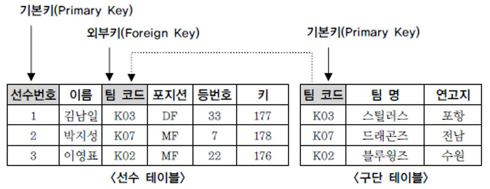

#### 4. 무결성 제약조건(Integrity Constraints) 4가지 (PDF p.25)
1. **개체 무결성 (Entity Integrity, 기본키 PK 제약)**:
   - 테이블의 기본키(Primary Key)를 구성하는 컬럼은 **`NULL` 값을 가질 수 없으며, 중복된 값을 가질 수 없다** (`UNIQUE + NOT NULL`).
2. **참조 무결성 (Referential Integrity, 외래키 FK 제약)**:
   - 외래키(Foreign Key) 값은 **`NULL`이거나 참조하는 부모 릴레이션의 기본키(PK) 값과 동일**해야 한다 (부모 테이블에 없는 값을 자식이 참조할 수 없음).
3. **도메인 무결성 (Domain Integrity)**:
   - 주어진 속성의 값이 그 속성이 정의된 **도메인(데이터 타입, 길이, `CHECK`, `NOT NULL` 등)에 속한 값**이어야 한다.
4. **고유 무결성 (Unique Integrity)**:
   - 특정 속성에 대해 각 튜플이 갖는 값들이 서로 달라야 한다 (`UNIQUE` 제약조건 — 단, **Oracle에서 `UNIQUE` 제약조건은 `NULL` 값을 여러 개 허용**함!).

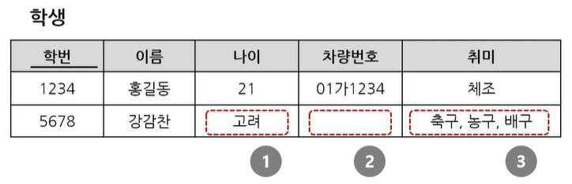

#### 5. 테이블 정의서와 ERD 매핑 (PDF p.26)
- 논리 모델의 **엔터티 ➔ 테이블**, **인스턴스 ➔ 행(Row)**, **속성 ➔ 열(Column)**, **식별자 ➔ PK/FK**로 물리 모델에 매핑된다.

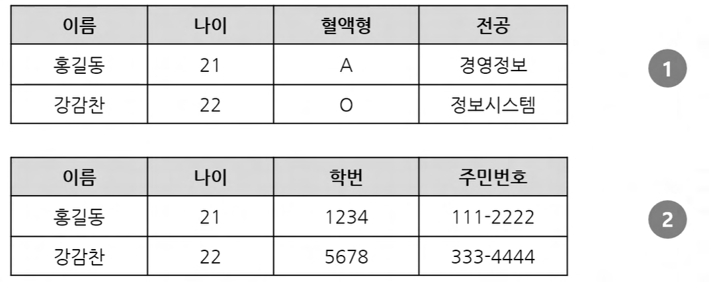

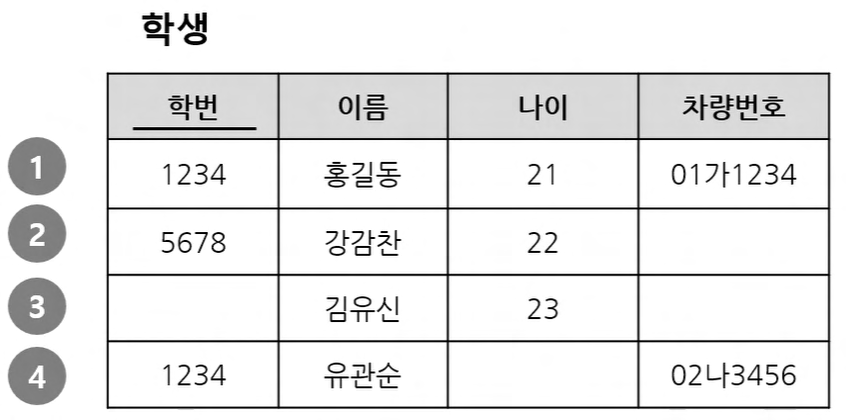

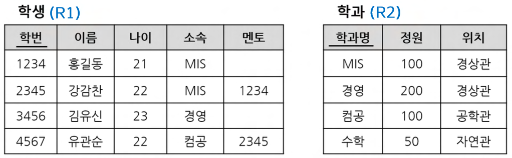

---

### 🧅 [SQLD양파 심화 이론 · 실전 SQL 트레이스 · Before & After · 30초 시험 직전 정리] (2-1-1 관계형 데이터베이스 개요)

## [핵심 요약]

> 관계형 데이터베이스(RDB)는 데이터를 행과 열로 된 표(테이블)로 저장하고, 표들 사이의 관계로 데이터를 관리하는 시스템이다.

ex) 엑셀 한 권에 여러 시트(=테이블), VLOOKUP 키(=외래키)로 시트끼리 연결되는 구조를 안전·동시 처리까지 가능하게 만든 것이 RDB

---

## [개념 도식화] 데이터베이스의 구조

```
   ┌──────────────────────────────────┐
   │            DBMS                  │
   │  ┌─────────────────────────┐    │
   │  │         Database          │    │
   │  │   ┌───────┐ ┌───────┐   │    │
   │  │   │TABLE A│ │TABLE B│   │    │
   │  │   │       │ │       │   │    │
   │  │   └───┬───┘ └───┬───┘   │    │
   │  │       └────관계──┘        │    │
   │  └─────────────────────────┘    │
   └──────────────────────────────────┘
```

| 용어 | 의미 |
|---|---|
| DBMS | 데이터베이스를 관리하는 SW (Oracle, MySQL 등) |
| Database | 데이터의 저장소 |
| Table | 행과 열로 된 표 |
| Row(Record) | 한 줄(한 인스턴스) |
| Column(Attribute) | 한 칸(속성) |

---

## SQL 명령어 분류

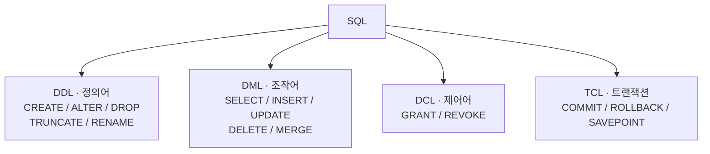

| 분류 | 풀이 | 명령어 | 비유 |
|---|---|---|---|
| **DDL**(`2-3-3`) | Data Definition | CREATE, ALTER, DROP, TRUNCATE, RENAME | 표(설계도) 만들기/바꾸기 |
| **DML**(`2-3-1`) | Data Manipulation | **SELECT**(`2-1-2`), INSERT, UPDATE, DELETE, MERGE | 표 안의 데이터 조작 |
| **DCL**(`2-3-4`) | Data Control | GRANT, REVOKE | 권한 부여/회수 |
| **TCL**(`2-3-2`) | Transaction Control | COMMIT, ROLLBACK, SAVEPOINT | 트랜잭션 묶음 처리 |

헷갈리기 쉬운 점: TRUNCATE 는 DDL, DELETE 는 DML

---

## 주요 데이터 타입

| 타입 | 의미 | 예 |
|---|---|---|
| CHAR(n) | **고정** 길이 문자열 — 모자라면 공백으로 채움 | CHAR(5) 에 'AB' 저장 → 'AB&nbsp;&nbsp;&nbsp;' (공백 3칸) |
| VARCHAR2(n) | **가변** 길이 문자열 — 입력한 만큼만 저장 | VARCHAR2(5) 에 'AB' 저장 → 'AB' |
| NUMBER(p, s) | 숫자 (전체 p자리, 소수 s자리) | NUMBER(7, 2) → 12345.67 |
| DATE | 날짜+시간 | 2026-04-26 13:24:00 |
| TIMESTAMP | 정밀 시간 (소수초까지) | 2026-04-26 13:24:00.123456 |

---

## 트랜잭션의 핵심 약속 — ACID

| 성질 | 의미 |
|---|---|
| Atomicity | 전부 성공 또는 전부 실패 |
| Consistency | 규칙 유지 |
| Isolation | 동시 처리 시 격리 |
| Durability | 커밋 후 영구 저장 |

---

## [SQL 실전] 가장 기본적인 흐름

```sql
-- DDL: 테이블 생성
CREATE TABLE EMP (
    EMP_ID NUMBER PRIMARY KEY,
    NAME   VARCHAR2(50),
    SAL    NUMBER
);

-- DML: 데이터 입력/조회
INSERT INTO EMP VALUES (1, '김철수', 3000);
SELECT * FROM EMP;

-- TCL: 영구 저장
COMMIT;

-- DCL: 권한 부여
GRANT SELECT ON EMP TO USER1;
```

---

## [Before & After] 파일 시스템 vs RDB

직원 데이터(EMP_ID, NAME, SAL) 2건을 보관하고 "급여 2000 초과인 사람"을 찾는 상황. 텍스트 파일 vs RDB 의 EMP 테이블.

### Before — 일반 파일에 저장

```
emp.txt
1, 김철수, 3000
2, 이영희, 4000
```

동시 수정 불가, 검색 느림, 무결성 보장 어려움

### After — RDB 사용

```sql
SELECT * FROM EMP WHERE SAL > 2000;
```

빠른 검색(인덱스), 동시 처리(트랜잭션), 무결성 제약 보장

파일은 의미·타입·관계 정보가 없어 매번 직접 파싱해야 하고, 동시 수정 시 한쪽 변경이 사라짐. RDB 는 스키마·인덱스·트랜잭션을 엔진이 보장하므로 데이터가 많거나 다중 사용자 환경에서는 RDB 가 정답.

---

## RDB의 5대 장점

| 장점 | 설명 |
|---|---|
| 데이터 독립성 | DB 변경이 응용 프로그램에 영향을 덜 줌 |
| 데이터 중복 최소화 | 정규화로 일관성 유지 |
| 무결성 | 제약조건으로 잘못된 데이터 차단 |
| 보안 | DCL로 권한 관리 |
| 동시성 | 트랜잭션 격리로 충돌 방지 |

---

## [시험 출제 포인트]

| 함정 | 정답 |
|---|---|
| TRUNCATE는 DDL인가 DML인가 | DDL(롤백 불가) |
| DELETE는 어디에 속하는가 | DML(롤백 가능) |
| COMMIT은 | TCL |
| GRANT/REVOKE는 | DCL |
| RDB 데이터 저장 단위 | 테이블(행과 열) |
| 한 행을 무엇이라 하는가 | Row, Record, Tuple |
| 한 열을 무엇이라 하는가 | Column, Attribute, Field |

단골 함정: "INSERT/UPDATE/DELETE/SELECT 모두 DML" 은 옳음. MERGE 도 DML.

---

> **30초 시험 직전 정리**
> · DDL: **CREATE / ALTER / DROP / TRUNCATE / RENAME** (자동 COMMIT, 롤백 불가)
> · DML: **SELECT / INSERT / UPDATE / DELETE / MERGE**
> · DCL: **GRANT / REVOKE** (권한)
> · TCL: **COMMIT / ROLLBACK / SAVEPOINT** (트랜잭션)
> · 함정: **TRUNCATE = DDL** (롤백 X), **DELETE = DML** (롤백 O)
> · 행/열 동의어: Row=Record=Tuple / Column=Attribute=Field


---

# 2-1-2. SELECT 문

> **단원 분류**: `2과목` > `2-1. SQL 기본` > **`2-1-2. SELECT 문`**

### 📘 [해리누나 2024 개정판 + 2과목 요약본 완벽 통합] 제1장 제2절. SELECT 문 (PDF p.27 ~ p.29)

#### 1. SELECT 문의 문법 작성 순서 vs 내부 실행(파싱) 순서 (★초빈출!) (PDF p.27, p.43)

> 💡 **[핵심 필수 암기]**
> **SELECT 문 작성 순서 vs 실행 순서 (별칭 Alias 사용 가능 위치를 결정짓는 핵심 원리!)**
> - **작성(문법) 순서 (`"셀·프·웨·그·해·오"`)**:
>   `SELECT` ➔ `FROM` ➔ `WHERE` ➔ `GROUP BY` ➔ `HAVING` ➔ `ORDER BY`
> - **실제 실행 순서 (`"프·웨·그·해·셀·오"`)**:
>   **`① FROM` ➔ `② WHERE` ➔ `③ GROUP BY` ➔ `④ HAVING` ➔ `⑤ SELECT` ➔ `⑥ ORDER BY`**
> - **핵심 결론**: `SELECT` 절에서 정의한 **컬럼 별칭(Alias)**은 `SELECT`보다 먼저 실행되는 **`WHERE`, `GROUP BY`, `HAVING` 절에서는 절대 사용할 수 없으며(에러 발생!)**, `SELECT` 이후에 실행되는 **`ORDER BY` 절에서만 사용할 수 있다!**
> - 반면, `FROM` 절에서 정의한 **테이블 별칭(Table Alias)**은 가장 먼저 실행되므로 `WHERE`, `SELECT`, `ORDER BY` 등 **모든 절에서 사용 가능**하다(오히려 테이블 별칭을 선언했다면 원래 테이블명 대신 반드시 별칭을 써야 함!).

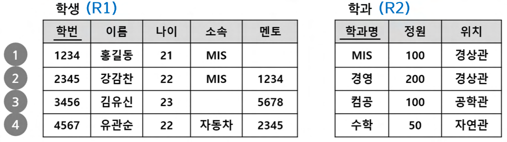

#### 2. SELECT 절 옵션 (`*`, `ALL`, `DISTINCT`)과 ALIAS(별칭) 부여 규칙 (PDF p.27 ~ p.28)
- **`ALL` (기본값)**: 중복된 데이터가 있어도 모두 출력 (생략 시 기본값은 `ALL`).
- **`DISTINCT`**: 조회 결과에서 **중복된 행(Row)을 제거**하고 유일한 값만 출력.
  - **`DISTINCT` 주의사항**: `SELECT` 키워드 바로 뒤에 작성하며, 뒤에 여러 컬럼(`SELECT DISTINCT DEPTNO, JOB`)을 나열하면 한 컬럼이 아니라 **나열된 모든 컬럼의 조합(세트)이 동일한 경우에만 중복으로 간주**하여 제거한다! 또한 **`DISTINCT`는 `NULL`도 하나의 값으로 인정**하여 여러 개의 `NULL`이 있으면 결과에 `NULL` 행 1개를 포함시킨다!
- **ALIAS (별칭) 부여 시 주의사항 4가지**:
  1. 컬럼명 바로 뒤에 작성하며, 컬럼명과 별칭 사이에 **`AS`** 키워드를 넣을 수 있다 (생략 가능). *(단, **Oracle에서 `FROM` 절의 테이블 별칭에는 `AS`를 쓰면 문법 에러**가 발생한다!)*
  2. 별칭에 **공백(띄어쓰기), 특수문자(`_`, `$`, `#` 제외)**가 포함되거나 **대소문자를 그대로 구분**해서 출력하고 싶을 때, 혹은 **숫자로 시작**할 때는 반드시 **큰따옴표(`"별칭"`)**로 감싸야 한다! (작은따옴표 `' '`는 문자열 리터럴에만 사용!)

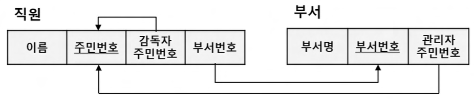

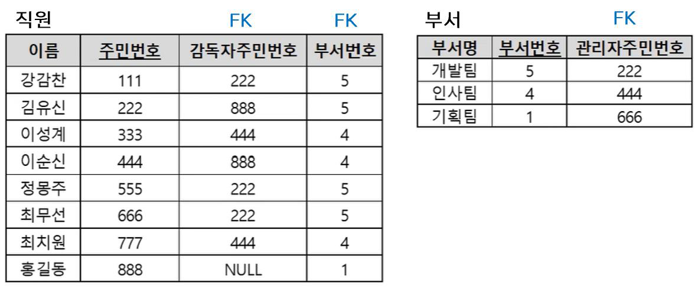

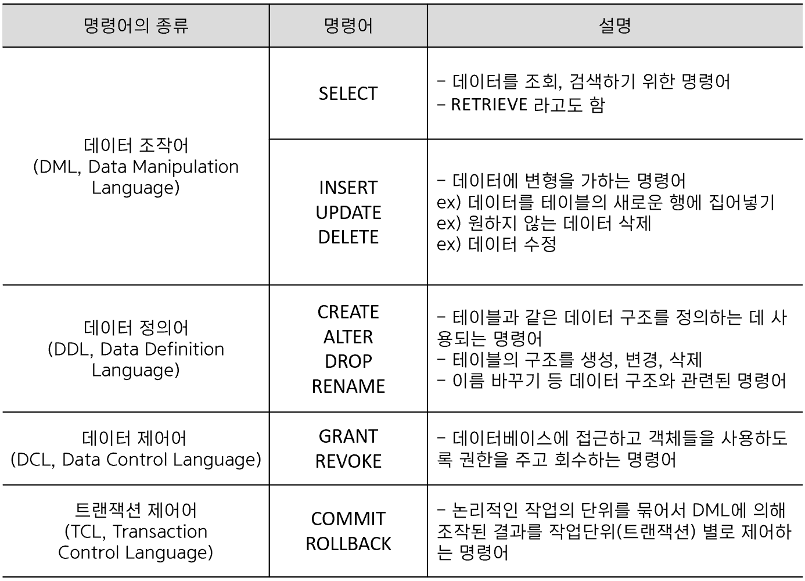

#### 3. 산술 연산자 우선순위와 합성(연결) 연산자 `||` / `+`, DUAL 테이블 (PDF p.28 ~ p.29)
- **산술 연산자**: `()` 괄호 ➔ `*`, `/` ➔ `+`, `-` 순으로 우선순위를 가진다.
  - 숫자나 날짜 데이터에 사용 가능하며, **`NULL`과 산술 연산을 수행하면 결과는 무조건 `NULL`**이다!
- **합성(Concatenation) 연산자 (문자열 결합)**:
  - **Oracle**: **`||`** (수직바 2개, 예: `'A' || 'B'` ➔ `'AB'`)
  - **SQL Server**: **`+`** (더하기 기호, 예: `'A' + 'B'` ➔ `'AB'`)
  - **공통 함수**: **`CONCAT(문자열1, 문자열2)`** *(주의: Oracle의 `CONCAT` 함수는 인자를 **딱 2개만** 받을 수 있다! 3개를 연결하려면 `CONCAT(CONCAT(A, B), C)`처럼 중첩하거나 `||`를 써야 함)*
  - **합성 연산자와 `NULL`의 함정**:
    - **Oracle**에서 `'SQL' || NULL`의 결과는 `NULL`이 아니라 **`'SQL'`**이다! (합성 연산 시 `NULL`은 빈 문자열처럼 무시됨)
    - 반면 **SQL Server**에서 `'SQL' + NULL`의 결과는 기본 설정상 **`NULL`**이 된다!
- **DUAL 테이블 (Oracle)**:
  - 오라클에서 기본 제공하는 더미(Dummy) 테이블로, `DUMMY`라는 `VARCHAR2(1)` 컬럼 하나에 `'X'`라는 값 1건만 들어 있다.
  - 테이블을 참조할 필요 없이 함수 계산이나 상수 연산(`SELECT 1 + 1 FROM DUAL;`, `SELECT SYSDATE FROM DUAL;`)만 수행할 때 `FROM` 절에 사용한다. (SQL Server는 `FROM` 절 자체를 생략 가능)

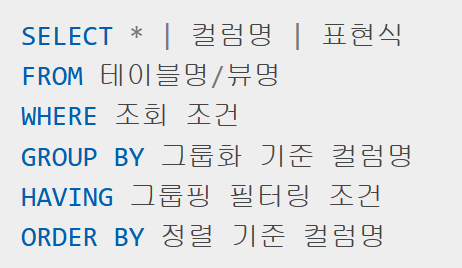

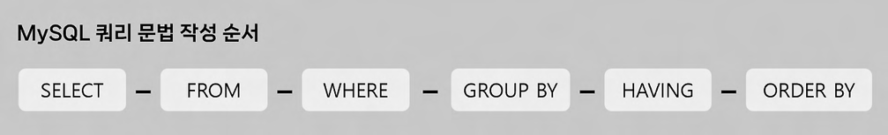


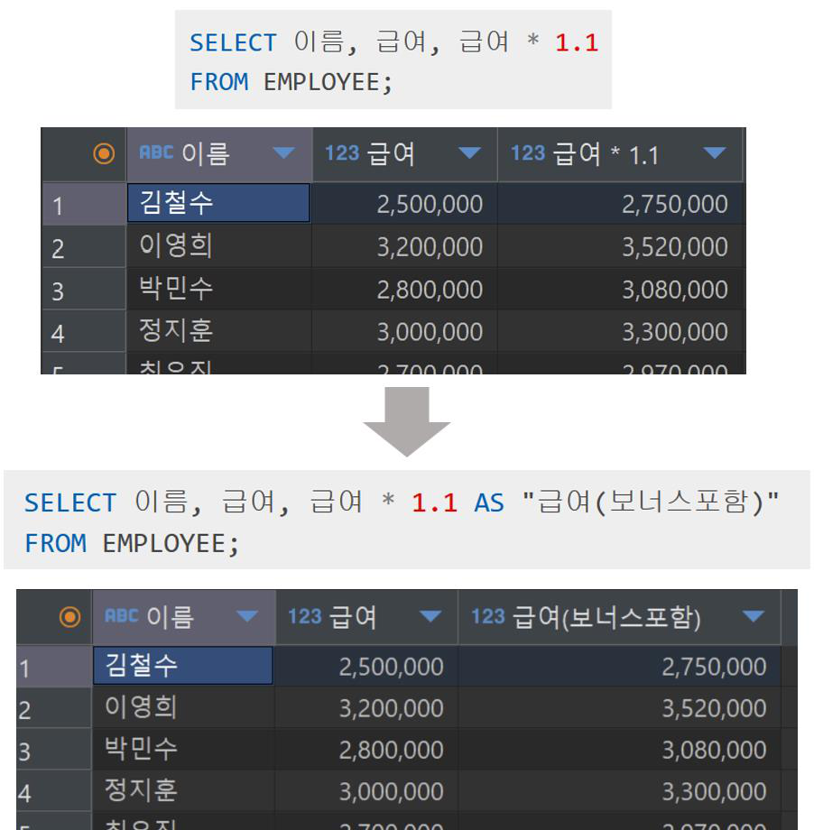

---

### 🧅 [SQLD양파 심화 이론 · 실전 SQL 트레이스 · Before & After · 30초 시험 직전 정리] (2-1-2 SELECT 문)

## [핵심 요약]

> SELECT 문은 데이터베이스에서 원하는 데이터를 골라서 뽑아내는 가장 기본적인 명령어다.

ex) 식당 주문처럼 "어느 식당(FROM)·어떤 음식(SELECT)·조건(WHERE)·그룹별(GROUP BY)·정렬(ORDER BY)" 을 차례로 지정

---

## [개념 도식화] SELECT 문의 6대 절

```
SELECT    컬럼1, 컬럼2, ...      ← ② 어떤 컬럼? (함수 활용)
FROM      테이블                   ← ① 어디서? (조인 가능)
WHERE     조건                     ← ③ 어떤 행?
GROUP BY  그룹기준                 ← ④ 어떻게 묶을지?
HAVING    그룹조건                 ← ⑤ 묶은 후 조건?
ORDER BY  정렬기준;                ← ⑥ 어떻게 정렬?
```

각 절의 자세한 사용은 **WHERE**(`2-1-4`), **GROUP BY/HAVING**(`2-1-5`), **ORDER BY**(`2-1-6`), **함수**(`2-1-3`), **조인**(`2-1-7`) 챕터 참고

### 작성 순서 vs 실행 순서


| 작성 순서 | 실행 순서 |
|---|---|
| 1. SELECT | 5. SELECT |
| 2. FROM | 1. FROM |
| 3. WHERE | 2. WHERE |
| 4. GROUP BY | 3. GROUP BY |
| 5. HAVING | 4. HAVING |
| 6. ORDER BY | 6. ORDER BY |

암기: FROM → WHERE → GROUP → HAVING → SELECT → ORDER (FWGHSO)

---

## SELECT 절의 다양한 표현

| 형태 | 의미 |
|---|---|
| `SELECT *` | 모든 컬럼 |
| `SELECT col1, col2` | 특정 컬럼 |
| `SELECT DISTINCT col` | 중복 제거 |
| `SELECT col AS 별명` | 별칭 부여 |
| <code>SELECT col &#124;&#124; '문자'</code> | 문자열 연결(Oracle) |
| `SELECT 1+1 FROM DUAL` | 계산식 |

---

## [SQL 실전]

```sql
-- 1. 모든 컬럼
SELECT * FROM EMP;

-- 2. 특정 컬럼
SELECT EMP_ID, NAME, SAL FROM EMP;

-- 3. 별칭(AS 생략 가능, 한글 별칭은 "")
SELECT NAME AS 사원명, SAL*12 "연봉" FROM EMP;

-- 4. 중복 제거
SELECT DISTINCT DEPT_ID FROM EMP;

-- 5. 문자열 연결
SELECT NAME || '님' AS GREETING FROM EMP;
```

---

## [Before & After]

EMP 4명 중 동명이인 김철수가 D1·D2 부서에 한 명씩 있는 상황. 컬럼 지정·DISTINCT·연봉 계산 별칭에 따라 결과가 달라지는 양상 비교.

### EMP

| EMP_ID | NAME | DEPT_ID | SAL |
|---|---|---|---|
| 1 | 김철수 | D1 | 3000 |
| 2 | 이영희 | D1 | 4000 |
| 3 | 박민수 | D2 | 3500 |
| 4 | 김철수 | D2 | 3200 |

### `SELECT NAME, SAL FROM EMP;`

| NAME | SAL |
|---|---|
| 김철수 | 3000 |
| 이영희 | 4000 |
| 박민수 | 3500 |
| 김철수 | 3200 |

### `SELECT DISTINCT NAME FROM EMP;`

| NAME |
|---|
| 김철수 |
| 이영희 |
| 박민수 |

### `SELECT NAME, SAL*12 AS "연봉" FROM EMP;`

| NAME | 연봉 |
|---|---|
| 김철수 | 36000 |
| 이영희 | 48000 |
| 박민수 | 42000 |
| 김철수 | 38400 |

DISTINCT 는 SELECT 절 전체(여러 컬럼이면 조합) 단위로 중복 제거 → NAME 만 보면 동명이인 김철수도 한 줄로 합쳐짐. SAL*12 같은 표현은 행 단위 계산이라 같은 이름이라도 별개 행. 원본 그대로면 컬럼 나열, 값 종류만이면 DISTINCT, 가공값에 의미있는 이름이면 별칭.

---

## 별칭(Alias) 규칙

| 규칙 | 예 |
|---|---|
| AS 생략 가능 | `SELECT NAME 사원명` |
| 공백/한글/특수문자 포함 시 `""` 사용 | `"사원 이름"` |
| 테이블 별칭은 AS 사용 불가(Oracle) | `FROM EMP E` |
| WHERE/GROUP/HAVING에서 SELECT의 별칭 사용 | 불가(실행 순서 때문) |
| ORDER BY에서 별칭 사용 | 가능 |

---

## DUAL 테이블 (Oracle)

시스템 내장 가짜 테이블. 1행 1컬럼. 계산이나 함수 결과 확인용.

```sql
SELECT 1+1 FROM DUAL;        -- 2
SELECT SYSDATE FROM DUAL;    -- 현재 시각
SELECT USER FROM DUAL;       -- 접속 계정
```

---

## [시험 출제 포인트]

| 함정 | 정답 |
|---|---|
| SELECT 실행 순서 | FROM → WHERE → GROUP BY → HAVING → SELECT → ORDER BY |
| WHERE에서 SELECT 별칭 사용 가능? | 불가(SELECT가 나중에 실행됨) |
| ORDER BY에서 SELECT 별칭 사용 가능? | 가능 |
| DISTINCT 적용 범위 | SELECT 절 전체(여러 컬럼이면 조합 단위) |
| Oracle 테이블 별칭에 AS | 사용 불가 |
| `SELECT * FROM DUAL`의 결과 | 1행 1컬럼('X') |

자주 출제: WHERE 절에서 SELECT 별칭 사용 시 에러. 실행 순서상 WHERE 가 먼저 처리되기 때문.

---

> **30초 시험 직전 정리**
> · 작성: SELECT → FROM → WHERE → GROUP → HAVING → ORDER
> · 실행: **FROM → WHERE → GROUP → HAVING → SELECT → ORDER (FWGHSO)**
> · 별칭 사용: **ORDER BY 만 가능**, WHERE/GROUP/HAVING 은 불가 (SELECT 가 더 늦게 실행됨)
> · DISTINCT = SELECT 절 전체에 적용 (여러 컬럼이면 컬럼 조합 단위로 중복 제거)
> · Oracle 테이블 별칭 = AS 사용 **불가** / 컬럼 별칭 = AS 사용 **가능 (생략도 가능)**
> · DUAL = Oracle 시스템 내장 1행 1컬럼 가짜 테이블 (계산·함수 테스트용)


---

# 2-1-3. 함수(Function)

> **단원 분류**: `2과목` > `2-1. SQL 기본` > **`2-1-3. 함수`**

### 📘 [해리누나 2024 개정판 + 2과목 요약본 완벽 통합 (오타 2건 교정 반영!)] 제1장 제3절. 함수 (Function) (PDF p.29 ~ p.35)

#### 1. 내장 함수(Built-in Function)의 개요와 단일행 함수의 특징 (PDF p.29)
- **단일행 함수 (Single-Row Function)**:
  - 테이블에 저장되어 있는 **개별 행(Row)마다 함수가 하나씩 적용**되어, 입력 행 수만큼 결과값을 반환하는 함수 (1:1 대응).
  - `SELECT`, `WHERE`, `ORDER BY`, `GROUP BY`, `HAVING` 절 등 **어디서나 사용 가능**하다!
  - 여러 인자를 입력받아도 **단 하나의 결과값**만 반환하며, **` 함수1(함수2(컬럼)) `처럼 중첩해서 사용**할 수 있다 (안쪽 함수부터 바깥쪽 순서로 실행).

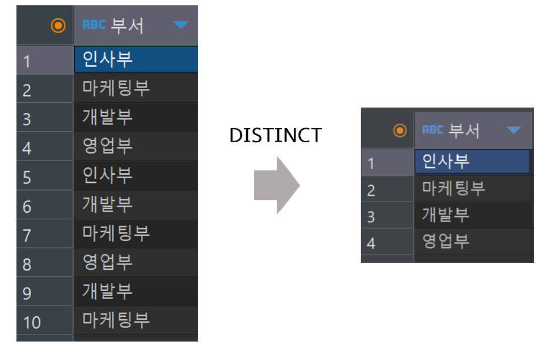

---

#### 2. 문자형 함수 (Character Functions) 완벽 정리 (PDF p.30 ~ p.31)

| 함수명 (Oracle / SQL Server) | 기능 및 문법 | 시험 빈출 예제 및 결과 |
| :--- | :--- | :--- |
| **`LOWER(문자열)`** | 모든 영문자를 **소문자**로 변환 | `LOWER('SQL Expert')` ➔ **`'sql expert'`** |
| **`UPPER(문자열)`** | 모든 영문자를 **대문자**로 변환 | `UPPER('sql expert')` ➔ **`'SQL EXPERT'`** |
| **`INITCAP(문자열)`** *(Oracle)* | 단어의 **첫 글자만 대문자**, 나머지는 소문자로 변환 *(구분자: 공백, 특수문자, 숫자 뒤의 첫 알파벳도 대문자가 됨!)* | `INITCAP('sql expert')` ➔ **`'Sql Expert'`** |
| **`ASCII(문자)`** | 문자의 아스키 코드 번호 반환 (`'A'=65`, `'a'=97`, `'0'=48`) | `ASCII('A')` ➔ **`65`** |
| **`CHR(숫자)` / `CHAR(숫자)`** | 아스키 코드 번호에 해당하는 문자 반환 | `CHR(65)` ➔ **`'A'`** |
| **`CONCAT(문자열1, 문자열2)`** | 두 문자열을 연결 *(Oracle은 인자 **2개만** 가능!)* | `CONCAT('RDBMS', ' SQL')` ➔ **`'RDBMS SQL'`** |
| **`SUBSTR(문자열, 시작위치 [, 길이])`**<br>/ **`SUBSTRING(...)`** | 문자열의 `시작위치`(1부터 시작!)부터 `길이`만큼 잘라서 반환.<br>★`시작위치`가 **음수(`-n`)이면 뒤에서부터 `n`번째 위치**에서 오른쪽 방향으로 자름! `길이` 생략 시 끝까지 반환. | `SUBSTR('SQL Expert', 5, 3)` ➔ **`'Exp'`**<br>`SUBSTR('SQL Expert', -3, 2)` ➔ **`'er'`** |
| **`LENGTH(문자열)` / `LEN(문자열)`** | 문자열의 글자 수(길이)를 숫자로 반환 | `LENGTH('SQL Expert')` ➔ **`10`** |
| **`INSTR(문자열, 찾을문자 [, 시작위치, n번째])`** | 문자열에서 특정 문자의 위치(인덱스, 1부터 시작)를 반환 (없으면 `0`). | `INSTR('CORPORATE FLOOR', 'OR', 3, 2)` ➔ **`14`** (3번째 글자부터 찾아서 2번째로 나오는 `'OR'`의 위치) |
| **`LPAD(문자열, 총길이, 채울문자)`**<br>**`RPAD(문자열, 총길이, 채울문자)`** | 문자열이 `총길이`가 되도록 **왼쪽(`LPAD`)** 또는 **오른쪽(`RPAD`)** 남는 공간을 `채울문자`로 채움 (채울문자 생략 시 공백). | `LPAD('SQL', 5, '*')` ➔ **`'**SQL'`**<br>`RPAD('SQL', 5, '*')` ➔ **`'SQL**'`** |
| **`LTRIM(문자열 [, 제거문자집합])`**<br>**`RTRIM(문자열 [, 제거문자집합])`** | 왼쪽(`LTRIM`) 또는 오른쪽(`RTRIM`) 끝에서부터 **제거문자집합에 포함된 문자가 아닌 글자가 나올 때까지 한글자씩 모두 제거**! | `LTRIM('xxxYYZZxYZ', 'x')` ➔ **`'YYZZxYZ'`**<br>`RTRIM('xxxYYZZxYZ', 'YZx')` ➔ **`''`** (모두 제거됨!) |
| **`TRIM([LEADING\|TRAILING\|BOTH] ['문자' FROM] 문자열)`** | 양쪽(`BOTH`, 기본값), 왼쪽(`LEADING`), 오른쪽(`TRAILING`)에서 특정 **단일 문자(1글자만 지정 가능!)**를 제거. | `TRIM('x' FROM 'xxYYZZxx')` ➔ **`'YYZZ'`** |
| **`REPLACE(문자열, 찾을문자열 [, 바꿀문자열])`** | 문자열에서 **`찾을문자열`이라는 덩어리 전체**를 찾아 `바꿀문자열`로 치환. `바꿀문자열` 생략 시 해당 문자열을 **삭제**함! | `REPLACE('ABC_DEF', 'B', '')` ➔ **`'AC_DEF'`** |
| **`TRANSLATE(문자열, 찾을문자들, 바꿀문자들)`** | 문자열에서 `찾을문자들`과 `바꿀문자들`을 **1글자씩 1:1 매핑**하여 변환! 매핑될 바꿀문자가 없으면 해당 글자는 **삭제**됨! | `TRANSLATE('12345', '135', 'ab')`<br>(`1->a`, `3->b`, `5->삭제`) ➔ **`'a2b4'`** |

> ⚠️ **[시험 단골 함정 주의]**
> **시험 단골 함정 3가지 (`TRIM` vs `LTRIM/RTRIM`, `REPLACE` vs `TRANSLATE`)**:
> 1. **`TRIM`은 제거할 문자를 딱 1글자만** 지정할 수 있다 (`TRIM('xy' FROM 'xyABC')` ➔ **에러 발생!**). 반면 **`LTRIM`/`RTRIM`은 여러 글자로 된 문자 집합**을 넣을 수 있으며(`LTRIM('xyxABC', 'xy')` ➔ `'ABC'`), 단어 단위가 아니라 **집합 내 개별 문자 단위로 비교**하여 연속 제거한다!
> 2. **`REPLACE`는 단어(문자열 덩어리) 단위** 치환이고, **`TRANSLATE`는 글자 대 글자(1:1 문자 매핑)** 치환이다!

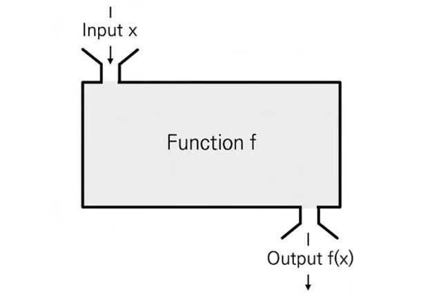


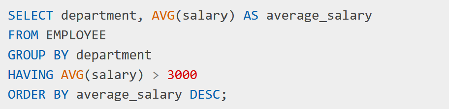

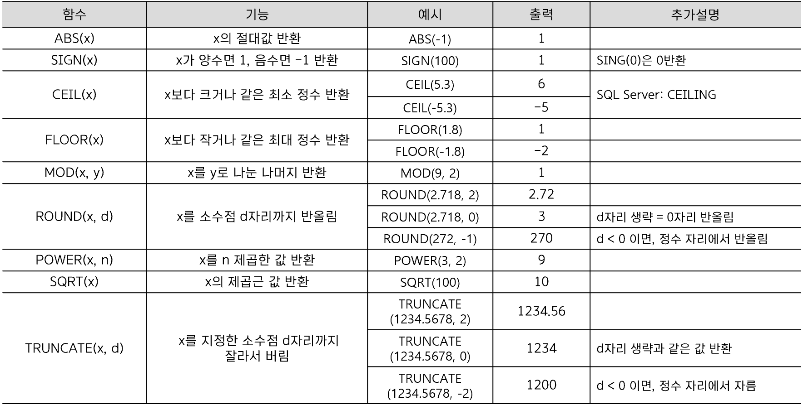

---

#### 3. 숫자형 함수 (Numeric Functions) 완벽 정리 (PDF p.31 ~ p.32)

> 🚨 **[절대 주의 / 원본 오타 교정]**
> **🚨 원본 요약본(`SQLD_2과목_SQL 기본.pdf`) 오타 교정 1번 반영!**
> - `ROUND(163.76, -1)`의 결과는 `163`이 아니라 **`160`**입니다!
> - 두 번째 인자 `m`이 **양수(`+n`)**이면 **소수점 아래 `n`째 자리까지 출력**(즉, 소수점 `n+1`째 자리에서 반올림/버림)하고,
> - 두 번째 인자 `m`이 **`0`(또는 생략)**이면 **소수점 첫째 자리에서 반올림/버림하여 정수(일의 자리)까지 출력**하며,
> - 두 번째 인자 `m`이 **음수(`-1`, `-2`...)**이면 **소수점 왼쪽(정수부 `10^1`, `10^2` 자리)에서 반올림/버림**합니다! 따라서 `-1`은 **일의 자리(`3`)에서 반올림하여 십의 자리까지 표시하므로 `160`**이 됩니다!

| 함수명 | 설명 및 동작 원리 | 핵심 예제 및 결과 (★부호 및 음수 자릿수 주의!) |
| :--- | :--- | :--- |
| **`ABS(n)`** | 숫자의 **절댓값** 반환 | `ABS(-15)` ➔ **`15`** |
| **`SIGN(n)`** | 부호 판별: **양수면 `1`, 음수면 `-1`, `0`이면 `0`** 반환 | `SIGN(-20)` ➔ **`-1`**, `SIGN(0)` ➔ **`0`** |
| **`MOD(n1, n2)`** | `n1`을 `n2`로 나눈 **나머지** 반환 (`n2=0`이면 `n1` 자체 반환) | `MOD(7, 3)` ➔ **`1`**, `MOD(-15, 4)` ➔ **`-3`** |
| **`CEIL(n)` / `CEILING(n)`** | `n`보다 **크거나 같은 최소 정수** (수직선 오른쪽 방향 올림!) | `CEIL(38.123)` ➔ **`39`**<br>★`CEIL(-38.123)` ➔ **`-38`** (`-39` 아님 주의!) |
| **`FLOOR(n)`** | `n`보다 **작거나 같은 최대 정수** (수직선 왼쪽 방향 내림!) | `FLOOR(38.9)` ➔ **`38`**<br>★`FLOOR(-38.123)` ➔ **`-39`** (`-38` 아님 주의!) |
| **`ROUND(n [, m])`** | 소수점 `m`자리까지 남도록 **반올림** (`m` 기본값 `0`) | `ROUND(163.76, 1)` ➔ **`163.8`**<br>`ROUND(163.76, 0)` ➔ **`164`**<br>★**`ROUND(163.76, -1)` ➔ `160`** *(오타 교정 완료!)*<br>`ROUND(163.76, -2)` ➔ **`200`** |
| **`TRUNC(n [, m])`** | 소수점 `m`자리까지 남도록 **버림(절사)** (`m` 기본값 `0`) | `TRUNC(163.76, 1)` ➔ **`163.7`**<br>`TRUNC(163.76, -1)` ➔ **`160`**<br>`TRUNC(-38.9)` ➔ **`-38`** (`FLOOR`와 음수에서 결과 다름!) |
| **`POWER(m, n)` / `SQRT(n)`** | `m`의 `n`거듭제곱 (`m^n`) / `n`의 제곱근(√n) | `POWER(3, 2)` ➔ **`9`**, `SQRT(4)` ➔ **`2`** |
| **`EXP(n)` / `LN(n)` / `LOG(m, n)`** | e^n 지수함수 / 자연로그 ln(n) / 밑이 `m`인 로그 log_m(n) | `LN(EXP(1))` ➔ **`1`**, `LOG(10, 100)` ➔ **`2`** |

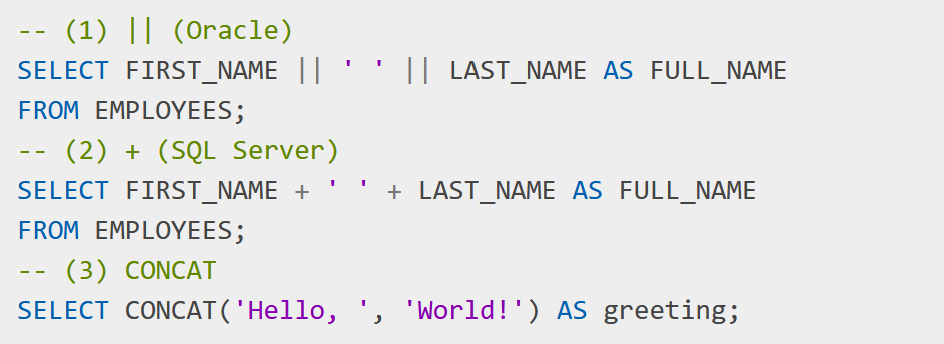

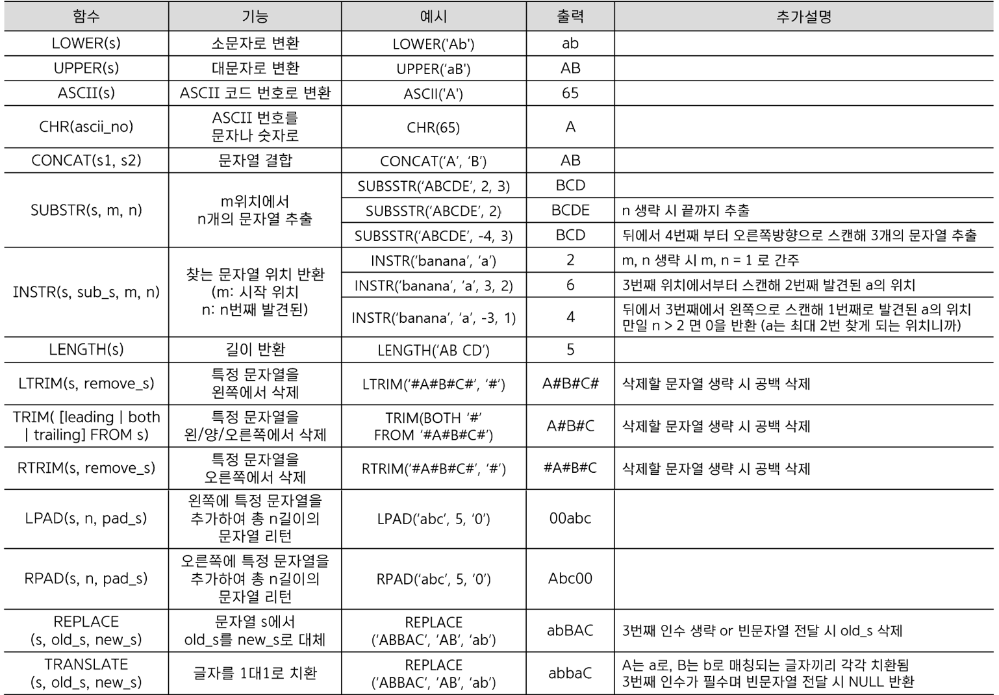

---

#### 4. 날짜형 함수 (Date Functions) 및 날짜 산술 연산 (PDF p.33)
- **날짜형 데이터의 산술 연산 원리 (★숫자 `1` = 하루 `1일(24시간)`!)**:
  - `날짜 + 숫자` = 해당 날짜로부터 숫자(일수)만큼 지난 날짜
  - `날짜 - 숫자` = 해당 날짜로부터 숫자(일수)만큼 이전 날짜
  - **`날짜 + 1/24`** = **1시간**을 더함
  - **`날짜 + 1/24/60`** (= `날짜 + 1/1440`) = **1분**을 더함
  - **`날짜 + 1/24/60/60`** (= `날짜 + 1/86400`) = **1초**를 더함
  - `날짜1 - 날짜2` = 두 날짜 사이의 일수(Day) 차이 (숫자 반환) *(단, `날짜 + 날짜`는 연산 불가 — 에러!)*

| 함수명 (Oracle / SQL Server) | 기능 및 문법 | 예시 |
| :--- | :--- | :--- |
| **`SYSDATE` / `GETDATE()`** | 현재 데이터베이스 시스템의 연, 월, 일, 시, 분, 초 반환 | `SELECT SYSDATE FROM DUAL;` |
| **`EXTRACT(단위 FROM 날짜)`**<br>/ **`DATEPART(단위, 날짜)`** | 날짜 데이터에서 특정 단위(`YEAR`, `MONTH`, `DAY`, `HOUR`, `MINUTE`, `SECOND`) 값을 **숫자형**으로 추출 | `EXTRACT(MONTH FROM HIREDATE)` ➔ `12` |
| **`TO_NUMBER(TO_CHAR(날짜, 포맷))`** | 날짜를 포맷 문자열(`'YYYY'`, `'MM'`, `'DD'`)로 바꾼 뒤 숫자로 변환 | `TO_CHAR(SYSDATE, 'YYYY')` |
| **`ADD_MONTHS(날짜, n)`**<br>/ **`DATEADD(MONTH, n, 날짜)`** | 날짜에 `n`개월을 더하거나(`+n`) 뺀(`-n`) 날짜 반환 | `ADD_MONTHS(DATE '2024-01-31', 1)` ➔ `'2024-02-29'` (말일 자동 보정) |
| **`MONTHS_BETWEEN(날짜1, 날짜2)`** | 두 날짜 사이의 개월 수 차이를 실수로 반환 | `MONTHS_BETWEEN(SYSDATE, HIREDATE)` |
| **`NEXT_DAY(날짜, 요일)`** | 지정한 날짜 이후에 돌아오는 가장 빠른 특정 요일의 날짜 반환 | `NEXT_DAY(SYSDATE, '월요일')` |
| **`LAST_DAY(날짜)`** | 해당 날짜가 속한 달(Month)의 **마지막 날짜(말일)** 반환 | `LAST_DAY(DATE '2024-02-10')` ➔ `'2024-02-29'` |
| **`ROUND(날짜, 단위)` / `TRUNC(날짜, 단위)`** | 날짜를 특정 단위(`'YEAR'`, `'MONTH'`, `'DAY'`/생략) 기준으로 반올림/버림(절사). `TRUNC(SYSDATE)`는 시분초를 `00:00:00`으로 초기화! | `TRUNC(DATE '2024-11-06', 'MM')` ➔ `'2024-11-01'` |

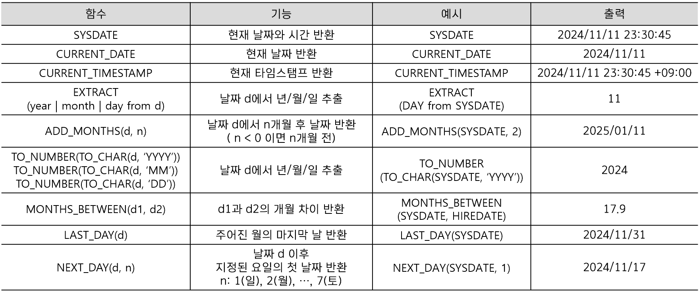

---

#### 5. 변환형 함수 (Conversion Functions): 명시적 vs 암시적 형변환 (PDF p.34)
- **명시적 데이터 유형 변환**: 변환형 함수를 사용하여 데이터 타입 변환을 직접 명시해주는 것 (권장!).
- **암시적(자동) 데이터 유형 변환**: DBMS가 내부적으로 알아서 데이터 타입을 변환하는 것. (편리하지만 **인덱스 컬럼에 암시적 형변환이 일어나면 인덱스를 사용하지 못해(Full Table Scan) 심각한 성능 저하**가 발생할 수 있음!)
  - *(우선순위 참고: 문자열 `'100'`과 숫자 `100`을 비교(`WHERE VARCHAR_COL = 100`)하면 **문자열이 숫자로 변환(`TO_NUMBER(VARCHAR_COL) = 100`)**된다! 따라서 만약 `VARCHAR_COL`에 `'A'` 같은 문자가 섞여 있으면 `ORA-01722: 수치가 부적합합니다(Invalid Number)` 에러가 발생함!)*

| 변환 함수 | 방향 | 설명 및 문법 |
| :--- | :---: | :--- |
| **`TO_NUMBER(문자열)`** | 문자 ➔ 숫자 | 숫자 형태의 문자열을 숫자 타입으로 변환 (`'123'` ➔ `123`). 숫자로 바꿀 수 없는 문자가 포함되면 에러! |
| **`TO_CHAR(숫자 또는 날짜 [, 포맷])`** | 숫자/날짜 ➔ 문자 | 숫자나 날짜를 지정된 `포맷`의 문자열로 변환 (예: `TO_CHAR(SYSDATE, 'YYYY-MM-DD HH24:MI:SS')`, `TO_CHAR(12345, 'L99,999')`) |
| **`TO_DATE(문자열 [, 포맷])`** | 문자 ➔ 날짜 | 문자열을 지정된 `포맷`에 맞춰 날짜 타입으로 변환 |
| **`CAST(표현식 AS 데이터타입)`** | ANSI 표준 (공통) | `CAST('123' AS NUMBER)`처럼 표준 문법으로 타입 변환 |
| **`CONVERT(데이터타입, 표현식 [, 스타일])`** | SQL Server 전용 | SQL Server에서 데이터 타입 변환 시 사용 |

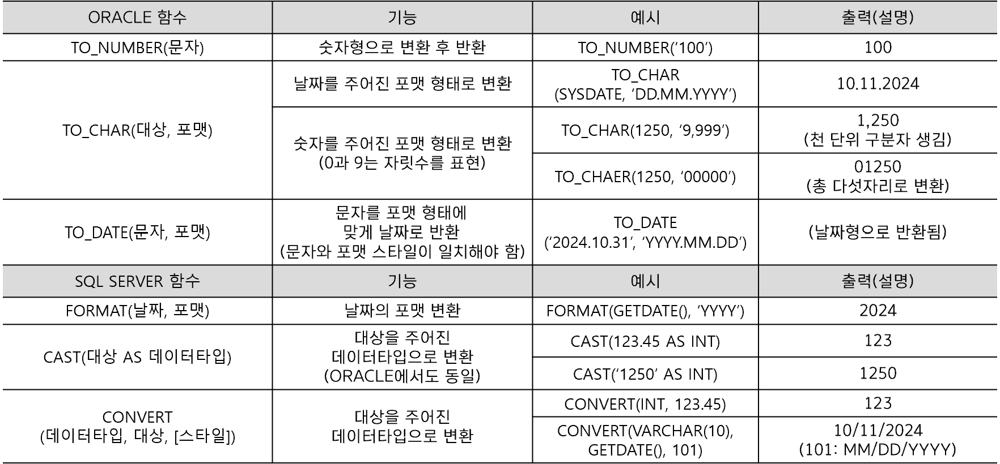

---

#### 6. CASE 표현(Expression)과 DECODE 함수 (PDF p.35)
1. **Simple CASE Expression (`= ` 동등 비교만 가능)**:
   ```sql
   CASE 컬럼명
        WHEN 비교값1 THEN 결과값1
        WHEN 비교값2 THEN 결과값2
        ELSE 기본값
   END
   ```
2. **Searched CASE Expression (부등호 `>`, `<`, `BETWEEN`, `IS NULL` 등 모든 조건식 가능)**:
   ```sql
   CASE WHEN 조건식1 THEN 결과값1
        WHEN 조건식2 THEN 결과값2
        ELSE 기본값
   END
   ```
   > ⚠️ **주의**: `ELSE` 절을 생략하고 모든 `WHEN` 조건에 해당하지 않으면 **`NULL`이 반환**된다!
3. **`DECODE(표현식, 기준값1, 결과1, 기준값2, 결과2, ..., 기본값)` (Oracle 전용)**:
   - `Simple CASE`와 동일하게 동등(`=`) 비교만 수행하며, `기본값` 생략 시 일치하는 값이 없으면 **`NULL`**을 반환한다.
   - ★ **유일한 예외이자 시험 특급 포인트**: SQL에서 원래 `NULL = NULL`은 거짓(Unknown)이지만, **`DECODE(COL, NULL, '널이다', '널아니다')`에서는 예외적으로 `NULL`과 `NULL`을 같다(True)고 판정**하여 `'널이다'`를 반환한다! (반면 `CASE COL WHEN NULL THEN ...`으로 쓰면 동작하지 않으며, 반드시 `CASE WHEN COL IS NULL THEN ...`으로 써야 한다!)

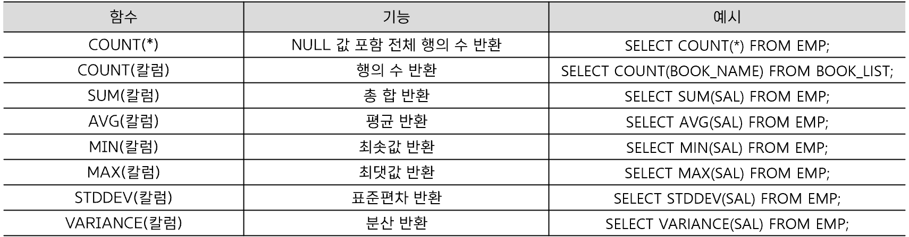

---

#### 7. NULL 관련 함수 4대장 (`NVL`/`ISNULL`, `NVL2`, `NULLIF`, `COALESCE`) (PDF p.35)

> 🚨 **[절대 주의 / 원본 오타 교정]**
> **🚨 원본 요약본(`SQLD_2과목_SQL 기본.pdf`) 오타 교정 2번 반영!**
> - `COALESECE` (❌ 오타) ➔ **`COALESCE`** (⭕ 정답: `C-O-A-L-E-S-C-E`)

| 함수명 | 문법 및 동작 원리 | `표현식1`이 `NULL`일 때 | `표현식1`이 `NULL`이 아닐 때 |
| :--- | :--- | :---: | :---: |
| **`NVL(식1, 식2)`** *(Oracle)*<br>**`ISNULL(식1, 식2)`** *(SQL Server)* | `식1`이 `NULL`이면 `식2`를 반환하고, 아니면 `식1` 그대로 반환 *(주의: `식1`과 `식2`의 데이터 타입이 호환되어야 함!)* | **`식2`** 반환 | **`식1`** 반환 |
| **`NVL2(식1, 식2, 식3)`** *(Oracle)* | `식1`이 **`NULL`이 아니면 `식2`**를 반환하고, **`NULL`이면 `식3`**를 반환! *(순서 헷갈림 주의: **"아닐 때 먼저(식2), 널일 때 나중(식3)"**)* | **`식3`** 반환 | **`식2`** 반환 |
| **`NULLIF(식1, 식2)`** *(ANSI 표준)* | 두 식을 비교하여 **`식1 = 식2`로 같으면 `NULL`**을 반환하고, **다르면 첫 번째 값인 `식1`**을 반환! | (`식1`이 `NULL`이면 다름 판정되어 **`NULL(=식1)`** 반환) | 같으면 **`NULL`**,<br>다르면 **`식1`** 반환 |
| **`COALESCE(식1, 식2, 식3, ...)`** *(ANSI 표준)* | 인자 리스트를 왼쪽부터 순서대로 검사하여 **가장 먼저 등장하는 `NULL`이 아닌 값**을 반환! (모두 `NULL`이면 `NULL` 반환) | `식2`, `식3` 중 첫 `NOT NULL` 값 | **`식1`** 반환 |

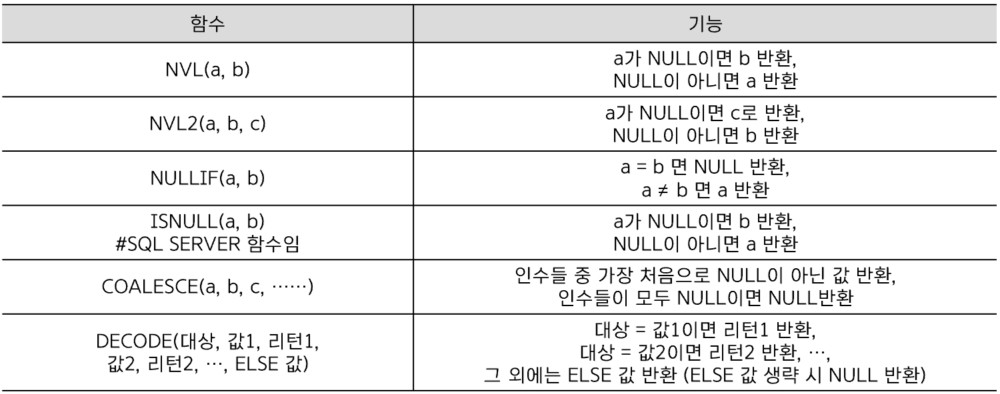

---

### 🧅 [SQLD양파 심화 이론 · 실전 SQL 트레이스 · Before & After · 30초 시험 직전 정리] (2-1-3 함수)

## [핵심 요약]

> 함수는 데이터를 입력받아 가공된 결과를 돌려주는 도구다. 문자, 숫자, 날짜, **NULL**(`1-2-4`)을 가공할 수 있다.

---

## [개념 도식화] 함수의 분류

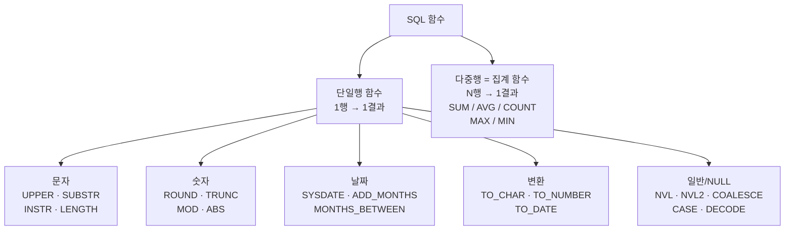

---

## 문자 함수

| 함수 | 설명 | 예 | 결과 |
|---|---|---|---|
| UPPER(s) | 대문자 | UPPER('abc') | ABC |
| LOWER(s) | 소문자 | LOWER('ABC') | abc |
| INITCAP(s) | 첫글자만 대문자 | INITCAP('hi sql') | Hi Sql |
| LENGTH(s) | 문자열 길이 | LENGTH('한글') | 2 |
| SUBSTR(s, m, n) | n글자 추출 | SUBSTR('ABCDE', 2, 3) | BCD |
| INSTR(s, sub) | 위치 찾기 | INSTR('ABCDE', 'C') | 3 |
| LPAD/RPAD | 자리 채우기 | LPAD('1', 3, '0') | 001 |
| LTRIM/RTRIM/TRIM | 공백 제거 | TRIM(' ABC ') | ABC |
| REPLACE(s, a, b) | 문자열 교체 | REPLACE('A-B', '-', '+') | A+B |
| CONCAT(a, b) 또는 `||` | 문자열 연결 | 'A' \|\| 'B' | AB |

---

## 숫자 함수

| 함수 | 설명 | 예 | 결과 |
|---|---|---|---|
| ABS(n) | 절댓값 | ABS(-5) | 5 |
| ROUND(n, m) | 반올림 | ROUND(3.456, 1) | 3.5 |
| TRUNC(n, m) | 버림 | TRUNC(3.456, 1) | 3.4 |
| MOD(a, b) | 나머지 | MOD(10, 3) | 1 |
| CEIL(n) | 올림 | CEIL(3.1) | 4 |
| FLOOR(n) | 내림 | FLOOR(3.9) | 3 |
| POWER(a, b) | 거듭제곱 | POWER(2, 3) | 8 |
| SIGN(n) | 부호(-1/0/1) | SIGN(-5) | -1 |

---

## 날짜 함수

| 함수 | 설명 |
|---|---|
| SYSDATE | 현재 날짜+시간 |
| CURRENT_DATE | 세션 기준 현재 |
| ADD_MONTHS(d, n) | 개월 더하기 |
| MONTHS_BETWEEN(d1, d2) | 개월 차이 |
| LAST_DAY(d) | 그 달의 마지막 날 |
| NEXT_DAY(d, '월') | 다음 월요일 |
| EXTRACT(YEAR FROM d) | 연도 추출 |
| TRUNC(d, 'MM') | 월 단위 자름 |

날짜 - 날짜 = 일수(숫자), 날짜 + 숫자 = 날짜

---

## 변환 함수

```
        TO_CHAR
[숫자] ────────→ [문자] ←────────  [날짜]
   ↑              │                  │
   └─ TO_NUMBER ──┘                  │
                  │                  │
                  └──── TO_DATE ────→┘
```

| 함수 | 변환 | 예 |
|---|---|---|
| TO_CHAR(d, 'YYYY-MM-DD') | 날짜 → 문자 | 2026-04-26 |
| TO_CHAR(n, '999,999') | 숫자 → 문자 | 1,000 |
| TO_NUMBER('1234') | 문자 → 숫자 | 1234 |
| TO_DATE('20260426', 'YYYYMMDD') | 문자 → 날짜 | 2026-04-26 |

| 종류 | 의미 |
|---|---|
| 명시적 형변환 | TO_CHAR, TO_NUMBER, TO_DATE 직접 호출 |
| 암시적 형변환 | DBMS가 자동 변환(의도치 않은 결과 위험) |

---

## NULL 관련 함수

| 함수 | 설명 |
|---|---|
| NVL(A, B) | A가 NULL이면 B |
| NVL2(A, B, C) | A가 NULL 아니면 B, NULL이면 C |
| NULLIF(A, B) | A=B면 NULL 반환 |
| COALESCE(A, B, C, …) | NULL 아닌 첫 번째 값 |

---

## [SQL 실전]

### 조건 함수 — CASE / DECODE

```sql
-- DECODE (Oracle 전용, 동등비교만 가능)
SELECT NAME,
       DECODE(GENDER, 'M', '남자', 'F', '여자', '기타') AS GENDER_KOR
FROM   MEMBER;

-- CASE (표준, 모든 비교 가능)
SELECT NAME,
       CASE WHEN SAL >= 5000 THEN '고급'
            WHEN SAL >= 3000 THEN '중급'
            ELSE '초급'
       END AS LEVEL
FROM   EMP;
```

| 함수 | 동등비교 | 범위비교 |
|---|---|---|
| DECODE | 가능 | 불가 |
| CASE | 가능 | 가능 |

---

## 다중행(집계) 함수

여러 행을 묶어 하나의 결과로 요약. 자세한 분석은 **그룹함수**(`2-2-3`) 챕터 참고. 보통 **WHERE**(`2-1-4`) 이후의 GROUP BY 와 함께 사용.

| 함수 | 의미 | NULL 처리 |
|---|---|---|
| COUNT(*) | 모든 행 수 | NULL 포함 |
| COUNT(col) | 컬럼 NULL 제외 | NULL 제외 |
| SUM(col) | 합 | NULL 무시 |
| AVG(col) | 평균 | NULL 무시 |
| MAX(col) | 최대 | NULL 무시 |
| MIN(col) | 최소 | NULL 무시 |

---

## [Before & After] 함수 활용

EMP 의 NAME(소문자), HIRE_DATE(날짜형), SAL+COMM(NULL 가능)을 한 번에 가공해야 하는 상황. 김철수는 COMM 이 NULL, 이영희는 200. 문자·날짜·NULL 함수를 결합해 "대문자 이름 / 입사연도 / 총급여" 를 동시에 뽑음.

### EMP

| NAME | HIRE_DATE | SAL | COMM |
|---|---|---|---|
| 김철수 | 2020-03-15 | 3000 | NULL |
| 이영희 | 2022-08-20 | 4000 | 200 |

### 쿼리

```sql
SELECT  UPPER(NAME)              AS UPPER_NAME,
        TO_CHAR(HIRE_DATE,'YYYY')   AS HIRE_YEAR,
        SAL + NVL(COMM, 0)         AS TOTAL
FROM    EMP;
```

| UPPER_NAME | HIRE_YEAR | TOTAL |
|---|---|---|
| 김철수 | 2020 | 3000 |
| 이영희 | 2022 | 4200 |

UPPER 는 문자형, TO_CHAR(HIRE_DATE,'YYYY') 는 날짜→문자, NVL(COMM,0) 은 NULL 안전 산술 — 함수마다 다루는 도메인이 다름. NVL 을 빼면 김철수의 TOTAL 이 NULL 로 사라지는 사고 발생. 출력 형식·표시 단위·NULL 처리를 모두 함수 단계에서 정리해 SELECT 결과를 화면에 바로 쓸 수 있는 형태로 만드는 것이 안전

---

## [시험 출제 포인트]

| 함정 | 정답 |
|---|---|
| `SUBSTR('ABCDE', 2, 3)` | 'BCD' (2번째부터 3글자) |
| Oracle `LENGTH('한글')` | 2(글자수). LENGTHB는 바이트수 |
| `MOD(10, 3)` | 1 |
| `ROUND(3.456, 2)` | 3.46 |
| `TRUNC(3.456, 2)` | 3.45 |
| DECODE로 범위비교 가능? | 불가 |
| 날짜 - 날짜 결과 | 숫자(일수) |
| `NVL2(NULL, 'A', 'B')` | 'B' |
| 암시적 형변환 권장? | 명시적이 안전 |

단골: COUNT(*) vs COUNT(컬럼) 차이를 묻는 문제. NULL 처리 주의

---

> **30초 시험 직전 정리**
> · 함수 = **단일행** (1행 → 1결과) vs **다중행 = 집계** (여러 행 → 1결과)
> · SUBSTR 인덱스 = **1부터** 시작 (Oracle)
> · LENGTH = 글자 수 / LENGTHB = 바이트 수 (한글 1자 = 3바이트)
> · ROUND vs TRUNC = 반올림 vs 버림
> · DECODE = **동등 비교만** / CASE = **모든 비교 (범위 가능)**
> · NVL(A, B) / NVL2(A, B, C) / NULLIF(A, B) / COALESCE(A, B, ...)
> · 집계 함수는 **NULL 무시** (단 COUNT(*) 만 NULL 포함)
> · 명시적 형변환 (TO_*) 권장 — 암시적은 의도치 않은 결과 위험


---

# 2-1-4. WHERE 절

> **단원 분류**: `2과목` > `2-1. SQL 기본` > **`2-1-4. WHERE 절`**

### 📘 [해리누나 2024 개정판 + 2과목 요약본 완벽 통합] 제1장 제4절. WHERE 절 (PDF p.36 ~ p.39)

#### 1. WHERE 절의 개요와 연산자 우선순위 (PDF p.36 ~ p.37)
- **WHERE 절의 역할**: `FROM` 절의 테이블로부터 원하는 조건(True)을 만족하는 행(Row)들만 필터링하여 제한한다 (`SELECT`, `UPDATE`, `DELETE` 문에서 사용 가능하며, `INSERT` 문에는 `WHERE` 절을 쓰지 않음).
- **연산자 전체 우선순위 (★시험 필수 암기!)**:
  > **`① 괄호 ()` ➔ `② 부정 연산자 (NOT)` ➔ `③ 비교 연산자 (=, >, <, >=, <=) 및 SQL 연산자 (BETWEEN, IN, LIKE, IS NULL)` ➔ `④ 논리 연산자 AND` ➔ `⑤ 논리 연산자 OR`**
  - 핵심: **`NOT` > `AND` > `OR`** 순서! 따라서 `WHERE A = 1 OR B = 2 AND C = 3`은 `B = 2 AND C = 3`이 먼저 묶여서 계산된 뒤 `A = 1`과 `OR` 연산된다!

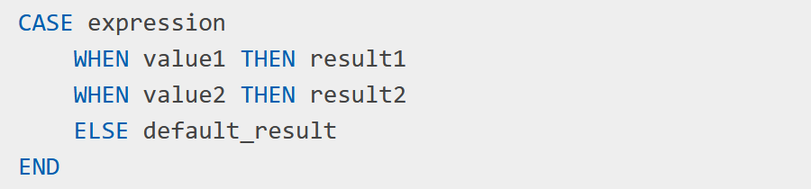

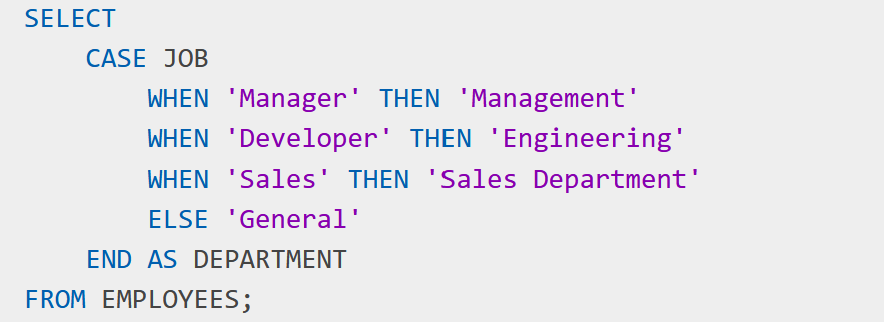

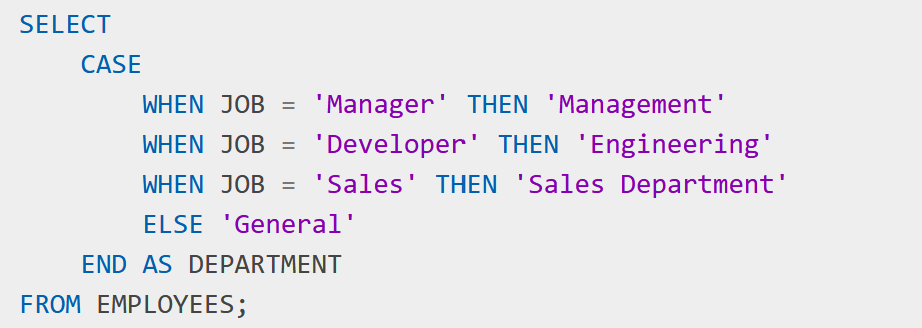

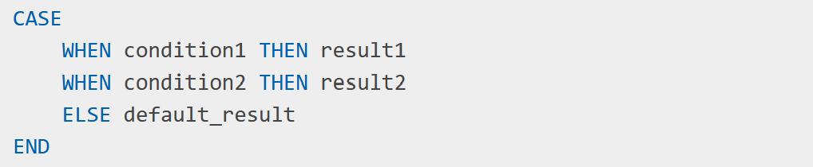

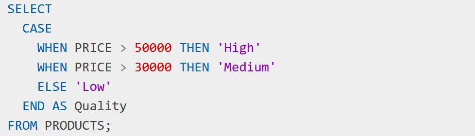

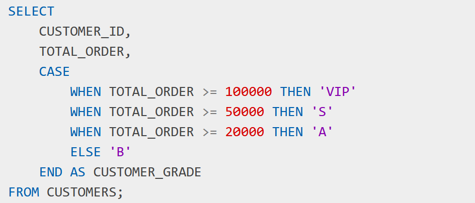

#### 2. 비교 연산자 및 부정 비교 연산자 (PDF p.37)
- **일반 비교 연산자**: `=`, `>`, `>=`, `<`, `<=`
  - 문자열 비교 시 사전순(아스키 코드순)으로 크기를 비교하며, 숫자로 변환 가능한 문자열과 숫자를 비교하면 문자열이 숫자로 자동 형변환되어 비교된다.
- **부정 비교 연산자**:
  - **`!=`**, **`^=`**, **`<>`** (ANSI 표준): 같지 않다 (모두 사용 가능)
  - **`NOT 컬럼명 = 값`**, **`NOT 컬럼명 > 값`**
  - ⚠️ **절대 불가(문법 오류) 연산자**: **`!>` (크지 않다)**, **`!<` (작지 않다)** 같은 기호는 오라클/표준 SQL에 존재하지 않는 잘못된 기호이다!


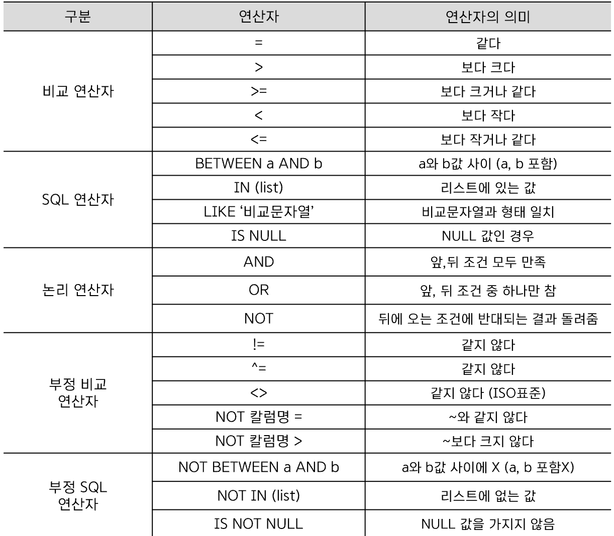

#### 3. SQL 연산자 (`BETWEEN`, `IN`, `LIKE`, `IS NULL`)와 부정 SQL 연산자 (PDF p.37 ~ p.39)

1. **`A BETWEEN a AND b`**:
   - **`A >= a AND A <= b`**와 완전히 동일하다 (**양 끝값 `a`, `b`를 모두 포함하는 이상/이하(폐구간)**!).
   - 주의: 반드시 **작은 값(`a`)을 앞에, 큰 값(`b`)을 뒤에** 써야 한다! 만약 `BETWEEN 200 AND 100`처럼 큰 값을 앞에 쓰면 에러는 나지 않지만 **조회 결과가 0건(공집합)**이 나온다!
   - 부정: **`NOT (A BETWEEN a AND b)`** 또는 **`A NOT BETWEEN a AND b`** ➔ **`A < a OR A > b`** (양 끝값 불포함!).

2. **`A IN (값1, 값2, ...)` vs `A NOT IN (값1, 값2, ...)` (★NULL 함정 1순위!)**:
   - **`A IN (1, 2, NULL)`**: 내부적으로 **`A = 1 OR A = 2 OR A = NULL`**로 풀린다. `A = NULL`은 `UNKNOWN`이지만, **`OR` 연산은 하나만 `TRUE`여도 전체가 `TRUE`**가 되므로 `A`가 `1`이거나 `2`인 행은 **정상적으로 조회된다!**
   - **`A NOT IN (1, 2, NULL)`**: 내부적으로 **`A != 1 AND A != 2 AND A != NULL`**로 풀린다. `A != NULL`이 `UNKNOWN`이 되는데, **`AND` 연산에 `UNKNOWN`이 하나라도 끼면 전체 조건이 `UNKNOWN`(거짓)이 되어버린다!** 따라서 `NOT IN` 괄호(또는 서브쿼리 결과) 안에 **`NULL`이 단 하나라도 포함되어 있으면 결과는 무조건 0건(한 건도 조회 안 됨!)**이 된다!

3. **`LIKE '패턴'` 및 와일드카드 (`%`, `_`), `ESCAPE` 옵션**:
   - **`%` (퍼센트)**: **0글자 이상**의 임의의 문자열 (글자 수 제한 없음)
   - **`_` (언더바)**: **정확히 1글자**의 임의의 문자
   - **`ESCAPE` 옵션**: 데이터 값 자체에 포함된 실제 `%`나 `_` 기호를 문자로 검색하고 싶을 때 사용!
     ```sql
     -- 예: 이름에 실제 언더바('_')가 포함된 사원 조회 ('A_A' 등)
     SELECT * FROM EMP WHERE ENAME LIKE '%#_%' ESCAPE '#';
     ```
     *(설명: `ESCAPE '#'`으로 지정하면 `#` 바로 뒤에 오는 `_`나 `%` 딱 1글자만 와일드카드가 아닌 일반 문자로 취급한다!)*

4. **`IS NULL` / `IS NOT NULL`**:
   - `NULL` 값을 찾을 때는 절대 `= NULL`이나 `!= NULL`을 쓰면 안 되며(에러는 안 나지만 결과 0건!), 반드시 **`IS NULL`**, **`IS NOT NULL`**을 사용해야 한다.

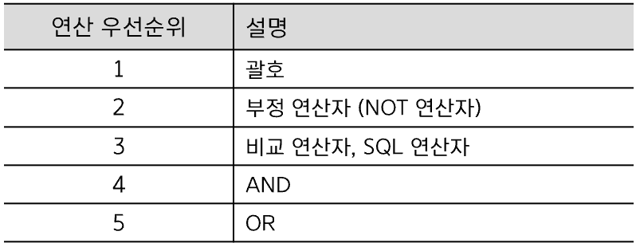


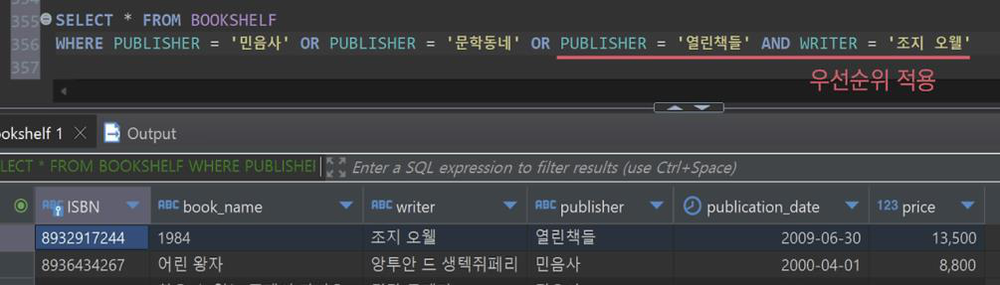

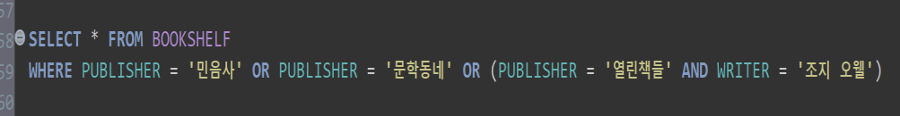

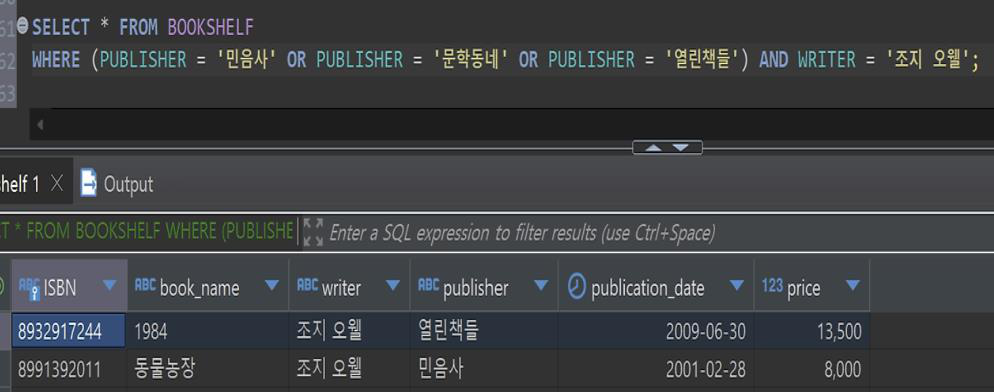

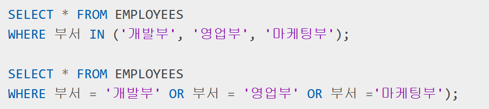


#### 4. ROWNUM (Oracle)과 TOP (SQL Server) 기초 (PDF p.39)
- **Oracle `ROWNUM`**: 조회된 결과 행에 `1`부터 순차적으로 부여되는 가상 컬럼(Pseudo Column).
  - 단, `1`번이 먼저 만들어져야 `2`번이 만들어지므로, **`WHERE ROWNUM = 1`이나 `WHERE ROWNUM <= 5`는 조회되지만, `WHERE ROWNUM = 2`나 `WHERE ROWNUM > 1`은 영원히 0건이 조회된다!**
- **SQL Server `TOP (N)`**: `SELECT TOP(3) * FROM EMP` 형태로 상위 `N`건을 추출한다.


---

### 🧅 [SQLD양파 심화 이론 · 실전 SQL 트레이스 · Before & After · 30초 시험 직전 정리] (2-1-4 WHERE 절)

## [핵심 요약]

> WHERE 절은 어떤 행만 가져올지 조건을 거는 필터다. 테이블 전체에서 원하는 행만 골라낸다.

ex) 옷가게에서 "검은색(`= '검정'`)·5만원 이하(`<= 50000`)·M 또는 L 사이즈(`IN ('M','L')`)" 라고 조건을 거는 것과 같음

---

## [개념 도식화] WHERE의 위치

**SELECT 문**(`2-1-2`) 의 6대 절 중 행 단위 필터 역할


---

## WHERE 절의 연산자

### 비교 연산자

| 연산자 | 의미 |
|---|---|
| `=` | 같다 |
| `!=`, `<>`, `^=` | 다르다 |
| `>`, `>=`, `<`, `<=` | 크다/작다 |

### 논리 연산자

| 연산자 | 의미 | 비유 |
|---|---|---|
| AND | 둘 다 | 검정색 그리고 5만원 이하 |
| OR | 둘 중 하나 | 검정색 또는 흰색 |
| NOT | 부정 | 검정색이 아닌 |

### SQL 연산자

| 연산자 | 의미 | 예 |
|---|---|---|
| BETWEEN A AND B | A ≤ x ≤ B | `BETWEEN 100 AND 200` |
| IN (a, b, c) | 그 안에 있으면 (값 목록 또는 **서브쿼리**(`2-2-1`) 가능) | `IN ('M', 'F')` |
| LIKE '패턴' | 문자 패턴 매칭 | `LIKE '김%'` |
| IS NULL | NULL인지 | `IS NULL` |

### 부정형

NOT BETWEEN, NOT IN, NOT LIKE, IS NOT NULL

---

## LIKE 연산자의 와일드카드

| 기호 | 의미 | 예 |
|---|---|---|
| `%` | 0개 이상의 문자 | `'김%'` → '김', '김철수', '김OO' |
| `_` | 정확히 1개 문자 | `'김_수'` → '김철수', '김영수' |

```sql
-- 김으로 시작
SELECT * FROM EMP WHERE NAME LIKE '김%';

-- 정확히 3글자, 가운데가 '철'
SELECT * FROM EMP WHERE NAME LIKE '_철_';

-- 와일드카드 자체를 검색하려면 ESCAPE
SELECT * FROM ITEM WHERE NAME LIKE '%50\%%' ESCAPE '\';
```

---

## NULL 비교

| 잘못된 표현 | 올바른 표현 |
|---|---|
| `WHERE COL = NULL` | `WHERE COL IS NULL` |
| `WHERE COL != NULL` | `WHERE COL IS NOT NULL` |

NULL 과의 비교는 항상 UNKNOWN → 결과가 비어버림

---

## 연산자 우선순위

```
1. 산술 ( *, /, +, - )
2. 연결 ( || )
3. 비교 ( =, <, > 등)
4. NOT
5. AND
6. OR
```

AND 가 OR 보다 먼저 처리됨. `A OR B AND C` = `A OR (B AND C)`

```sql
-- 의도: 부서가 D1이거나 D2 이면서 급여 3000 이상
-- 잘못된 예
WHERE DEPT = 'D1' OR DEPT = 'D2' AND SAL >= 3000
-- AND 먼저 해석되어 D1 또는 (D2 AND SAL>=3000)이 됨

-- 올바른 예
WHERE (DEPT = 'D1' OR DEPT = 'D2') AND SAL >= 3000
```

---

## [SQL 실전]

```sql
-- 비교
SELECT * FROM EMP WHERE SAL >= 3000;

-- BETWEEN
SELECT * FROM EMP WHERE SAL BETWEEN 3000 AND 5000;

-- IN
SELECT * FROM EMP WHERE DEPT_ID IN ('D1', 'D2', 'D3');

-- LIKE
SELECT * FROM EMP WHERE NAME LIKE '김%';

-- IS NULL
SELECT * FROM EMP WHERE COMM IS NULL;

-- AND/OR
SELECT * FROM EMP WHERE DEPT_ID = 'D1' AND SAL >= 3000;
```

---

## [Before & After]

EMP 4명에서 부서·급여·이름·커미션 조건을 조합해 행을 골라내는 상황. IN·LIKE·IS NULL 결합 방식에 따라 결과 행이 어떻게 달라지는지 비교.

### EMP

| EMP_ID | NAME | DEPT_ID | SAL | COMM |
|---|---|---|---|---|
| 1 | 김철수 | D1 | 3000 | NULL |
| 2 | 이영희 | D1 | 4500 | 200 |
| 3 | 박민수 | D2 | 2500 | NULL |
| 4 | 김영수 | D3 | 5000 | 500 |

### `WHERE DEPT_ID IN ('D1', 'D3') AND SAL >= 3000`

| EMP_ID | NAME | DEPT_ID | SAL |
|---|---|---|---|
| 1 | 김철수 | D1 | 3000 |
| 2 | 이영희 | D1 | 4500 |
| 4 | 김영수 | D3 | 5000 |

### `WHERE NAME LIKE '김%' AND COMM IS NULL`

| EMP_ID | NAME |
|---|---|
| 1 | 김철수 |

WHERE 는 행을 하나씩 검사해 조건이 TRUE 인 행만 통과 → 조건 표현이 곧 결과 집합. NULL 비교는 항상 UNKNOWN 이라 `=`·`!=` 로는 잡히지 않으니 IS NULL 사용. IN 으로 다중 선택과 비교 연산자를 AND 로 묶어 조건 세분화. "정확히 어떤 행이 필요한가" 를 먼저 말로 풀어 쓴 뒤 그대로 연산자로 옮기면 실수가 줄어듦

---

## [시험 출제 포인트]

| 함정 | 정답 |
|---|---|
| `WHERE COMM = NULL`의 결과 | 0건. IS NULL을 사용 |
| `BETWEEN 100 AND 200` | 100, 200 포함(양 끝 포함) |
| `LIKE '_김%'` | 두 번째 글자가 '김'으로 시작 |
| `IN (a, b, c)`은 OR과 같음 | 옳음 |
| AND와 OR 우선순위 | AND가 먼저 |
| `NOT IN` 사용 시 NULL 주의 | NULL이 포함되면 결과가 비어버릴 수 있음 |
| `_`와 `%` 차이 | `_`은 1글자, `%`은 0개 이상 |

단골 함정: `WHERE A NOT IN (1, 2, NULL)` 은 항상 거짓 → 결과 0건

---

> **30초 시험 직전 정리**
> · BETWEEN A AND B = **A·B 양 끝 포함** (A ≤ x ≤ B)
> · IN(a,b,c) = OR 의 단축형 / NOT IN + NULL = **항상 거짓** (결과 0건)
> · LIKE: `%` = 0개 이상 / `_` = 정확히 1개. 자체 검색은 ESCAPE
> · NULL 비교는 **IS NULL / IS NOT NULL** 만 가능 (`= NULL` 항상 거짓)
> · 우선순위: 산술 > 연결(||) > 비교 > NOT > AND > OR
> · 함정: `A=1 OR B=2 AND C=3` = `A=1 OR (B=2 AND C=3)` (AND 가 먼저)


---

# 2-1-5. GROUP BY, HAVING 절

> **단원 분류**: `2과목` > `2-1. SQL 기본` > **`2-1-5. GROUP BY · HAVING 절`**

### 📘 [해리누나 2024 개정판 + 2과목 요약본 완벽 통합 (오타 3번 교정 반영!)] 제1장 제5절. GROUP BY, HAVING 절 (PDF p.39 ~ p.41)

#### 1. 집계 함수 (Aggregate Functions)의 특징과 종류 (PDF p.39 ~ p.40)

> 🚨 **[절대 주의 / 원본 오타 교정]**
> **🚨 원본 요약본(`SQLD_2과목_SQL 기본.pdf`) 오타 교정 3번 반영!**
> - `COUNT(DISTRICT 컬럼)` (❌ 오타) ➔ **`COUNT(DISTINCT 컬럼)`** (⭕ 정답)

- **집계 함수의 5대 핵심 규칙 (★매 시험 출제!)**:
  1. 여러 행들의 그룹이 모여서 **그룹당 단 하나의 결과**를 돌려주는 다중행 함수이다.
  2. `GROUP BY` 절은 행들을 소그룹화하며, **`GROUP BY` 절 없이도 테이블 전체를 하나의 그룹으로 보고 `SELECT SUM(SAL) FROM EMP;`처럼 집계 함수를 단독 사용할 수 있다.**
  3. **`SELECT` 절, `HAVING` 절, `ORDER BY` 절에 사용할 수 있다.** (★절대 **`WHERE` 절에는 집계 함수를 직접 쓸 수 없다!** `WHERE AVG(SAL) > 2000` ➔ **문법 에러!**)
  4. **`COUNT(*)`을 제외한 모든 집계 함수는 `NULL` 값을 연산에서 제외(무시)**하고 계산한다!
     - 예: 값 4개가 `[10, 20, 30, NULL]`일 때:
       - `COUNT(*)` ➔ **`4`** (`NULL` 행 포함 전체 행 수)
       - `COUNT(컬럼)` ➔ **`3`** (`NULL` 제외 건수)
       - `SUM(컬럼)` ➔ **`60`**
       - `AVG(컬럼)` ➔ `60 / 4`가 아니라 **`60 / 3 = 20`**!
       - 만약 `NULL`을 `0`으로 치환해서 4명으로 나눈 평균(`15`)을 구하고 싶다면 **`AVG(NVL(컬럼, 0))`**으로 작성해야 한다! *(주의: `NVL(AVG(컬럼), 0)`은 이미 `NULL`을 빼고 3으로 나눈 평균 `20`을 구한 뒤 그 결과가 `NULL`일 때만 `0`으로 바꾸는 것이므로 결과가 `20`으로 전혀 다르다!)*
  5. **공집합(조회된 행이 0건)일 때의 반환값**:
     - `GROUP BY` 없이 `WHERE 1=2`처럼 대상 행이 0건일 때 `COUNT(*)`나 `COUNT(컬럼)`은 **`0`**을 반환하고, `SUM`, `AVG`, `MAX`, `MIN`은 **`NULL`** (1행)을 반환한다.

| 집계 함수 | 의미 |
| :--- | :--- |
| **`COUNT(*)`** | **`NULL` 값을 포함한** 전체 행(Row)의 수를 출력 |
| **`COUNT(표현식)`** | 표현식의 값이 **`NULL`인 것을 제외한** 행의 수를 출력 |
| **`COUNT(DISTINCT 표현식)`** | 표현식의 값이 **`NULL`인 것을 제외하고, 중복된 값도 제거한** 유일한 값의 개수를 출력 *(오타 교정 완료!)* |
| **`SUM([DISTINCT\|ALL] 표현식)`** | `NULL`을 제외한 합계 출력 |
| **`AVG([DISTINCT\|ALL] 표현식)`** | `NULL`을 제외한 평균 출력 (`SUM / COUNT(표현식)`) |
| **`MAX(표현식)` / `MIN(표현식)`** | `NULL`을 제외한 최댓값 / 최솟값 출력 *(숫자뿐만 아니라 **문자열, 날짜 타입에도 사용 가능**!)* |
| **`STDDEV(표현식)` / `VARIANCE(표현식)`** | 표준편차 / 분산 출력 |

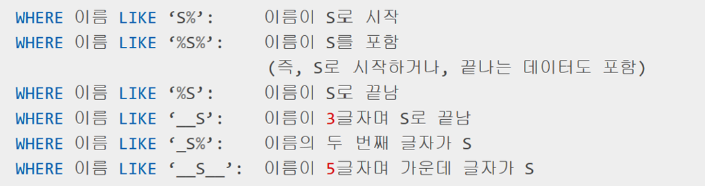


---

#### 2. GROUP BY 절과 HAVING 절의 핵심 규칙 및 WHERE 절과의 차이 (PDF p.40 ~ p.41)
- **GROUP BY 절의 특징**:
  1. **`GROUP BY` 절에는 컬럼 별칭(Alias)을 사용할 수 없다!** (실행 순서상 `GROUP BY`가 `SELECT`보다 먼저 수행되기 때문)
  2. **`GROUP BY` 절에서는 `NULL` 값도 하나의 독립된 그룹으로 묶인다!** (집계 함수는 `NULL`을 무시하지만, `GROUP BY 부서코드`를 하면 부서코드가 `NULL`인 사원들끼리 하나의 그룹 행으로 출력됨!)
  3. `GROUP BY` 절을 사용할 때, **`SELECT` 절과 `ORDER BY` 절에는 `GROUP BY`에 명시된 기준 컬럼(또는 그 표현식)과 집계 함수만 올 수 있다!** (`GROUP BY DEPTNO`만 했는데 `SELECT DEPTNO, ENAME, AVG(SAL)`처럼 그룹화되지 않은 일반 컬럼 `ENAME`을 쓰면 `ORA-00979: GROUP BY 표현식이 아닙니다` 에러 발생!)
- **WHERE 절 vs HAVING 절 완벽 비교**:
  - **`WHERE` 절**: `GROUP BY`로 그룹화하기 **이전에 개별 행(Row)**을 먼저 걸러내는 조건절. (집계 함수 사용 **불가**, 조건에 맞지 않는 행을 미리 버리므로 그룹화 연산량을 줄여줌)
  - **`HAVING` 절**: `GROUP BY`로 그룹화한 **이후에 집계된 소그룹(Group)**을 걸러내는 조건절. (**집계 함수 사용 가능!**)
  - *(참고: 문법적으로 `GROUP BY`와 `HAVING`의 작성 순서를 바꿔서 `HAVING ... GROUP BY ...`로 써도 Oracle에서는 에러 없이 돌아가지만, 논리적 실행 순서는 무조건 **`WHERE` ➔ `GROUP BY` ➔ `HAVING`** 순이다!)*


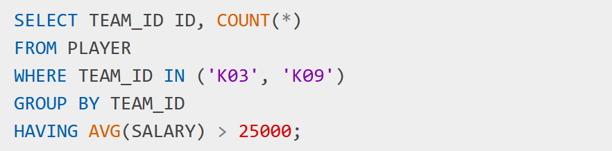

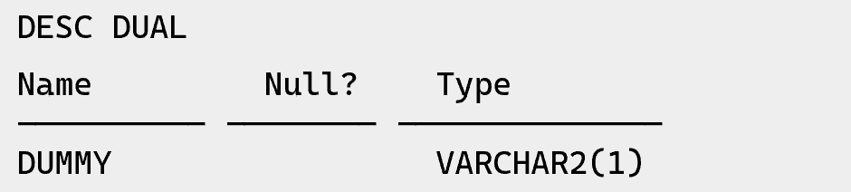

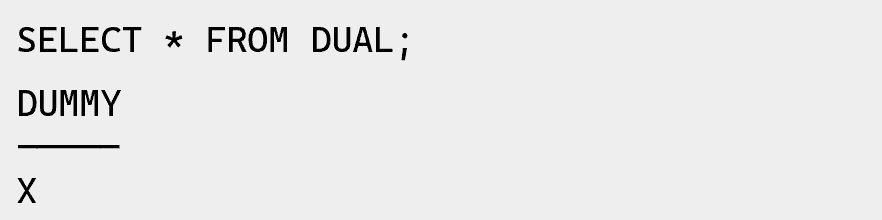

---

### 🧅 [SQLD양파 심화 이론 · 실전 SQL 트레이스 · Before & After · 30초 시험 직전 정리] (2-1-5 GROUP BY · HAVING 절)

## [핵심 요약]

> GROUP BY는 데이터를 그룹별로 묶는 절, HAVING은 묶인 그룹에 조건을 거는 절이다.

ex) 영수증 50장을 "분류별로 묶어 합계(GROUP BY 분류)" → "합계 10만원 넘는 분류만(HAVING 합계 > 10만)" 으로 거르는 것과 같음

---

## [개념 도식화] WHERE vs HAVING의 위치


실행 순서: **FROM → WHERE → GROUP BY → HAVING → SELECT → ORDER BY**

---

## GROUP BY의 핵심 규칙

GROUP BY 에 명시되지 않은 컬럼은 SELECT 절에 그대로 사용 불가. 집계함수로만 사용 가능

```sql
-- 잘못된 쿼리
SELECT DEPT_ID, NAME, AVG(SAL)   -- NAME이 GROUP BY에 없음
FROM   EMP
GROUP BY DEPT_ID;

-- 옳은 쿼리
SELECT DEPT_ID, AVG(SAL)
FROM   EMP
GROUP BY DEPT_ID;
```

---

## 집계 함수 복습

GROUP BY 와 함께 쓰이는 **그룹함수**(`2-2-3`) 의 기본형. 행 단위 분석이 필요하면 **윈도우함수**(`2-2-4`) 로 확장

| 함수 | 설명 |
|---|---|
| COUNT(*) | 행 수(NULL 포함) |
| COUNT(컬럼) | NULL 제외 행 수 |
| SUM(컬럼) | 합 |
| AVG(컬럼) | 평균 |
| MAX/MIN(컬럼) | 최대/최소 |

---

## WHERE vs HAVING

**WHERE 절**(`2-1-4`) 이 행 단위 필터라면, HAVING 은 그룹 단위 필터

| 비교 | WHERE | HAVING |
|---|---|---|
| 적용 시점 | 그룹화 전(행 단위) | 그룹화 후(그룹 단위) |
| 집계함수 사용 | 불가 | 가능 |
| 예 | `WHERE SAL > 3000` | `HAVING AVG(SAL) > 3000` |

```sql
-- 잘못된 예: WHERE에 집계함수
SELECT DEPT_ID, AVG(SAL)
FROM   EMP
WHERE  AVG(SAL) > 3000;     -- 에러

-- 옳은 예: HAVING에 집계함수
SELECT DEPT_ID, AVG(SAL)
FROM   EMP
GROUP BY DEPT_ID
HAVING AVG(SAL) > 3000;
```

---

## [SQL 실전]

```sql
-- 부서별 인원수와 평균급여
SELECT  DEPT_ID,
        COUNT(*)    AS CNT,
        AVG(SAL)    AS AVG_SAL
FROM    EMP
GROUP BY DEPT_ID;

-- 부서별 평균급여가 3500 이상인 부서만
SELECT  DEPT_ID, AVG(SAL)
FROM    EMP
GROUP BY DEPT_ID
HAVING  AVG(SAL) >= 3500;

-- WHERE + GROUP BY + HAVING 조합
SELECT  DEPT_ID, AVG(SAL)
FROM    EMP
WHERE   HIRE_DATE >= DATE '2020-01-01'   -- 2020년 이후 입사자만
GROUP BY DEPT_ID
HAVING  COUNT(*) >= 3;                   -- 3명 이상인 부서
```

---

## [Before & After]

EMP 5명을 D1·D2·D3 세 부서로 묶어 부서별 인원수·평균급여를 구하고, 그중 평균급여 3500 이상 부서만 남기는 상황. GROUP BY 로 그룹화한 단계와 HAVING 으로 거른 단계의 결과를 단계별로 비교.

### EMP

| NAME | DEPT_ID | SAL |
|---|---|---|
| 김 | D1 | 3000 |
| 이 | D1 | 4000 |
| 박 | D2 | 2500 |
| 최 | D2 | 3500 |
| 홍 | D3 | 5000 |

### `GROUP BY DEPT_ID`

| DEPT_ID | COUNT(*) | AVG(SAL) |
|---|---|---|
| D1 | 2 | 3500 |
| D2 | 2 | 3000 |
| D3 | 1 | 5000 |

### `HAVING AVG(SAL) >= 3500`

| DEPT_ID | AVG(SAL) |
|---|---|
| D1 | 3500 |
| D3 | 5000 |

GROUP BY 는 행을 키 단위로 접어 한 그룹당 한 행으로 만들고, 그 위에서 집계 함수 동작. 평균급여 같은 집계 결과를 조건으로 걸려면 행 단위 WHERE 가 아니라 그룹 단위 HAVING 사용. "어떤 행을 걸러야 하나" 는 WHERE, "묶은 결과 중 어떤 그룹을 남기나" 는 HAVING — 필터를 어느 단계에 둘지 먼저 정하고 쿼리를 짜는 것이 안전

---

## 다중 컬럼 그룹화

```sql
SELECT  DEPT_ID, JOB, COUNT(*)
FROM    EMP
GROUP BY DEPT_ID, JOB;
```

| DEPT_ID | JOB | COUNT(*) |
|---|---|---|
| D1 | MGR | 1 |
| D1 | CLERK | 1 |
| D2 | CLERK | 2 |

---

## SELECT - GROUP BY 매칭 규칙

| SELECT 절에 쓸 수 있는 것 | 가능 여부 |
|---|---|
| GROUP BY 컬럼 | 가능 |
| 집계 함수(SUM, AVG 등) | 가능 |
| 상수, 함수, 표현식 | 가능 |
| 그 외 일반 컬럼 | 불가 |

---

## [시험 출제 포인트]

| 함정 | 정답 |
|---|---|
| WHERE에 집계함수 사용 | 불가 → HAVING에서 사용 |
| GROUP BY에 없는 일반 컬럼을 SELECT에 사용 | 불가 |
| HAVING은 GROUP BY 없이 쓸 수 있는가 | 가능(전체를 1개 그룹으로 봄) |
| 실행 순서 | FROM → WHERE → GROUP BY → HAVING → SELECT → ORDER BY |
| COUNT(*) vs COUNT(컬럼) | NULL 포함 여부의 차이 |
| GROUP BY (A, B) 결과 행 수 | A, B 조합 개수 |

단골 함정: SELECT 에 그룹화되지 않은 컬럼이 끼어 있는 쿼리를 에러로 판별하라는 문제

---

> **30초 시험 직전 정리**
> · WHERE = **행 단위 필터** / HAVING = **그룹 단위 필터** (실행 순서상 GROUP BY 후 적용)
> · WHERE 에 집계 함수 = **불가** / HAVING 에 집계 함수 = **가능**
> · GROUP BY 에 없는 일반 컬럼을 SELECT 에 그대로 사용 = **불가**
> · GROUP BY 없이 HAVING 단독 = **가능** (전체를 1개 그룹으로 봄)
> · 결과 행 수 = GROUP BY 컬럼 조합의 개수


---

# 2-1-6. ORDER BY 절

> **단원 분류**: `2과목` > `2-1. SQL 기본` > **`2-1-6. ORDER BY 절`**

### 📘 [해리누나 2024 개정판 + 2과목 요약본 완벽 통합] 제1장 제6절. ORDER BY 절 (PDF p.41 ~ p.43)

#### 1. ORDER BY 정렬의 기본 특징과 3가지 지정 방식 (PDF p.41 ~ p.42)
- **`ORDER BY` 절의 특징**:
  - SQL 문장으로 조회된 데이터들을 다양한 목적에 맞게 특정 컬럼을 기준으로 정렬하여 출력하는데 사용한다.
  - **`ORDER BY` 절을 명시하지 않으면 데이터는 임의의 순서(무순서)로 출력**된다.
  - 기본 정렬 순서는 **오름차순(`ASC`, Ascending — 생략 가능)**이며, 내림차순은 **`DESC`(Descending — 생략 불가)**를 명시한다.
  - 여러 기준을 콤마(`,`)로 나열하면(`ORDER BY A DESC, B ASC`), 앞의 `A` 컬럼은 내림차순으로 정렬하고 `A` 값이 같은 행들끼리는 `B` 컬럼 기준 오름차순으로 정렬한다 (`DESC`는 바로 앞의 컬럼 하나에만 적용됨!).
- **`ORDER BY` 절에서 정렬 기준을 지정하는 3가지 방법 (모두 혼용 가능!)**:
  1. **컬럼명(Column Name)** 직접 사용: `ORDER BY PLAYER_NAME DESC`
  2. **`SELECT` 절에서 부여한 별칭(Alias)** 사용: `ORDER BY 선수명 DESC` *(실행 순서상 `ORDER BY`는 `SELECT` 다음에 마지막으로 실행되므로 별칭 사용 가능!)*
  3. **`SELECT` 절에 나열된 컬럼의 순서 번호(1, 2, 3...)** 사용: `ORDER BY 1 DESC, 2 ASC`

> ⚠️ **[시험 단골 함정 주의]**
> **ORDER BY 절에 `SELECT` 절에 없는 컬럼을 쓸 수 있는가?**
> - **일반 조회 쿼리 (`GROUP BY`나 `DISTINCT`, 집합 연산자가 없을 때)**: `SELECT` 절에 출력하지 않은 테이블 내 다른 컬럼으로도 **`ORDER BY` 정렬이 가능하다!** (예: `SELECT ENAME FROM EMP ORDER BY SAL DESC;` ➔ **정상 실행!**)
> - **예외 (에러가 나는 경우 3가지)**:
>   1. **`GROUP BY` 절을 사용한 경우**: `ORDER BY` 절에도 반드시 **`GROUP BY` 기준 컬럼이나 집계 함수만** 올 수 있다! (일반 개별 행 컬럼 사용 시 에러!)
>   2. **`SELECT DISTINCT`를 사용한 경우**: `SELECT` 절에 명시된 컬럼으로만 `ORDER BY` 할 수 있다!
>   3. **집합 연산자 (`UNION`, `INTERSECT`, `MINUS`)를 사용한 경우**: 쿼리 맨 마지막에 딱 한 번만 `ORDER BY`를 쓸 수 있으며, **첫 번째 `SELECT` 절의 컬럼명, 별칭, 또는 위치 번호**만 사용할 수 있다!


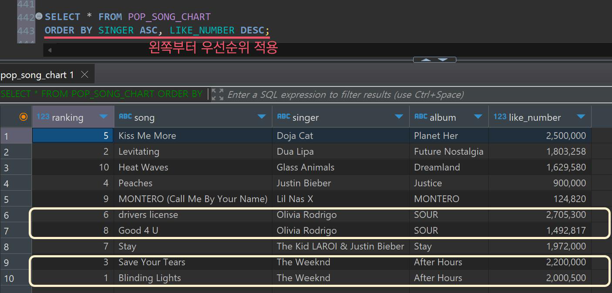

---

#### 2. Oracle vs SQL Server의 NULL 정렬 순서 차이 (★100% 출제!) (PDF p.42)

> 💡 **[핵심 필수 암기]**
> **DBMS별 `NULL`의 크기 취급 (암기: `"오·큰 / 설·작"` — 오라클은 NULL이 가장 큰 값, SQL Server는 NULL이 가장 작은 값!)**

| 구분 | Oracle (오라클) | SQL Server (MSSQL) |
| :---: | :--- | :--- |
| **`NULL`의 크기 취급** | **`NULL`을 가장 큰 값(무한대 ∞)**으로 취급! | **`NULL`을 가장 작은 값(-∞)**으로 취급! |
| **오름차순 (`ASC`, 기본값)** | 작은 값 ➔ 큰 값 ➔ **`NULL`이 맨 마지막(맨 아래)에 출력** | **`NULL`이 맨 처음(맨 위)에 출력** ➔ 작은 값 ➔ 큰 값 |
| **내림차순 (`DESC`)** | **`NULL`이 맨 처음(맨 위)에 출력** ➔ 큰 값 ➔ 작은 값 | 큰 값 ➔ 작은 값 ➔ **`NULL`이 맨 마지막(맨 아래)에 출력** |
| **위치 강제 변경 옵션** | `ORDER BY 컬럼 ASC` **`NULLS FIRST`** (NULL을 맨 위로)<br>`ORDER BY 컬럼 DESC` **`NULLS LAST`** (NULL을 맨 아래로) | 별도 키워드 대신 `CASE WHEN COL IS NULL THEN 1 ELSE 0 END` 등 활용 |

---

#### 3. SELECT 문 실행 순서와 ROWNUM + ORDER BY 함정 (PDF p.43)
- **실행 순서 복습**: `FROM` ➔ `WHERE` ➔ `GROUP BY` ➔ `HAVING` ➔ `SELECT` ➔ `ORDER BY`
- **🔥 `WHERE ROWNUM <= 3`과 `ORDER BY SAL DESC`를 같은 레벨에 쓰면 왜 틀리는가?**:
  ```sql
  -- ❌ 잘못된 쿼리 (급여 상위 3명을 뽑으려 했으나 실패!)
  SELECT ENAME, SAL
    FROM EMP
   WHERE ROWNUM <= 3
   ORDER BY SAL DESC;
  ```
  - **이유**: 실행 순서상 **`WHERE` 절이 `ORDER BY` 절보다 먼저 실행**된다! 따라서 위 쿼리는 정렬되기 전 테이블에서 **아무나 무작위로 3명을 먼저 뽑은 뒤(`WHERE ROWNUM <= 3`)**, 그 뽑힌 3명끼리만 급여순으로 정렬(`ORDER BY SAL DESC`)해버린다!
  - **⭕ 올바른 해결법 (인라인 뷰 사용)**: 서브쿼리(`FROM` 절 인라인 뷰) 안에서 먼저 `ORDER BY SAL DESC`로 정렬을 끝내놓은 뒤, 바깥쪽 메인 쿼리에서 `WHERE ROWNUM <= 3`으로 잘라야 한다!

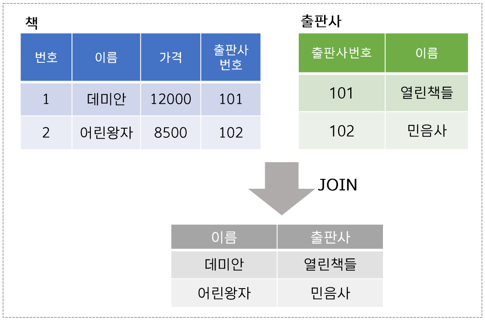

---

### 🧅 [SQLD양파 심화 이론 · 실전 SQL 트레이스 · Before & After · 30초 시험 직전 정리] (2-1-6 ORDER BY 절)

## [핵심 요약]

> ORDER BY는 결과를 어떤 순서로 보여줄지 정렬하는 절이다. SELECT 문에서 가장 마지막에 실행된다.

ex) 책장 정리처럼 "가나다순(`ASC`)·최신순(`DESC`)·분야별 → 분야 내 가나다순(`ORDER BY 분야, 책이름`)" 식으로 1차·2차 정렬 가능

---

## [개념 도식화] ORDER BY의 위치

```
SELECT  ...
FROM    ...
WHERE   ...
GROUP BY ...
HAVING  ...
ORDER BY ...   ← 항상 맨 마지막
```


---

## ASC vs DESC

| 키워드 | 의미 | 기본값 |
|---|---|---|
| ASC | 오름차순(작→큰, ㄱ→ㅎ) | 기본 |
| DESC | 내림차순(큰→작) | — |

```sql
ORDER BY SAL          -- ASC(기본)
ORDER BY SAL ASC      -- 명시
ORDER BY SAL DESC     -- 내림차순
```

---

## 정렬 기준 작성 방법 3가지

```sql
SELECT NAME, SAL FROM EMP
-- 방법 1: 컬럼명
ORDER BY SAL DESC;

-- 방법 2: SELECT 별칭(Alias)
SELECT NAME, SAL*12 AS ANNUAL_SAL FROM EMP
ORDER BY ANNUAL_SAL DESC;

-- 방법 3: SELECT의 N번째 컬럼(정수)
SELECT NAME, SAL FROM EMP
ORDER BY 2 DESC;        -- 2번째 컬럼 = SAL
```

ORDER BY 는 SELECT 다음에 실행되므로 별칭 사용 가능(WHERE, GROUP BY 는 불가)

---

## 다중 정렬

```sql
-- 부서별로 묶고, 같은 부서 안에서는 급여 높은 순
SELECT NAME, DEPT_ID, SAL
FROM   EMP
ORDER BY DEPT_ID ASC, SAL DESC;
```

```
DEPT_ID 오름차순
   └ SAL 내림차순으로 2차 정렬
```

---

## NULL의 정렬 순서

**NULL**(`1-2-4`) 은 비교 불가 값이므로 정렬에서도 DBMS 마다 다르게 처리

| DBMS | ASC 기본 | DESC 기본 |
|---|---|---|
| Oracle | NULL이 마지막 | NULL이 처음 |
| MS-SQL Server | NULL이 처음 | NULL이 마지막 |

명시적 지정:

```sql
ORDER BY COMM ASC NULLS FIRST   -- NULL 먼저
ORDER BY COMM ASC NULLS LAST    -- NULL 마지막
```

---

## [SQL 실전]

```sql
-- 단일 컬럼
SELECT NAME, SAL FROM EMP
ORDER BY SAL DESC;

-- 다중 컬럼
SELECT NAME, DEPT_ID, SAL FROM EMP
ORDER BY DEPT_ID, SAL DESC;

-- 별칭으로
SELECT NAME, SAL*12 AS YEAR_SAL FROM EMP
ORDER BY YEAR_SAL DESC;

-- 컬럼 번호로
SELECT NAME, DEPT_ID, SAL FROM EMP
ORDER BY 3 DESC, 2 ASC;
```

---

## [Before & After]

EMP 5명을 부서별로 묶고, 같은 부서 안에서는 급여가 높은 사람이 먼저 보이도록 정렬하는 상황. DEPT_ID(오름차순)와 SAL(내림차순)을 한 ORDER BY 절에 섞었을 때 결과 순서가 어떻게 결정되는지 확인.

### EMP

| NAME | DEPT_ID | SAL |
|---|---|---|
| 김 | D1 | 3000 |
| 이 | D2 | 4000 |
| 박 | D1 | 2500 |
| 최 | D2 | 4500 |
| 홍 | D1 | 4000 |

### `ORDER BY DEPT_ID ASC, SAL DESC`

| NAME | DEPT_ID | SAL |
|---|---|---|
| 홍 | D1 | 4000 |
| 김 | D1 | 3000 |
| 박 | D1 | 2500 |
| 최 | D2 | 4500 |
| 이 | D2 | 4000 |

부서 오름차순 → 부서 내 급여 내림차순으로 정렬됨

ORDER BY 는 나열된 컬럼 순서대로 1차·2차·3차 정렬을 적용하고, ASC/DESC 는 컬럼별로 따로 지정됨. "DEPT_ID 는 오름차순, SAL 은 내림차순" 처럼 키마다 방향이 달라도 한 줄에 함께 쓸 수 있음. 결과 순서를 사람 눈에 보일 형태로 확정해야 하는 보고서·페이지네이션·TopN 쿼리에서는 정렬 키를 의도대로 명시해두는 것이 안전

---

## ORDER BY 주의사항

ORDER BY 는 정렬된 상위 N 개만 추출하는 **TopN 쿼리**(`2-2-5`) 의 기반

| 주의 | 설명 |
|---|---|
| 항상 맨 끝 | UNION 등 집합연산자 사용 시도 마지막에 한 번만 |
| 숫자 정렬 | 1, 2, 10... 숫자 그대로 |
| 문자 정렬 | '1', '10', '2'... 사전순 → 1, 10, 2 |
| NULL 위치 | DBMS별로 다름. 명시 권장 |
| 인덱스 활용 | 정렬 작업에 인덱스가 활용될 수 있음 |

---

## SELECT 실행 순서

| 순서 | 절 |
|---|---|
| 1 | FROM |
| 2 | WHERE |
| 3 | GROUP BY |
| 4 | HAVING |
| 5 | SELECT |
| 6 | ORDER BY |

ORDER BY 가 마지막이라 별칭과 컬럼번호 사용 가능

---

## [시험 출제 포인트]

| 함정 | 정답 |
|---|---|
| ORDER BY 기본값 | ASC(오름차순) |
| ORDER BY에서 SELECT 별칭 사용 | 가능 |
| ORDER BY에서 컬럼 번호(숫자) 사용 | 가능 |
| Oracle ORDER BY ASC, NULL의 위치 | 마지막 |
| MS-SQL ORDER BY ASC, NULL의 위치 | 처음 |
| `ORDER BY DEPT, SAL DESC`의 의미 | DEPT는 ASC(생략값), SAL만 DESC |
| 집합연산자(UNION) 후 ORDER BY 위치 | 맨 마지막에 한 번만 |

단골 함정: 문자형 컬럼에 숫자값이 들어 있을 때 정렬 순서. 예) '1', '10', '2' 를 정렬하면 사전순으로 '1', '10', '2'

---

> **30초 시험 직전 정리**
> · 기본값 = **ASC** (오름차순). DESC 명시 필수
> · ORDER BY 에는 **컬럼명 / 별칭 / 컬럼 번호** 모두 사용 가능 (가장 마지막 실행이라)
> · `ORDER BY DEPT, SAL DESC` = DEPT ASC + SAL DESC (정렬 옵션은 컬럼별 개별 적용)
> · NULL 위치: Oracle ASC = **마지막** / MS-SQL ASC = **처음**. 명시는 `NULLS FIRST/LAST`
> · 문자형 정렬 = **사전순** ('1', '10', '2' 순). 숫자 정렬 원하면 TO_NUMBER 후
> · UNION 등 집합연산 후 ORDER BY = **맨 마지막에 한 번만**


---

# 2-1-7. 조인(JOIN)

> **단원 분류**: `2과목` > `2-1. SQL 기본` > **`2-1-7. 조인`**

### 📘 [해리누나 2024 개정판 + 2과목 요약본 완벽 통합] 제1장 제7절. 조인 (JOIN) (PDF p.44 ~ p.47)

#### 1. 조인(JOIN)의 개념과 수행 원리 (PDF p.44)
- **조인의 정의**: 두 개 이상의 테이블들을 연결 또는 결합하여 데이터를 출력하는 것.
- 일반적인 경우 행들은 **PK(기본키)나 FK(외래키) 값의 연관에 의해 조인이 성립**된다. 하지만 어떤 경우에는 **PK, FK의 관계가 없어도 논리적인 값들의 연관만으로 조인이 성립** 가능하다!
- **N개 테이블 조인 시 최소 조인 조건의 개수**:
  - **`N`개의 테이블을 조인하려면 최소 `N - 1`개의 조인 조건이 필요**하다! (예: 4개의 테이블을 조인하려면 최소 `4 - 1 = 3`개의 조인 조건문이 필요함. 만약 조인 조건을 누락하면 **카티션 곱(Cartesian Product, 교차곱)**이 발생하여 행 수가 `M × N`개로 폭발한다!)

#### 2. EQUI JOIN (등가 조인)과 테이블 별칭(Alias) 규칙 (PDF p.44 ~ p.45)
- **EQUI JOIN (등가 조인)**: 두 테이블 간에 칼럼 값들이 서로 정확하게 일치하는 경우에 사용되는 방법으로, **`=` (등호) 연산자**를 사용하여 조건을 표현한다 (대부분 PK ↔ FK 관계를 기반으로 함).
- **⚠️ 테이블 별칭(Table Alias) 사용 시 절대 규칙**:
  - 두 테이블에 같은 이름의 컬럼(예: `TEAM_ID`)이 존재할 때 `SELECT TEAM_ID`처럼 앞에 테이블명이나 별칭을 붙이지 않으면 **`ORA-00918: 열의 정의가 애매합니다 (Column ambiguously defined)` 에러**가 발생한다!
  - **`FROM PLAYER P, TEAM T`처럼 테이블에 별칭(`P`, `T`)을 부여했다면, `SELECT` 절이나 `WHERE` 절에서는 원래 테이블명(`PLAYER.TEAM_ID`)을 쓰면 에러가 나며, 반드시 별칭(`P.TEAM_ID`)만 사용해야 한다!**

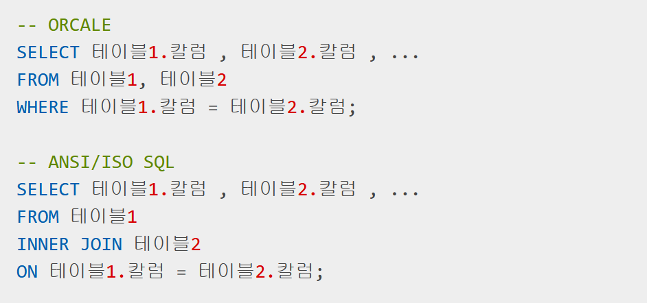

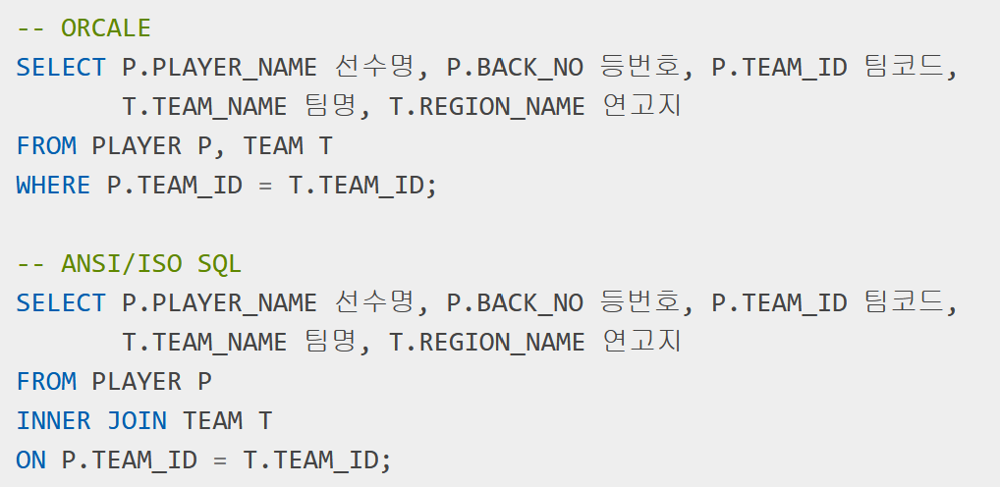

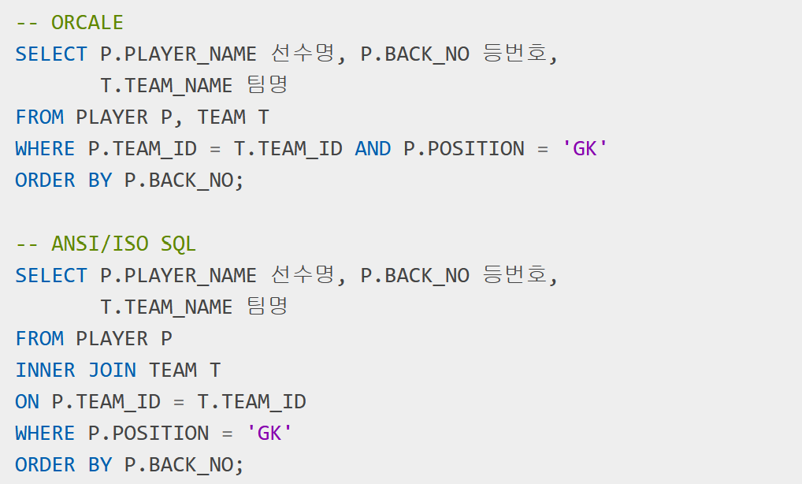


#### 3. NON-EQUI JOIN (비등가 조인) (PDF p.45 ~ p.46)
- **NON-EQUI JOIN (비등가 조인)**: 두개의 테이블 간에 칼럼 값들이 서로 정확하게 일치하지 않는 경우에 사용되며, **`=` 연산자가 아닌 `BETWEEN`, `>`, `>=`, `<`, `<=` 등의 연산자**를 사용하여 조인을 수행한다. (예: 사원의 급여 `EMP.SAL`이 급여등급 테이블 `SALGRADE`의 `LOSAL`과 `HISAL` 사이에 속하는지 조인: `WHERE E.SAL BETWEEN S.LOSAL AND S.HISAL`)

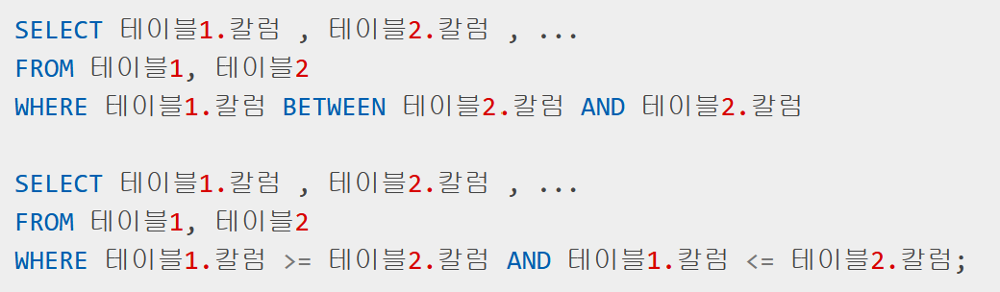

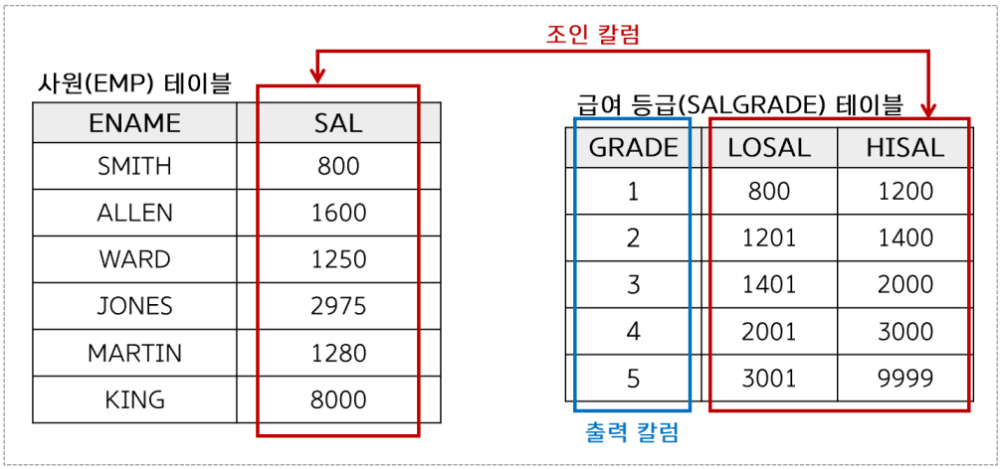

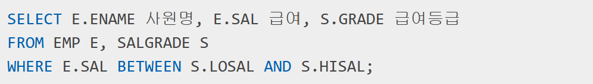


#### 4. 3개 이상 테이블 조인 및 Oracle OUTER JOIN `(+)` 기호 규칙 (PDF p.46 ~ p.47)
- **3개 이상 테이블 조인**: `PLAYER`, `TEAM`, `STADIUM` 3개 테이블을 조인할 때는 최소 `3 - 1 = 2`개의 조인 조건을 `AND`로 연결한다.
- **Oracle 전용 OUTER JOIN 기호 `(+)` 완벽 정리 (★위치 헷갈림 주의!)**:
  - `(+)` 기호는 **"데이터가 부족한 쪽(모자란 쪽, 즉 `NULL` 행이 새로 덧붙여져서라도 나와야 하는 보조 테이블 쪽)"** 컬럼 뒤에 붙인다!
  - **`WHERE A.ID = B.ID(+)`** ➔ 기준이 `A` 테이블이므로 **`A LEFT OUTER JOIN B`**와 같다! (`A`의 모든 행이 다 나오고, `B`에 매칭되는 값이 없으면 `B` 컬럼들이 `NULL`로 채워짐)
  - **`WHERE A.ID(+) = B.ID`** ➔ 기준이 `B` 테이블이므로 **`A RIGHT OUTER JOIN B`**와 같다!
  - *(주의: 양쪽에 동시에 `A.ID(+) = B.ID(+)`처럼 붙이는 것은 문법 에러이다! Oracle `(+)` 기호로는 `FULL OUTER JOIN`을 직접 표현할 수 없다.)*


---

### 🧅 [SQLD양파 심화 이론 · 실전 SQL 트레이스 · Before & After · 30초 시험 직전 정리] (2-1-7 조인)

## [핵심 요약]

> 조인은 두 개 이상의 테이블을 키로 연결해 한 결과로 합치는 작업이다.

ex) 영화관 티켓(영화 정보)과 회원증(회원 정보)을 회원번호라는 공통 키로 매칭해 "누가 어떤 영화를 봤는지" 알아내는 것과 같음

---

## [개념 도식화] 조인의 기본 원리

조인은 모델링 단계의 **관계**(`1-1-4`) 가 SQL 단에서 실제로 사용되는 방식. 이론적 배경은 **관계와 조인의 이해**(`1-2-2`) 참고


---

## 조인의 종류


| 종류 | 의미 | 예 |
|---|---|---|
| EQUI 조인 | `=`으로 연결(가장 흔함) | `A.ID = B.ID` |
| Non-EQUI | `=` 외(BETWEEN 등) | `SAL BETWEEN LO AND HI` |
| SELF JOIN | 같은 테이블끼리 | 사원-매니저(같은 EMP) |
| OUTER JOIN | 매칭 안 돼도 한쪽 다 포함 | LEFT/RIGHT/FULL |
| CROSS JOIN | 모든 조합(카티션) | 두 테이블의 곱 |

---

## EQUI JOIN — 가장 기본

### 전통적 방식 (Oracle)

```sql
SELECT  E.NAME, D.DEPT_NAME
FROM    EMP E, DEPT D
WHERE   E.DEPT_ID = D.DEPT_ID;     -- 조인 조건
```

### 표준 ANSI 방식

```sql
SELECT  E.NAME, D.DEPT_NAME
FROM    EMP  E
        JOIN DEPT D ON E.DEPT_ID = D.DEPT_ID;
```

자세한 **표준 조인**(`2-1-8`) 은 다음 챕터 참고

---

## Non-EQUI JOIN — 범위 매칭

```sql
-- 급여 등급표를 조인
SELECT  E.NAME, E.SAL, S.GRADE
FROM    EMP E, SALGRADE S
WHERE   E.SAL BETWEEN S.LOSAL AND S.HISAL;
```

| EMP | SALGRADE |
|---|---|
| (사원, 급여) | (등급, 하한, 상한) |

---

## SELF JOIN — 자기 자신

한 테이블에 부모-자식 관계가 들어있을 때 사용(예: 사원-매니저). 계층 구조 조회와 함께 **계층형 질의와 셀프조인**(`2-2-6`) 챕터에서 심화.

```sql
SELECT  E.NAME    AS 사원,
        M.NAME    AS 매니저
FROM    EMP E, EMP M
WHERE   E.MGR_ID = M.EMP_ID;
```

| EMP | EMP_ID |
|---|---|
| 김(매니저: 이) | E1 |
| 이(매니저: 박) | E2 |
| 박 | E3 |

---

## OUTER JOIN — 한쪽 다 포함

```
LEFT  OUTER : A 모두 + 매칭되는 B    (A 에 없으면 결과에서 빠짐, B 에 없으면 NULL)
RIGHT OUTER : B 모두 + 매칭되는 A    (B 에 없으면 결과에서 빠짐, A 에 없으면 NULL)
FULL  OUTER : A·B 모두                (한쪽이라도 있으면 결과에 포함, 없는 쪽은 NULL)
```

```sql
-- LEFT OUTER (왼쪽 다)
SELECT M.NAME, O.ORDER_ID
FROM   MEMBER M LEFT OUTER JOIN ORDERS O
       ON M.MEMBER_ID = O.MEMBER_ID;

-- Oracle 전통 방식 (+) 기호
SELECT M.NAME, O.ORDER_ID
FROM   MEMBER M, ORDERS O
WHERE  M.MEMBER_ID = O.MEMBER_ID(+);   -- (+)는 NULL 채워질 쪽
```

---

## CROSS JOIN — 모든 조합(카티션 곱)

```sql
SELECT * FROM A CROSS JOIN B;
-- A 3행, B 2행 → 6행 (3×2)
```

조인 조건을 빼먹어도 발생 → 의도치 않으면 위험

---

## [SQL 실전] 다양한 조인

```sql
-- INNER JOIN
SELECT E.NAME, D.DEPT_NAME
FROM   EMP E JOIN DEPT D ON E.DEPT_ID = D.DEPT_ID;

-- 3개 테이블 조인
SELECT E.NAME, D.DEPT_NAME, L.CITY
FROM   EMP E
       JOIN DEPT D     ON E.DEPT_ID = D.DEPT_ID
       JOIN LOCATION L ON D.LOC_ID  = L.LOC_ID;

-- LEFT OUTER JOIN
SELECT M.NAME, O.ORDER_ID
FROM   MEMBER M LEFT JOIN ORDERS O ON M.MEMBER_ID = O.MEMBER_ID;
```

---

## [Before & After]

EMP 에는 부서가 없는 박, DEPT 에는 아무도 속하지 않은 D3(개발부)가 있는 상황. 같은 두 테이블에 INNER / LEFT / RIGHT / FULL OUTER 조인을 차례로 적용해 결과 행이 늘었다 줄었다 하는 양상 비교.

### EMP

| EMP_ID | NAME | DEPT_ID |
|---|---|---|
| 1 | 김 | D1 |
| 2 | 이 | D2 |
| 3 | 박 | NULL |

### DEPT

| DEPT_ID | DEPT_NAME |
|---|---|
| D1 | 영업부 |
| D2 | 인사부 |
| D3 | 개발부 |

### INNER JOIN

| NAME | DEPT_NAME |
|---|---|
| 김 | 영업부 |
| 이 | 인사부 |

### LEFT OUTER (EMP 기준)

| NAME | DEPT_NAME |
|---|---|
| 김 | 영업부 |
| 이 | 인사부 |
| 박 | NULL |

### RIGHT OUTER (DEPT 기준)

| NAME | DEPT_NAME |
|---|---|
| 김 | 영업부 |
| 이 | 인사부 |
| NULL | 개발부 |

### FULL OUTER

| NAME | DEPT_NAME |
|---|---|
| 김 | 영업부 |
| 이 | 인사부 |
| 박 | NULL |
| NULL | 개발부 |

INNER 조인은 양쪽 모두 매칭되는 행만 남기므로 박과 개발부가 동시에 사라짐. LEFT/RIGHT OUTER 는 기준 쪽을 다 살리고 반대쪽이 비면 NULL 을 채움. FULL OUTER 는 양쪽 모두 살림. "어느 쪽에 매칭이 없는 데이터까지 보고 싶은가" 가 INNER vs OUTER 선택 기준. OUTER 조인 후 WHERE 에 비기준 컬럼 조건을 걸면 NULL 행이 도로 빠지므로 추가 조건은 ON 절에 두는 것이 안전

---

## 조인 시 주의사항

| 함정 | 결과 | 해결 |
|---|---|---|
| 조인 조건 누락 | 카티션 곱(행수 폭발) | ON 또는 WHERE 명시 |
| OUTER JOIN과 WHERE 혼용 | NULL 행 사라짐 | 조건은 ON에 |
| N+1 테이블 조인 | N개 조인 조건 필요 | 잘 매핑 |

---

## [시험 출제 포인트]

| 함정 | 정답 |
|---|---|
| 조인 조건이 빠지면 | 카티션 곱(Cartesian Product) |
| Oracle 외부조인 표기 | `(+)` 기호(NULL 보충될 쪽에 붙임) |
| N개 테이블 조인 시 조인 조건 수 | 최소 N-1개 |
| Non-EQUI 조인 예 | BETWEEN, >, < 등 |
| SELF 조인은 같은 테이블을 두 번 사용? | 그렇다(별칭 필수) |
| INNER vs OUTER 차이 | OUTER는 매칭 안 되는 행도 NULL과 함께 포함 |

단골 함정: Oracle 의 `(+)` 위치는 NULL 을 채울 쪽(없을 수 있는 쪽)에 붙임

---

> **30초 시험 직전 정리**
> · 5종류: **EQUI / Non-EQUI / SELF / OUTER / CROSS**
> · 조인 조건 누락 = **카티션 곱** (행 수 폭발: A행 × B행)
> · N개 테이블 조인 = 조인 조건 **최소 N-1 개**
> · SELF 조인 = **별칭 필수** (같은 테이블을 두 번 사용)
> · Oracle `(+)` 표기 = **NULL 채울 쪽** (없을 수 있는 쪽)에 붙임
> · OUTER JOIN 추가 조건 = **ON 절에** (WHERE 두면 NULL 행 빠져 INNER 와 같아짐)


---

# 2-1-8. 표준 조인 (ANSI Standard Join)

> **단원 분류**: `2과목` > `2-1. SQL 기본` > **`2-1-8. 표준 조인`**

### 📘 [해리누나 2024 개정판 + 2과목 요약본 완벽 통합] 제1장 제8절. 표준 조인 (Standard JOIN) (PDF p.47 ~ p.52)

#### 1. ANSI/ISO 표준 조인의 4대 형태 개요 (PDF p.47)
- **`INNER JOIN`**: 조인 조건을 만족하는(양쪽 모두에 존재하는) 행만 반환 (`JOIN` 앞에 `INNER`는 생략 가능).
- **`NATURAL JOIN`**: 두 테이블에서 **같은 이름을 가진 모든 컬럼**들에 대해 자동으로 EQUI(`=`) 조인을 수행.
- **`CROSS JOIN`**: 조인 조건 없이 두 테이블 간의 가능한 **모든 행의 조합(카티션 곱, `M × N`행)**을 반환.
- **`OUTER JOIN`**: 조인 조건을 만족하지 않는 행도 결과에 포함 (`LEFT OUTER JOIN`, `RIGHT OUTER JOIN`, `FULL OUTER JOIN` — 여기서 `OUTER` 키워드는 생략 가능!).

---

#### 2. NATURAL JOIN vs USING 조건절 vs ON 조건절 완벽 비교 (★시험 100% 출제!) (PDF p.47 ~ p.50)

> 💡 **[핵심 필수 암기]**
> **조인 기준 컬럼에 테이블 별칭(Alias, 예 `D.DEPTNO`)을 붙일 수 있는가?**
> - **`ON` 조건절 (`JOIN ... ON D.DEPTNO = E.DEPTNO`)**: 이름이 같은 컬럼에 **반드시 테이블명/별칭을 붙여야 한다!** (안 붙이면 애매모호 에러!)
> - **`NATURAL JOIN` 및 `USING(컬럼)` 조건절**: 조인 기준이 되는 공통 컬럼(`DEPTNO`)이 결과에서 **하나의 컬럼으로 통합**되므로, **`SELECT` 절이나 `WHERE` 절, `USING` 절 어디에서도 해당 공통 컬럼 앞에 테이블명이나 별칭(`D.DEPTNO`)을 붙이면 문법 에러가 발생한다!** (무조건 별칭 없이 그냥 `DEPTNO`로만 써야 함!)

| 비교 항목 | `NATURAL JOIN` | `JOIN ... USING (공통컬럼)` | `JOIN ... ON (조건식)` |
| :---: | :--- | :--- | :--- |
| **조인 컬럼 지정** | 지정 불가! (`ON`이나 `USING` 쓸 수 없음). 두 테이블에서 **이름이 같은 모든 컬럼**을 자동으로 찾아서全部 `AND` 등가조인 수행! | 이름이 같은 컬럼 중 **내가 원하는 특정 컬럼만 `(괄호)` 안에 지정**하여 등가조인 수행! (괄호 필수!) | 컬럼 이름이 **같든 다르든 상관없이** 자유롭게 조건식(`=`, `BETWEEN` 등) 지정 가능! |
| **공통 컬럼에 별칭(Alias) 사용** | **❌ 절대 사용 불가!** (`E.DEPTNO` ➔ 에러! 그냥 `DEPTNO`로만 써야 함) | **❌ 절대 사용 불가!** (`USING` 괄호 안이나 `SELECT` 절에서 `E.DEPTNO` 쓰면 에러!) | **⭕ 반드시 별칭 사용해야 함!** (`E.DEPTNO`, `D.DEPTNO` 구분 필수) |
| **`SELECT *` 수행 시 컬럼 수** | 공통 컬럼이 **맨 앞에 1번만** 출력됨 (중복 제거) | `USING`에 쓴 컬럼이 **맨 앞에 1번만** 출력됨 (중복 제거) | 양쪽 테이블의 컬럼이 **각각 따로(2번 모두)** 출력됨 |


---

#### 3. OUTER JOIN에서 `ON` 절 조건 vs `WHERE` 절 조건의 결정적 차이 (★킬러 문항!) (PDF p.50)


---

#### 4. CROSS JOIN (교차 조인)과 LEFT / RIGHT / FULL OUTER JOIN (PDF p.50 ~ p.52)
- **`CROSS JOIN` (카티션 곱, Cartesian Product)**:
  - 조인 조건이 없으므로 테이블 `A`가 `m`건, 테이블 `B`가 `n`건이면 결과는 무조건 **`m × n`건**이 생성된다. (`FROM A CROSS JOIN B` 또는 `FROM A, B`에서 `WHERE` 조인 조건을 안 쓴 것과 동일)
- **`LEFT OUTER JOIN`**:
  - 왼쪽(먼저 쓴) 테이블의 데이터는 **무조건 100% 모두 출력**하고, 오른쪽 테이블에 조인 조건에 맞는 값이 없으면 오른쪽 컬럼들을 `NULL`로 채워서 출력한다.
- **`RIGHT OUTER JOIN`**:
  - 오른쪽(나중에 쓴) 테이블의 데이터를 **무조건 100% 모두 출력**하고, 왼쪽 테이블에 매칭되는 값이 없으면 왼쪽 컬럼들을 `NULL`로 채워서 출력한다.
- **`FULL OUTER JOIN`**:
  - 왼쪽과 오른쪽 테이블의 데이터를 **양쪽 모두 빠짐없이 출력**한다 (합집합 개념: **`LEFT OUTER JOIN` 결과 ∪ `RIGHT OUTER JOIN` 결과 (`UNION`과 동일!)**).


---

### 🧅 [SQLD양파 심화 이론 · 실전 SQL 트레이스 · Before & After · 30초 시험 직전 정리] (2-1-8 표준 조인)

## [핵심 요약]

> 표준 조인은 ANSI/ISO에서 정의한, 모든 DBMS에서 통하는 조인 문법이다. `JOIN ... ON` 키워드를 사용한다. 앞 챕터의 **조인**(`2-1-7`) 종류를 표준 문법으로 정리.

---

## [개념 도식화] 표준 조인의 종류


---

## [SQL 실전]

### INNER JOIN — 양쪽 매칭만

```sql
SELECT  E.NAME, D.DEPT_NAME
FROM    EMP E
        INNER JOIN DEPT D ON E.DEPT_ID = D.DEPT_ID;
        -- INNER 생략 가능: JOIN ... ON
```

```
   EMP    DEPT
   ┌──┐  ┌──┐
   │  ╲╱  │      ← 교집합만
   └──┘  └──┘
```

---

### LEFT OUTER JOIN — 왼쪽 다, 오른쪽 매칭

```sql
SELECT  E.NAME, D.DEPT_NAME
FROM    EMP E
        LEFT OUTER JOIN DEPT D ON E.DEPT_ID = D.DEPT_ID;
        -- OUTER 생략 가능: LEFT JOIN
```

```
   EMP    DEPT
   ┌──┐  ┌──┐
   │██╲╱  │      ← 왼쪽 모두 + 매칭된 오른쪽
   └──┘  └──┘
```

---

### RIGHT OUTER JOIN — 오른쪽 다, 왼쪽 매칭

```sql
SELECT  E.NAME, D.DEPT_NAME
FROM    EMP E
        RIGHT OUTER JOIN DEPT D ON E.DEPT_ID = D.DEPT_ID;
```

---

### FULL OUTER JOIN — 양쪽 다

```sql
SELECT  E.NAME, D.DEPT_NAME
FROM    EMP E
        FULL OUTER JOIN DEPT D ON E.DEPT_ID = D.DEPT_ID;
```

```
   EMP    DEPT
   ┌──┐  ┌──┐
   │██╲╱██│      ← 양쪽 모두(한쪽만 있어도 NULL 채워서)
   └──┘  └──┘
```

---

### CROSS JOIN — 모든 조합

```sql
SELECT  *
FROM    EMP E CROSS JOIN DEPT D;
```

조인 조건 없음. 결과는 A행수 × B행수

---

### NATURAL JOIN — 같은 이름 컬럼 자동 조인

```sql
SELECT  *
FROM    EMP NATURAL JOIN DEPT;     -- DEPT_ID로 자동 조인
```

| 특징 | 설명 |
|---|---|
| 자동 매칭 | 이름이 같은 컬럼으로 매칭 |
| 별칭 사용 X | 같은 이름 컬럼에 별칭 사용 불가 |
| 같은 이름 컬럼은 한 번만 등장 | 중복 제거 |

의도치 않은 컬럼이 매칭될 수 있어 실무에서는 잘 안 씀

---

### USING 절 — 명시적 컬럼 매칭

```sql
SELECT  NAME, DEPT_NAME, DEPT_ID
FROM    EMP JOIN DEPT USING (DEPT_ID);
```

| NATURAL vs USING | 차이 |
|---|---|
| NATURAL | 자동(모든 같은 이름) |
| USING | 지정한 컬럼만 |

USING 으로 조인된 컬럼은 테이블 별칭 사용 불가(예: `E.DEPT_ID` 불가)

---

### ON 절 vs WHERE 절 (OUTER JOIN 핵심)

```sql
-- 잘못된 예: OUTER JOIN인데 WHERE로 필터하면 NULL 행이 빠짐
SELECT M.NAME, O.ORDER_ID
FROM   MEMBER M LEFT JOIN ORDERS O ON M.MEMBER_ID = O.MEMBER_ID
WHERE  O.AMOUNT > 1000;     -- 주문 없는 회원이 사라짐

-- 올바른 예: 조인 조건에 함께
SELECT M.NAME, O.ORDER_ID
FROM   MEMBER M LEFT JOIN ORDERS O
       ON M.MEMBER_ID = O.MEMBER_ID
       AND O.AMOUNT > 1000;
```

---

## [Before & After] 표준 조인 결과 비교

EMP 3행(박은 부서 미지정)과 DEPT 3행(D3 개발은 소속 사원 없음)을 같은 키 DEPT_ID 로 조인하는 상황. 동일한 두 테이블에 INNER / LEFT / RIGHT / FULL / CROSS 를 차례로 적용해 ANSI 표준 문법별 결과 행 수가 어떻게 달라지는지 비교.

### 입력

**EMP**

| EMP_ID | NAME | DEPT_ID |
|---|---|---|
| 1 | 김 | D1 |
| 2 | 이 | D2 |
| 3 | 박 | NULL |

**DEPT**

| DEPT_ID | DEPT_NAME |
|---|---|
| D1 | 영업 |
| D2 | 인사 |
| D3 | 개발 |

### INNER JOIN

| NAME | DEPT_NAME |
|---|---|
| 김 | 영업 |
| 이 | 인사 |

### LEFT JOIN

| NAME | DEPT_NAME |
|---|---|
| 김 | 영업 |
| 이 | 인사 |
| 박 | NULL |

### RIGHT JOIN

| NAME | DEPT_NAME |
|---|---|
| 김 | 영업 |
| 이 | 인사 |
| NULL | 개발 |

### FULL JOIN

| NAME | DEPT_NAME |
|---|---|
| 김 | 영업 |
| 이 | 인사 |
| 박 | NULL |
| NULL | 개발 |

### CROSS JOIN

3 × 3 = 9행

ANSI 표준은 결과 집합을 키워드 한 단어로 명확히 구분 — INNER 는 매칭만, LEFT/RIGHT 는 한쪽 기준 모두, FULL 은 양쪽 모두, CROSS 는 카티션 곱. "어느 쪽에 매칭이 없는 데이터까지 살릴 것인가" 를 먼저 정한 뒤 그에 맞는 키워드 선택. OUTER 조인의 추가 조건은 반드시 ON 절에 두어야 매칭 안 되는 NULL 행이 그대로 살아남음

---

## 정리표

| 종류 | 매칭 안 되는 왼쪽 | 매칭 안 되는 오른쪽 |
|---|---|---|
| INNER | 제외 | 제외 |
| LEFT | 포함(NULL) | 제외 |
| RIGHT | 제외 | 포함(NULL) |
| FULL | 포함 | 포함 |
| CROSS | 모든 조합 | 모든 조합 |

---

## [시험 출제 포인트]

| 함정 | 정답 |
|---|---|
| INNER JOIN 키워드 생략 가능? | 가능. `JOIN ... ON`이 INNER JOIN |
| OUTER 키워드 생략 가능? | 가능. `LEFT JOIN` = `LEFT OUTER JOIN` |
| NATURAL JOIN의 매칭 기준 | 이름이 같은 모든 컬럼 |
| NATURAL JOIN에서 같은 이름 컬럼에 별칭 | 사용 불가 |
| USING 절의 컬럼에 테이블 별칭 | 사용 불가 |
| OUTER JOIN의 조건은 ON vs WHERE | ON에 둬야 NULL 행이 살아남음 |
| FULL OUTER 결과 | 양쪽 매칭 안 되는 것까지 모두 |
| CROSS JOIN 행수 | A × B |

단골 함정: LEFT JOIN 인데 WHERE 에 오른쪽 조건을 거는 케이스 → 결과적으로 INNER JOIN 과 같아짐

---

> **30초 시험 직전 정리**
> · `JOIN ... ON` = 표준 ANSI 문법 (어느 DBMS 든 통함)
> · INNER 키워드 생략 가능 / OUTER 키워드 생략 가능 (`LEFT JOIN` = `LEFT OUTER JOIN`)
> · NATURAL JOIN = 같은 이름 컬럼 **자동 전부** 매칭. 별칭 사용 **불가**
> · USING (컬럼) = **지정한 컬럼만** 매칭. USING 컬럼에 테이블 별칭 **불가**
> · OUTER JOIN 추가 조건은 반드시 **ON** 에 (WHERE 두면 INNER 효과)
> · 결과 행: INNER ≤ LEFT/RIGHT ≤ FULL, CROSS = A × B


---
