# 📗 [제2과목 제2장] SQL 활용 — 2024 개정판 SQLD 마스터북

> **수록 범위**: 제2장 SQL 활용 (`2-2-1` 서브쿼리 ~ `2-2-8` 정규 표현식) + 원본 도식·실행 결과 139개(`p053`~`p081`) 전수 수록

---

# 2-2-1. 서브쿼리(Sub Query)

> **단원 분류**: `2과목` > `2-2. SQL 활용` > **`2-2-1. 서브쿼리`**

### 📘 [해리누나 2024 개정판 필기 & 원본 도식 완벽 정리] 제2장 제1절. 서브쿼리 (Subquery) (PDF p.53 ~ p.58)

#### 1. 서브쿼리(Subquery)의 개념과 3대 분류 체계 (PDF p.53)
- **서브쿼리의 정의**: 하나의 SQL문 안에 포함되어 있는 또 다른 SQL문을 말한다.
- **서브쿼리 사용 시 주의사항 (★단골 객관식 보기!)**:
  1. 서브쿼리는 반드시 **괄호 `( )`**로 감싸서 기술한다.
  2. 서브쿼리는 단일 행 또는 복수 행 비교 연산자와 함께 사용할 수 있다 (단, **단일 행 비교 연산자(`=`, `<`, `>`, `<=`, `>=`, `<>`)는 서브쿼리의 결과가 반드시 1건 이하**여야 하며, 2건 이상 반환되면 에러 발생!).
  3. **서브쿼리(특히 중첩 서브쿼리/스칼라 서브쿼리) 안에서는 `ORDER BY` 절을 사용할 수 없다!** (`ORDER BY` 절은 메인 쿼리의 마지막 문장에 단 한 개만 올 수 있음. *단, `FROM` 절에 쓰이는 **인라인 뷰(Inline View)** 안에서는 Top-N 추출 등을 위해 예외적으로 `ORDER BY` 사용이 가능하다!*)
  4. 서브쿼리가 사용 가능한 위치: **`SELECT` 절**, **`FROM` 절**, **`WHERE` 절**, **`HAVING` 절**, **`ORDER BY` 절**, **`INSERT` 문의 `VALUES` 절**, **`UPDATE` 문의 `SET` 절**. *(주의: `GROUP BY` 절에는 서브쿼리를 사용할 수 없다!)*

| 분류 기준 | 세부 유형 | 핵심 설명 및 특징 |
| :---: | :--- | :--- |
| **1. 동작하는 방식에 따른 분류** | **비연관(Un-Correlated) 서브쿼리** | 서브쿼리가 메인쿼리 컬럼을 가지고 있지 않은 형태. 메인쿼리에 값(서브쿼리가 실행된 결과)을 제공하기 위한 목적으로 주로 사용. |
| | **연관(Correlated) 서브쿼리** | 서브쿼리가 **메인쿼리의 컬럼을 포함**하고 있는 형태. 일반적으로 메인쿼리가 먼저 수행되어 읽혀진 데이터를 서브쿼리에서 조건이 맞는지 확인하고자 할 때 사용. |
| **2. 반환되는 데이터 형태에 따른 분류** | **단일행(Single Row) 서브쿼리** | 서브쿼리의 실행 결과가 **항상 1건 이하**인 서브쿼리. 단일행 비교연산자(`=`, `<`, `<=`, `>`, `>=`, `<>`)와 함께 사용. |
| | **다중행(Multi Row) 서브쿼리** | 서브쿼리의 실행 결과가 **여러 건**인 서브쿼리. 다중행 비교연산자(**`IN`, `ALL`, `ANY`, `SOME`, `EXISTS`**)와 함께 사용. |
| | **다중컬럼(Multi Column) 서브쿼리** | 서브쿼리의 실행 결과로 **여러 컬럼**을 반환. 메인쿼리의 조건절에 여러 컬럼을 동시에 비교(`WHERE (DEPTNO, SAL) IN (SELECT ...)`). **SQL Server에서는 지원하지 않음!** |
| **3. 위치에 따른 분류 (★명칭 암기!)** | **스칼라 서브쿼리 (Scalar Subquery)** | **`SELECT` 절**에 사용하는 서브쿼리 (**반드시 1행 1열 단일 값**만 반환해야 함! 결과가 0건이면 **`NULL`** 반환, 2건 이상이면 에러!) |
| | **인라인 뷰 (Inline View)** | **`FROM` 절**에 사용하는 서브쿼리 (**동적 뷰(Dynamic View)**라고도 부르며, 가상의 테이블처럼 취급되어 메인쿼리에서 인라인 뷰의 컬럼을 자유롭게 참조 가능!) |
| | **중첩 서브쿼리 (Nested Subquery)** | **`WHERE` 절**이나 **`HAVING` 절**에 조건절의 일부로 사용하는 서브쿼리. |

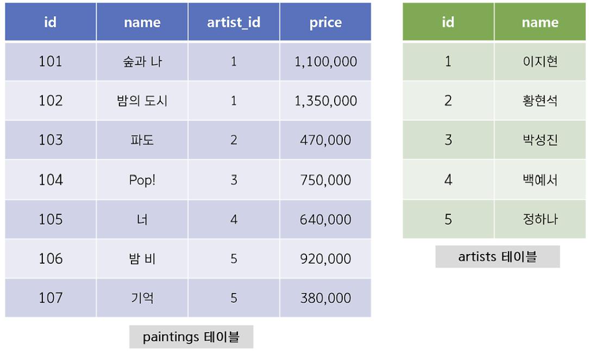

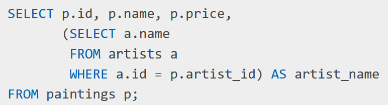

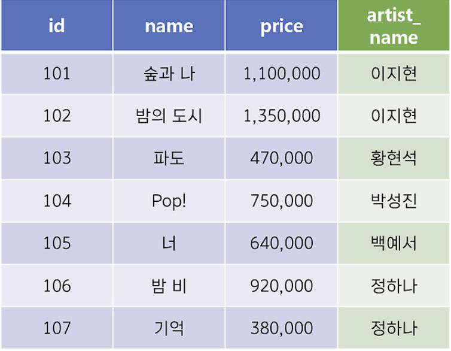

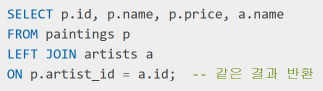

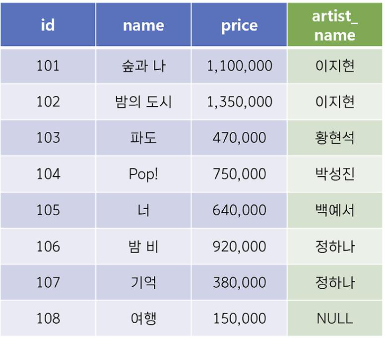

---

#### 2. 다중행 서브쿼리 연산자 (`IN`, `ALL`, `ANY`/`SOME`, `EXISTS`) 완벽 비교 (PDF p.54 ~ p.55)

> 💡 **[핵심 필수 암기]**
> **`ALL` vs `ANY(SOME)` 부등호 크기 비교 암기 공식!**
> 서브쿼리 결과 집합이 `(1000, 2000, 3000)`일 때:
> - **`SAL > ALL (1000, 2000, 3000)`**: **"모두보다 크다"** ➔ 제일 큰 값(`MAX = 3000`)보다 커야 함! (**`SAL > MAX(...)`**와 동일)
> - **`SAL < ALL (1000, 2000, 3000)`**: **"모두보다 작다"** ➔ 제일 작은 값(`MIN = 1000`)보다 작아야 함! (**`SAL < MIN(...)`**와 동일)
> - **`SAL > ANY (1000, 2000, 3000)`**: **"하나라도 크다"** ➔ 제일 작은 값(`MIN = 1000`)보다만 크면 됨! (**`SAL > MIN(...)`**와 동일)
> - **`SAL < ANY (1000, 2000, 3000)`**: **"하나라도 작다"** ➔ 제일 큰 값(`MAX = 3000`)보다만 작으면 됨! (**`SAL < MAX(...)`**와 동일)
> - **`SAL = ANY (1000, 2000, 3000)`**: **`SAL IN (1000, 2000, 3000)`**과 완전히 동일!

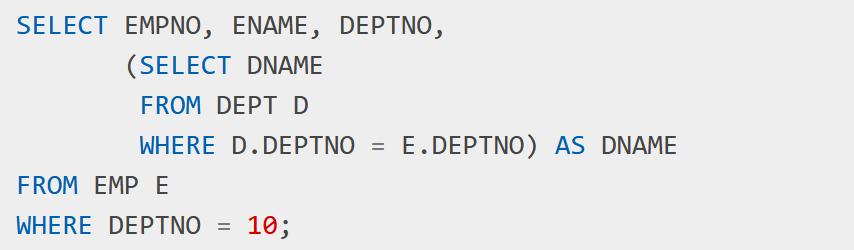

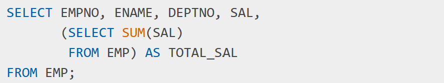

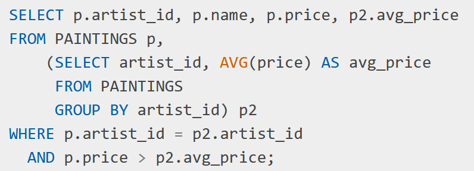

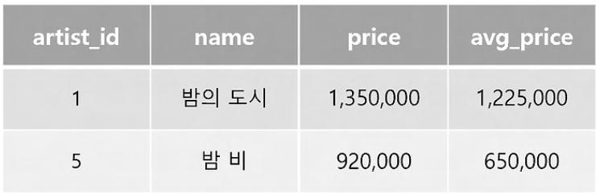

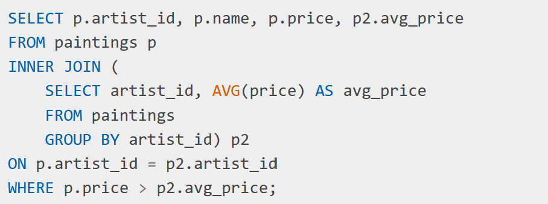

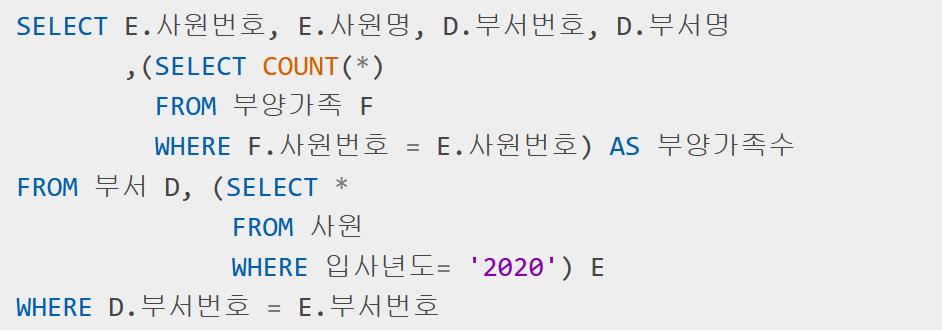

---

#### 3. 스칼라 서브쿼리, 인라인 뷰, HAVING절/DML 서브쿼리 및 `NOT IN` vs `NOT EXISTS` (PDF p.55 ~ p.58)
- **스칼라 서브쿼리 (`SELECT` 절)**:
  - 메인쿼리의 한 행당 **단일 행, 단일 컬럼(1행 1열)**을 반환한다 (`LEFT OUTER JOIN`과 유사한 효과를 냄 — 매칭되는 서브쿼리 결과가 없으면 해당 행을 탈락시키지 않고 **`NULL`을 출력**함!).
- **인라인 뷰 (`FROM` 절)**:
  - SQL 문이 실행될 때만 임시로 생성되는 **동적 뷰(Dynamic View)**이기 때문에 데이터베이스에 해당 구조가 저장되지 않는다 (일반 뷰를 **정적 뷰(Static View)**라고 하는 것과 대비됨).
  - 인라인 뷰 안의 컬럼은 메인 쿼리의 `SELECT`, `WHERE` 등에서 자유롭게 참조할 수 있다! (반면 일반 `WHERE` 절 서브쿼리의 컬럼은 메인쿼리 `SELECT` 절에서 출력할 수 없음!)
- **🔥 `NOT IN` vs `NOT EXISTS`의 결정적 차이 (★서브쿼리에 `NULL`이 있을 때!)**:
  - **`WHERE A NOT IN (서브쿼리)`**: 서브쿼리의 결과 집합에 **`NULL`이 단 1건이라도 포함되어 있으면**, `AND A != NULL`이 `UNKNOWN`이 되어 **전체 메인쿼리 결과가 무조건 0건(공집합)**이 나온다!
  - **`WHERE NOT EXISTS (연관 서브쿼리)`**: 메인쿼리 행을 대입했을 때 조건을 만족하는 행이 존재하는지 여부(`TRUE`/`FALSE`)만 검사하므로, 서브쿼리 테이블에 **`NULL`이 들어있어도 영향을 받지 않고 정상적으로 차집합 결과를 반환**한다!

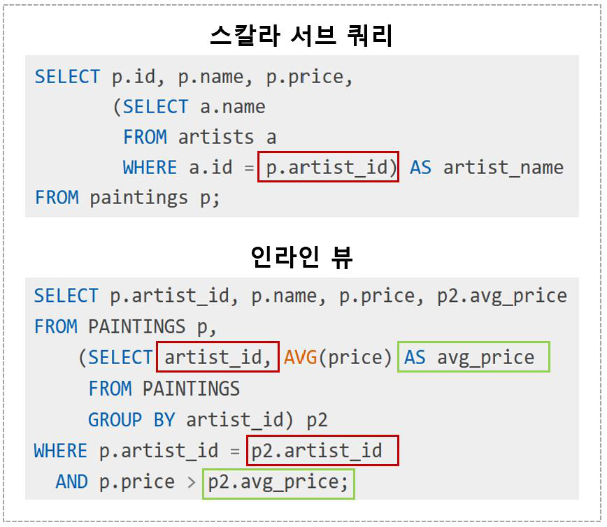

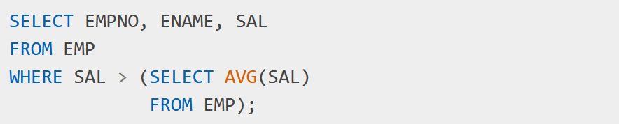

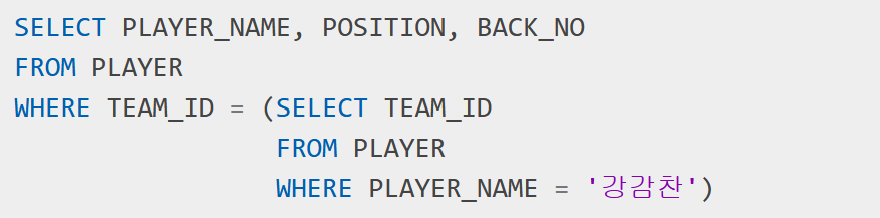

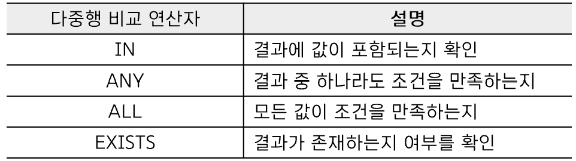

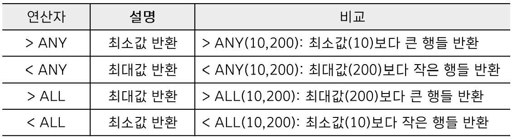

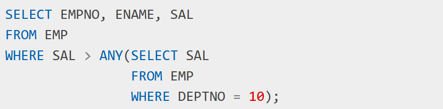

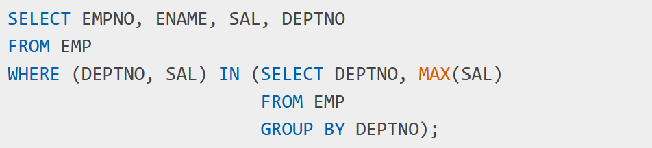

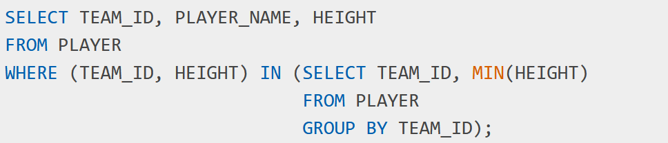

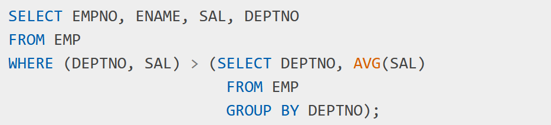

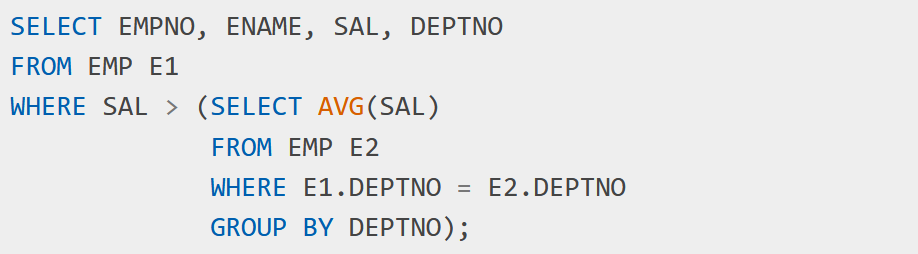

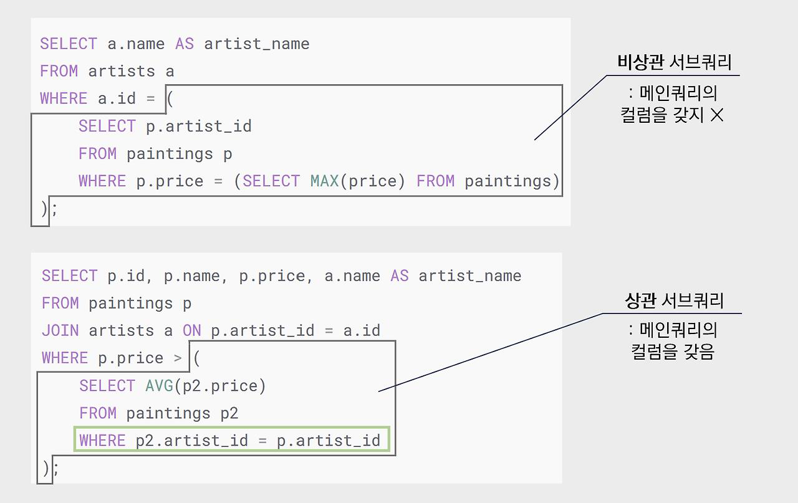

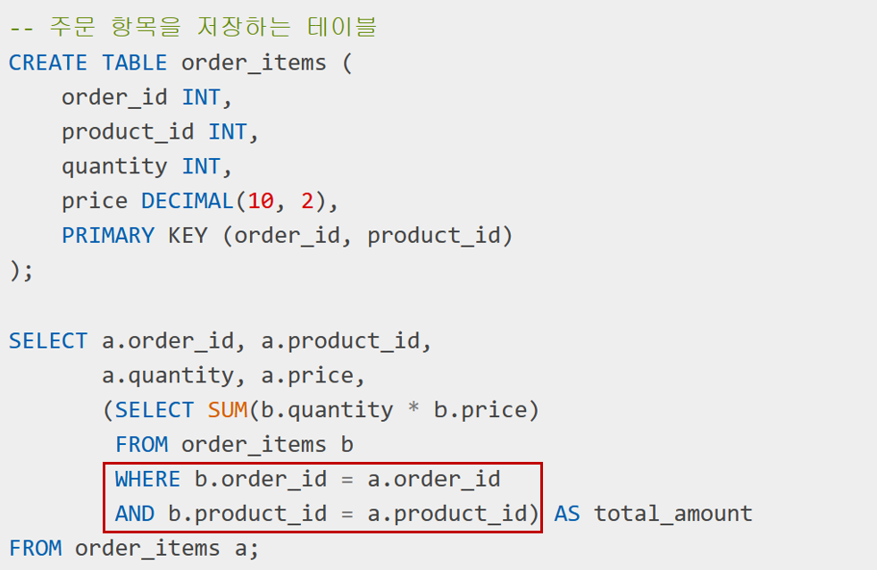

---

### 🧅 [SQLD양파 심화 이론 · 실전 SQL 트레이스 · Before & After · 30초 시험 직전 정리] (2-2-1 서브쿼리)

## [핵심 요약]

> 서브쿼리는 쿼리 안에 들어 있는 또 다른 쿼리다. 메인쿼리가 사용할 값을 미리 계산해 알려주는 보조 쿼리다.

ex) "평균 가격보다 비싼 상품"을 찾을 때, 평균을 먼저 계산(서브쿼리)한 뒤 그 값보다 큰 상품을 찾는(메인쿼리) 두 단계 작업.

---

## [개념 도식화] 서브쿼리의 위치

```sql
SELECT  컬럼들                    ← SELECT 서브쿼리(스칼라)
FROM    (서브쿼리)                 ← FROM 서브쿼리(인라인 뷰)
WHERE   컬럼 = (서브쿼리);         ← WHERE 서브쿼리(대표적)
```

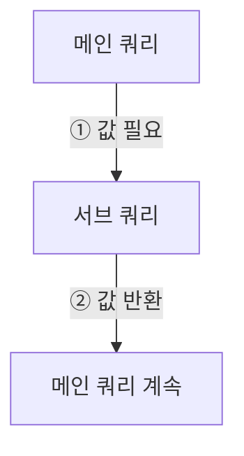

---

## 서브쿼리의 분류

### 결과 행수에 따른 분류

| 종류 | 결과 행수 | 사용 연산자 |
|---|---|---|
| 단일행 서브쿼리 | 1행 | `=`, `>`, `<`, `>=`, `<=`, `<>` |
| 다중행 서브쿼리 | 여러 행 | IN, ANY, ALL, EXISTS |
| 다중컬럼 서브쿼리 | 여러 컬럼 | `(A, B) IN (...)` |

### 위치에 따른 분류

| 위치 | 이름 | 예 |
|---|---|---|
| SELECT 절 | 스칼라 서브쿼리 | `SELECT (SELECT MAX(SAL) FROM EMP) FROM ...` |
| FROM 절 | 인라인 뷰 | `FROM (SELECT ...) X` |
| **WHERE**(`2-1-4`) 절 | 중첩 서브쿼리 | `WHERE SAL > (SELECT AVG(SAL)...)` |

### 메인쿼리와의 관계

| 종류 | 의미 | 특징 |
|---|---|---|
| 비연관 서브쿼리 | 메인쿼리 컬럼 사용 안 함 | 한 번만 실행 |
| 연관 서브쿼리 | 메인쿼리 컬럼 참조 | 메인의 각 행마다 반복 실행 |

---

## [SQL 실전]

### 단일행 서브쿼리

```sql
-- 평균 급여보다 많이 받는 사원
SELECT  NAME, SAL
FROM    EMP
WHERE   SAL > (SELECT AVG(SAL) FROM EMP);
```

서브쿼리 결과가 1행 1값이므로 `>` 같은 단순 연산자 사용 가능

---

### 다중행 서브쿼리 — IN / ANY / ALL

| 연산자 | 의미 |
|---|---|
| IN (...) | 값 중 하나와 같으면 |
| > ANY(...) | 하나 이상보다 크면 → 최솟값보다 크면 됨 |
| > ALL(...) | 모두보다 크면 → 최댓값보다 커야 함 |
| EXISTS (...) | 존재하면 참 |

```sql
-- IN
SELECT  *
FROM    EMP
WHERE   DEPT_ID IN (SELECT DEPT_ID FROM DEPT WHERE LOC = 'SEOUL');

-- > ANY: 어느 한 값보다 크면 → 최솟값보다만 크면 됨
SELECT  *
FROM    EMP
WHERE   SAL > ANY (SELECT SAL FROM EMP WHERE DEPT_ID = 'D1');

-- > ALL: 모든 값보다 커야 함 → 최댓값보다 커야 함
SELECT  *
FROM    EMP
WHERE   SAL > ALL (SELECT SAL FROM EMP WHERE DEPT_ID = 'D1');
```

---

### EXISTS 서브쿼리

```sql
-- 주문 내역이 있는 회원만
SELECT  *
FROM    MEMBER M
WHERE   EXISTS (SELECT 1 FROM ORDERS O WHERE O.MEMBER_ID = M.MEMBER_ID);
```

| 특징 | 설명 |
|---|---|
| 결과가 존재하기만 하면 TRUE | 1건이라도 있으면 통과 |
| IN보다 효율적일 수 있음 | 존재 확인만 하면 됨 |

---

### 스칼라 서브쿼리 (SELECT 절)

```sql
SELECT  E.NAME,
        E.SAL,
        (SELECT AVG(SAL) FROM EMP) AS 전체평균
FROM    EMP E;
```

반드시 1행 1값 반환. 여러 행 반환 시 에러

---

### 인라인 뷰 (FROM 절)

```sql
-- 부서별 평균 중 평균 4000 이상인 부서
SELECT  *
FROM    (SELECT DEPT_ID, AVG(SAL) AS AVG_SAL
         FROM   EMP
         GROUP BY DEPT_ID) X
WHERE   X.AVG_SAL >= 4000;
```

임시 테이블처럼 사용. 별칭 필수

---

### 연관 서브쿼리

```sql
-- 자기 부서 평균보다 많이 받는 사원
SELECT  E.NAME, E.SAL, E.DEPT_ID
FROM    EMP E
WHERE   E.SAL > (SELECT AVG(SAL)
                 FROM   EMP
                 WHERE  DEPT_ID = E.DEPT_ID);   -- E.DEPT_ID는 메인쿼리 참조
```

| 특징 | 설명 |
|---|---|
| 메인쿼리의 각 행마다 서브쿼리 실행 | 행 수만큼 반복 |
| 성능 영향 | 큼. 필요시 **조인**(`2-1-7`)으로 변환 |

---

## [Before & After]

같은 EMP 4명 데이터에 같은 비교(자기보다 평균이 큰 사람)를 적용해도, 비교 기준이 "회사 전체 평균"이냐 "자기 부서 평균"이냐에 따라 결과가 갈린다. 단일행 서브쿼리(전체 평균 1개) vs 연관 서브쿼리(부서별 평균 2개).

### EMP

| NAME | DEPT_ID | SAL |
|---|---|---|
| 김 | D1 | 3000 |
| 이 | D1 | 5000 |
| 박 | D2 | 4000 |
| 최 | D2 | 4500 |

### 단일행 서브쿼리

```sql
SELECT NAME, SAL FROM EMP WHERE SAL > (SELECT AVG(SAL) FROM EMP);
```

전체 평균 = 4125

| NAME | SAL |
|---|---|
| 이 | 5000 |
| 최 | 4500 |

### 연관 서브쿼리

```sql
SELECT NAME, SAL FROM EMP E
WHERE  SAL > (SELECT AVG(SAL) FROM EMP WHERE DEPT_ID = E.DEPT_ID);
```

부서별 평균: D1=4000, D2=4250

| NAME | SAL |
|---|---|
| 이 | 5000 |
| 최 | 4500 |

비연관(단일행) 서브쿼리는 메인쿼리와 무관하게 한 번만 실행되어 4125라는 한 값을 만들고, 모든 행이 그 값과 비교된다. 반면 연관 서브쿼리는 바깥의 E.DEPT_ID를 참조하므로 행마다 평균이 다시 계산된다(D1행은 4000, D2행은 4250 기준). 결과 행 집합이 우연히 같아 보여도 비교 기준은 행마다 다르다. "전체 기준"이면 단일행, "그룹 기준"이면 연관.

---

## [시험 출제 포인트]

| 함정 | 정답 |
|---|---|
| 다중행에 `=` 사용 | 에러 → IN 사용 |
| `> ANY` 의미 | 최솟값보다 크면 통과 |
| `> ALL` 의미 | 최댓값보다 커야 통과 |
| 스칼라 서브쿼리 결과 | 1행 1값 |
| 인라인 뷰의 위치 | FROM 절 |
| EXISTS는 결과를 사용? | 존재 여부만 확인 |
| 연관 서브쿼리 특징 | 메인쿼리 컬럼 참조 |

단골 함정: `SAL > ANY(...)`를 "모두보다 큰"으로 잘못 해석하는 보기. ANY=최소 기준, ALL=최대 기준. 두 SELECT 결과를 합치는 도구는 서브쿼리가 아니라 **집합 연산자**(`2-2-2`)(혼동 주의).

---

> **30초 시험 직전 정리**
> · 행수 분류: **단일행** (`=`,`>`,…) / **다중행** (IN, ANY, ALL, EXISTS) / **다중컬럼**
> · 위치 분류: **스칼라** (SELECT) / **인라인뷰** (FROM) / **중첩** (WHERE)
> · `> ANY` = **최솟값보다 크면** 통과 (헐거움) / `> ALL` = **최댓값보다 커야** 통과 (엄격)
> · EXISTS = 존재 여부만 확인 (1건이라도 있으면 TRUE)
> · 연관 서브쿼리 = 메인쿼리 컬럼 참조, **각 행마다 반복 실행** (성능 주의)
> · 인라인뷰 = **별칭 필수** (FROM 절 서브쿼리)


---

# 2-2-2. 집합 연산자(Set Operators)

> **단원 분류**: `2과목` > `2-2. SQL 활용` > **`2-2-2. 집합 연산자`**

### 📘 [해리누나 2024 개정판 필기 & 원본 도식 완벽 정리] 제2장 제2절. 집합 연산자 (Set Operators) (PDF p.58 ~ p.60)

#### 1. 집합 연산자 4종 (`UNION`, `UNION ALL`, `INTERSECT`, `MINUS`/`EXCEPT`) 완벽 비교 (PDF p.58 ~ p.59)
- **집합 연산자의 정의**: 두 개 이상의 테이블에서 조인을 사용하지 않고 연관된 데이터를 조회하는 방법. 여러 개의 질의의 결과를 연결하여 하나로 결합하는 방식을 사용한다. (**조인(JOIN)이 컬럼(열)을 옆으로 붙이는 수평 결합**이라면, **집합 연산자는 행(Row)을 위아래로 이어 붙이는 수직 결합**이다!)

| 집합 연산자 | 수학적 의미 | 중복 행 제거 여부 | 내부 정렬(SORT) 발생 여부 | 실행 속도 / 성능 |
| :---: | :---: | :---: | :---: | :---: |
| **`UNION`** | **합집합** (`A ∪ B`) | **⭕ 중복 행 제거** (유일한 행만 남김) | **⭕ 정렬 발생** (중복 비교를 위해 내부 소트 수행) | 느림 (부하 큼) |
| **`UNION ALL`** | **합집합 + 교집합 그대로 유지** (`A + B`) | **❌ 중복 제거 안 함!** (단순히 위아래로 이어 붙임) | **❌ 정렬 발생 안 함** | **⚡ 가장 빠름!** |
| **`INTERSECT`** | **교집합** (`A ∩ B`, 양쪽 모두 존재하는 행) | **⭕ 중복 행 제거** | **⭕ 정렬 발생** | 느림 |
| **`MINUS`** *(Oracle)*<br>**`EXCEPT`** *(SQL Server)* | **차집합** (`A - B`, 앞 쿼리 결과에서 뒤 쿼리 결과를 뺌) | **⭕ 중복 행 제거** | **⭕ 정렬 발생** | 느림 |

> 💡 **[핵심 필수 암기]**
> **집합 연산자 사용 시 5대 필수 규칙 (★시험 단골 출제!)**:
> 1. 두 `SELECT` 절의 **컬럼 개수가 같아야** 하고, 대응되는 위치의 **컬럼 데이터 타입이 상호 호환**되어야 한다 (컬럼 이름은 달라도 무방!).
> 2. 결과 테이블의 **컬럼 제목(Header/별칭)은 무조건 첫 번째 `SELECT` 문의 컬럼명(또는 별칭)**을 따라간다!
> 3. **`ORDER BY` 절은 개별 쿼리마다 쓸 수 없고, 전체 집합 연산 쿼리의 맨 마지막 줄에 딱 한 번만** 사용할 수 있다! (이때 `ORDER BY`에는 첫 번째 `SELECT` 절의 컬럼명, 별칭, 또는 순서 번호 `1, 2...`를 사용해야 함!)
> 4. 만약 두 쿼리의 결과가 애초에 서로 겹칠 일이 없는 배타적 조건(예: 쿼리1은 `DEPTNO = 10`, 쿼리2는 `DEPTNO = 20`)이라면, **`UNION`과 `UNION ALL`의 결과 행 집합은 100% 동일**하다! (단, 성능은 정렬을 하지 않는 `UNION ALL`이 훨씬 좋다!)

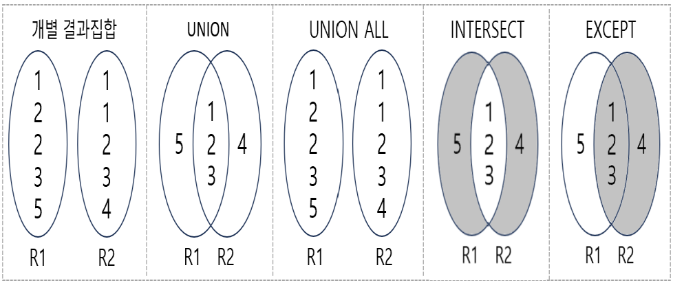


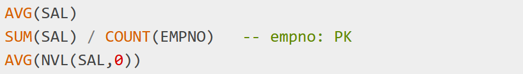

---

### 🧅 [SQLD양파 심화 이론 · 실전 SQL 트레이스 · Before & After · 30초 시험 직전 정리] (2-2-2 집합 연산자)

## [핵심 요약]

> 집합 연산자는 두 개 이상의 SELECT 결과를 합치거나 비교하는 도구다. 합집합(UNION), 교집합(INTERSECT), 차집합(MINUS).

ex) 도시락 A={김밥,사과,우유}와 B={사과,빵,우유} → UNION={김밥,사과,우유,빵}, INTERSECT={사과,우유}, MINUS(A-B)={김밥}.

---

## [개념 도식화]

```
A = { 김, 이, 박 }      B = { 이, 박, 최 }

UNION       (A ∪ B, 중복 제거)  →  { 김, 이, 박, 최 }
UNION ALL   (A + B, 중복 유지)  →  { 김, 이, 박, 이, 박, 최 }
INTERSECT   (A ∩ B, 교집합)     →  { 이, 박 }
MINUS       (A − B, 차집합)     →  { 김 }       (A 에만 있는 것)
```

---

## 4가지 집합 연산자

| 연산자 | 의미 | 중복 처리 |
|---|---|---|
| UNION | 합집합 | 중복 제거 |
| UNION ALL | 합집합 | 중복 유지(가장 빠름) |
| INTERSECT | 교집합 | 중복 제거 |
| MINUS(Oracle) / EXCEPT(표준) | 차집합 | 중복 제거 |

---

## 사용 조건

```
[ 집합 연산자 사용 4조건 ]
  ① 양쪽 SELECT 의 컬럼 개수 동일
  ② 같은 자리 컬럼은 데이터 타입 호환
  ③ 결과의 컬럼명은 첫 SELECT 기준
  ④ ORDER BY 는 맨 마지막에 한 번만
```

| 조건 | 설명 |
|---|---|
| 컬럼 개수 | 두 SELECT의 컬럼 수가 같아야 함 |
| 데이터 타입 | 같은 자리의 컬럼은 호환되는 타입 |
| 컬럼명 | 결과의 컬럼명은 첫 SELECT 기준 |
| ORDER BY | 맨 마지막에 한 번만 |

---

## [SQL 실전]

```sql
-- UNION (중복 제거)
SELECT NAME FROM EMP_A
UNION
SELECT NAME FROM EMP_B;

-- UNION ALL (중복 유지)
SELECT NAME FROM EMP_A
UNION ALL
SELECT NAME FROM EMP_B;

-- INTERSECT (교집합)
SELECT NAME FROM EMP_A
INTERSECT
SELECT NAME FROM EMP_B;

-- MINUS (차집합, A에만 있는 것)
SELECT NAME FROM EMP_A
MINUS
SELECT NAME FROM EMP_B;

-- ORDER BY는 마지막에
SELECT NAME FROM EMP_A
UNION
SELECT NAME FROM EMP_B
ORDER BY NAME;
```

---

## [Before & After]

본사(EMP_A)와 지사(EMP_B) 두 명단을 합치거나 비교. 두 표에 "이"와 "박"이 양쪽 모두 있고, "김"은 A에만, "최"는 B에만 있다. 같은 데이터를 네 가지 집합 연산자(UNION/UNION ALL/INTERSECT/MINUS)에 넣었을 때 결과가 어떻게 갈라지는지.

### EMP_A

| NAME |
|---|
| 김 |
| 이 |
| 박 |

### EMP_B

| NAME |
|---|
| 이 |
| 박 |
| 최 |

### UNION

| NAME |
|---|
| 김 |
| 이 |
| 박 |
| 최 |

(중복 제거, 4행)

### UNION ALL

| NAME |
|---|
| 김 |
| 이 |
| 박 |
| 이 |
| 박 |
| 최 |

(중복 그대로, 6행)

### INTERSECT

| NAME |
|---|
| 이 |
| 박 |

### MINUS

| NAME |
|---|
| 김 |

같은 두 입력에서 4가지 결과가 갈라지는 이유는 "중복을 어떻게 다루느냐"와 "어느 쪽 기준으로 비교하느냐"가 연산마다 다르기 때문이다. UNION은 중복 제거를 위해 정렬을 한 번 더 거치므로 행 수가 줄고, UNION ALL은 그 단계를 건너뛰어 그대로 이어붙인다. INTERSECT는 양쪽 모두에 있는 값만, MINUS는 A에만 있는 값만 남긴다. "합칠 때 중복이 의미가 있는가", "두 집합의 공통 부분만 보고 싶은가", "한쪽에만 있는 것을 추리는가"를 먼저 묻고 연산자를 고를 것.

---

## UNION vs UNION ALL 성능 차이

| 비교 | UNION | UNION ALL |
|---|---|---|
| 중복 제거 | 함 | 안 함 |
| 정렬 작업 | 일어남(중복 제거 위해) | 안 일어남 |
| 성능 | 느림 | 빠름 |
| 권장 | 중복 가능성이 있을 때 | 중복 없거나 그대로 둬도 될 때 |

중복이 절대 없다고 확신하면 UNION ALL로 성능을 높인다. 두 결과를 "행 단위로 이어붙이는" 집합 연산자와 달리 **조인**(`2-1-7`)은 컬럼을 옆으로 붙이고, **서브쿼리**(`2-2-1`)는 메인쿼리에 값 하나를 공급. 역할이 다르다.

---

## 다중 컬럼 집합 연산

```sql
SELECT NAME, DEPT_ID, SAL FROM EMP_A
UNION
SELECT NAME, DEPT_ID, SAL FROM EMP_B;
```

모든 컬럼 값이 일치할 때만 중복으로 간주

---

## NULL과 집합 연산

집합 연산에서 NULL = NULL 로 취급되어 중복 처리(일반 비교 `=` 와 다름)

| EMP_A.COL | EMP_B.COL |
|---|---|
| NULL | NULL |

UNION 시 1행만 남음

---

## [시험 출제 포인트]

| 함정 | 정답 |
|---|---|
| 컬럼 개수가 다르면 | 에러 |
| UNION vs UNION ALL | UNION은 중복 제거, ALL은 그대로 |
| 결과 컬럼명 기준 | 첫 SELECT |
| ORDER BY 위치 | 마지막에 한 번 |
| 정렬 발생 여부 | UNION/INTERSECT/MINUS는 정렬 발생(중복 제거 위해) |
| MINUS는 표준인가 | Oracle 전용. 표준은 EXCEPT |
| NULL의 처리 | NULL = NULL로 간주(중복) |

단골 함정: 컬럼 데이터 타입이 다른데 합치려는 케이스는 에러

---

> **30초 시험 직전 정리**
> · UNION = **중복 제거** (정렬 발생, 느림) / UNION ALL = **중복 유지** (정렬 없음, 빠름)
> · INTERSECT = 교집합 (중복 제거) / MINUS(Oracle) = EXCEPT(표준) = A − B (중복 제거)
> · 사용 조건: **컬럼 개수 동일** + **타입 호환** + 컬럼명은 첫 SELECT
> · ORDER BY = **맨 마지막에 한 번만**
> · NULL 처리 = `NULL = NULL` 로 간주 (중복 제거 대상)
> · 중복 없다고 확신 → **UNION ALL** 로 성능 ↑


---

# 2-2-3. 그룹 함수(Group Functions)

> **단원 분류**: `2과목` > `2-2. SQL 활용` > **`2-2-3. 그룹 함수`**

### 📘 [해리누나 2024 개정판 필기 & 원본 도식 완벽 정리] 제2장 제3절. 그룹 함수 (`ROLLUP`, `CUBE`, `GROUPING SETS`, `GROUPING`) (PDF p.60 ~ p.65)

#### 1. 그룹 함수(소계·합계 산출 함수)의 개요와 3대장 비교 (PDF p.60 ~ p.61)
- 일반 `GROUP BY`만으로는 소그룹별 집계와 전체 합계를 한 번에 구하기 위해 `UNION ALL`로 같은 테이블을 여러 번 읽어야 했다.
- **`ROLLUP`**, **`CUBE`**, **`GROUPING SETS`**를 사용하면 **테이블을 딱 한 번만 읽으면서 원하는 레벨의 소계(Subtotal)와 총계(Grand Total)를 자동으로 생성**해 준다!

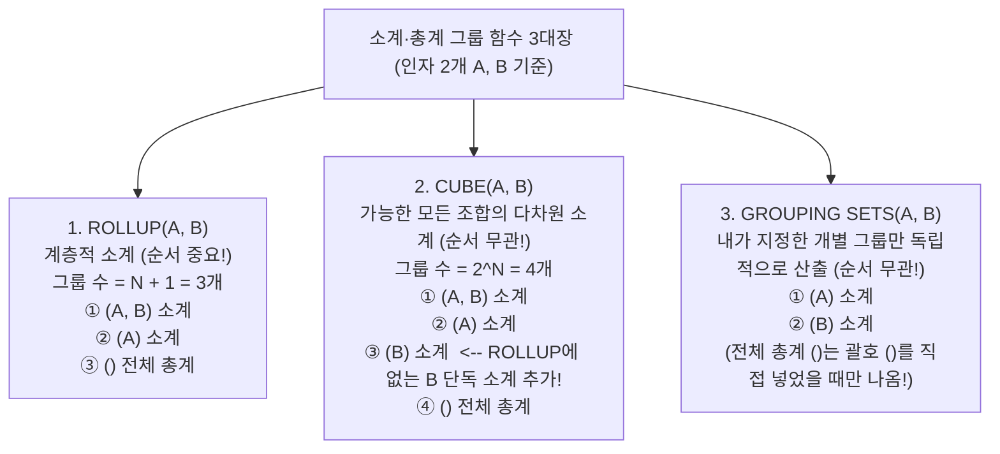

> 💡 **[핵심 필수 암기]**
> **시험에서 가장 많이 나오는 `UNION ALL` 치환 및 동치 관계 공식!**:
> 1. **`GROUP BY ROLLUP(A, B)`** ≡ **`GROUP BY GROUPING SETS((A, B), (A), ())`**
> 2. **`GROUP BY CUBE(A, B)`** ≡ **`GROUP BY GROUPING SETS((A, B), (A), (B), ())`**
> 3. **`GROUP BY A, ROLLUP(B)`** *(부분 ROLLUP)*: `A`는 고정되어 있으므로 **전체 총계 `()`가 나오지 않는다!** ➔ **`(A, B)` 소계 + `(A)` 소계** (총 2가지 그룹만 생성!)
> 4. **`GROUP BY ROLLUP((A, B))`** *(괄호로 묶은 결합 컬럼)*: `(A, B)`를 하나의 덩어리로 취급하므로 중간 단계인 `(A)` 소계가 생략되고 **`(A, B)` 소계 + `()` 전체 총계**만 나온다!

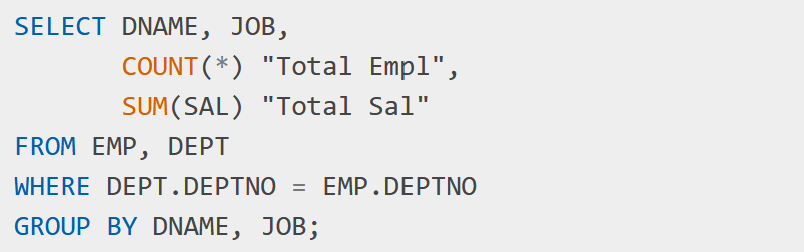

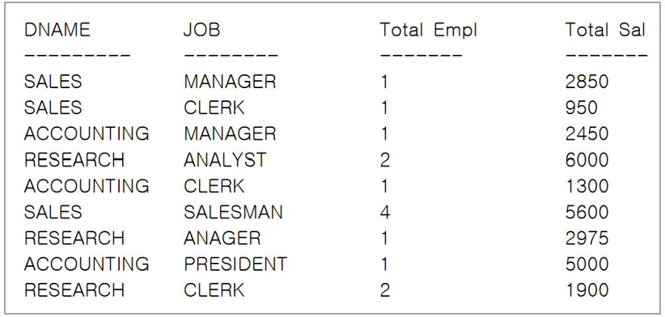

---

#### 2. `ROLLUP` 함수와 **`GROUPING(컬럼)`** 함수 완벽 이해 (PDF p.61 ~ p.63)
- **`ROLLUP(A, B)`의 특징**:
  - 인자의 **순서가 바뀌면 결과도 완전히 달라진다!** (`ROLLUP(A, B)`는 `A`별 소계를 구하지만, `ROLLUP(B, A)`는 `B`별 소계를 구함 — 비대칭적!).
  - `N`개의 인자를 지정하면 총 **`N + 1`개**의 그룹핑 조합이 생성된다.
- **`GROUPING(컬럼)` 함수 (★`1`인지 `0`인지 헷갈리면 틀리는 단골 문제!)**:
  - 소계나 총계 행이 생성될 때, 집계 대상에서 제외되어 묶인 컬럼 자리는 결과 테이블에 **`NULL`**로 표시된다.
  - 이때 이 `NULL`이 **원래 테이블에 들어있던 진짜 `NULL` 데이터(`0`)**인지, 아니면 **소계/총계를 내기 위해 시스템이 만든 가짜 `NULL`(`1`)**인지 구분해주는 함수가 **`GROUPING(컬럼)`**이다!
  - **`GROUPING(컬럼) = 1`**: 해당 컬럼이 소계/총계 계산을 위해 **집계되어 `NULL`로 표시된 행**일 때 **`1`** 반환! (주로 `CASE WHEN GROUPING(DNAME) = 1 THEN '전체합계' ELSE DNAME END` 형태로 소계 이름표를 붙일 때 사용!)
  - **`GROUPING(컬럼) = 0`**: 일반 그룹화 행(실제 데이터 값 또는 원래 데이터의 진짜 `NULL`)일 때 **`0`** 반환!

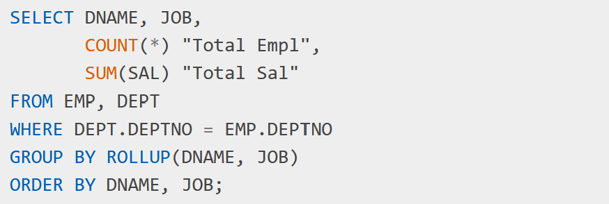

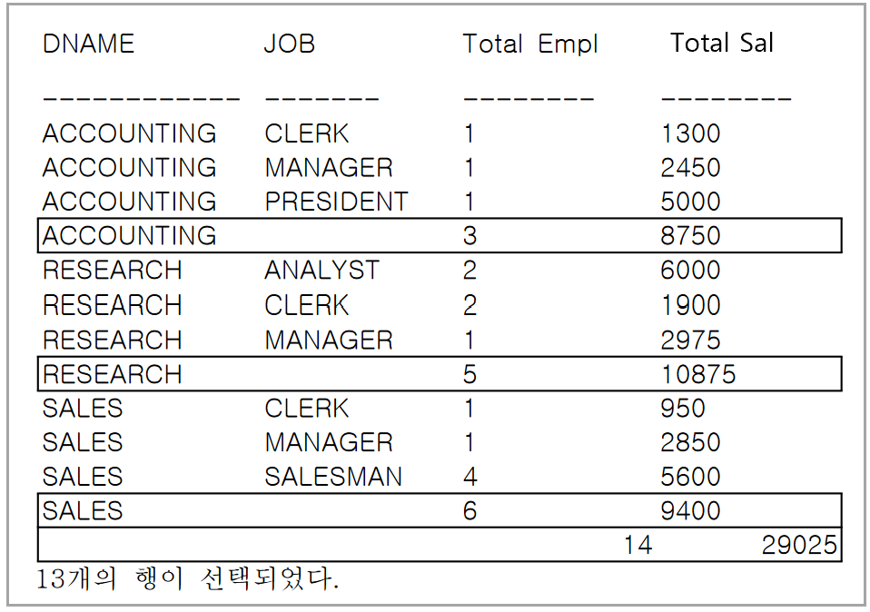

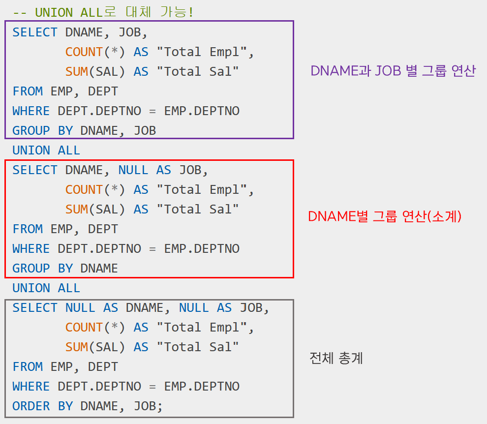

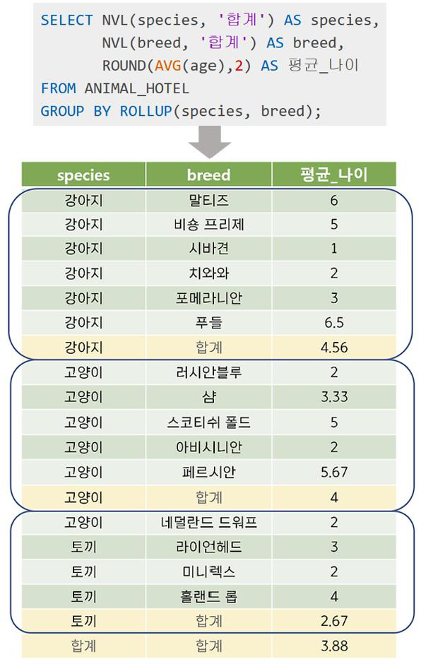

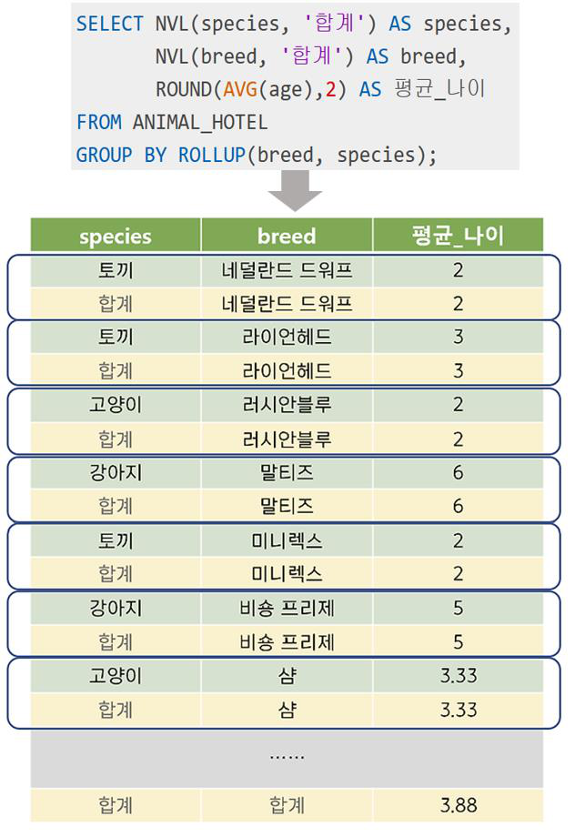

---

#### 3. `CUBE` 함수와 `GROUPING SETS` 함수 상세 분석 (PDF p.63 ~ p.65)
- **`CUBE(A, B)`**:
  - 결합 가능한 **모든 값에 대하여 다차원 집계**를 생성한다 (`N`개 인자 시 **`2^N`개**의 그룹핑 조합 생성).
  - 인자의 순서가 바뀌어도(`CUBE(A, B)` vs `CUBE(B, A)`) 정렬 순서만 다를 뿐 **결과 데이터 건수와 내용은 100% 동일**하다!
- **`GROUPING SETS(인자1, 인자2, ...)`**:
  - 계층 구조와 상관없이 **괄호 안에 나열한 개별 그룹핑 조건들을 각각 독립적으로 `GROUP BY` 한 뒤 `UNION ALL`로 합친 것과 완전히 동일**하다!
  - 인자 순서를 바꿔도 결과는 동일하며, 전체 총계를 함께 보고 싶다면 인자 안에 빈 괄호 **`()`**(또는 `NULL`)를 명시적으로 추가하면 된다: `GROUPING SETS(DNAME, JOB, ())`.

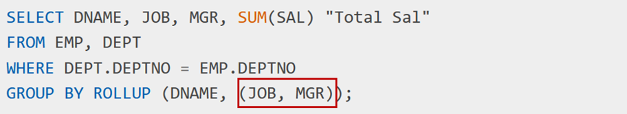

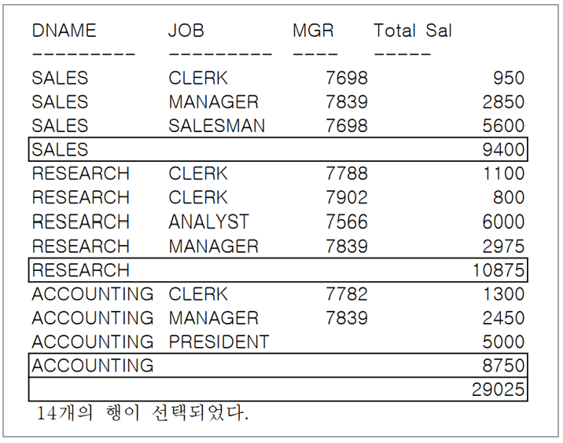

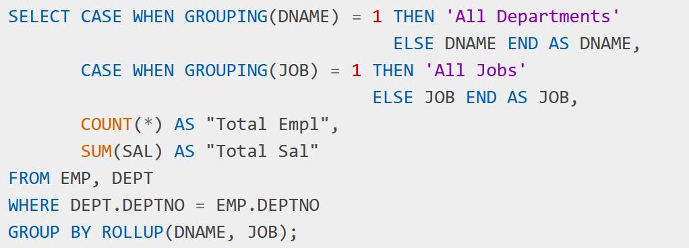

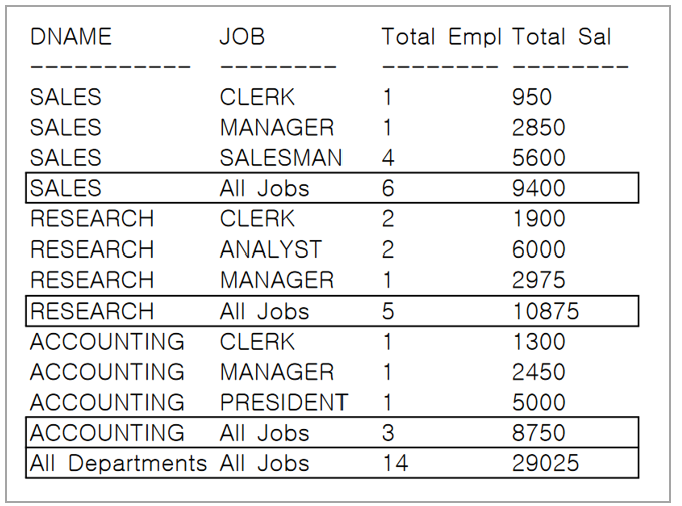

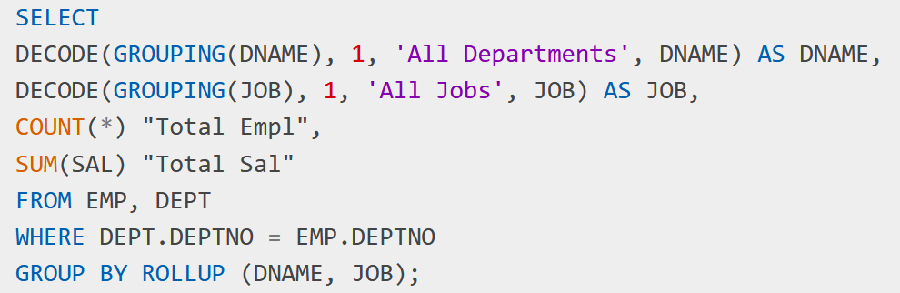

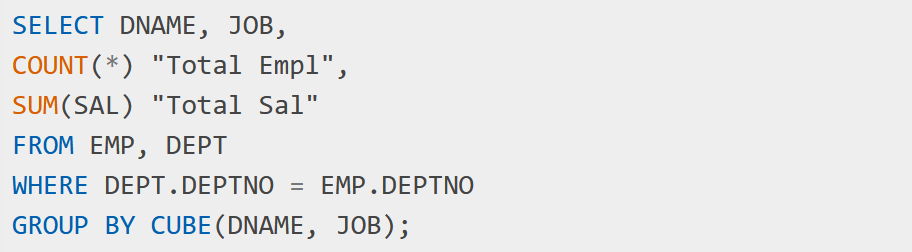

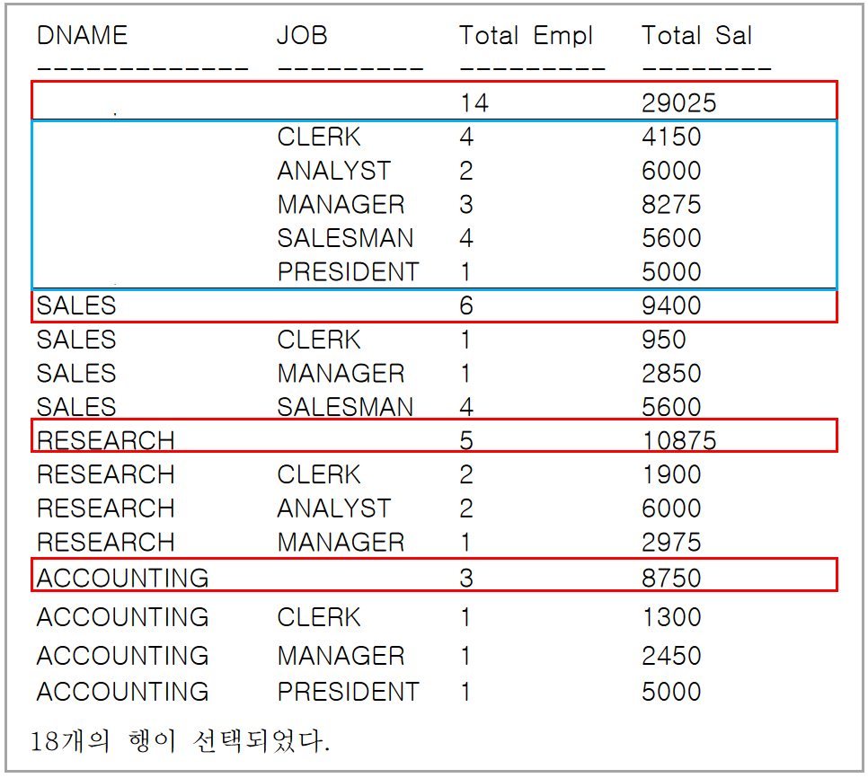

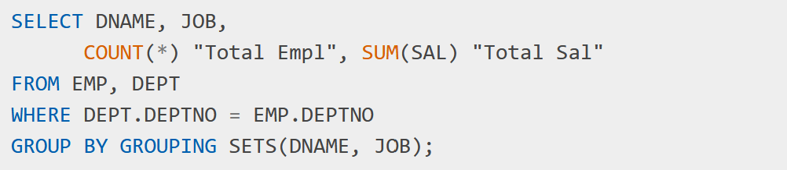

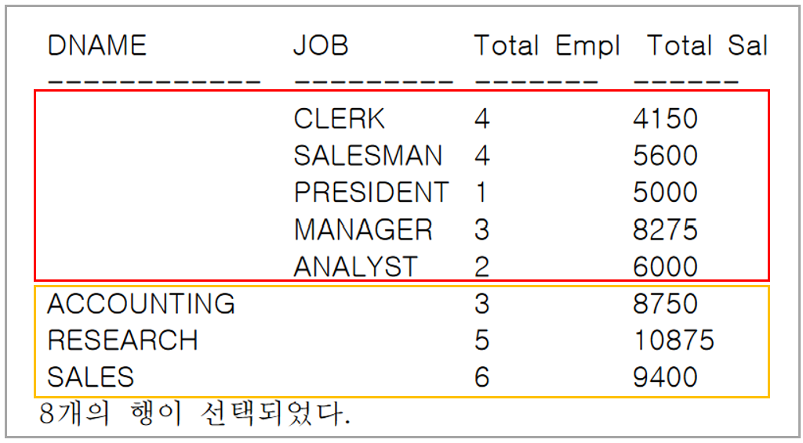

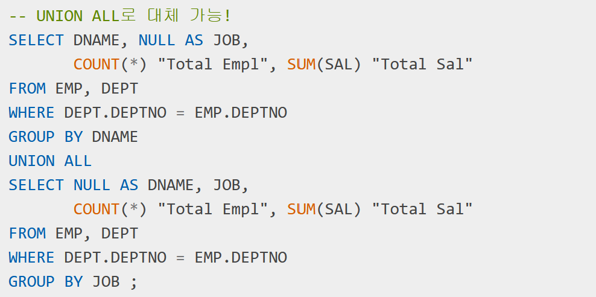

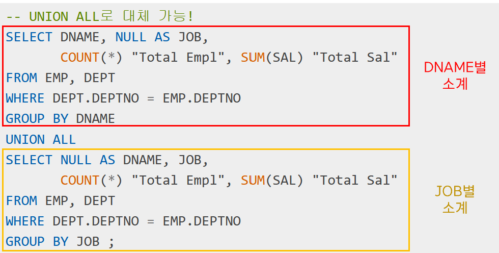

---

### 🧅 [SQLD양파 심화 이론 · 실전 SQL 트레이스 · Before & After · 30초 시험 직전 정리] (2-2-3 그룹 함수)

## [핵심 요약]

> 그룹 함수는 다양한 단위의 소계와 합계를 한 쿼리로 한꺼번에 뽑아주는 확장 **GROUP BY**(`2-1-5`) 도구다(ROLLUP, CUBE, GROUPING SETS).

ex) 매장 매출 보고서에서 "부서별 / 부서+상품별 / 전체 합계"를 따로따로 SELECT하지 않고 한 번에 뽑는 도구.

---

## [개념 도식화] 그룹 함수의 종류

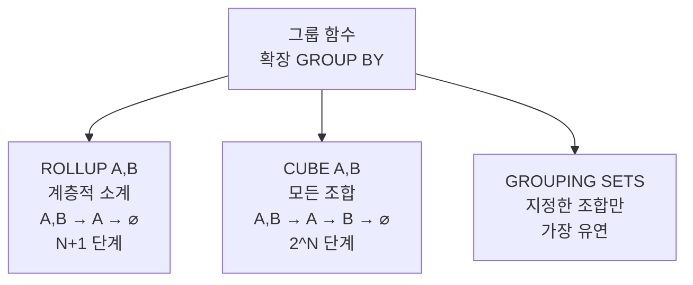

| 함수 | 의미 | 비유 |
|---|---|---|
| ROLLUP(A, B) | A별, A+B별, 전체 합계 | 단계적 소계 |
| CUBE(A, B) | 모든 조합(A별, B별, A+B별, 전체) | 큐브의 모든 면 |
| GROUPING SETS((A), (B)) | 특정 조합만 | 골라서 보기 |

---

## [SQL 실전]

### ROLLUP — 계층적 소계

```sql
SELECT  DEPT_ID, JOB, SUM(SAL)
FROM    EMP
GROUP BY ROLLUP(DEPT_ID, JOB);
```

### 결과 — 4단계(부서+직무, 부서, 전체)

| DEPT_ID | JOB | SUM(SAL) |
|---|---|---|
| D1 | MGR | 5000 |
| D1 | CLERK | 2000 |
| D1 | NULL | 7000 (D1 소계) |
| D2 | MGR | 4500 |
| D2 | NULL | 4500 (D2 소계) |
| NULL | NULL | 11500 (전체 합계) |

ROLLUP(A, B): A → A+B 로 갈수록 세분화, 위로 갈수록 소계

---

### CUBE — 모든 조합

```sql
SELECT  DEPT_ID, JOB, SUM(SAL)
FROM    EMP
GROUP BY CUBE(DEPT_ID, JOB);
```

### 결과 — ROLLUP 결과 + JOB별 합계까지

| DEPT_ID | JOB | SUM(SAL) |
|---|---|---|
| D1 | MGR | 5000 |
| D1 | CLERK | 2000 |
| D1 | NULL | 7000 |
| D2 | MGR | 4500 |
| D2 | NULL | 4500 |
| NULL | MGR | 9500 (MGR 합계, CUBE만 추가) |
| NULL | CLERK | 2000 (CLERK 합계) |
| NULL | NULL | 11500 |

N 개 컬럼 CUBE = 2^N 가지 조합

---

### GROUPING SETS — 골라 보기

```sql
SELECT  DEPT_ID, JOB, SUM(SAL)
FROM    EMP
GROUP BY GROUPING SETS((DEPT_ID), (JOB), ());
```

### 결과 — 부서별, 직무별, 전체

| DEPT_ID | JOB | SUM(SAL) |
|---|---|---|
| D1 | NULL | 7000 |
| D2 | NULL | 4500 |
| NULL | MGR | 9500 |
| NULL | CLERK | 2000 |
| NULL | NULL | 11500 |

---

## 정리표

| 함수 | 결과 |
|---|---|
| GROUP BY (A, B) | A, B 조합 |
| GROUP BY ROLLUP(A, B) | (A, B), (A), () |
| GROUP BY CUBE(A, B) | (A, B), (A), (B), () |
| GROUP BY GROUPING SETS((A, B), (A)) | 지정한 조합만 |

---

### GROUPING 함수 — 소계 행 구분

결과에 NULL이 보일 때, 원래 NULL 인지 소계로 인한 NULL 인지 구분하는 함수

| 결과 | 의미 |
|---|---|
| GROUPING(컬럼) = 0 | 일반 행(실제 그룹) |
| GROUPING(컬럼) = 1 | 소계 행 |

```sql
SELECT  DEPT_ID, JOB, SUM(SAL),
        GROUPING(DEPT_ID) AS G_DEPT,
        GROUPING(JOB)     AS G_JOB
FROM    EMP
GROUP BY ROLLUP(DEPT_ID, JOB);
```

| DEPT_ID | JOB | SUM | G_DEPT | G_JOB |
|---|---|---|---|---|
| D1 | MGR | 5000 | 0 | 0 |
| D1 | NULL | 7000 | 0 | 1 (소계) |
| NULL | NULL | 11500 | 1 | 1 (전체 합계) |

---

## [Before & After] ROLLUP vs CUBE 비교

EMP 3행(D1·D2 부서, A·B 직무)을 부서/직무로 집계. 같은 데이터를 일반 GROUP BY, ROLLUP, CUBE에 차례로 넣어 어디까지 소계가 추가되는지 비교. 핵심은 "부서 소계만 필요한가, 직무 소계까지 필요한가".

### EMP

| DEPT_ID | JOB | SAL |
|---|---|---|
| D1 | A | 1000 |
| D1 | B | 2000 |
| D2 | A | 3000 |

### `GROUP BY (DEPT, JOB)` — 기본

| D | J | SUM |
|---|---|---|
| D1 | A | 1000 |
| D1 | B | 2000 |
| D2 | A | 3000 |

### `ROLLUP(DEPT, JOB)`

| D | J | SUM |
|---|---|---|
| D1 | A | 1000 |
| D1 | B | 2000 |
| D1 | NULL | 3000 |
| D2 | A | 3000 |
| D2 | NULL | 3000 |
| NULL | NULL | 6000 |

### `CUBE(DEPT, JOB)` 추가 행

| NULL | A | 4000 |
| NULL | B | 2000 |

기본 GROUP BY는 (DEPT, JOB) 조합 1단계만, ROLLUP(DEPT, JOB)은 (DEPT, JOB) → (DEPT) → ()로 왼쪽부터 한 칸씩 떼어내며 소계를 쌓는다(N+1단계). CUBE(DEPT, JOB)는 거기에 더해 (JOB) 단독 소계까지 만들어 모든 조합 2^N단계를 채운다. 부서 단위 소계만 필요하면 ROLLUP으로 충분하지만, 직무별 가로 합계까지 한 번에 보고 싶다면 CUBE가 정답. 특정 조합만 골라 뽑고 싶다면 GROUPING SETS.

---

## [시험 출제 포인트]

| 함정 | 정답 |
|---|---|
| ROLLUP(A, B) 결과 단계 | (A, B), (A), () |
| CUBE(A, B) 결과 단계 | (A, B), (A), (B), () |
| 그룹함수에서 NULL 행의 의미 | 소계 행 또는 원래 NULL |
| GROUPING 함수 결과가 1이면 | 소계 행 |
| CUBE의 조합 수 | 2^N (N=컬럼수) |
| 소계 NULL과 데이터 NULL 구분 | GROUPING 함수 사용 |

단골 함정: ROLLUP(A, B, C) 의 단계 수는 N+1 = 4단계, CUBE 는 2^N = 8단계. 행을 합치는 그룹 함수와 달리, 행을 그대로 두고 옆에 통계를 붙이는 도구는 **윈도우 함수**(`2-2-4`), 행을 컬럼으로 펼치는 도구는 **PIVOT**(`2-2-7`).

---

> **30초 시험 직전 정리**
> · ROLLUP(A, B) = (A,B) → (A) → () — **N+1 단계** (계층적 소계)
> · CUBE(A, B) = (A,B) → (A) → (B) → () — **2^N 단계** (모든 조합)
> · GROUPING SETS = 원하는 조합만 골라 (유연)
> · GROUPING(컬럼) = **1 이면 소계 행** / 0 이면 일반 행
> · 결과의 NULL 이 데이터인지 소계인지 → **GROUPING 함수로 구분**
> · "ROLLUP 시작 위치만 다름" 함정 — `ROLLUP(A,B)` ≠ `ROLLUP(B,A)` (단계 다름)


---

# 2-2-4. 윈도우 함수(Window Function)

> **단원 분류**: `2과목` > `2-2. SQL 활용` > **`2-2-4. 윈도우 함수`**

### 📘 [해리누나 2024 개정판 필기 & 원본 도식 완벽 정리] 제2장 제4절. 윈도우 함수 (Window Functions) (PDF p.65 ~ p.70, p.73 ~ p.74)

#### 1. 윈도우 함수(분석 함수, Analytic Function)의 개념과 기본 문법 구조 (PDF p.65 ~ p.66)
- **윈도우 함수의 핵심 특징**:
  - 일반 `GROUP BY` 집계 함수는 여러 행을 하나로 합쳐서 **전체 행의 개수가 줄어들지만**,
  - **윈도우 함수(`OVER(...)`)는 원래 테이블의 개별 행(Row)들을 그대로 유지하면서(행 수가 줄어들지 않음!)** 각 행 옆에 그룹별 순위, 합계, 평균, 누적값, 이전/다음 행 값 등을 함께 보여준다!
  - ⚠️ **주의**: 윈도우 함수는 다른 윈도우 함수 안에 **중첩해서 사용할 수 없으며**(`SUM(RANK() OVER(...)) OVER(...)` ➔ 에러!), 서브쿼리에서도 사용 가능하지만 `WHERE`, `GROUP BY`, `HAVING` 절에는 쓸 수 없고 **`SELECT` 절과 `ORDER BY` 절에서만 사용 가능**하다!

```sql
SELECT 윈도우함수(인자) OVER (
           [PARTITION BY 칼럼]                 -- 1. 소그룹 분할 기준 (생략 시 전체 행이 하나의 파티션)
           [ORDER BY 칼럼 ASC|DESC]            -- 2. 파티션 내 정렬 기준
           [ROWS | RANGE BETWEEN A AND B]      -- 3. 연산 범위(Windowing Frame) 지정
       )
  FROM 테이블명;
```

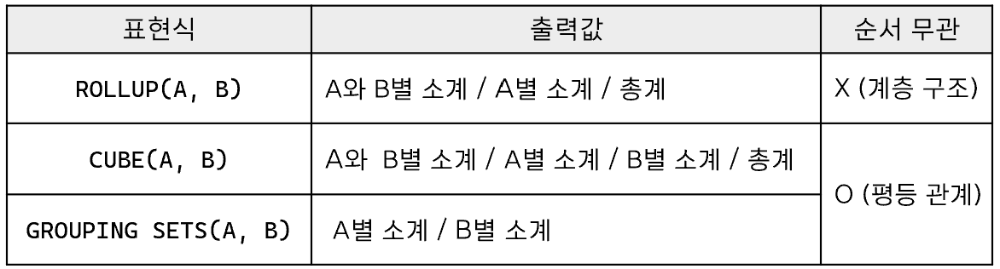

---

#### 2. 윈도우 프레임(Windowing 절): `ROWS` vs `RANGE`의 결정적 차이 (★킬러 문항!) (PDF p.66 ~ p.68)

> 💡 **[핵심 필수 암기]**
> **윈도우 프레임 지정 키워드 의미**:
> - **`UNBOUNDED PRECEDING`**: 파티션의 **맨 첫 번째 행(시작점)**부터
> - **`n PRECEDING`**: 현재 행 기준 **`n`건 앞(위)의 행**(또는 값 차이가 `n` 이하인 범위)부터
> - **`CURRENT ROW`**: **현재 행**까지
> - **`n FOLLOWING`**: 현재 행 기준 **`n`건 뒤(아래)의 행**(또는 값 차이가 `n` 이하인 범위)까지
> - **`UNBOUNDED FOLLOWING`**: 파티션의 **맨 마지막 행(끝점)**까지
>
> **🔥 시험에 무조건 나오는 3가지 핵심 암기 규칙!**:
> 1. **`OVER()` 안에 `ORDER BY`를 생략했을 때**: 파티션 **전체 행**(`UNBOUNDED PRECEDING AND UNBOUNDED FOLLOWING`)의 총합/평균을 구한다!
> 2. **`OVER()` 안에 `ORDER BY`를 쓰는 순간! (프레임 절 생략 시 기본값)**:
>    - 자동으로 기본 프레임인 **`RANGE BETWEEN UNBOUNDED PRECEDING AND CURRENT ROW` (첫 행부터 현재 행까지의 누적값!)**가 적용된다!
> 3. **동점자(같은 값)가 있을 때 `ROWS` vs `RANGE`의 차이**:
>    - **`ROWS` (물리적 행 단위)**: 값이 같든 다르든 **무조건 한 줄씩 물리적인 행 순서대로** 따로따로 누적한다! (예: 급여가 `1000, 1000`인 두 사원이 있으면 첫 번째는 `1000`, 두 번째는 `2000`이 됨)
>    - **`RANGE` (논리적 값 범위 단위, 기본값!)**: `ORDER BY` 기준 컬럼의 **값이 같으면(동점자이면) 같은 범위로 묶어서 한꺼번에 합산**한다! (예: 급여가 `1000, 1000`인 두 사원이 있으면 **첫 번째 사원 행에서도 이미 두 명을 합친 `2000`이 찍히고, 두 번째 사원 행에서도 `2000`**이 찍힌다!)

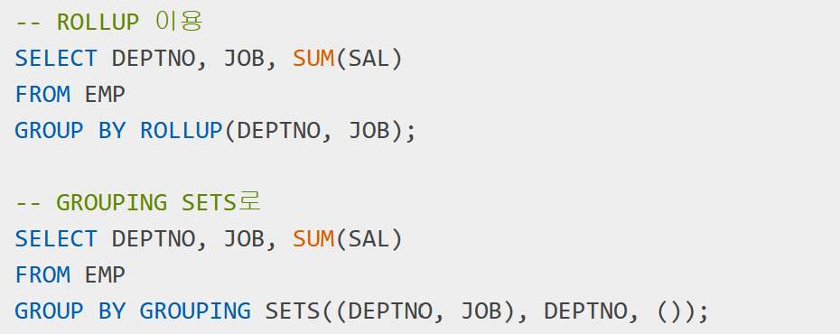

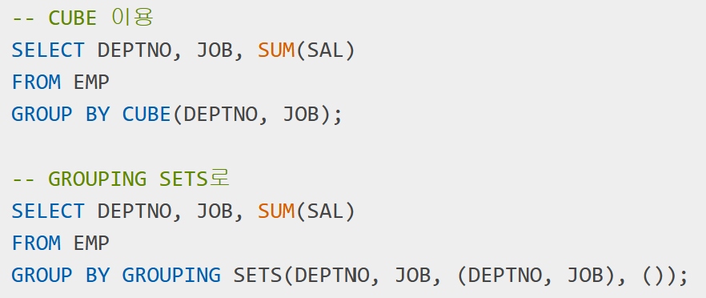

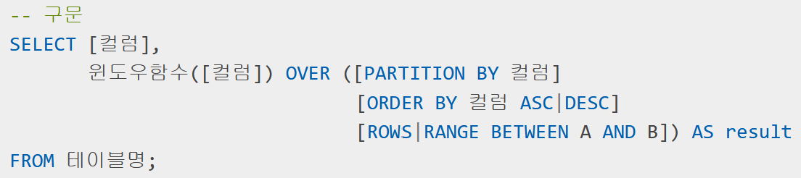


---

#### 3. 그룹 내 순위 함수 3대장 (`RANK`, `DENSE_RANK`, `ROW_NUMBER`) (PDF p.68 ~ p.69)

| 순위 함수 | 동점자(같은 값) 처리 방식 | 동점자 다음 순위 | 예시 (`SAL`이 `5000, 3000, 3000, 2000`일 때) |
| :--- | :---: | :---: | :---: |
| **`RANK() OVER(ORDER BY ...)`** | 동점자에게 **같은 순위** 부여 | 동점자 수만큼 **건너뛰고** 다음 순위 부여 (올림픽 방식) | **`1등 ➔ 2등 ➔ 2등 ➔ 4등`** (`3등` 없음!) |
| **`DENSE_RANK() OVER(ORDER BY ...)`** | 동점자에게 **같은 순위** 부여 | 건너뛰지 않고 **바로 다음 순위(+1)** 부여 (빽빽한 순위) | **`1등 ➔ 2등 ➔ 2등 ➔ 3등`** |
| **`ROW_NUMBER() OVER(ORDER BY ...)`** | 동점자여도 **무조건 서로 다른 고유 순번** 부여 | 순서대로 1씩 증가 | **`1등 ➔ 2등 ➔ 3등 ➔ 4등`** |

- *(참고: 일반 집계형 함수인 **`RANK(특정값) WITHIN GROUP (ORDER BY 컬럼)`**은 전체 행 중에서 해당 `특정값`이 몇 등인지를 숫자 하나로 반환한다!)*


---

#### 4. 그룹 내 행 순서 함수 (`FIRST_VALUE`, `LAST_VALUE`, `LAG`, `LEAD`) (PDF p.70, p.73)

| 행 순서 함수 | 의미 및 문법 | 시험 핵심 포인트 및 주의사항 |
| :--- | :--- | :--- |
| **`FIRST_VALUE(컬럼) OVER(...)`** | 파티션(윈도우) 내에서 **가장 첫 번째 행의 값**을 반환 | `MIN`/`MAX`와 달리 정렬 기준 컬럼이 아닌 다른 컬럼(예: 급여 1등의 `사원이름`)을 바로 가져올 수 있음! (동점자 시 공동 처리가 안 되므로 2차 정렬 기준 지정 권장) |
| **`LAST_VALUE(컬럼) OVER(...)`** | 파티션(윈도우) 내에서 **가장 마지막 행의 값**을 반환 | ⚠️ **초특급 함정**: `OVER(ORDER BY SAL)`만 쓰면 기본 프레임이 `UNBOUNDED PRECEDING AND CURRENT ROW`(현재 행까지!)이므로 **`LAST_VALUE`를 써도 파티션 끝값이 아니라 '자기 자신(현재 행)'의 값이 나온다!** 진짜 파티션 마지막 행 값을 얻으려면 반드시 **`ROWS BETWEEN UNBOUNDED PRECEDING AND UNBOUNDED FOLLOWING`**을 명시해야 한다! |
| **`LAG(컬럼 [, n, 기본값]) OVER(ORDER BY ...)`** | 현재 행보다 **`n`칸 이전(위쪽) 행의 값**을 가져옴 | `n` 생략 시 기본값은 **`1`** (바로 이전 행). 이전 행이 없을 때(첫 번째 행) `기본값` 생략 시 **`NULL`** 반환, `기본값` 지정 시 해당 값 반환 (`NVL` 효과 내장!). |
| **`LEAD(컬럼 [, n, 기본값]) OVER(ORDER BY ...)`** | 현재 행보다 **`n`칸 이후(아래쪽) 행의 값**을 가져옴 | `n` 생략 시 기본값은 **`1`** (바로 다음 행). 다음 행이 없을 때(마지막 행) `기본값` 생략 시 **`NULL`** 반환. |

---

#### 5. 그룹 내 비율 함수 (`RATIO_TO_REPORT`, `PERCENT_RANK`, `CUME_DIST`, `NTILE`) (PDF p.70, p.73 ~ p.74)

> 💡 **[핵심 필수 암기]**
> **비율 함수 4대장 계산 공식 완벽 암기! (소수점 값 직접 계산 문제 빈출!)**

| 비율 함수 | 의미 | 정확한 수학적 계산 공식 | 값의 범위 |
| :--- | :--- | :--- | :---: |
| **`RATIO_TO_REPORT(컬럼) OVER(...)`** | 파티션 내 `컬럼` 전체 합계 중에서 현재 행의 값이 차지하는 **비율(점유율)** *(주의: `OVER()` 안에 `ORDER BY` 사용 불가!)* | $$rac{	ext{현재 행의 값}}{	ext{파티션 전체 합계 (SUM)}}$$ | $0 < 	ext{값} \le 1$<br>(전체 합 = `1`) |
| **`PERCENT_RANK() OVER(ORDER BY ...)`** | 파티션 내 첫 번째 행을 **`0`**, 마지막 행을 **`1`**로 놓고 구간(간격) 기준으로 계산한 **백분위 순위** | $$rac{	ext{현재 행의 RANK 순위} - 1}{	ext{파티션 전체 행 수} - 1}$$<br>*(단, 파티션 행이 1건뿐이면 `0`)* | **`0` 이상 `1` 이하**<br>($0 \le 	ext{값} \le 1$,<br>첫 행은 무조건 **`0`**!) |
| **`CUME_DIST() OVER(ORDER BY ...)`** | 파티션 전체 건수 중에서 현재 행의 값보다 **작거나 같은(동점자 포함!) 건수의 누적 백분율** | $$rac{	ext{현재 행 이하(동점 포함)의 누적 행 수}}{	ext{파티션 전체 행 수}}$$ | **`0` 초과 `1` 이하**<br>($0 < 	ext{값} \le 1$,<br>마지막 행은 무조건 **`1`**!) |
| **`NTILE(n) OVER(ORDER BY ...)`** | 파티션 전체 행을 `n`개의 조(버킷, Bucket)로 등분하여 각 행에 `1`부터 `n`까지의 조 번호 부여 | **⚠️ 남는 행(나머지) 배분 규칙**: 전체 10건을 `NTILE(4)`로 나누면 몫이 `2`이고 나머지가 `2`이다. 이때 **나머지 2건은 무조건 `1`번 조부터 순서대로 1건씩 추가로 더 배정**한다! ➔ 결과 조별 인원수: **1조(3명), 2조(3명), 3조(2명), 4조(2명)**! | `1` ~ `n` 정수 |


---

### 🧅 [SQLD양파 심화 이론 · 실전 SQL 트레이스 · Before & After · 30초 시험 직전 정리] (2-2-4 윈도우 함수)

## [핵심 요약]

> 윈도우 함수는 행을 합치지 않으면서, 행마다 **그룹**(`2-2-3`)별 통계나 순위를 옆에 붙여주는 함수다(분석 함수라고도 한다).

ex) 학생 명단을 GROUP BY로 묶으면 학년 평균만 남아 개별 정보가 사라지지만, 윈도우 함수는 학생 행은 그대로 두고 옆에 학년 평균/등수를 추가한다.

---

## [개념 도식화] 일반 집계 vs 윈도우 함수

| 일반 집계 (GROUP BY) | 윈도우 함수 (OVER) |
|---|---|
| 행이 그룹별로 **합쳐짐** | 행은 **그대로 유지** + 옆에 분석값 |
| 결과 1행 | 결과 N행 (원본과 같음) |
| AVG = 4000 | NAME · SAL · RANK · AVG 모두 보임 |

윈도우 함수 결과 예시 (`AVG(SAL) OVER ()` + `RANK()`):

| NAME | SAL | RANK | AVG |
|---|---|---|---|
| 김 | 3000 | 3 | 4000 |
| 이 | 5000 | 1 | 4000 |
| 박 | 4000 | 2 | 4000 |

```
[원본 행]  ──OVER 절로 윈도우 정의──→  [행 그대로 유지 + 옆에 분석값 추가]
```

---

## 기본 문법

```sql
함수명(컬럼) OVER (
    PARTITION BY 그룹기준        -- 어떻게 묶을지
    ORDER BY 정렬기준              -- 어떻게 정렬할지
    ROWS BETWEEN ... AND ...       -- 어디부터 어디까지(윈도우)
)
```

| 구성 | 의미 |
|---|---|
| PARTITION BY | 그룹 기준(생략 시 전체) |
| **ORDER BY**(`2-1-6`) | 그룹 내 정렬 |
| ROWS/RANGE | 윈도우 프레임 범위 |

---

## 윈도우 함수의 분류


## [SQL 실전]

### 순위 함수

| 함수 | 동점 처리 | 다음 순위 |
|---|---|---|
| RANK() | 같은 등수 | 건너뜀 (1, 1, 3) |
| DENSE_RANK() | 같은 등수 | 연속 (1, 1, 2) |
| ROW_NUMBER() | 무조건 다른 등수 | (1, 2, 3) |

```sql
SELECT  NAME, SAL,
        RANK()       OVER (ORDER BY SAL DESC) AS R,
        DENSE_RANK() OVER (ORDER BY SAL DESC) AS DR,
        ROW_NUMBER() OVER (ORDER BY SAL DESC) AS RN
FROM    EMP;
```

| NAME | SAL | R | DR | RN |
|---|---|---|---|---|
| 이 | 5000 | 1 | 1 | 1 |
| 박 | 5000 | 1 | 1 | 2 |
| 최 | 4500 | 3 | 2 | 3 |
| 김 | 3000 | 4 | 3 | 4 |

---

### 집계 윈도우 함수

| 함수 | 의미 |
|---|---|
| SUM/AVG/MAX/MIN/COUNT | 행 옆에 그룹 통계 |

```sql
-- 부서별 평균 급여를 옆에 붙임
SELECT  NAME, DEPT_ID, SAL,
        AVG(SAL) OVER (PARTITION BY DEPT_ID) AS DEPT_AVG
FROM    EMP;
```

| NAME | DEPT_ID | SAL | DEPT_AVG |
|---|---|---|---|
| 김 | D1 | 3000 | 4000 |
| 이 | D1 | 5000 | 4000 |
| 박 | D2 | 4000 | 4000 |
| 최 | D2 | 4000 | 4000 |

---

### 행 순서 함수

| 함수 | 의미 |
|---|---|
| LAG(col, n) | n행 전 값(앞 행) |
| LEAD(col, n) | n행 후 값(뒷 행) |
| FIRST_VALUE(col) | 윈도우의 첫 값 |
| LAST_VALUE(col) | 윈도우의 마지막 값 |

```sql
SELECT  NAME, HIRE_DATE,
        LAG(NAME)  OVER (ORDER BY HIRE_DATE) AS PREV_EMP,
        LEAD(NAME) OVER (ORDER BY HIRE_DATE) AS NEXT_EMP
FROM    EMP;
```

---

### 비율 함수

| 함수 | 의미 |
|---|---|
| CUME_DIST() | 누적 비율 |
| PERCENT_RANK() | 백분위 순위 |
| NTILE(N) | N등분 그룹 |
| RATIO_TO_REPORT(col) | 전체 합 대비 비율(Oracle) |

```sql
-- 4등분으로 나눠서 그룹 번호 부여
SELECT NAME, SAL, NTILE(4) OVER (ORDER BY SAL DESC) AS QUARTILE FROM EMP;
```

---

### 윈도우 프레임 — ROWS / RANGE

```sql
ROWS BETWEEN UNBOUNDED PRECEDING AND CURRENT ROW   -- 처음~현재
ROWS BETWEEN 1 PRECEDING AND 1 FOLLOWING           -- 앞1, 자신, 뒤1
RANGE BETWEEN UNBOUNDED PRECEDING AND UNBOUNDED FOLLOWING  -- 전체
```

| 키워드 | 의미 |
|---|---|
| UNBOUNDED PRECEDING | 그룹의 처음부터 |
| n PRECEDING | 앞 n번째부터 |
| CURRENT ROW | 현재 행 |
| n FOLLOWING | 뒤 n번째까지 |
| UNBOUNDED FOLLOWING | 그룹의 끝까지 |

```sql
-- 누적 합(running total)
SELECT  NAME, HIRE_DATE, SAL,
        SUM(SAL) OVER (ORDER BY HIRE_DATE
                       ROWS BETWEEN UNBOUNDED PRECEDING AND CURRENT ROW) AS RUN_TOT
FROM    EMP;
```

---

## [Before & After]

D1·D2 두 부서 4명에 대해 "부서 안에서의 등수"와 "부서 평균"을 동시에 한 표에 보여줘야 하는 상황. GROUP BY로 묶으면 4행이 2행으로 줄어 개별 이름이 사라지지만, 윈도우 함수는 4행을 그대로 유지하면서 옆에 부서별 RANK와 부서 AVG를 붙인다. D2의 박·최가 4500으로 동률일 때 RANK가 어떻게 매겨지는지도 함께.

### EMP

| NAME | DEPT_ID | SAL |
|---|---|---|
| 김 | D1 | 3000 |
| 이 | D1 | 5000 |
| 박 | D2 | 4500 |
| 최 | D2 | 4500 |

### 쿼리

```sql
SELECT  NAME, DEPT_ID, SAL,
        RANK() OVER (PARTITION BY DEPT_ID ORDER BY SAL DESC) AS DEPT_RANK,
        AVG(SAL) OVER (PARTITION BY DEPT_ID) AS DEPT_AVG
FROM    EMP;
```

| NAME | DEPT_ID | SAL | DEPT_RANK | DEPT_AVG |
|---|---|---|---|---|
| 이 | D1 | 5000 | 1 | 4000 |
| 김 | D1 | 3000 | 2 | 4000 |
| 박 | D2 | 4500 | 1 | 4500 |
| 최 | D2 | 4500 | 1 | 4500 |

PARTITION BY DEPT_ID가 D1·D2를 각각 독립된 윈도우로 나누기 때문에 RANK와 AVG가 부서별로 따로 계산된다. D2의 박·최가 둘 다 RANK 1을 받는 이유는 RANK()가 동률을 같은 등수로 처리하기 때문이고(다음 등수는 3으로 건너뜀), AVG도 부서 안 두 명만으로 계산해 4500이 된다. 행을 합치지 않고 옆에 통계를 붙이는 윈도우 함수의 본질 — 같은 부서 두 명의 SAL이 그대로 보이면서 평균·등수가 함께 따라붙는다.

---

## 윈도우 함수 vs GROUP BY

| 항목 | GROUP BY | 윈도우 함수 |
|---|---|---|
| 결과 행수 | 줄어듦(그룹별 1행) | 유지(원본 그대로) |
| 개별 데이터 | 사라짐 | 남음 |
| 사용 목적 | 집계 결과만 | 개별 + 집계 |

---

## [시험 출제 포인트]

| 함정 | 정답 |
|---|---|
| RANK vs DENSE_RANK vs ROW_NUMBER | RANK 건너뜀 / DENSE_RANK 연속 / ROW_NUMBER 모두 다름 |
| `OVER ()` 빈 괄호 | 전체를 한 윈도우로 |
| PARTITION BY 생략 | 전체 행을 하나의 그룹으로 |
| 윈도우 함수에 WHERE 절 사용 | WHERE에 직접 못 씀 → 인라인뷰 사용 |
| LAG/LEAD 기본 오프셋 | 1 |
| 윈도우 함수 결과 행 수 | 원본과 동일 |

단골 함정: `RANK() OVER(...)` 결과를 WHERE 에 직접 사용 불가. 서브쿼리/인라인뷰로 감싸야 함(부서별 **Top N 쿼리**(`2-2-5`)도 같은 패턴).

---

> **30초 시험 직전 정리**
> · 결과 행 수 = **원본과 동일** (GROUP BY 처럼 합치지 않음)
> · 순위: **RANK** (동점 후 건너뜀: 1,1,3) / **DENSE_RANK** (연속: 1,1,2) / **ROW_NUMBER** (모두 다름)
> · 문법: `함수() OVER (PARTITION BY ... ORDER BY ... ROWS BETWEEN ...)`
> · PARTITION BY 생략 = **전체를 한 그룹**
> · LAG = 앞 / LEAD = 뒤 / FIRST_VALUE / LAST_VALUE / NTILE(N)
> · 윈도우 결과를 **WHERE 에서 직접 사용 불가** → 서브쿼리·인라인뷰로 감쌈
> · 누적합 = `SUM(...) OVER (ORDER BY ... ROWS BETWEEN UNBOUNDED PRECEDING AND CURRENT ROW)`


---

# 2-2-5. Top N 쿼리

> **단원 분류**: `2과목` > `2-2. SQL 활용` > **`2-2-5. Top N 쿼리`**

### 📘 [해리누나 2024 개정판 필기 & 원본 도식 완벽 정리] 제2장 제5절. Top N 쿼리 (PDF p.70 ~ p.72, p.74 ~ p.76)

#### 1. Oracle `ROWNUM`의 동작 원리와 절대 함정 2가지 (PDF p.70 ~ p.71, p.74 ~ p.75)
- **Oracle의 슈도 컬럼(Pseudo Column, 의사 컬럼) `ROWNUM`**:
  - 실제 디스크 테이블에 저장되어 있는 컬럼이 아니라, `WHERE` 절을 통과하여 **추출되는 결과 행에 그때그때 `1`부터 차례대로 번호를 매기는 가상 컬럼**이다.
- **🚨 `ROWNUM`의 2대 절대 함정 (★시험 100% 출제!)**:
  1. **`ROWNUM`은 반드시 `1`번부터 시작하는 조건만 `TRUE`가 될 수 있다!**
     - ⭕ 가능: `WHERE ROWNUM = 1`, `WHERE ROWNUM <= 5`, `WHERE ROWNUM < 5`
     - ❌ **불가능 (결과 무조건 0건!)**: `WHERE ROWNUM = 2`, `WHERE ROWNUM > 1`, `WHERE ROWNUM BETWEEN 2 AND 5`
     - *(이유: 첫 번째로 읽은 행에 임시로 `ROWNUM = 1`을 부여한 뒤 `WHERE ROWNUM = 2`인지 검사하면 거짓이므로 버려진다. 첫 번째 행이 버려졌으므로 다음 행이 들어와도 또다시 `ROWNUM = 1`이 부여되고 또 버려져서 영원히 한 건도 통과하지 못한다! 만약 2번째~5번째 행을 뽑고 싶다면 **인라인 뷰 안에서 `SELECT ROWNUM AS RN`으로 별칭을 붙여 확정 지은 뒤, 바깥 메인쿼리에서 `WHERE RN BETWEEN 2 AND 5`**로 조회해야 한다!)*
  2. **`ORDER BY`보다 `WHERE ROWNUM`이 먼저 실행된다!**
     - 정렬된 상위 `N`건을 뽑으려면 반드시 **인라인 뷰(서브쿼리) 안에서 `ORDER BY`를 먼저 수행한 뒤**, 바깥쪽 쿼리에서 `WHERE ROWNUM <= N`으로 잘라야 한다!


---

#### 2. ANSI 표준 `OFFSET ... FETCH` 구문 (Row Limiting Clause)과 SQL Server `TOP` (PDF p.72, p.74 ~ p.76)
- **1) ANSI 표준 / Oracle 12c 이상 Row Limiting 절 (`ORDER BY` 바로 뒤에 작성!)**:
  ```sql
  SELECT ENAME, SAL
    FROM EMP
   ORDER BY SAL DESC
   OFFSET 5 ROWS                          -- 앞의 5건은 건너뛰고 (6번째 행부터!) [생략 가능]
   FETCH FIRST 3 ROWS ONLY;               -- 그다음 3건만 가져와라! (동점자 포함하려면 WITH TIES)
  ```
  - `ROW`와 `ROWS`는 단수/복수 구분 없이 서로 바꿔 써도 완전히 동일하다.
  - `FIRST`와 `NEXT`도 서로 바꿔 써도 완전히 동일하다.
  - **`ONLY` vs `WITH TIES`**:
    - **`ONLY`**: 동점자가 있더라도 정확히 지정한 `N`건만 딱 잘라서 출력한다.
    - **`WITH TIES`**: 마지막 `N`번째 행과 **동점(같은 정렬 값)인 행이 더 있으면 그 동점자들까지 모두 함께 출력**한다! (따라서 `N`건보다 더 많은 행이 출력될 수 있음)
- **2) SQL Server `TOP (N) [PERCENT] [WITH TIES]`**:
  ```sql
  SELECT TOP(2) WITH TIES ENAME, SAL
    FROM EMP
   ORDER BY SAL DESC;
  ```


---

### 🧅 [SQLD양파 심화 이론 · 실전 SQL 트레이스 · Before & After · 30초 시험 직전 정리] (2-2-5 Top N 쿼리)

## [핵심 요약]

> Top N 쿼리는 상위 N개 행만 뽑는 쿼리다(예: 매출 상위 10개 상품, 최신 5건의 주문).

---

## [개념 도식화] Top N의 4가지 방법


---

## [SQL 실전]

### Oracle ROWNUM

ROWNUM = 행이 만들어진 순서대로 1, 2, 3... 이 매겨지는 의사 컬럼

```sql
SELECT  *
FROM    EMP
WHERE   ROWNUM <= 5;
```

#### ROWNUM의 함정

ROWNUM 은 **ORDER BY**(`2-1-6`) 적용 전에 매겨지므로 정렬을 먼저 한 인라인 뷰를 감싸야 함

```sql
-- 잘못된 예: 정렬 전에 ROWNUM이 매겨짐
SELECT *
FROM   EMP
WHERE  ROWNUM <= 5
ORDER BY SAL DESC;     -- 5개 추출 후 정렬되어 의도와 다름

-- 올바른 예: 인라인 뷰로 정렬 먼저
SELECT *
FROM   (SELECT * FROM EMP ORDER BY SAL DESC)
WHERE  ROWNUM <= 5;
```

| 조건 | 결과 |
|---|---|
| `ROWNUM = 1` | 가능 |
| `ROWNUM <= 5` | 가능 |
| `ROWNUM = 5` | 결과 없음 |
| `ROWNUM > 5` | 결과 없음 |

ROWNUM 은 1부터 시작하므로 "5번째만"을 ROWNUM = 5 로 표현 불가

---

### 표준 FETCH FIRST (Oracle 12c+)

```sql
-- 상위 5개
SELECT *
FROM   EMP
ORDER BY SAL DESC
FETCH FIRST 5 ROWS ONLY;

-- 상위 10%(백분율)
SELECT *
FROM   EMP
ORDER BY SAL DESC
FETCH FIRST 10 PERCENT ROWS ONLY;

-- 동률 포함
SELECT *
FROM   EMP
ORDER BY SAL DESC
FETCH FIRST 5 ROWS WITH TIES;     -- 5등 동률은 모두 포함
```

| 옵션 | 의미 |
|---|---|
| FETCH FIRST n ROWS ONLY | 정확히 n개 |
| FETCH FIRST n ROWS WITH TIES | n등 동률은 모두 포함 |
| OFFSET n ROWS | n개 건너뛰고 |

---

### MS-SQL TOP

```sql
SELECT TOP 5 *
FROM   EMP
ORDER BY SAL DESC;

-- 동률 포함
SELECT TOP 5 WITH TIES *
FROM   EMP
ORDER BY SAL DESC;
```

---

### **윈도우 함수**(`2-2-4`) — 가장 안전·범용

```sql
-- 부서별 급여 상위 3명
SELECT *
FROM   (SELECT NAME, DEPT_ID, SAL,
               ROW_NUMBER() OVER (PARTITION BY DEPT_ID ORDER BY SAL DESC) AS RN
        FROM   EMP)
WHERE  RN <= 3;
```

| 함수 | 동률 처리 |
|---|---|
| ROW_NUMBER() | 무조건 다른 번호 → 정확히 N개 |
| RANK() | 동률 같은 등수, 건너뜀 |
| DENSE_RANK() | 동률 같은 등수, 연속 |

---

### 페이징(Pagination)

"1페이지: 1-10번째, 2페이지: 11-20번째..."

### Oracle

```sql
-- 11~20번째
SELECT *
FROM   (SELECT ROWNUM RN, X.*
        FROM   (SELECT * FROM EMP ORDER BY SAL DESC) X
        WHERE  ROWNUM <= 20)
WHERE  RN >= 11;
```

### 표준 (Oracle 12c+)

```sql
SELECT *
FROM   EMP
ORDER BY SAL DESC
OFFSET 10 ROWS FETCH NEXT 10 ROWS ONLY;
```

---

## [Before & After]

EMP 5명에서 급여 상위 3명을 뽑는 상황. 박·최가 4500으로 동률이라는 점이 핵심 차이를 만든다. 같은 "Top 3" 요구라도 ROWNUM 기반(정확히 3명)과 WITH TIES(동률 모두 포함)가 어떻게 갈라지는지.

### EMP

| NAME | SAL |
|---|---|
| 김 | 3000 |
| 이 | 5000 |
| 박 | 4500 |
| 최 | 4500 |
| 홍 | 2000 |

### 급여 상위 3명

```sql
SELECT *
FROM   (SELECT * FROM EMP ORDER BY SAL DESC)
WHERE  ROWNUM <= 3;
```

| NAME | SAL |
|---|---|
| 이 | 5000 |
| 박 | 4500 |
| 최 | 4500 |

### `WITH TIES` 사용 시

| NAME | SAL |
|---|---|
| 이 | 5000 |
| 박 | 4500 |
| 최 | 4500 |

4500이 더 있으면 4명 이상 가능

이 예에서는 박·최 두 명이 4500이라 마침 정확히 3명이 떨어졌지만, 만약 4500이 한 명 더 있었다면 ROWNUM 방식은 그중 임의의 3명만, WITH TIES는 동률 전원을 포함해 4명 이상을 반환한다. "정확한 N개"가 필요하면 ROW_NUMBER()/ROWNUM, "공평하게 동률 포함"이 원칙이면 WITH TIES 나 RANK(). 결과 행 수가 입력 데이터에 따라 달라질 수 있다는 점이 Top N 쿼리의 단골 함정.

---

## ROWNUM vs ROW_NUMBER()

| 항목 | ROWNUM | ROW_NUMBER() |
|---|---|---|
| 정렬 적용 시점 | WHERE보다 먼저(정렬 전) | OVER에 ORDER BY 명시 |
| 그룹별 번호 | 불가 | 가능(PARTITION BY) |
| `=N` 사용 | 안 됨(1만 가능) | 가능 |

---

## [시험 출제 포인트]

| 함정 | 정답 |
|---|---|
| `WHERE ROWNUM = 5` | 결과 없음(1만 매칭) |
| ROWNUM과 ORDER BY 조합 | 인라인 뷰로 정렬 먼저, ROWNUM은 나중에 |
| 동률 포함하려면 | WITH TIES 또는 RANK() |
| 부서별 Top N | 윈도우 함수(ROW_NUMBER + PARTITION BY) |
| 페이징 표준 문법 | OFFSET ... FETCH NEXT ... |

단골 함정: ROWNUM 은 `=1` 만 의미 있음. `>n` 은 항상 거짓.

---

> **30초 시험 직전 정리**
> · ROWNUM 함정 = **`=1`만 가능**, **`>n` 항상 거짓**, **정렬 전에 매겨짐** → 인라인뷰로 정렬 먼저
> · 표준: `FETCH FIRST n ROWS ONLY` (Oracle 12c+) / `WITH TIES` 면 동률 포함
> · MS-SQL: `SELECT TOP n` / `TOP n WITH TIES`
> · 부서별 Top N = **ROW_NUMBER() OVER (PARTITION BY ... ORDER BY ...)** + 인라인뷰
> · 페이징 표준 = `OFFSET n ROWS FETCH NEXT m ROWS ONLY`


---

# 2-2-6. 계층형 질의와 셀프 조인

> **단원 분류**: `2과목` > `2-2. SQL 활용` > **`2-2-6. 계층형 질의와 셀프 조인`**

### 📘 [해리누나 2024 개정판 필기 & 원본 도식 완벽 정리] 제2장 제6절. 계층형 질의와 셀프 조인 (PDF p.72, p.76 ~ p.78)

#### 1. 셀프 조인 (Self-Join) (PDF p.72, p.76)
- **셀프 조인의 정의**: **동일 테이블 사이의 조인**을 말한다.
- 한 테이블 내에 두 칼럼이 연관 관계(예: `EMP` 테이블의 사원번호 `EMPNO`와 직속상관 사원번호 `MGR`)가 있을 때 사용한다.
- `FROM` 절에 같은 테이블이 두 번 들어가므로, DBMS가 두 테이블을 구분할 수 있도록 **반드시 서로 다른 테이블 별칭(Alias, 예 `FROM EMP E1, EMP E2`)을 지정해야만 한다!**


---

#### 2. Oracle 계층형 질의 (`START WITH ... CONNECT BY PRIOR ...`) 완벽 공략 (PDF p.77 ~ p.78)

> 💡 **[핵심 필수 암기]**
> **`PRIOR`의 위치에 따른 전개 방향 (★매 시험 100% 출제! 암기 공식: `"프·자·순 / 프·부·역"`)**
> `PRIOR`는 **"이전 단계(방금 읽은 행)의"**라는 뜻입니다. 등호(`=`)를 기준으로 `PRIOR`가 어느 쪽에 붙어 있는지만 보면 순방향인지 역방향인지 1초 만에 판별할 수 있습니다!
> - **`PRIOR 자식컬럼 = 부모컬럼`** (예: **`PRIOR EMPNO = MGR`** 또는 `MGR = PRIOR EMPNO`):
>   - *"이전 행의 사원번호(`PRIOR EMPNO`)가 현재 행의 매니저번호(`MGR`)와 같다"*
>   - ➔ 위(부모/사장)에서 아래(자식/부하직원)로 내려가는 **순방향 전개 (Top-Down)**! (**"프자순: `PRIOR 자식 = 부모`는 순방향!"**)
> - **`PRIOR 부모컬럼 = 자식컬럼`** (예: **`PRIOR MGR = EMPNO`** 또는 `EMPNO = PRIOR MGR`):
>   - *"이전 행의 매니저번호(`PRIOR MGR`)가 현재 행의 사원번호(`EMPNO`)와 같다"*
>   - ➔ 아래(자식/부하직원)에서 위(부모/사장)로 올라가는 **역방향 전개 (Bottom-Up)**! (**"프부역: `PRIOR 부모 = 자식`은 역방향!"**)


- **🔥 `CONNECT BY` 절에 쓴 조건 vs `WHERE` 절에 쓴 조건의 결정적 차이 (★킬러 문제!)**:
  - **`CONNECT BY` 절에 `AND 조건`을 추가한 경우**: 계층을 타고 내려가는 **도중에** 조건에 맞지 않는 노드를 만나면, **그 노드뿐만 아니라 그 아래에 매달린 모든 하위 자식/손자 노드들까지 통째로 가지치기(Pruning)되어 결과에서 사라진다!** *(단, `START WITH`로 뽑힌 루트 노드는 `CONNECT BY` 절의 조건을 거치지 않고 무조건 출력된다!)*
  - **`WHERE` 절에 조건을 쓴 경우**: 일단 `START WITH ... CONNECT BY`로 **전체 계층 트리를 끝까지 다 전개해 놓은 다음**, 마지막에 **`WHERE` 조건에 맞지 않는 해당 단일 행만 쏙 빼고(하위 자식들은 그대로 살아남음!)** 출력한다!

| 계층형 질의 가상 컬럼 / 함수 | 설명 |
| :--- | :--- |
| **`LEVEL`** | 루트(시작) 데이터가 **`1`**, 그 하위 자식이 **`2`**, 손자가 **`3`**... 형태로 현재의 깊이(Depth)를 반환 |
| **`CONNECT_BY_ISLEAF`** | 전개 과정에서 해당 데이터가 **맨 끝단(더 이상 자식이 없는 단말 노드, Leaf Node)이면 `1`**, 자식이 있으면 **`0`**을 반환 |
| **`CONNECT_BY_ISCYCLE`** | 무한 루프(순환)가 발생했을 때 원인이 되는 행이면 `1`, 아니면 `0` 반환 (`CONNECT BY NOCYCLE` 옵션과 함께 사용해야 함) |
| **`SYS_CONNECT_BY_PATH(컬럼, 구분자)`** | 루트 데이터부터 현재 전개할 데이터까지의 경로를 구분자(예: `'/'`)로 이어 붙여서 문자열로 출력 (예: `'/KING/JONES/SCOTT'`) |
| **`CONNECT_BY_ROOT 컬럼`** | 현재 행의 **최상위 루트(Root, `LEVEL = 1`) 노드의 해당 컬럼 값**을 반환 |
| **`ORDER SIBLINGS BY 컬럼`** | 계층 트리 구조를 깨뜨리지 않고 **동일한 부모를 가진 형제(Sibling) 노드들 사이에서만 정렬** 수행! (일반 `ORDER BY`를 쓰면 계층 줄기가 완전히 뒤섞여 깨짐!) |


---

### 🧅 [SQLD양파 심화 이론 · 실전 SQL 트레이스 · Before & After · 30초 시험 직전 정리] (2-2-6 계층형 질의와 셀프 조인)

## [핵심 요약]

> 계층형 질의는 트리 구조 데이터(예: 조직도)를 위에서 아래로 펼치는 쿼리다. 셀프 조인은 같은 테이블을 자기 자신과 조인하는 것이다.

ex) 가족 족보를 "사람ID, 부모ID" 한 테이블에 저장한 뒤 CONNECT BY로 할아버지 → 아버지 → 나 순으로 펼쳐 보는 쿼리.

---

## [개념 도식화] 계층형 데이터의 모양

```
       사장(E1)
       /    \
   매니저A(E2) 매니저B(E3)
     /
  사원(E4)
```

| EMP_ID | NAME | MGR_ID |
|---|---|---|
| E1 | 사장 | NULL |
| E2 | 매니저A | E1 |
| E3 | 매니저B | E1 |
| E4 | 사원 | E2 |

---

## CONNECT BY (Oracle 계층형 질의)

```sql
SELECT  LEVEL,
        EMP_ID, NAME, MGR_ID
FROM    EMP
START WITH MGR_ID IS NULL          -- 시작점(루트)
CONNECT BY PRIOR EMP_ID = MGR_ID;  -- 부모-자식 관계
```

| 키워드 | 의미 |
|---|---|
| START WITH | 루트 행 조건 |
| CONNECT BY PRIOR | 부모-자식 연결 |
| LEVEL | 깊이(1=루트) |
| CONNECT_BY_ROOT | 루트의 컬럼값 |
| CONNECT_BY_ISLEAF | 리프(잎)이면 1 |
| SYS_CONNECT_BY_PATH(col, '/') | 경로 표시 |

### PRIOR 위치

| 표현 | 의미 |
|---|---|
| `PRIOR EMP_ID = MGR_ID` | 순방향: 부모→자식 |
| `PRIOR MGR_ID = EMP_ID` | 역방향: 자식→부모 |

---

## [SQL 실전] 계층형 질의

```sql
SELECT  LEVEL,
        LPAD(' ', (LEVEL-1)*4) || NAME AS TREE,
        SYS_CONNECT_BY_PATH(NAME, '/') AS PATH
FROM    EMP
START WITH MGR_ID IS NULL
CONNECT BY PRIOR EMP_ID = MGR_ID;
```

### 결과

| LEVEL | TREE | PATH |
|---|---|---|
| 1 | 사장 | /사장 |
| 2 | &nbsp;&nbsp;&nbsp;&nbsp;매니저A | /사장/매니저A |
| 3 | &nbsp;&nbsp;&nbsp;&nbsp;&nbsp;&nbsp;&nbsp;&nbsp;사원 | /사장/매니저A/사원 |
| 2 | &nbsp;&nbsp;&nbsp;&nbsp;매니저B | /사장/매니저B |

---

## ORDER SIBLINGS BY — 형제 정렬

```sql
SELECT  LEVEL, NAME
FROM    EMP
START WITH MGR_ID IS NULL
CONNECT BY PRIOR EMP_ID = MGR_ID
ORDER SIBLINGS BY NAME;     -- 형제(같은 LEVEL)끼리만 정렬
```

일반 ORDER BY 는 계층 구조를 망가뜨리므로 ORDER SIBLINGS BY 사용

---

## SELF JOIN

같은 테이블을 두 번 사용해 **조인**(`2-1-7`). 별칭으로 구분.

```sql
SELECT  E.NAME    AS 사원,
        M.NAME    AS 매니저
FROM    EMP E,  EMP M
WHERE   E.MGR_ID = M.EMP_ID;
```

표준 방식

```sql
SELECT  E.NAME    AS 사원,
        M.NAME    AS 매니저
FROM    EMP E LEFT JOIN EMP M ON E.MGR_ID = M.EMP_ID;
```

| 사원 | 매니저 |
|---|---|
| 사장 | NULL |
| 매니저A | 사장 |
| 매니저B | 사장 |
| 사원 | 매니저A |

---

## 계층형 질의 vs 셀프 조인

| 비교 | 계층형 질의 | 셀프 조인 |
|---|---|---|
| 구조 | 여러 단계 트리 | 보통 1단계(직속만) |
| 사용 함수 | LEVEL, PATH 등 | 일반 SQL |
| 표준 여부 | Oracle 전용(CONNECT BY) | 표준 |
| 깊이 제한 | 무제한 | 1단계 |

---

## 표준 재귀 쿼리 (참고)

```sql
-- ANSI 표준: 재귀 CTE(Common Table Expression)
WITH RECURSIVE EMP_TREE(EMP_ID, NAME, MGR_ID, LV) AS (
    SELECT EMP_ID, NAME, MGR_ID, 1
    FROM   EMP
    WHERE  MGR_ID IS NULL
    UNION ALL
    SELECT E.EMP_ID, E.NAME, E.MGR_ID, T.LV + 1
    FROM   EMP E JOIN EMP_TREE T ON E.MGR_ID = T.EMP_ID
)
SELECT * FROM EMP_TREE;
```

Oracle 12c 이상 및 다른 DBMS 도 지원

---

## [Before & After]

평면 테이블 EMP는 4행이 단순히 나열돼 있을 뿐, 사장-매니저-사원의 위계가 보이지 않는다. CONNECT BY로 MGR_ID 컬럼을 따라 부모-자식 관계를 펼치면 같은 4행이 트리 순서로 재배열되고 LEVEL 이 1·2·3으로 매겨진다.

### EMP

| EMP_ID | NAME | MGR_ID |
|---|---|---|
| E1 | 사장 | NULL |
| E2 | 매니저A | E1 |
| E3 | 매니저B | E1 |
| E4 | 사원 | E2 |

### 쿼리

```sql
SELECT LEVEL, NAME, EMP_ID, MGR_ID
FROM   EMP
START WITH MGR_ID IS NULL
CONNECT BY PRIOR EMP_ID = MGR_ID;
```

| LEVEL | NAME | EMP_ID | MGR_ID |
|---|---|---|---|
| 1 | 사장 | E1 | NULL |
| 2 | 매니저A | E2 | E1 |
| 3 | 사원 | E4 | E2 |
| 2 | 매니저B | E3 | E1 |

START WITH MGR_ID IS NULL 이 사장(E1)을 루트로 잡고, CONNECT BY PRIOR EMP_ID = MGR_ID 가 "현재 행의 EMP_ID = 다음 행의 MGR_ID"라는 부모-자식 규칙을 정의해 깊이 우선으로 트리를 펼친다. 그래서 매니저A 다음에 그 자식인 사원이 먼저 따라붙고, 그다음에야 매니저B가 출력된다(매니저B 자식이 없으면 거기서 가지 끝). 셀프 조인이라면 "사원-매니저" 1단계만 가능하지만, 계층형 질의는 깊이가 깊어져도 LEVEL 과 SYS_CONNECT_BY_PATH 로 재귀 추적이 가능 — 결정적 차이.

---

## [시험 출제 포인트]

| 함정 | 정답 |
|---|---|
| START WITH의 의미 | 루트(최상위) 조건 |
| `CONNECT BY PRIOR EMP_ID = MGR_ID` | 순방향(부모→자식) |
| LEVEL의 시작 값 | 1(루트) |
| 형제 정렬 | ORDER SIBLINGS BY |
| SYS_CONNECT_BY_PATH | 경로 문자열 |
| 셀프 조인 시 별칭 | 필수 |
| 계층형 질의는 표준인가 | Oracle 전용. 표준은 재귀 CTE |

단골 함정: PRIOR 의 위치를 바꾸면 순방향과 역방향이 뒤바뀜

---

> **30초 시험 직전 정리**
> · `START WITH` = **루트 조건** (보통 MGR_ID IS NULL)
> · `CONNECT BY PRIOR EMP_ID = MGR_ID` = **순방향** (부모 → 자식, 위에서 아래로)
> · `CONNECT BY PRIOR MGR_ID = EMP_ID` = **역방향** (자식 → 부모)
> · LEVEL = **1부터** (루트가 1) / SYS_CONNECT_BY_PATH = 경로 표시
> · 형제 정렬 = **ORDER SIBLINGS BY** (일반 ORDER BY 는 트리 깨짐)
> · 표준 재귀 쿼리 = **WITH RECURSIVE ... UNION ALL** (CTE)
> · SELF JOIN = 같은 테이블 두 번 사용, **별칭 필수** (1단계 관계만)


---

# 2-2-7. PIVOT 절과 UNPIVOT 절

> **단원 분류**: `2과목` > `2-2. SQL 활용` > **`2-2-7. PIVOT / UNPIVOT 절`**

### 📘 [해리누나 2024 개정판 필기 & 원본 도식 완벽 정리] 제2장 제7절. PIVOT 절과 UNPIVOT 절 (PDF p.78 ~ p.79)

> 📌 **[2024 개정 출제 안내]**
> **2024년 개정 SQLD 신설·강화 파트!**: 문법 구조(`AGG(...) FOR 컬럼 IN (...)`)의 빈칸 채우기나 실행 결과 표의 행·열 개수를 묻는 문제가 매회 출제되고 있습니다.

#### 1. 데이터의 구조: Long Data (Tidy Data) vs Wide Data (Cross-table) (PDF p.78)
- **Long Data (세로형 데이터)**: 하나의 속성이 하나의 컬럼으로 되어 있어 아래로 행이 길게 쌓이는 형태 (RDB 저장 및 조인에 적합).
- **Wide Data (가로형 요약표)**: 특정 컬럼의 값들(예: `10번 부서, 20번 부서, 30번 부서`)을 가로 열(Column Header)로 펼쳐서 교차표 형태로 만든 데이터 (보고서/시각화에 적합).
- **`PIVOT`**: **행(Row) 데이터를 열(Column)로 회전** (Long ➔ Wide 변환, 집계 수행!)
- **`UNPIVOT`**: **열(Column)로 펼쳐진 데이터를 다시 행(Row)으로 회전** (Wide ➔ Long 변환!)


#### 2. `PIVOT` 절과 `UNPIVOT` 절 문법 완벽 정리 (PDF p.78 ~ p.79)

1. **`PIVOT` 절 구문**:
   ```sql
   SELECT *
     FROM (피벗할 원본 컬럼만 추린 인라인 뷰!)   -- ★중요: 여기에 불필요한 컬럼(예: EMPNO)이 남아있으면 그 컬럼까지 암묵적 그룹핑 기준이 되어 행이 쪼개짐!
    PIVOT (
        SUM(SAL)                               -- 1. 교차 칸에 채울 집계함수(값)
        FOR DEPTNO                             -- 2. 가로 열(Column) 제목이 될 기준 컬럼
        IN (10 AS D10, 20 AS D20, 30 AS D30)   -- 3. 열로 펼칠 실제 값 목록 (별칭 부여 가능)
    );
   ```
   - **핵심 원리**: `PIVOT` 절에 명시하지 않은 **인라인 뷰의 나머지 모든 컬럼(예: `JOB`)이 자동으로 `GROUP BY` 기준 컬럼(세로 행 기준)**이 된다!

2. **`UNPIVOT` 절 구문**:
   ```sql
   SELECT *
     FROM 피벗된테이블
   UNPIVOT [INCLUDE NULLS | EXCLUDE NULLS] (   -- 기본값은 EXCLUDE NULLS (값이 NULL인 열은 행으로 안 만듦!)
        SAL                                    -- 1. 가로 열들에 들어있던 실제 수치 값들이 모일 '새 컬럼명'
        FOR DEPTNO                             -- 2. 기존 가로 열 이름들(D10, D20...)이 값으로 들어갈 '새 컬럼명'
        IN (D10 AS 10, D20 AS 20, D30 AS 30)   -- 3. 행으로 내릴 기존 가로 컬럼명 목록
   );
   ```


---

### 🧅 [SQLD양파 심화 이론 · 실전 SQL 트레이스 · Before & After · 30초 시험 직전 정리] (2-2-7 PIVOT / UNPIVOT 절)

## [핵심 요약]

> PIVOT은 세로 데이터를 가로 데이터로, UNPIVOT은 가로 데이터를 세로 데이터로 바꾼다. 데이터 모양 변환 도구다.

ex) "(김철수, 수학, 3) / (김철수, 영어, 2)" 같은 세로 카드 형태를 "김철수 | 수학3 | 영어2"의 가로 엑셀 표로 펼치는 작업이 PIVOT.

---

## [개념 도식화] PIVOT vs UNPIVOT

**세로형 (Long) — 원본**

| 회원 | 과목 | 수 |
|---|---|---|
| 김 | 수학 | 3 |
| 김 | 영어 | 2 |
| 김 | 과학 | 1 |

**↓ PIVOT (세로 → 가로) / ↑ UNPIVOT (가로 → 세로)**

**가로형 (Wide) — 변환**

| 회원 | 수학 | 영어 | 과학 |
|---|---|---|---|
| 김 | 3 | 2 | 1 |

---

## PIVOT 절 — 세로 → 가로

### 문법

```sql
SELECT  *
FROM    원본테이블
        PIVOT (
            집계함수(값컬럼)
            FOR  변환대상컬럼 IN (값1 AS 별칭1, 값2 AS 별칭2, ...)
        );
```

### 예시

```sql
SELECT *
FROM   SCORE
       PIVOT (
           SUM(POINT)
           FOR SUBJECT IN ('수학' AS 수학, '영어' AS 영어, '과학' AS 과학)
       );
```

### Before

| MEMBER | SUBJECT | POINT |
|---|---|---|
| 김 | 수학 | 90 |
| 김 | 영어 | 80 |
| 김 | 과학 | 70 |
| 이 | 수학 | 100 |

### After (PIVOT 결과)

| MEMBER | 수학 | 영어 | 과학 |
|---|---|---|---|
| 김 | 90 | 80 | 70 |
| 이 | 100 | NULL | NULL |

---

## UNPIVOT 절 — 가로 → 세로

### 문법

```sql
SELECT  *
FROM    가로테이블
        UNPIVOT (
            값컬럼
            FOR 새컬럼명 IN (가로컬럼1 AS '값1', 가로컬럼2 AS '값2', ...)
        );
```

### 예시

```sql
SELECT *
FROM   SCORE_WIDE
       UNPIVOT (
           POINT
           FOR SUBJECT IN (수학 AS '수학', 영어 AS '영어', 과학 AS '과학')
       );
```

### Before (가로형)

| MEMBER | 수학 | 영어 | 과학 |
|---|---|---|---|
| 김 | 90 | 80 | 70 |

### After (UNPIVOT 결과)

| MEMBER | SUBJECT | POINT |
|---|---|---|
| 김 | 수학 | 90 |
| 김 | 영어 | 80 |
| 김 | 과학 | 70 |

---

## CASE WHEN으로 PIVOT 흉내내기 (전통 방식)

PIVOT 절 없이도 같은 결과 가능

```sql
SELECT  MEMBER,
        SUM(CASE WHEN SUBJECT = '수학' THEN POINT END) AS 수학,
        SUM(CASE WHEN SUBJECT = '영어' THEN POINT END) AS 영어,
        SUM(CASE WHEN SUBJECT = '과학' THEN POINT END) AS 과학
FROM    SCORE
GROUP BY MEMBER;
```

시험 단골: PIVOT 절을 몰라도 CASE + GROUP BY 로 같은 효과 가능(소계까지 함께 뽑고 싶으면 **그룹 함수**(`2-2-3`)의 ROLLUP/CUBE 결합).

---

## NULL 처리

| 상황 | 결과 |
|---|---|
| PIVOT 후 매칭 없는 칸 | NULL |
| UNPIVOT 시 NULL 값 | 기본 제외 |
| INCLUDE NULLS 옵션 | NULL 값도 포함 |

```sql
-- NULL도 포함시켜 UNPIVOT
... UNPIVOT INCLUDE NULLS (POINT FOR SUBJECT IN (...));
```

---

## [SQL 실전] 추가 예시

```sql
-- 부서별, 직무별 인원수를 가로로
SELECT *
FROM   EMP
       PIVOT (
           COUNT(*)
           FOR JOB IN ('MGR' AS 매니저, 'CLERK' AS 사무직, 'SALES' AS 영업)
       );
```

| DEPT_ID | 매니저 | 사무직 | 영업 |
|---|---|---|---|
| D1 | 1 | 2 | 0 |
| D2 | 1 | 0 | 3 |

---

## [Before & After] CASE 방식과 PIVOT 절 비교

분기·카테고리·매출이 세로로 쌓인 SALES 표를 분기별 가로 보고서로 변환. Q2에는 카테고리 B 매출이 없어 결과에서 NULL 처리. 같은 변환을 Oracle PIVOT 절과 전통적인 CASE WHEN + GROUP BY 방식으로 동시에 표현해 비교.

### 원본

| 분기 | 카테고리 | 매출 |
|---|---|---|
| Q1 | A | 100 |
| Q1 | B | 200 |
| Q2 | A | 150 |

### 결과 (PIVOT)

| 분기 | A | B |
|---|---|---|
| Q1 | 100 | 200 |
| Q2 | 150 | NULL |

```sql
-- PIVOT
SELECT * FROM SALES
PIVOT (SUM(매출) FOR 카테고리 IN ('A' AS A, 'B' AS B));

-- CASE WHEN 방식
SELECT 분기,
       SUM(CASE WHEN 카테고리='A' THEN 매출 END) AS A,
       SUM(CASE WHEN 카테고리='B' THEN 매출 END) AS B
FROM   SALES
GROUP BY 분기;
```

두 방식의 결과가 같은 이유는 PIVOT 절이 사실상 "카테고리별 SUM(CASE WHEN ...)"을 분기 GROUP BY 로 묶는 동작을 문법적으로 단순화한 것이기 때문이다. Q2의 B 칸이 NULL 이 되는 것도 같은 메커니즘으로, 매칭되는 원본 행이 없어 SUM 의 입력이 비어 있기 때문. PIVOT 은 IN 절에 변환할 값을 명시적으로 나열해야 하므로 "어떤 컬럼이 만들어질지"를 미리 알아야 하고, CASE 방식은 분기 컬럼을 동적으로 조립할 수 있어 더 유연. 표현력의 차이.

---

## [시험 출제 포인트]

| 함정 | 정답 |
|---|---|
| PIVOT의 결과 모양 | 행 → 컬럼으로 변환 |
| UNPIVOT의 결과 모양 | 컬럼 → 행으로 변환 |
| PIVOT의 IN 절 | 변환할 값들 나열 |
| 매칭 안 되는 칸 | NULL |
| UNPIVOT 기본 NULL 처리 | 제외(INCLUDE NULLS로 포함 가능) |
| CASE WHEN으로 PIVOT 가능? | 가능(PIVOT 절 없이) |

단골 함정: PIVOT 은 SUM/COUNT 같은 집계함수 필수. 단순 변환만 하려고 해도 집계함수가 들어가야 함. UNPIVOT 결과를 다른 SELECT 결과와 합치려면 **집합 연산자**(`2-2-2`)(UNION ALL 등)를 함께 사용.

---

> **30초 시험 직전 정리**
> · PIVOT = **세로 → 가로** (행을 컬럼으로)
> · UNPIVOT = **가로 → 세로** (컬럼을 행으로)
> · PIVOT 은 **집계 함수 필수** (SUM/COUNT/MAX 등) — 단순 변환에도 형식상 필요
> · 매칭 안 되는 칸 → **NULL**
> · UNPIVOT 기본 = **NULL 제외**, `INCLUDE NULLS` 로 포함
> · PIVOT 절 없이 = **CASE WHEN + GROUP BY** 로 흉내 가능 (시험 단골)


---

# 2-2-8. 정규 표현식(Regular Expression)

> **단원 분류**: `2과목` > `2-2. SQL 활용` > **`2-2-8. 정규 표현식`**

### 📘 [해리누나 2024 개정판 필기 & 원본 도식 완벽 정리] 제2장 제8절. 정규 표현식 (Regular Expressions) (PDF p.79 ~ p.81)

> 📌 **[2024 개정 출제 안내]**
> **2024년 개정 SQLD 신설 파트!**: 메타문자(`^`, `$`, `.`, `|`, `[ ]`, `[^ ]`), 수량자(`?`, `*`, `+`, `{m,n}`), 그리고 오라클 5대 정규식 함수(`REGEXP_LIKE`, `REGEXP_REPLACE`, `REGEXP_SUBSTR`, `REGEXP_INSTR`, `REGEXP_COUNT`)의 인자 순서를 정확히 알아야 합니다.

#### 1. 정규 표현식 기본 메타문자 · 수량자 · 문자 클래스 총정리 (PDF p.79 ~ p.80)

| 분류 | 기호 / 패턴 | 의미 및 시험 핵심 포인트 | 예시 |
| :---: | :---: | :--- | :--- |
| **기본 메타문자** | **`.` (마침표)** | 줄바꿈 문자를 제외한 **임의의 문자 딱 1글자** (`LIKE`의 `_`와 대응!) | `'a.b'` ➔ `'acb'`, `'a1b'` 매칭 (`'ab'`는 불일치!) |
| | **`\|` (버티컬 바)** | **또는 (OR)** 조건 | `'a\|b'` ➔ `'a'` 또는 `'b'` |
| | **`\` (역슬래시)** | 다음에 오는 메타문자를 특수기능이 아닌 **일반 문자 그대로(Escape)** 취급 | `'\.'` ➔ 실제 마침표 `.` 문자 자체를 의미 |
| **앵커 (위치)** | **`^` (캐럿, 대괄호 밖)** | 문자열(또는 줄)의 **시작(Start)**! | `'^a'` ➔ `'a'`로 시작하는 문자열 |
| | **`$` (달러)** | 문자열(또는 줄)의 **끝(End)**! | `'a$'` ➔ `'a'`로 끝나는 문자열 |
| **수량자<br>(Quantifiers)** | **`?` (물음표)** | 앞 문자가 **0회 또는 1회** 나타남 (있거나 없거나) | `'ab?c'` ➔ `'ac'`, `'abc'` 매칭 (`'abbc'` 불일치) |
| | **`*` (별표)** | 앞 문자가 **0회 이상** 반복됨 (`0, 1, 2...` — 안 나와도 매칭됨!) | `'ab*c'` ➔ `'ac'`, `'abc'`, `'abbbc'` 모두 매칭! |
| | **`+` (더하기)** | 앞 문자가 **1회 이상** 반복됨 (최소 1번은 반드시 나와야 함!) | `'ab+c'` ➔ `'abc'`, `'abbbc'` 매칭 (**`'ac'`는 불일치!**) |
| | **`{m}`** | 앞 문자가 **정확히 `m`회** 반복 | `'a{3}'` ➔ `'aaa'` |
| | **`{m,}`** | 앞 문자가 **최소 `m`회 이상** 반복 | `'a{2,}'` ➔ `'aa'`, `'aaa'`, ... |
| | **`{,m}` / `{0,m}`** | 앞 문자가 **최대 `m`회 이하** 반복 | `'a{0,2}'` ➔ `''`, `'a'`, `'aa'` |
| | **`{m,n}`** | 앞 문자가 **최소 `m`회 이상, 최대 `n`회 이하** 반복 | `'a{2,4}'` ➔ `'aa'`, `'aaa'`, `'aaaa'` |
| **괄호 / 문자클래스** | **`(abc)` (소괄호)** | 괄호 안의 문자열 전체를 **하나의 그룹(단위)**으로 묶음 | `'(ab)+'` ➔ `'ab'`, `'abab'`, `'ababab'` |
| | **`[abc]` (대괄호)** | 대괄호 안의 문자들 중 **어느 한 글자**와 일치 (`OR` 개념), 범위는 `-` 사용 (`[0-9]`, `[a-zA-Z]`) | `'[abc]d'` ➔ `'ad'`, `'bd'`, `'cd'` |
| | **`[^abc]` (대괄호 안 첫 글자 `^`)** | ★대괄호 안 맨 앞의 `^`는 시작이 아니라 **부정(NOT — 해당 문자들을 제외한 나머지 1글자)**! | `'[^0-9]'` ➔ 숫자가 아닌 문자 1글자 |
| **펄(Perl) / POSIX 클래스** | **`\d` / `[:digit:]`** | **숫자** (`[0-9]`) / **`\D`**는 숫자가 아닌 문자 (`[^0-9]`) | `'\d{3}'` 또는 `'[[:digit:]]{3}'` (숫자 3자리) |
| | **`\w` / `[:alnum:]`** | 영문자 + 숫자 (`\w`는 `_` 포함) / **`\W`**는 그 외 문자 | |
| | **`\s` / `[:space:]`** | **공백 문자** (띄어쓰기, 탭 등) / **`\S`**는 공백이 아닌 문자 | |
| | **`[:alpha:]` / `[:lower:]` / `[:upper:]`** | 알파벳 전체 / 영문 소문자 / 영문 대문자 *(주의: POSIX 클래스는 대괄호 안에 한 번 더 감싸서 **`[[:digit:]]`** 형태로 사용함!)* | |


![대괄호 문자 클래스([char], [^char]) 및 범위 지정 예시](images/p080_img03.png)

![POSIX 문자 클래스([:digit:], [:alpha:] 등) 및 Perl 정규식 기호(\d, \w, \s) 표](images/p080_img04.png)

---

#### 2. Oracle 정규 표현식 5대 함수와 `match_param` 옵션 (PDF p.80 ~ p.81)

| 정규 표현식 함수 | 대응하는 일반 SQL 함수 | 문법 및 인자 순서 `(원본, 패턴 [, 시작위치, n번째매칭, 옵션])` |
| :--- | :---: | :--- |
| **`REGEXP_LIKE(원본, 패턴 [, 옵션])`** | `LIKE` | `WHERE` 절에서 원본 문자열이 정규식 `패턴`과 일치하는지 검사하여 참/거짓 반환 |
| **`REGEXP_REPLACE(원본, 패턴 [, 대체문자열, 시작위치, n번째, 옵션])`** | `REPLACE` | 원본에서 `패턴`과 일치하는 부분을 찾아 `대체문자열`로 치환 (`n번째`를 생략하거나 `0`으로 주면 **매칭되는 모든 곳을 전부 치환**! `대체문자열` 생략 시 삭제!) |
| **`REGEXP_SUBSTR(원본, 패턴 [, 시작위치, n번째, 옵션, 서브그룹])`** | `SUBSTR` | 원본에서 `시작위치`(기본 1)부터 검색하여 **`n번째`(기본 1)로 `패턴`에 일치하는 부분 문자열 자체를 추출**하여 반환! |
| **`REGEXP_INSTR(원본, 패턴 [, 시작위치, n번째, 반환위치옵션, 옵션])`** | `INSTR` | 원본에서 `패턴`과 일치하는 부분의 **위치 인덱스(숫자)**를 반환 (`반환위치옵션`이 `0`(기본)이면 매칭 시작 위치, `1`이면 매칭이 끝난 직후 다음 글자 위치 반환!) |
| **`REGEXP_COUNT(원본, 패턴 [, 시작위치, 옵션])`** | - | 원본 문자열 내에 해당 `패턴`이 **총 몇 번 등장하는지(개수)**를 숫자로 반환 |

- **일치 옵션 (`match_param`) 5가지**:
  - **`'i'`**: 대소문자를 구분하지 않고 검색 (Case-**i**nsensitive)
  - **`'c'`**: 대소문자를 구분하여 검색 (Case-sensitive, 기본값)
  - **`'n'`**: 마침표(`.`)가 줄바꿈 문자(Newline)까지도 임의의 문자로 매칭하도록 허용
  - **`'m'`**: 원본 문자열을 여러 줄(Multi-line)로 취급하여 각 줄마다 `^`(줄 시작)와 `$`(줄 끝)를 적용
  - **`'x'`**: 정규식 패턴 내부에 적은 공백 문자를 무시(무시하고 패턴 가독성만 높일 때 사용)


---

### 🧅 [SQLD양파 심화 이론 · 실전 SQL 트레이스 · Before & After · 30초 시험 직전 정리] (2-2-8 정규 표현식)

## [핵심 요약]

> 정규 표현식은 문자 패턴을 표현하는 짧은 식이다. LIKE보다 훨씬 강력하게 문자열을 검색·추출·교체할 수 있다.

ex) LIKE는 "'김%'로 시작" 정도지만, 정규식은 "010-숫자4자리-숫자4자리" / "한글 3글자 이름" / "이메일 형식" 같은 정밀 패턴을 표현한다.

---

## [개념 도식화] LIKE vs REGEXP 비교

```
LIKE       │ % (0개 이상), _ (1개)               │  단순·기본 검색
REGEXP     │ . * + ? [ ] ^ $ | { } \d \w \s …    │  정밀·고급 검색
```

| 비교 | LIKE | REGEXP |
|---|---|---|
| 표현력 | 약함 | 강함 |
| 와일드카드 | `%`, `_` | `.`, `*`, `+`, `[]`, `^`, `$` 등 다수 |
| 성능 | 빠름 | 약간 느림 |

---

## Oracle 정규식 **함수**(`2-1-3`)


| 함수 | 의미 |
|---|---|
| REGEXP_LIKE(s, pattern) | LIKE의 정규식 버전(조건절용) |
| REGEXP_REPLACE(s, pattern, replace) | 패턴 매칭 부분을 교체 |
| REGEXP_SUBSTR(s, pattern) | 패턴 일치 부분 추출 |
| REGEXP_INSTR(s, pattern) | 패턴이 처음 나타나는 위치 |
| REGEXP_COUNT(s, pattern) | 패턴 등장 횟수 |

---

## 자주 쓰는 메타문자

| 기호 | 의미 | 예 |
|---|---|---|
| `.` | 임의의 한 글자 | `'a.c'` → 'abc', 'aXc' |
| `*` | 0개 이상 반복 | `'ab*'` → 'a', 'ab', 'abb' |
| `+` | 1개 이상 반복 | `'ab+'` → 'ab', 'abb' (a 안 됨) |
| `?` | 0 또는 1 | `'colou?r'` → 'color', 'colour' |
| `[abc]` | a, b, c 중 하나 | `'[Aa]pple'` |
| `[^abc]` | a, b, c가 아닌 것 | |
| `[0-9]` | 숫자 한 글자 | |
| `[a-z]` | 영소문자 | |
| `^` | 문자열 시작 | `^010` (010으로 시작) |
| `$` | 문자열 끝 | `\.com$` |
| <code>&#124;</code> | 또는 | `(cat\|dog)` |
| `{n}` | 정확히 n번 | `\d{4}` |
| `{n,m}` | n~m번 | `\d{2,4}` |
| `\d` | 숫자 [0-9] | |
| `\w` | 단어문자 [A-Za-z0-9_] | |
| `\s` | 공백 | |

---

## [SQL 실전]

### REGEXP_LIKE (**WHERE**(`2-1-4`) 조건절)

```sql
-- 휴대폰 번호 형식 (010으로 시작, 3-4-4 자리)
SELECT *
FROM   MEMBER
WHERE  REGEXP_LIKE(PHONE, '^010-\d{3,4}-\d{4}$');

-- 이메일 형식
SELECT *
FROM   MEMBER
WHERE  REGEXP_LIKE(EMAIL, '^[A-Za-z0-9._%+-]+@[A-Za-z0-9.-]+\.[A-Za-z]{2,}$');

-- 한글 3글자 이름
SELECT *
FROM   MEMBER
WHERE  REGEXP_LIKE(NAME, '^[가-힣]{3}$');
```

### REGEXP_REPLACE (교체)

```sql
-- 모든 공백 제거
SELECT REGEXP_REPLACE('Hello   World', '\s+', '') FROM DUAL;
-- 결과: 'HelloWorld'

-- 전화번호 가운데를 마스킹
SELECT REGEXP_REPLACE('010-1234-5678', '(\d{3})-(\d{4})-(\d{4})', '\1-****-\3') FROM DUAL;
-- 결과: '010-****-5678'
```

### REGEXP_SUBSTR (추출)

```sql
-- 첫 번째 숫자 묶음 추출
SELECT REGEXP_SUBSTR('주문번호 12345 입니다', '\d+') FROM DUAL;
-- 결과: '12345'
```

### REGEXP_INSTR / REGEXP_COUNT

```sql
-- 처음 숫자가 나타나는 위치
SELECT REGEXP_INSTR('abc123def', '\d') FROM DUAL;  -- 4

-- 단어 개수
SELECT REGEXP_COUNT('one two three', '\w+') FROM DUAL;  -- 3
```

---

## [Before & After]

MEMBER 3건에서 "한글 이름 + 010 휴대폰 번호" 회원만 골라내야 하는 상황. 2번은 휴대폰이 02 지역번호라 탈락, 3번은 이름이 영문이라 탈락. LIKE 두 개로는 표현하기 까다로운 두 조건을 REGEXP_LIKE 로 정밀하게 거른다.

### MEMBER

| ID | NAME | PHONE |
|---|---|---|
| 1 | 김철수 | 010-1234-5678 |
| 2 | 이영희 | 02-1234-5678 |
| 3 | Jane | 010-9999-1234 |

### 한글 이름 + 010 휴대폰만

```sql
SELECT *
FROM   MEMBER
WHERE  REGEXP_LIKE(NAME, '^[가-힣]+$')
  AND  REGEXP_LIKE(PHONE, '^010-');
```

| ID | NAME | PHONE |
|---|---|---|
| 1 | 김철수 | 010-1234-5678 |

`^[가-힣]+$` 는 문자열 처음(`^`)부터 끝(`$`)까지가 모두 한글 한 글자(`[가-힣]`)의 1회 이상 반복으로만 채워질 때만 매칭하므로, "Jane"은 영문이라 즉시 탈락하고 김철수·이영희는 통과한다. 다음 조건 `^010-` 은 PHONE 이 정확히 "010-"으로 시작할 때만 통과시키므로 02 지역번호인 이영희가 떨어진다. 두 정규식 조건을 AND 로 조합해 "한글 이름 + 010 휴대폰" 교집합만 남는다. LIKE 의 `%`·`_` 로는 "글자 종류(한글)"를 표현할 수 없으니, 문자 종류·길이·위치를 동시에 검사해야 할 때는 정규식이 자연스러운 선택.

---

## 정규식 옵션 (4번째 인자)

```sql
REGEXP_LIKE('ABC', 'abc', 'i')   -- 대소문자 무시
```

| 옵션 | 의미 |
|---|---|
| i | 대소문자 무시 |
| c | 대소문자 구분(기본) |
| m | 멀티라인 |
| n | `.`이 줄바꿈도 매칭 |
| x | 공백 무시 |

---

## [시험 출제 포인트]

| 함정 | 정답 |
|---|---|
| `^`의 의미 | 문자열의 시작(`[]` 안에선 부정) |
| `$`의 의미 | 문자열의 끝 |
| `*` vs `+` | `*`은 0개 이상, `+`은 1개 이상 |
| `.`의 의미 | 임의의 한 글자(LIKE의 `_`와 같음) |
| `\d`의 의미 | 숫자 [0-9] |
| `[가-힣]` | 한글 한 글자 |
| LIKE와 REGEXP_LIKE 차이 | LIKE는 `%`와 `_`만, REGEXP는 다양한 메타문자 사용 |

단골 함정: `^` 이 `[]` 안과 밖에서 의미가 다름. 밖에서 `^` 은 시작, `[^abc]` 안에서는 부정.

---

> **30초 시험 직전 정리**
> · 5개 함수: **REGEXP_LIKE** (조건) / **REGEXP_REPLACE** (교체) / **REGEXP_SUBSTR** (추출) / **REGEXP_INSTR** (위치) / **REGEXP_COUNT** (횟수)
> · 자주 쓰는 메타: `.` (1글자), `*` (0+), `+` (1+), `?` (0/1), `[abc]`, `[^abc]`, `^` (시작), `$` (끝)
> · `\d` = 숫자 / `\w` = 영숫자_  / `\s` = 공백 / `[가-힣]` = 한글 1자
> · `^` 함정 = `[]` 밖이면 **시작** / `[]` 안이면 **부정**
> · 옵션 4번째 인자: `i` 대소문자 무시 / `m` 멀티라인
> · LIKE 와 차이 = 표현력 ↑, **성능 약간 ↓**


---
