# 📙 [제2과목 제3장] 관리 구문 (DML · TCL · DDL · DCL) — 2024 개정판 SQLD 마스터북

> **수록 범위**: 제3장 관리 구문 (`2-3-1` DML ~ `2-3-4` DCL) + 원본 도식·실행 결과 88개(`p082`~`p103`) 전수 수록

---

# 2-3-1. DML (Data Manipulation Language)

> **단원 분류**: `2과목` > `2-3. 관리 구문` > **`2-3-1. DML`**

### 📘 [해리누나 2024 개정판 필기 & 원본 도식 완벽 정리] 제3장 제1절. DML (Data Manipulation Language) (PDF p.82 ~ p.87)

#### 1. DML(데이터 조작어)의 개요와 4대 명령어 (`INSERT`, `UPDATE`, `DELETE`, `MERGE`) (PDF p.82)
- 테이블에 데이터를 입력(`INSERT`), 수정(`UPDATE`), 삭제(`DELETE`), 병합(`MERGE`), 조회(`SELECT`)하는 명령어이다.

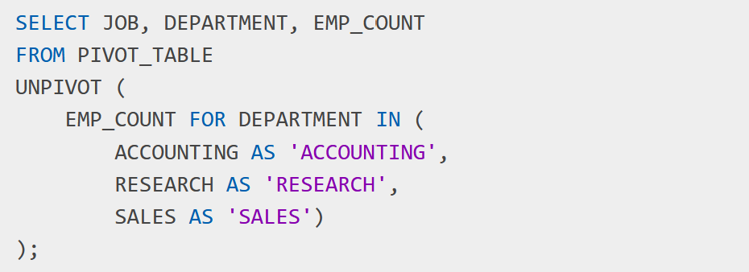

---

#### 2. `INSERT` 문 작성법 2가지와 빈 문자열(`''`)의 DBMS별 차이 (PDF p.82 ~ p.84)
1. **컬럼 리스트를 명시하는 방식**:
   ```sql
   INSERT INTO 테이블명 (컬럼1, 컬럼2, ...) VALUES (값1, 값2, ...);
   ```
   - `컬럼 리스트`의 순서·개수·데이터 타입과 `VALUES` 절의 값 순서·개수·타입이 1:1로 일치해야 한다.
   - **명시하지 않은 나머지 컬럼들에는 자동으로 `NULL` 값(또는 테이블 생성 시 지정한 `DEFAULT` 값)이 입력**된다! (단, 생략된 컬럼에 `NOT NULL` 제약조건이 걸려 있고 `DEFAULT` 값도 없다면 에러 발생!)
2. **컬럼 리스트를 생략하는 방식 (전체 컬럼 입력)**:
   ```sql
   INSERT INTO 테이블명 VALUES (전체컬럼값1, 전체컬럼값2, ...);
   ```
   - 테이블에 정의된 **모든 컬럼의 순서대로 빠짐없이** 값을 나열해야 한다. 값을 넣지 않을 컬럼 자리에는 명시적으로 `NULL`이나 `''`을 적어야 한다.
3. **🔥 빈 문자열(`''`) 입력 시 Oracle vs SQL Server 차이 (★단골 출제!)**:
   - **Oracle**: `INSERT` 시 빈 문자열 **`''`을 입력하면 자동으로 `NULL`로 변환되어 저장**된다! 따라서 조회할 때도 `WHERE COL = ''`이 아니라 **`WHERE COL IS NULL`**로 조회해야 나온다!
   - **SQL Server**: 빈 문자열 **`''`을 `NULL`이 아닌 길이가 0인 빈 문자열 값 자체로 저장**한다! 따라서 조회할 때 **`WHERE COL = ''`**로 조회해야 나온다!

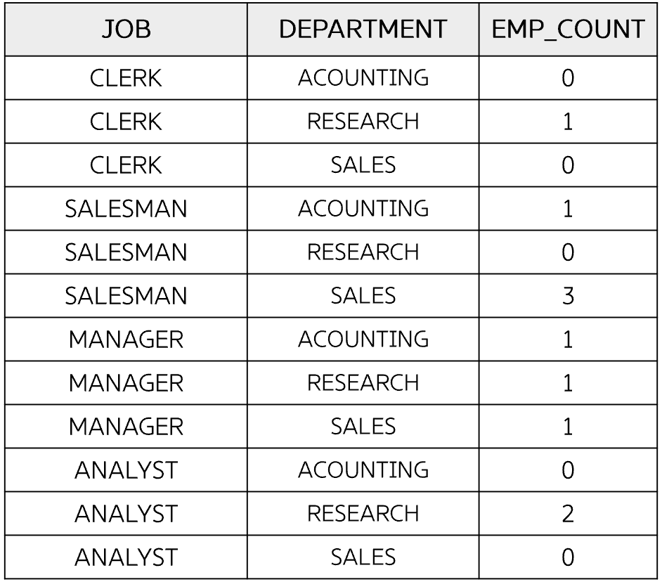

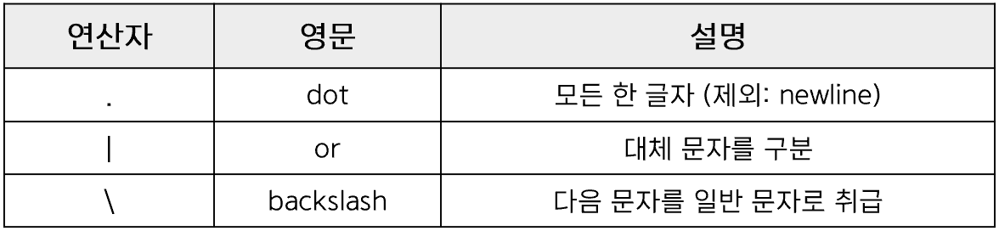

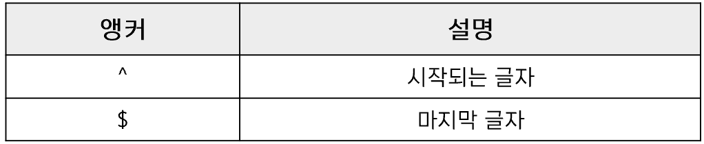

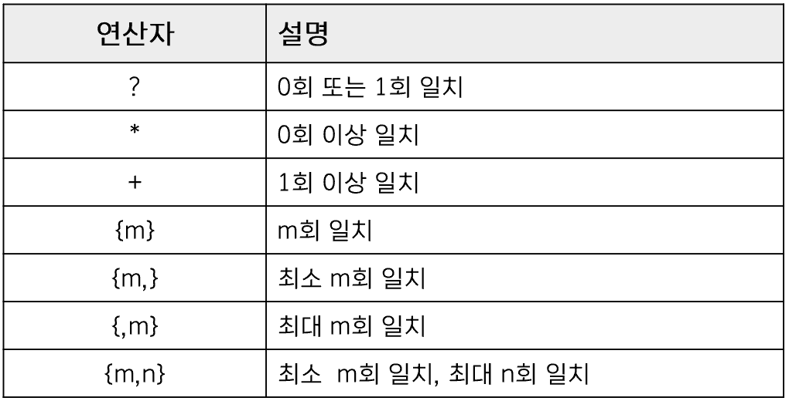

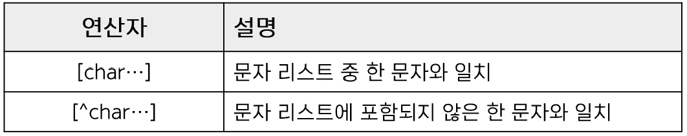

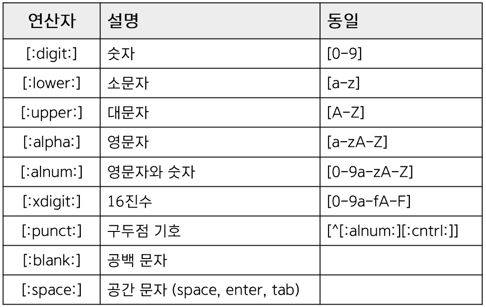

---

#### 3. `UPDATE` 문과 `DELETE` 문, 그리고 DDL vs DML의 내부 처리 차이 (PDF p.83 ~ p.85)
- **`UPDATE` 문**:
  ```sql
  UPDATE 테이블명
     SET 수정할컬럼1 = 새값1, 수정할컬럼2 = 새값2
   [WHERE 조건절];
  ```
  - ⚠️ **`WHERE` 절을 생략하면 테이블의 모든 행(전체 데이터)이 전부 수정**되므로 주의!
- **`DELETE` 문**:
  ```sql
  DELETE [FROM] 테이블명
   [WHERE 조건절];
  ```
  - **`FROM` 키워드는 생략 가능**하다 (`DELETE EMP WHERE ...` 가능!).
  - **`WHERE` 절을 생략하면 테이블의 모든 행이 삭제**된다. (단, 테이블 구조와 디스크 저장공간(용량)은 그대로 남아있으며 `ROLLBACK` 가능!)
- **🔥 DML (`INSERT/UPDATE/DELETE`) vs DDL (`CREATE/ALTER/DROP/TRUNCATE`) 처리 방식 차이**:
  - **DML**: 명령어를 실행하면 디스크의 데이터 파일에 바로 반영되는 것이 아니라 **메모리 버퍼(Buffer)에만 변경사항이 올라가며 Redo/Undo 로그를 기록**한다. 따라서 변경을 확정하려면 **`COMMIT`**을 해야 하고, 취소하려면 **`ROLLBACK`**으로 원상복구할 수 있다! *(단, SQL Server는 기본적으로 DML도 `AUTO COMMIT` 모드이나, `BEGIN TRAN`을 열면 수동 커밋/롤백이 가능함)*
  - **DDL**: 실행하는 즉시 **자동으로 `AUTO COMMIT`**이 수행되어 디스크에 영구 반영되며 **`ROLLBACK`이 불가능**하다!

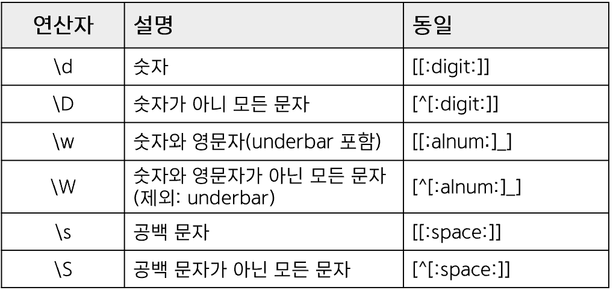


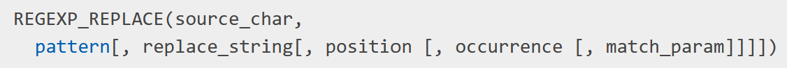

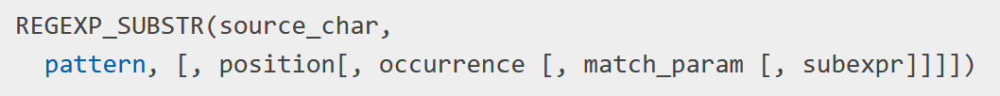

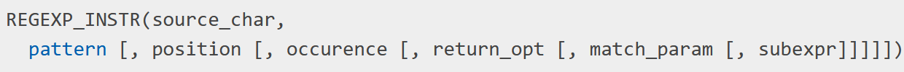

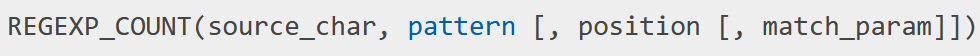

---

#### 4. `MERGE` 문 (조건부 입력·수정·삭제 통합 구문) 및 DML 에러 사례 (PDF p.85 ~ p.87)
- **`MERGE` 문의 역할**: 기준 테이블(Target)과 소스 테이블(Source/서브쿼리)을 조인(`ON`)하여, **일치하는 행이 있으면(`WHEN MATCHED THEN`) `UPDATE`(또는 `DELETE` 포함 가능)**를 수행하고, **일치하는 행이 없으면(`WHEN NOT MATCHED THEN`) `INSERT`**를 한 번에 수행하는 명령어이다.

```sql
MERGE INTO 타겟테이블 T
USING 소스테이블 S
   ON (T.사원번호 = S.사원번호)               -- ★주의: ON 절에 사용된 연결 컬럼(T.사원번호)은 아래 UPDATE SET 절에서 절대 수정할 수 없음!(에러 발생)
 WHEN MATCHED THEN
      UPDATE SET T.급여 = S.급여, T.부서 = S.부서   -- (주의: UPDATE 키워드 뒤에 테이블명 안 씀!)
      [DELETE WHERE 조건]                     -- UPDATE 된 결과 행 중 특정 조건 행 즉시 삭제 가능
 WHEN NOT MATCHED THEN
      INSERT (T.사원번호, T.급여, T.부서)     -- (주의: INSERT 뒤에 INTO 키워드 안 씀!)
      VALUES (S.사원번호, S.급여, S.부서);
```

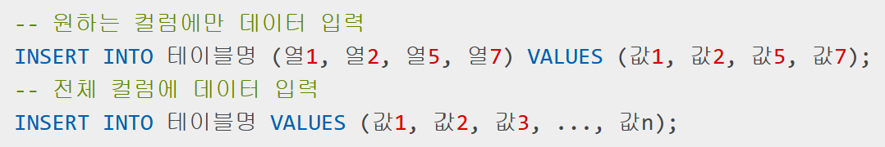


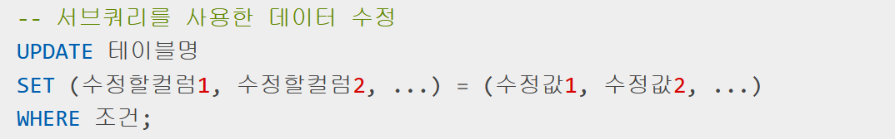

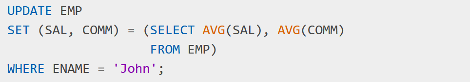


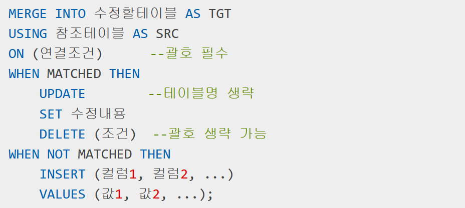

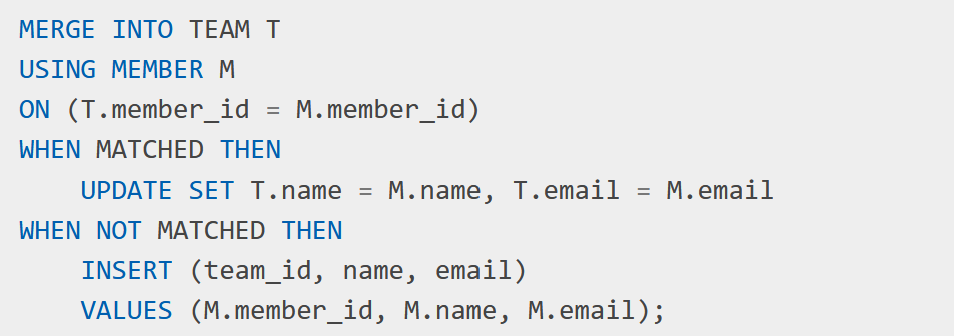


---

### 🧅 [SQLD양파 심화 이론 · 실전 SQL 트레이스 · Before & After · 30초 시험 직전 정리] (2-3-1 DML)

## [핵심 요약]

> DML은 테이블 안의 데이터를 입력·수정·삭제·조회하는 명령어들이다(INSERT, UPDATE, DELETE, MERGE, SELECT).

ex) 노트에 비유하면 INSERT는 새 줄 적기, UPDATE는 줄 고치기, DELETE는 줄 지우기, MERGE는 있으면 고치고 없으면 적기, SELECT는 읽기다.

---

## [개념 도식화] DML의 분류

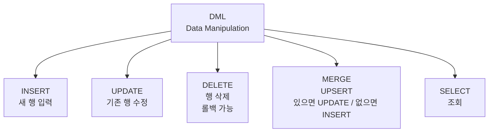

| 명령 | 용도 |
|---|---|
| INSERT | 새 행 입력 |
| UPDATE | 기존 행 수정 |
| DELETE | 행 삭제 |
| MERGE | UPSERT(있으면 UPDATE, 없으면 INSERT) |
| SELECT | 조회 |

---

## [SQL 실전]

## INSERT — 데이터 입력

### 기본 문법

```sql
-- 모든 컬럼에 입력
INSERT INTO EMP VALUES (1, '김철수', 'D1', 3000);
-- 1 row inserted.

-- 특정 컬럼만
INSERT INTO EMP (EMP_ID, NAME) VALUES (2, '이영희');
-- 1 row inserted. (DEPT_ID, SAL은 NULL 또는 DEFAULT)
```

### 다른 테이블에서 가져오기

```sql
INSERT INTO EMP_BACKUP
SELECT * FROM EMP WHERE DEPT_ID = 'D1';
```

### Multi-Insert (Oracle)

```sql
INSERT ALL
    INTO TBL_A VALUES (1, 'A')
    INTO TBL_B VALUES (2, 'B')
SELECT * FROM DUAL;
```

---

## UPDATE — 데이터 수정

```sql
-- 모든 행 수정 (위험)
UPDATE EMP SET SAL = SAL * 1.1;

-- 조건부 수정
UPDATE EMP
SET    SAL = SAL * 1.1
WHERE  DEPT_ID = 'D1';

-- 여러 컬럼 동시 수정
UPDATE EMP
SET    SAL = 5000, DEPT_ID = 'D2'
WHERE  EMP_ID = 1;

-- 서브쿼리로 수정
UPDATE EMP
SET    SAL = (SELECT AVG(SAL) FROM EMP)
WHERE  EMP_ID = 1;
```

WHERE를 빼먹으면 모든 행이 수정된다. 항상 WHERE를 확인한다.

---

## DELETE — 데이터 삭제

```sql
-- 조건부 삭제
DELETE FROM EMP WHERE DEPT_ID = 'D9';

-- 모든 행 삭제(구조는 유지)
DELETE FROM EMP;
```

### DELETE vs TRUNCATE vs DROP

| 명령 | 분류 | 데이터 | 테이블 구조 | 롤백 | 속도 |
|---|---|---|---|---|---|
| DELETE | DML | 삭제 | 유지 | 가능 | 느림 |
| TRUNCATE | **DDL**(`2-3-3`) | 모두 삭제 | 유지 | 불가 | 빠름 |
| DROP | DDL | 삭제 | 삭제 | 불가 | 매우 빠름 |

```sql
DELETE FROM EMP;       -- 데이터만, 롤백 가능
TRUNCATE TABLE EMP;    -- 데이터만, 롤백 불가
DROP TABLE EMP;        -- 테이블 자체 삭제
```

---

## MERGE — 있으면 UPDATE, 없으면 INSERT (UPSERT)

```sql
MERGE INTO EMP E
USING NEW_EMP N
   ON (E.EMP_ID = N.EMP_ID)
WHEN MATCHED THEN
    UPDATE SET E.SAL = N.SAL
WHEN NOT MATCHED THEN
    INSERT (EMP_ID, NAME, SAL) VALUES (N.EMP_ID, N.NAME, N.SAL);
```

### 시각화

```
     NEW_EMP의 행
        │
   E.EMP_ID 매칭?
   ├ 있음 → UPDATE
   └ 없음 → INSERT
```

---

## DML과 트랜잭션

```sql
INSERT INTO EMP ...;
UPDATE EMP ...;
DELETE FROM EMP ...;
COMMIT;        -- 영구 반영
-- 또는
ROLLBACK;      -- 취소
```

DML은 **트랜잭션**(`1-2-3`)의 대상이며 COMMIT 전까지 메모리에만 있다. COMMIT/ROLLBACK 같은 트랜잭션 제어 명령은 **TCL**(`2-3-2`)에서 다룬다.

---

## [Before & After]

3행짜리 EMP 테이블에 INSERT → UPDATE → DELETE를 순서대로 적용한다. D1 부서 직원(김·이) 두 명에게만 10% 인상이 들어가고, 새로 추가했던 4번 직원(최)은 마지막에 다시 삭제되는 흐름이다.

### EMP

| EMP_ID | NAME | DEPT_ID | SAL |
|---|---|---|---|
| 1 | 김 | D1 | 3000 |
| 2 | 이 | D1 | 4000 |
| 3 | 박 | D2 | 3500 |

### `INSERT INTO EMP VALUES (4, '최', 'D2', 4500);`

| EMP_ID | NAME | DEPT_ID | SAL |
|---|---|---|---|
| 1 | 김 | D1 | 3000 |
| 2 | 이 | D1 | 4000 |
| 3 | 박 | D2 | 3500 |
| 4 | 최 | D2 | 4500 |

### `UPDATE EMP SET SAL = SAL * 1.1 WHERE DEPT_ID = 'D1';`

| EMP_ID | NAME | DEPT_ID | SAL |
|---|---|---|---|
| 1 | 김 | D1 | 3300 |
| 2 | 이 | D1 | 4400 |
| 3 | 박 | D2 | 3500 |
| 4 | 최 | D2 | 4500 |

### `DELETE FROM EMP WHERE EMP_ID = 4;`

| EMP_ID | NAME | DEPT_ID | SAL |
|---|---|---|---|
| 1 | 김 | D1 | 3300 |
| 2 | 이 | D1 | 4400 |
| 3 | 박 | D2 | 3500 |

DML은 행 단위로 데이터를 바꾸지만 테이블 구조는 건드리지 않는다. 위 작업은 모두 COMMIT 전까지 메모리에만 머무르므로, 잘못 친 UPDATE·DELETE는 ROLLBACK으로 되돌릴 수 있다. 반대로 같은 "삭제"라도 TRUNCATE·DROP은 DDL이라 자동 COMMIT되며 되돌릴 수 없다. 데이터만 비울지·구조까지 없앨지·되돌릴 여지를 둘지를 의식해서 명령을 고른다.

---

## [시험 출제 포인트]

| 함정 | 정답 |
|---|---|
| TRUNCATE는 DDL인가 DML인가 | DDL(롤백 불가) |
| DELETE 후 ROLLBACK 가능? | 가능(DML) |
| `INSERT INTO ... VALUES`는 한 번에 한 행만? | 일반 INSERT는 1행. INSERT ALL 또는 `INSERT INTO ... SELECT`로 다중행 |
| `UPDATE ... WHERE` 누락 시 | 모든 행 수정 |
| MERGE의 두 가지 절 | WHEN MATCHED / WHEN NOT MATCHED |
| DML 후 자동 커밋? | Oracle은 명시적 COMMIT 필요 |

단골 함정: TRUNCATE와 DELETE의 차이. TRUNCATE는 롤백 불가, AUTO_COMMIT, 빠름.

---

> **30초 시험 직전 정리**
> · DML 5종: **INSERT / UPDATE / DELETE / MERGE / SELECT**
> · DELETE = **DML** (롤백 O) / TRUNCATE = **DDL** (롤백 X, 자동 COMMIT) / DROP = 테이블 자체 삭제
> · UPDATE 에 WHERE 누락 = **모든 행 수정** (위험)
> · MERGE = `WHEN MATCHED THEN UPDATE` + `WHEN NOT MATCHED THEN INSERT` (UPSERT)
> · INSERT 다중행 = **`INSERT ALL`** 또는 **`INSERT INTO ... SELECT`**
> · DML 후 Oracle 은 **명시적 COMMIT 필요** (DDL 은 자동)


---

# 2-3-2. TCL (Transaction Control Language)

> **단원 분류**: `2과목` > `2-3. 관리 구문` > **`2-3-2. TCL`**

### 📘 [해리누나 2024 개정판 필기 & 원본 도식 완벽 정리] 제3장 제2절. TCL (Transaction Control Language) (PDF p.87 ~ p.89)

#### 1. 트랜잭션(Transaction)의 정의와 4대 특성 (`ACID`) (★100% 출제!) (PDF p.87)
- **트랜잭션의 정의**: 데이터베이스의 논리적 연산단위 (밀접히 관련되어 분리될 수 없는 한 개 이상의 데이터베이스 조작).
- **트랜잭션의 4가지 특성 (`"원·일·고·지"` / `ACID`)**:

| 특성 | 영문명 | 핵심 정의 (객관식 보기 판별 키워드) |
| :---: | :---: | :--- |
| **1. 원자성** | **Atomicity** | 트랜잭션에서 정의된 연산들은 **모두 성공적으로 실행되던지 아니면 전혀 실행되지 않은 상태로 남아있어야 한다 (`All or Nothing`)**. |
| **2. 일관성** | **Consistency** | 트랜잭션이 실행되기 전의 데이터베이스 내용이 잘못되어 있지 않다면 **트랜잭션이 실행된 이후에도 데이터베이스의 내용에 잘못이 있으면 안 된다** (제약조건, 합계 일치 등 정합성 유지). |
| **3. 고립성<br>(격리성)** | **Isolation** | 트랜잭션이 실행되는 도중에 **다른 트랜잭션의 영향을 받아 잘못된 결과를 만들어서는 안 된다**. |
| **4. 지속성<br>(영속성)** | **Durability** | 트랜잭션이 일단 성공적으로 수행되면(`COMMIT` 완료 시) **그 트랜잭션이 갱신한 데이터베이스의 내용은 영구적으로 저장**된다. |

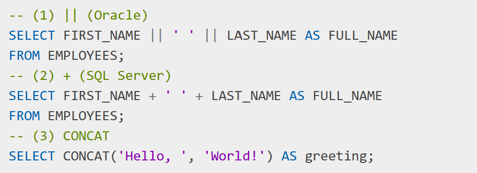

#### 2. 트랜잭션 격리성(Isolation)이 낮을 때 발생하는 3대 문제점 (PDF p.87)
> 💡 **[핵심 필수 암기]**
> **동시성 제어 3대 이상 현상 구분 (`"더·논·팬"`)**:
> 1. **Dirty Read (오손 읽기)**: 다른 트랜잭션에 의해 **수정되었고 아직 커밋되지 않은(`Uncommitted`) 데이터**를 읽는 것. (만약 그 트랜잭션이 롤백되면 잘못된 데이터를 읽은 셈이 됨!)
> 2. **Non-Repeatable Read (반복 불가능 읽기)**: 한 트랜잭션 내에서 같은 쿼리를 두 번 수행했는데, 그 사이에 다른 트랜잭션이 값을 **수정(`UPDATE`) 또는 삭제(`DELETE`)하고 커밋**하여 **두 쿼리의 결과가 다르게 나타나는 현상**.
> 3. **Phantom Read (유령 데이터 읽기)**: 한 트랜잭션 내에서 같은 범위 쿼리를 두 번 수행했는데, 그 사이에 다른 트랜잭션이 **새로운 행을 삽입(`INSERT`)하고 커밋**하여 첫 번째 쿼리에서 **없던 유령(Phantom) 레코드가 두 번째 쿼리에서 새로 나타나는 현상**.

---

#### 3. `COMMIT`, `ROLLBACK`, `SAVEPOINT`의 동작 원리와 주의사항 (PDF p.87 ~ p.89)

1. **`COMMIT` (변경사항 영구 반영)**:
   - 입력/수정/삭제한 자료에 대해서 전혀 문제가 없다고 판단되었을 경우 `COMMIT` 명령어를 통해서 트랜잭션을 완료한다.
   - **🔥 Oracle에서 자동으로 `COMMIT`이 일어나는 경우 (★초빈출 함정!)**:
     - **`DDL` 문 (`CREATE`, `ALTER`, `DROP`, `TRUNCATE`, `RENAME`)이나 `DCL` 문 (`GRANT`, `REVOKE`)을 실행하면, 그 이전에 수행했던 아직 커밋 안 된 모든 DML 문장들까지 자동으로 함께 `AUTO COMMIT` 되어버린다!** (이후 `ROLLBACK`을 해도 이미 DDL 시점에 커밋되었으므로 절대 되돌릴 수 없다!)
     - SQL*Plus 등을 **정상 종료(`EXIT`)**하면 자동 `COMMIT` 되고, 정전이나 강제 종료 등으로 **비정상 종료**되면 자동 `ROLLBACK` 된다.

2. **`ROLLBACK` (변경사항 취소)**:
   - 테이블 내 입력한 데이터나 수정한 데이터, 삭제한 데이터에 대하여 `COMMIT` 이전에는 변경 사항을 취소할 수 있다.
   - 전체 `ROLLBACK`을 실행하면 **직전 `COMMIT` 한 지점(또는 트랜잭션 시작 시점)**까지 모든 DML 변경사항이 취소되고, 걸려 있던 행 잠금(Lock)이 해제된다.

3. **`SAVEPOINT` (저장점, 부분 롤백)**:
   - 저장점(`SAVEPOINT`)을 정의하면 롤백할 때 트랜잭션에 포함된 전체 작업을 롤백하는 것이 아니라 **현 시점에서 해당 `SAVEPOINT`까지만 트랜잭션의 일부를 롤백**할 수 있다!
   - **문법 차이**:
     - **Oracle**: `SAVEPOINT SV1;` ➔ **`ROLLBACK TO SV1;`**
     - **SQL Server**: `SAVE TRANSACTION SV1;` (또는 `SAVE TRAN SV1`) ➔ **`ROLLBACK TRANSACTION SV1;`** (또는 `ROLLBACK TRAN SV1`)
   - **🚨 `SAVEPOINT` 절대 함정 2가지 (★시험에서 행 개수 계산할 때 100% 출제!)**:
     1. **과거로 돌아가면 미래의 세이브포인트는 소멸된다!**:
        - 시간 순서대로 `SAVEPOINT A` ➔ (작업) ➔ `SAVEPOINT B`를 만든 상태에서, 먼저 **`ROLLBACK TO A;`를 실행하여 과거(`A`)로 돌아가 버리면, 그 이후에 만들었던 `SAVEPOINT B`는 메모리에서 사라진다!** 따라서 그 직후에 `ROLLBACK TO B;`를 실행하면 **에러가 발생**한다! (반대로 `ROLLBACK TO B`를 먼저 하고 그 다음에 `ROLLBACK TO A`를 하는 것은 가능!)
     2. **중간에 `COMMIT`이나 `DDL`(`CREATE`, `ALTER` 등)이 실행되면 모든 `SAVEPOINT`가 초기화(소멸)된다!**:
        - 트랜잭션이 종료되었으므로 이전의 `SAVEPOINT`로 `ROLLBACK TO`를 시도하면 에러가 나며 데이터도 되돌아가지 않는다!

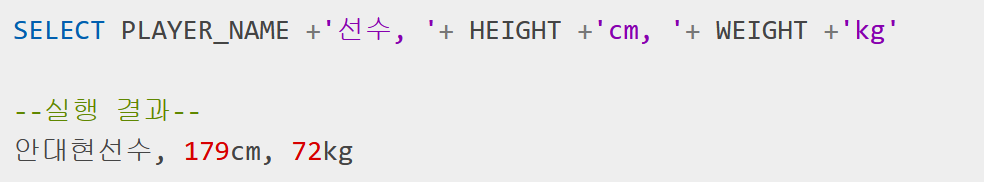

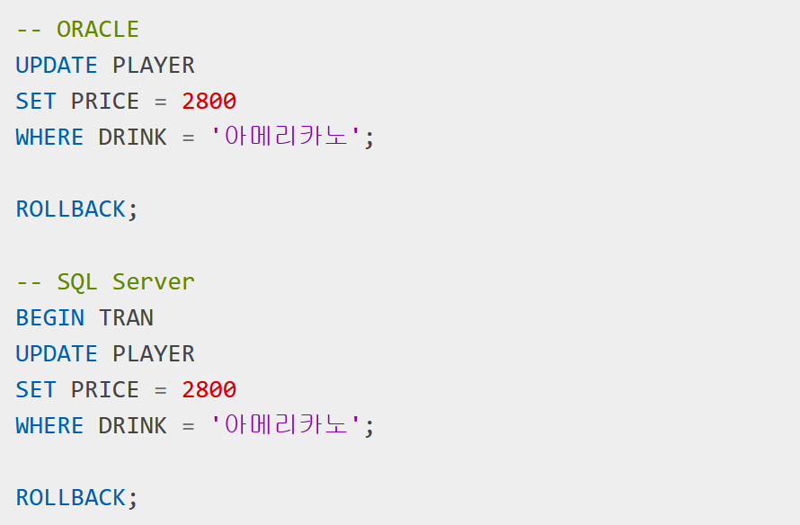

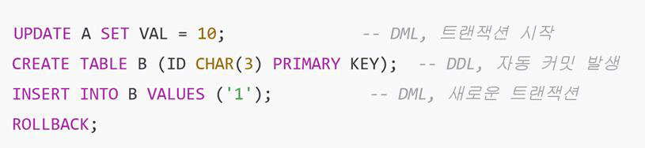

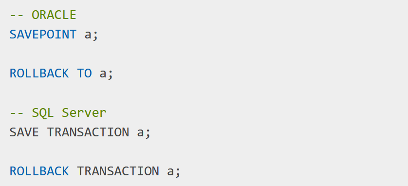

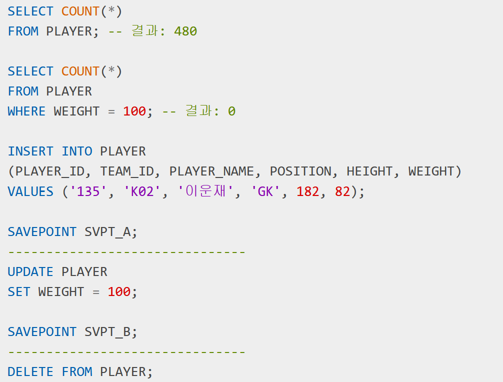

---

### 🧅 [SQLD양파 심화 이론 · 실전 SQL 트레이스 · Before & After · 30초 시험 직전 정리] (2-3-2 TCL)

## [핵심 요약]

> TCL은 트랜잭션을 제어하는 명령어들이다(COMMIT, ROLLBACK, SAVEPOINT).

ex) 워드(Word)에서 작성 중인 내용은 메모리에만 있고, 저장 버튼이 COMMIT(영구 반영), CTRL+Z가 ROLLBACK(취소), 임시 저장 지점이 SAVEPOINT(부분 취소)에 해당한다.

---

## [개념 도식화] 트랜잭션의 흐름

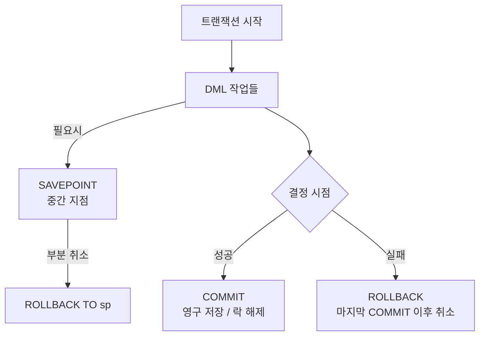

---

## COMMIT — 영구 반영

**DML**(`2-3-1`) 작업을 묶어서 영구 반영한다.

```sql
INSERT INTO EMP VALUES (1, '김', 3000);
UPDATE EMP SET SAL = 4000 WHERE EMP_ID = 1;
COMMIT;     -- 위 두 작업을 영구 반영
```

| COMMIT 후 | 결과 |
|---|---|
| 다른 사용자도 변경 사항을 볼 수 있음 | 가능 |
| ROLLBACK | 불가 |
| 락(Lock) 해제 | 됨 |

---

## ROLLBACK — 취소

```sql
INSERT INTO EMP VALUES (1, '김', 3000);
DELETE FROM EMP WHERE EMP_ID = 999;
ROLLBACK;   -- 위 두 작업 모두 취소
```

마지막 COMMIT 이후의 모든 DML이 취소된다.

---

## SAVEPOINT — 임시 저장 지점

```sql
INSERT INTO EMP VALUES (1, '김', 3000);
SAVEPOINT SP1;

INSERT INTO EMP VALUES (2, '이', 4000);
SAVEPOINT SP2;

INSERT INTO EMP VALUES (3, '박', 5000);

-- SP2 시점으로 되돌리기 (3번 INSERT만 취소)
ROLLBACK TO SP2;
```

| 시점 | 상태 |
|---|---|
| 시작 | EMP 비어있음 |
| SP1 | 김 |
| SP2 | 김, 이 |
| 마지막 INSERT 후 | 김, 이, 박 |
| ROLLBACK TO SP2 | 김, 이 |

---

## **트랜잭션**(`1-2-3`)의 ACID

| 성질 | 의미 |
|---|---|
| Atomicity (원자성) | 전부 또는 전무 |
| Consistency (일관성) | 규칙 유지 |
| Isolation (고립성) | 동시 처리 격리 |
| Durability (지속성) | COMMIT 후 영구 |

---

## 자동 커밋 vs 명시적 커밋

| 상황 | Oracle | MS-SQL |
|---|---|---|
| DML 후 | 수동 COMMIT 필요 | 자동 커밋(설정 따라) |
| DDL 후 | 자동 COMMIT | 트랜잭션 가능 |
| 정상 종료 | 자동 COMMIT | — |
| 비정상 종료 | 자동 ROLLBACK | — |

Oracle에서 CREATE, DROP 같은 DDL은 자동 COMMIT된다.

---

## [SQL 실전]

```sql
-- 트랜잭션 1: 정상 처리
INSERT INTO ACCOUNT VALUES (101, 'A', 10000);
INSERT INTO ACCOUNT VALUES (102, 'B', 5000);
COMMIT;     -- 둘 다 저장

-- 트랜잭션 2: 중간 오류
UPDATE ACCOUNT SET BALANCE = BALANCE - 1000 WHERE ID = 101;
SAVEPOINT BEFORE_DEPOSIT;

UPDATE ACCOUNT SET BALANCE = BALANCE + 1000 WHERE ID = 999;  -- 존재 X

-- 부분 취소 후 다른 처리
ROLLBACK TO BEFORE_DEPOSIT;
UPDATE ACCOUNT SET BALANCE = BALANCE + 1000 WHERE ID = 102;
COMMIT;
```

---

## [Before & After] SAVEPOINT 동작

비어있는 EMP에 김·이·박을 차례로 INSERT하면서 SP1, SP2 두 지점을 찍어 둔다. 마지막에 `ROLLBACK TO SP1`을 걸면 어디까지 살아남는지, 그 뒤 COMMIT까지 어떻게 이어지는지를 시점별로 추적한다.

### EMP

| EMP_ID | NAME |
|---|---|
| (비어있음) | |

### 작업 시나리오

```sql
INSERT INTO EMP VALUES (1, '김');
SAVEPOINT SP1;
INSERT INTO EMP VALUES (2, '이');
SAVEPOINT SP2;
INSERT INTO EMP VALUES (3, '박');
ROLLBACK TO SP1;
COMMIT;
```

### 시점별 상태

| 시점 | 데이터 |
|---|---|
| 첫 INSERT 후 | 김 |
| SP1 | 김 |
| 둘째 INSERT 후 | 김, 이 |
| SP2 | 김, 이 |
| 셋째 INSERT 후 | 김, 이, 박 |
| ROLLBACK TO SP1 | 김 |
| COMMIT | 김 |

`ROLLBACK TO SP1`은 SP1 이후의 DML(이·박 INSERT)만 취소하고 그 이전 작업은 그대로 둔다. 그래서 최종 COMMIT 시점에는 김 한 행만 남는다. 트랜잭션 도중 일부만 되돌리고 싶을 때는 SAVEPOINT로 안전 지점을 찍어둔다. 단, 전체 ROLLBACK이나 COMMIT이 일어나면 SAVEPOINT는 모두 사라진다.

---

## 트랜잭션 격리 수준 (참고)

| 수준 | 설명 |
|---|---|
| READ UNCOMMITTED | 커밋 안 된 것도 읽음 |
| READ COMMITTED | 커밋된 것만(Oracle 기본) |
| REPEATABLE READ | 같은 쿼리는 같은 결과 |
| SERIALIZABLE | 완전 격리(가장 엄격) |

---

## [시험 출제 포인트]

| 함정 | 정답 |
|---|---|
| TCL 명령어 종류 | COMMIT / ROLLBACK / SAVEPOINT |
| DDL 실행 후 | Oracle은 자동 COMMIT |
| ROLLBACK의 범위 | 마지막 COMMIT 이후 모든 DML |
| SAVEPOINT의 의미 | 부분 ROLLBACK 가능 지점 |
| ROLLBACK TO SP1 후 SP1 이전 작업 | 유지 |
| ROLLBACK 후 SAVEPOINT는 | 모두 사라짐 |
| 비정상 종료 시 | 자동 ROLLBACK |

단골 함정: "DDL 실행 후 ROLLBACK으로 취소 가능"은 틀렸다. Oracle에서 DDL은 자동 COMMIT이다.

---

> **30초 시험 직전 정리**
> · TCL 3종: **COMMIT / ROLLBACK / SAVEPOINT**
> · COMMIT = 영구 반영 + 락 해제 + 다른 사용자도 변경 사항 조회 가능
> · ROLLBACK = **마지막 COMMIT 이후** 모든 DML 취소 (SAVEPOINT 도 함께 사라짐)
> · ROLLBACK TO sp = **부분 취소** (sp 이전 작업은 유지)
> · DDL 실행 = **자동 COMMIT** (롤백 불가)
> · 비정상 종료 = **자동 ROLLBACK** / 정상 종료 = 자동 COMMIT
> · Oracle 기본 격리 수준 = **READ COMMITTED**


---

# 2-3-3. DDL (Data Definition Language)

> **단원 분류**: `2과목` > `2-3. 관리 구문` > **`2-3-3. DDL`**

### 📘 [해리누나 2024 개정판 필기 & 원본 도식 완벽 정리] 제3장 제3절. DDL (Data Definition Language) 및 기타 객체 (PDF p.90 ~ p.100)

#### 1. 데이터 타입: `CHAR` vs `VARCHAR2` 비교 (★단골 출제!) (PDF p.90)

| 데이터 타입 | 의미 | 저장 방식 및 공백 채움 | 동등 비교 (`=`) 시 규칙 |
| :--- | :--- | :--- | :--- |
| **`CHAR(길이)`** | **고정 길이** 문자열 | 지정한 길이보다 짧은 문자열이 들어오면 **남는 공간을 공백(`' '`)으로 채워서(Padding)** 고정된 크기로 저장! | 끝에 붙은 **공백의 개수만 다르면 서로 같은 값(`TRUE`)으로 판정**! (`'AA' = 'AA   '` ➔ **참!**) |
| **`VARCHAR2(길이)`** *(Oracle)*<br>**`VARCHAR(길이)`** *(SQL Server)* | **가변 길이** 문자열 | 실제 입력된 문자열의 길이만큼만 저장 공간을 할당하고 **남는 공간을 공백으로 채우지 않음!** | 공백도 엄연한 하나의 문자로 취급하므로 **공백 개수가 다르면 다른 값(`FALSE`)으로 판정**! (`'AA' = 'AA   '` ➔ **거짓!**)<br>*(따라서 `CHAR` 컬럼과 `VARCHAR2` 컬럼을 조인/비교할 때는 `TRIM`이 필요할 수 있음!)* |
| **`NUMBER(P, S)`** | 가변 숫자형 | `P`(전체 유효 자릿수 Precision), `S`(소수점 이하 자릿수 Scale). 예: `NUMBER(8, 2)`는 전체 8자리 중 정수부 6자리, 소수부 2자리. | |
| **`DATE` / `DATETIME`** | 날짜 및 시간형 | 연, 월, 일, 시, 분, 초 저장 | |

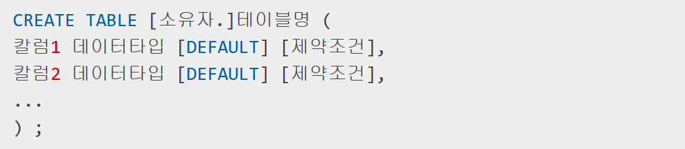

---

#### 2. `CREATE TABLE` 규칙과 5대 제약조건 (Constraints), 참조 무결성 옵션 (PDF p.90 ~ p.94)
- **테이블 및 칼럼 명명(Naming) 규칙 (★객관식 선지 단골!)**:
  1. 반드시 **문자로 시작**해야 한다 (**숫자로 시작할 수 없다!** 단, 중간이나 끝에 숫자가 들어가는 것은 가능).
  2. 알파벳(`A-Z`, `a-z`), 숫자(`0-9`), 그리고 특수문자는 **`_` (언더바), `$` (달러), `#` (샵) 딱 3가지만 허용**된다! (공백이나 `-` 하이픈 등은 사용 불가!)
  3. 한 계정(스키마) 내에서 다른 테이블/객체와 이름이 중복될 수 없으며, 한 테이블 내에서 컬럼명이 중복될 수 없다.
  4. SQL 예약어(`SELECT`, `TABLE`, `WHERE` 등)는 이름으로 사용할 수 없다.

- **5대 제약조건 (Constraints) 특징 비교**:
  1. **`PRIMARY KEY` (기본키)**: **`UNIQUE` + `NOT NULL`**. 테이블당 **단 1개만** 생성 가능(여러 컬럼을 묶어 1개의 복합 PK로 만드는 것은 가능!). 생성 시 자동으로 고유 인덱스(Unique Index) 생성.
  2. **`UNIQUE KEY` (고유키)**: 중복된 값을 허용하지 않으나, **`NULL` 값은 여러 개 입력 가능**하다! (테이블에 여러 개 생성 가능)
  3. **`NOT NULL`**: `NULL` 값 입력을 금지함. (주의: 테이블 레벨 방식으로는 정의할 수 없고 **컬럼 정의 옆에 쓰는 '컬럼 레벨' 방식으로만 정의 가능**!)
  4. **`CHECK`**: 입력될 수 있는 값의 범위나 조건을 제한 (`CHECK (SAL > 0)`). *(단, 조건식이 `UNKNOWN` 즉 **`NULL`이 들어오면 `CHECK` 제약조건 위반으로 보지 않고 통과(허용)**시킨다!)*
  5. **`FOREIGN KEY` (외래키)**: 부모 테이블의 `PK` 또는 `UNIQUE` 컬럼을 참조하며, 테이블당 여러 개 생성 가능하고 **`NULL` 값도 가질 수 있다**.

- **외래키(FK) 참조 무결성 옵션 (부모 행 삭제 `ON DELETE` / 수정 시 자식 처리 방식)**:
  - **`CASCADE`**: 부모 데이터 삭제 시 **자식 테이블의 관련 행들도 연쇄적으로 자동 삭제**!
  - **`SET NULL`**: 부모 데이터 삭제 시 **자식 테이블의 FK 컬럼 값을 `NULL`로 변경**! (단, 자식 FK 컬럼이 `NOT NULL`이면 불가능)
  - **`SET DEFAULT`**: 부모 데이터 삭제 시 자식 FK 값을 기본값(`DEFAULT`)으로 변경.
  - **`RESTRICT` / `NO ACTION` (기본값)**: 자식 테이블에 참조하고 있는 행이 존재하면 **부모 데이터의 삭제를 거부(에러 발생)**!
  - *(참고: 자식 테이블에 새 행을 `INSERT` 할 때 부모 테이블에 없는 키 값을 넣으려고 할 때의 옵션으로는 **`AUTOMATIC`**(부모 테이블에 자동으로 먼저 PK 생성 후 자식 삽입)과 **`DEPENDENT`**(부모에 있을 때만 삽입 허용, 기본값)가 있다.)*

- **`CREATE TABLE 테이블명 AS SELECT ...` (CTAS, 서브쿼리로 테이블 복사 생성)**:
  - ⚠️ **초특급 시험 포인트**: CTAS로 테이블을 복사 생성하면 기존 테이블의 구조(컬럼명, 데이터 타입)와 데이터는 그대로 복사되지만, **`PK`, `UNIQUE`, `FK`, `CHECK`, `DEFAULT` 등 모든 제약조건은 사라지고 오직 `NOT NULL` 제약조건 딱 하나만 복사된다!** (따라서 PK 등이 필요하면 생성 후 `ALTER TABLE`로 다시 추가해야 함!)

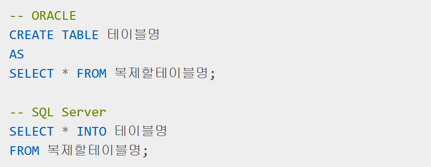

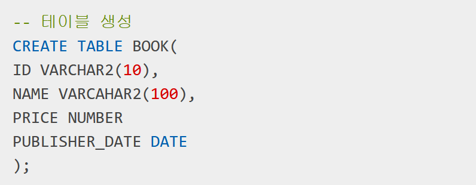

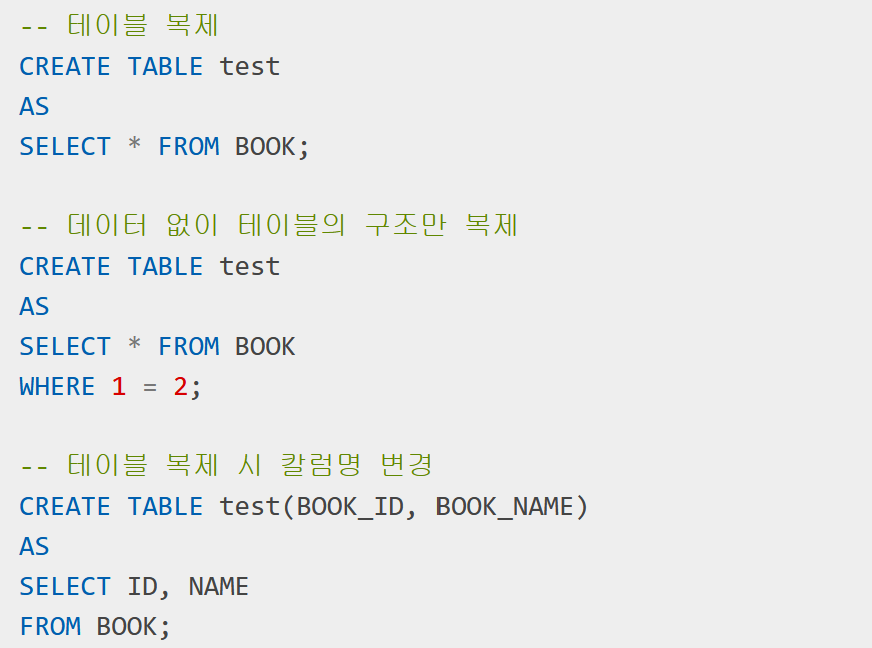

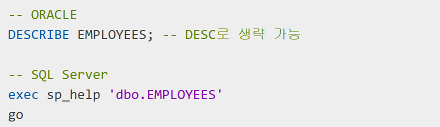

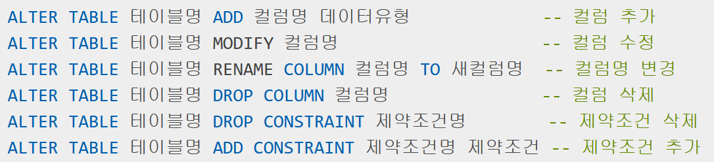


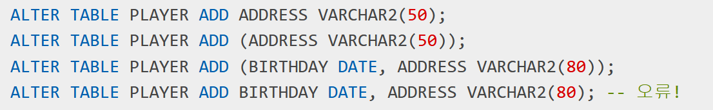

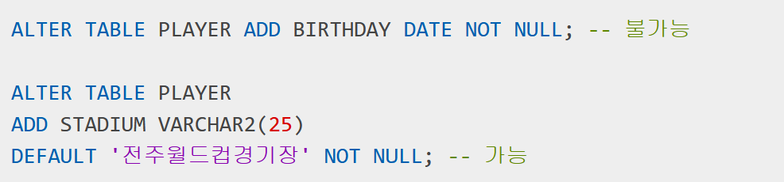

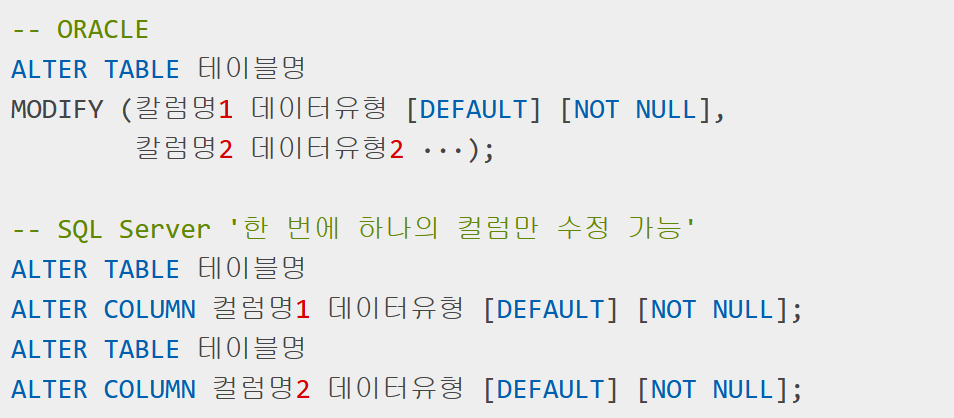

---

#### 3. `ALTER TABLE` (테이블 구조 변경) Oracle vs SQL Server 문법 비교 (★빈출!) (PDF p.93 ~ p.96)

> 💡 **[핵심 필수 암기]**
> **Oracle과 SQL Server의 `ALTER TABLE` 문법 차이 (객관식 문법 정오 판별 단골!)**

| 변경 작업 | Oracle (오라클) 문법 | SQL Server (MSSQL) 문법 | 주의사항 |
| :---: | :--- | :--- | :--- |
| **1. 컬럼 추가 (`ADD`)** | `ALTER TABLE 테이블명` **`ADD (컬럼명 타입)`**;<br>*(괄호 사용 가능, **`COLUMN` 키워드 안 씀!**)* | `ALTER TABLE 테이블명` **`ADD 컬럼명 타입`**; | 새로 추가된 컬럼은 테이블의 **맨 마지막 열**에 위치하며(중간 위치 지정 불가!), 기존 행들의 값은 `NULL`로 채워짐. |
| **2. 컬럼 삭제 (`DROP`)** | `ALTER TABLE 테이블명` **`DROP COLUMN 컬럼명`**; | `ALTER TABLE 테이블명` **`DROP COLUMN 컬럼명`**; | 데이터가 있든 없든 즉시 삭제되며 **롤백(복구) 불가!** 테이블에 최소 1개의 컬럼은 남아있어야 함 (모두 삭제 불가). |
| **3. 컬럼 타입/길이/NOT NULL 변경** | `ALTER TABLE 테이블명` **`MODIFY (컬럼명 타입 [DEFAULT 값] [NOT NULL])`**; | `ALTER TABLE 테이블명` **`ALTER COLUMN 컬럼명 타입 [NOT NULL]`**;<br>*(주의: SQL Server는 **괄호를 쓰지 않으며**, 여러 컬럼을 동시에 변경할 수 없고, `DEFAULT` 제약조건 변경 시 별도 구문 필요!)* | - 컬럼 크기를 **늘리는 것은 항상 가능**하지만, **줄이는 것은 해당 컬럼의 모든 값이 `NULL`이거나 줄이려는 크기보다 작을 때만** 가능!<br>- 데이터 타입 변경은 해당 컬럼의 **모든 값이 `NULL`일 때만** 가능!<br>- `NOT NULL` 추가는 기존 행에 `NULL`이 하나도 없을 때만 가능!<br>- **`DEFAULT` 값을 변경하면 변경 이후에 `INSERT` 되는 행부터만 적용**되며 기존 행의 값은 바뀌지 않음! |
| **4. 컬럼 이름 변경 (`RENAME`)** | `ALTER TABLE 테이블명` **`RENAME COLUMN 기존컬럼명 TO 새컬럼명`**; | **`sp_rename '테이블명.기존컬럼명', '새컬럼명', 'COLUMN'`* | |
| **5. 제약조건 삭제 / 추가** | - 삭제: `ALTER TABLE 테이블명` **`DROP CONSTRAINT 제약조건명`**;<br>- 추가: `ALTER TABLE 테이블명` **`ADD CONSTRAINT 제약조건명 PRIMARY KEY (컬럼)`**; | Oracle과 동일! | |

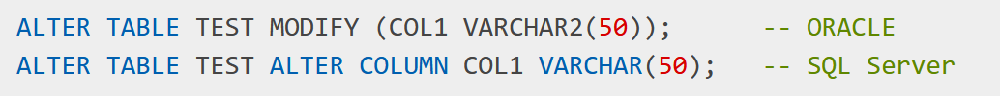

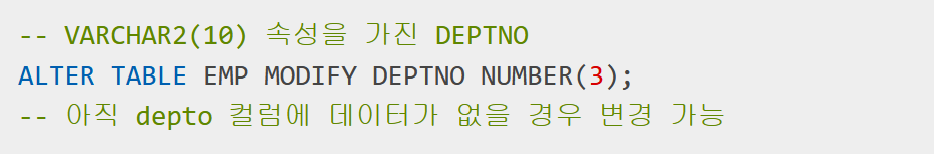


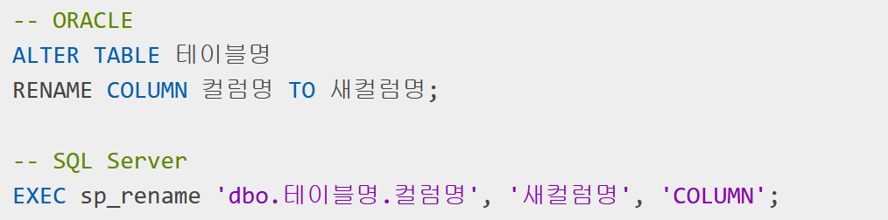


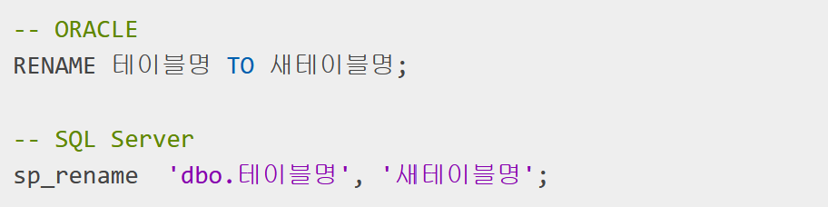

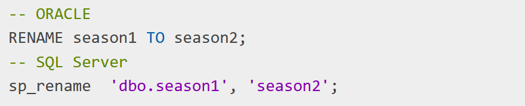

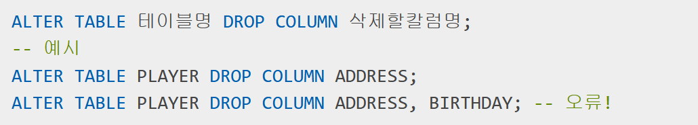

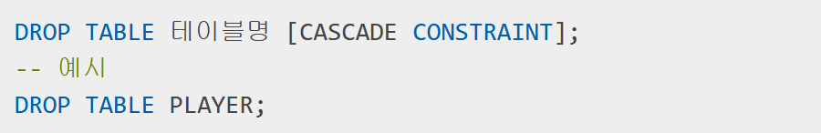

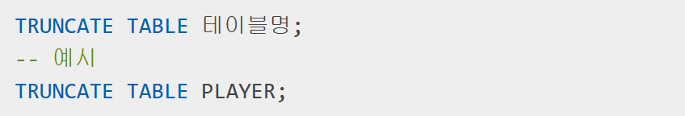

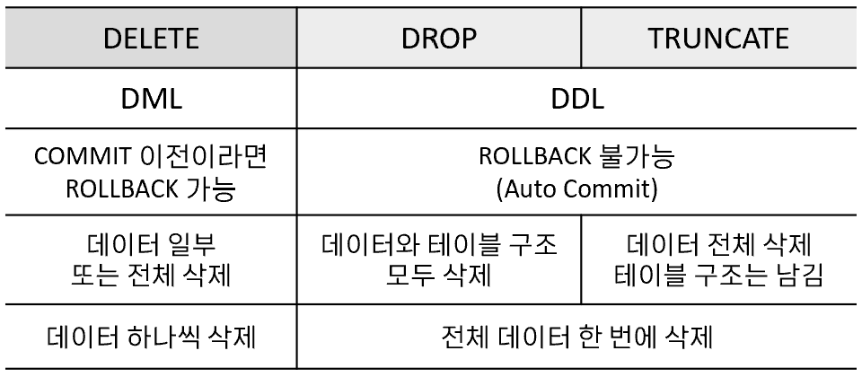

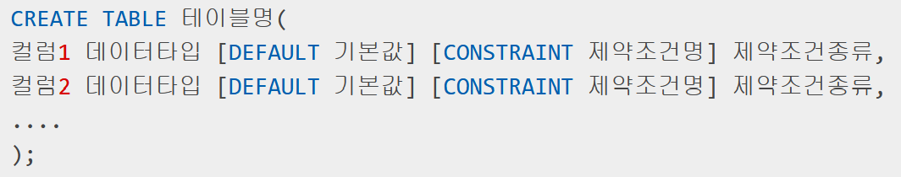

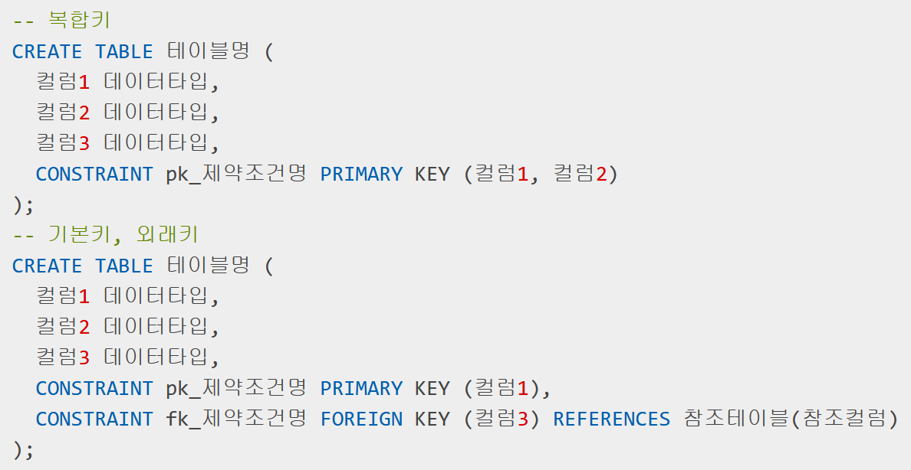

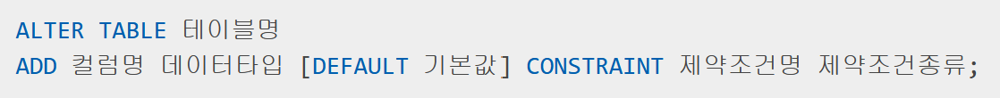

---

#### 4. `RENAME`, `DROP TABLE`, `TRUNCATE TABLE` 및 **`DELETE` vs `TRUNCATE` vs `DROP` 완벽 비교** (PDF p.96 ~ p.97)
- **테이블 이름 변경 (`RENAME`)**:
  - Oracle: **`RENAME 기존테이블명 TO 새테이블명;`** (또는 `ALTER TABLE 기존테이블명 RENAME TO 새테이블명;`)
  - SQL Server: **`sp_rename '기존테이블명', '새테이블명';`**
- **`DROP TABLE 테이블명 [CASCADE CONSTRAINTS];`**:
  - 테이블의 모든 데이터뿐만 아니라 **테이블의 구조(스키마 정의) 자체를 완전히 삭제**한다.
  - 다른(자식) 테이블에서 이 테이블의 PK를 외래키(FK)로 참조하고 있는 경우 그냥 `DROP TABLE`을 하면 에러가 발생하는데, 뒤에 **`CASCADE CONSTRAINTS`** 옵션을 붙이면 **자식 테이블에 걸려 있던 참조 제약조건(FK)까지 먼저 자동으로 끊어버린 뒤 부모 테이블을 삭제**한다! *(단, SQL Server에는 `CASCADE CONSTRAINTS` 옵션이 없으므로 자식 테이블의 FK 제약조건이나 자식 테이블을 먼저 삭제해야만 부모 테이블을 `DROP`할 수 있다!)*
- **`TRUNCATE TABLE 테이블명;`**:
  - 테이블 구조는 그대로 남기고 **모든 행(데이터)을 한 번에 영구 삭제**하며, 테이블이 사용하던 **디스크 저장 공간(용량)까지 초기 상태로 반환(해제)**한다! (DDL이므로 즉시 `AUTO COMMIT` 되어 **절대 `ROLLBACK` 불가**!)

> 💡 **[핵심 필수 암기]**
> **🔥 시험 출제율 100%! `DELETE` vs `TRUNCATE` vs `DROP` 3대 삭제 명령어 완벽 비교표 (PDF p.97)**

| 비교 항목 | `DELETE [FROM] 테이블명` | `TRUNCATE TABLE 테이블명` | `DROP TABLE 테이블명` |
| :---: | :---: | :---: | :---: |
| **SQL 명령어 분류** | **DML (데이터 조작어)** | **DDL (데이터 정의어)** | **DDL (데이터 정의어)** |
| **`WHERE` 절(일부 행만 삭제)** | **⭕ 가능** (일부 행 선택 삭제 가능) | **❌ 불가능** (무조건 전체 행 삭제) | **❌ 불가능** (테이블 통째로 삭제) |
| **삭제 후 테이블 구조(스키마)** | **유지됨** (남아있음) | **유지됨** (남아있음) | **❌ 완전히 삭제됨 (사라짐!)** |
| **디스크 저장 공간 (용량)** | **반환 안 됨** (공간 그대로 차지) | **⭕ 즉시 반환됨 (초기화)** | **⭕ 즉시 전부 반환됨** |
| **COMMIT / ROLLBACK 여부** | **수동 `COMMIT` / `ROLLBACK` 가능!** | **`AUTO COMMIT` / `ROLLBACK` 불가!** | **`AUTO COMMIT` / `ROLLBACK` 불가!** |
| **Undo 로그 생성 및 처리 속도** | 행 단위로 로그 기록 ➔ **느림 (부하 큼)** | 로그 최소 기록 ➔ **매우 빠름 (부하 적음)** | 즉시 삭제 ➔ **가장 빠름** |


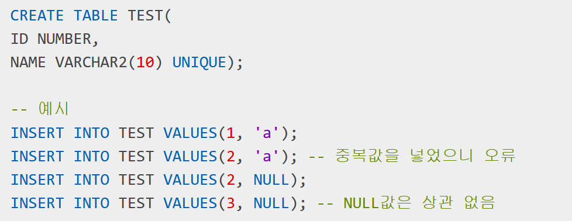

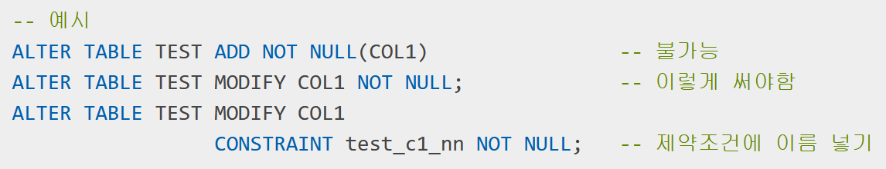

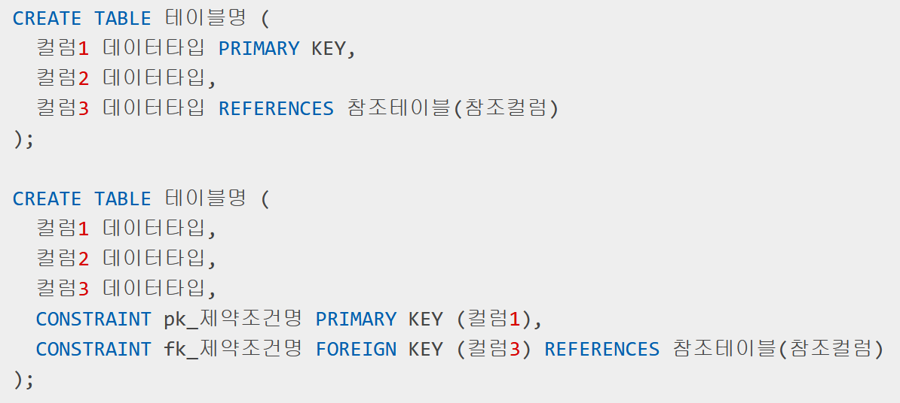

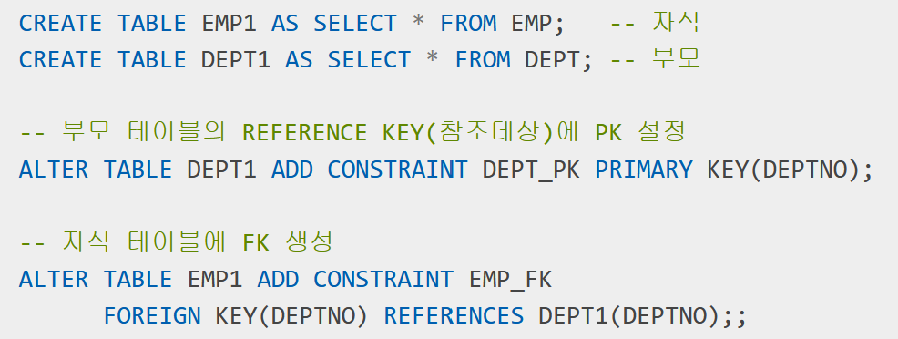


---

#### 5. 기타 데이터베이스 객체: 뷰(`VIEW`), 시퀀스(`SEQUENCE`), 시노님(`SYNONYM`) (PDF p.98 ~ p.100)
1. **뷰 (VIEW) — 가상 테이블**:
   - 실제 데이터를 물리적으로 저장하고 있지 않고, **`SELECT` 쿼리문(정의)만 저장**하고 있는 가상의 테이블이다.
   - **뷰 사용의 3대 장점 (`"독·편·보"`)**:
     - **독립성 (Independence)**: 원본 테이블 구조가 변경되어도 뷰를 사용하는 응용 프로그램은 변경하지 않아도 됨 (논리적 데이터 독립성 제공).
     - **편리성 (Convenience)**: 복잡한 조인/서브쿼리 SQL을 뷰로 만들어 두면 사용자는 단순한 `SELECT * FROM 뷰이름`으로 쉽게 조회 가능.
     - **보안성 (Security)**: 급여나 주민번호 같은 민감한 컬럼을 제외한 채 뷰를 만들어 권한을 부여함으로써 중요 데이터 노출 방지.
   - 생성/수정: **`CREATE [OR REPLACE] VIEW 뷰이름 AS SELECT ...`** / 삭제: **`DROP VIEW 뷰이름;`**
2. **시퀀스 (SEQUENCE)**:
   - 자동으로 순차적으로 증가하는 유일한 번호(일련번호 PK 등)를 생성해주는 객체.
   - **`시퀀스명.NEXTVAL`** (다음 번호 생성 및 증가), **`시퀀스명.CURRVAL`** (현재 번호 조회).
3. **시노님 (SYNONYM, 동의어)**:
   - 다른 유저의 객체나 긴 테이블 이름에 대해 간단한 별명(별칭)을 붙여주는 객체 (`CREATE [PUBLIC] SYNONYM 별칭 FOR 원본객체;`).


---

### 🧅 [SQLD양파 심화 이론 · 실전 SQL 트레이스 · Before & After · 30초 시험 직전 정리] (2-3-3 DDL)

## [핵심 요약]

> DDL은 테이블·뷰·인덱스 같은 객체를 만들고 바꾸고 지우는 명령어들이다(CREATE, ALTER, DROP, TRUNCATE, RENAME).

---

## [개념 도식화] DDL 명령 5종


| 명령 | 의미 |
|---|---|
| CREATE | 객체(테이블/뷰/인덱스) 생성 |
| ALTER | 객체 구조 변경 |
| DROP | 객체 삭제 |
| TRUNCATE | 데이터만 비움(구조 유지) |
| RENAME | 이름 변경 |

DDL은 자동 COMMIT된다. 실행 즉시 영구 반영되며 ROLLBACK 불가.

---

## [SQL 실전]

## CREATE — 객체 생성

```sql
CREATE TABLE EMP (
    EMP_ID    NUMBER       PRIMARY KEY,
    NAME      VARCHAR2(50) NOT NULL,
    SAL       NUMBER       DEFAULT 0,
    DEPT_ID   VARCHAR2(10),
    HIRE_DATE DATE         DEFAULT SYSDATE,
    CONSTRAINT FK_EMP_DEPT FOREIGN KEY (DEPT_ID) REFERENCES DEPT(DEPT_ID)
);
-- Table created.
```

### 테이블 명명 규칙

| 규칙 | 설명 |
|---|---|
| 영문/숫자/`_`만 | 한글, 특수문자 불가 |
| 첫 글자는 영문 | 숫자로 시작 불가 |
| 예약어 사용 불가 | SELECT, FROM 등 |
| 길이 30바이트 이내 | (Oracle 기준) |
| 동일 사용자 내 중복 불가 | — |

---

## 제약조건(Constraints)

| 제약 | 의미 | 예 |
|---|---|---|
| PRIMARY KEY | 기본키(UNIQUE + NOT NULL), **식별자**(`1-1-5`) 역할 | EMP_ID |
| FOREIGN KEY | 외래키 | DEPT_ID 참조 |
| UNIQUE | 중복 불가(**NULL**(`1-2-4`) 허용) | EMAIL |
| NOT NULL | NULL 불가 | NAME |
| CHECK | 조건 만족 | CHECK (SAL > 0) |
| DEFAULT | 기본값 | DEFAULT 0 |

### PK vs UNIQUE

| 비교 | PRIMARY KEY | UNIQUE |
|---|---|---|
| 중복 | 불가 | 불가 |
| NULL | 불가 | 허용 |
| 테이블당 개수 | 1개 | 여러 개 |

### FK 옵션

```sql
FOREIGN KEY (DEPT_ID) REFERENCES DEPT(DEPT_ID)
    ON DELETE CASCADE       -- 부모 삭제 시 자식도 삭제
    ON DELETE SET NULL      -- 부모 삭제 시 자식 FK NULL
```

---

## ALTER — 구조 변경

```sql
-- 컬럼 추가
ALTER TABLE EMP ADD (PHONE VARCHAR2(20));
-- Table altered.

-- 컬럼 변경
ALTER TABLE EMP MODIFY (PHONE VARCHAR2(30));
-- Table altered.

-- 컬럼 이름 변경
ALTER TABLE EMP RENAME COLUMN PHONE TO MOBILE;
-- Table altered.

-- 컬럼 삭제
ALTER TABLE EMP DROP COLUMN MOBILE;
-- Table altered.

-- 제약조건 추가/삭제
ALTER TABLE EMP ADD CONSTRAINT UQ_NAME UNIQUE (NAME);
ALTER TABLE EMP DROP CONSTRAINT UQ_NAME;
-- Table altered.
```

---

## DROP — 객체 삭제

```sql
DROP TABLE EMP;                  -- 테이블 자체 삭제
DROP TABLE EMP CASCADE CONSTRAINTS;  -- 참조 제약까지 함께
DROP TABLE EMP PURGE;            -- 휴지통도 비움(복구 불가)
-- Table dropped.
```

---

## TRUNCATE — 데이터만 비우기

```sql
TRUNCATE TABLE EMP;
-- Table truncated.
```

| TRUNCATE 특징 | 설명 |
|---|---|
| 데이터 모두 삭제 | 됨 |
| 테이블 구조 | 유지 |
| 롤백 | 불가 |
| 속도 | 매우 빠름 |

---

## RENAME — 이름 변경

```sql
RENAME EMP TO EMPLOYEE;
ALTER TABLE EMP RENAME TO EMPLOYEE;  -- 동일
-- Table renamed.
```

---

## DELETE vs TRUNCATE vs DROP

| 비교 | DELETE | TRUNCATE | DROP |
|---|---|---|---|
| 분류 | **DML**(`2-3-1`) | DDL | DDL |
| 데이터 | 삭제 | 모두 삭제 | 삭제 |
| 구조 | 유지 | 유지 | 삭제 |
| ROLLBACK | 가능 | 불가 | 불가 |
| WHERE | 가능 | 불가 | — |
| 속도 | 느림 | 빠름 | 매우 빠름 |
| 자동 COMMIT | 없음 | 있음 | 있음 |

---

## VIEW (뷰)

```sql
CREATE VIEW V_EMP_HIGH AS
SELECT NAME, SAL FROM EMP WHERE SAL > 5000;

SELECT * FROM V_EMP_HIGH;     -- 사용
DROP VIEW V_EMP_HIGH;
```

| 뷰의 장점 | |
|---|---|
| 복잡한 쿼리를 간단한 이름으로 | 됨 |
| 보안(특정 컬럼/행만 노출 — **DCL**(`2-3-4`)과 함께 권한 통제) | 됨 |
| 실제 테이블 아님(가상) | 됨 |

---

## 인덱스(INDEX)

```sql
CREATE INDEX IDX_EMP_NAME ON EMP(NAME);
-- Index created.
DROP INDEX IDX_EMP_NAME;
-- Index dropped.
```

도서관의 목차 같은 역할이다. 검색 속도는 빨라지지만 입력·수정 속도는 느려질 수 있다.

---

## [Before & After]

EMP_ID(PK)·NAME(NOT NULL)·SAL(DEFAULT 0)을 가진 EMP 테이블을 만들고, PHONE 컬럼을 더한 뒤, 같은 테이블에 TRUNCATE와 DROP을 차례로 적용한다. 데이터·구조·테이블 자체가 어느 명령에서 사라지는지를 비교한다.

### CREATE 후

```
EMP
─────────
EMP_ID (PK)
NAME (NOT NULL)
SAL (DEFAULT 0)
```

### `ALTER TABLE EMP ADD (PHONE VARCHAR2(20))` 후

```
EMP
─────────
EMP_ID (PK)
NAME (NOT NULL)
SAL (DEFAULT 0)
PHONE      (추가됨)
```

### `TRUNCATE TABLE EMP` 후

```
EMP (구조 유지, 데이터 0행)
─────────
EMP_ID (PK)
NAME
SAL
PHONE
```

### `DROP TABLE EMP` 후

```
(테이블 자체가 사라짐)
```

ALTER는 컬럼을 추가해 구조를 키우고, TRUNCATE는 데이터만 비우되 컬럼 정의(EMP_ID·NAME·SAL·PHONE)는 그대로 남기며, DROP은 테이블 객체 자체를 지운다. 셋 다 DDL이라 실행 즉시 자동 COMMIT되어 ROLLBACK으로 되돌릴 수 없다. "데이터만 비우고 싶다 → TRUNCATE", "테이블 자체가 필요 없다 → DROP", "구조만 바꾼다 → ALTER" 식으로 의도와 명령을 정확히 매칭한다.

---

## [시험 출제 포인트]

| 함정 | 정답 |
|---|---|
| TRUNCATE 분류 | DDL |
| DDL 실행 후 ROLLBACK 가능? | 불가(자동 COMMIT) |
| PRIMARY KEY는 NULL 허용? | 불허 |
| UNIQUE는 NULL 허용? | 허용 |
| 한 테이블에 PK는 몇 개? | 1개 |
| FK가 참조하는 컬럼 조건 | PK 또는 UNIQUE |
| CHECK 제약 예 | `CHECK (SAL > 0)` |
| ON DELETE CASCADE | 부모 삭제 시 자식도 삭제 |
| `ALTER TABLE ... DROP COLUMN`은 ROLLBACK 가능? | 불가 |

단골 함정: TRUNCATE는 DDL이지만 데이터만 삭제(구조 유지)된다. DROP은 테이블 자체를 삭제한다.

---

> **30초 시험 직전 정리**
> · DDL 5종: **CREATE / ALTER / DROP / TRUNCATE / RENAME** — 모두 **자동 COMMIT** (롤백 불가)
> · 제약 6종: **PK / FK / UNIQUE / NOT NULL / CHECK / DEFAULT**
> · PK = **UNIQUE + NOT NULL** / 테이블당 1개 / FK 가 참조하는 컬럼은 PK 또는 UNIQUE
> · UNIQUE = **NULL 허용** (중복만 막음)
> · DELETE / TRUNCATE / DROP — **데이터·구조·롤백** 차이 (가장 단골 함정)
> · ON DELETE CASCADE = 부모 삭제 시 자식도 자동 삭제
> · 컬럼 추가 = `ALTER TABLE ADD` / 변경 = `MODIFY` / 삭제 = `DROP COLUMN`


---

# 2-3-4. DCL (Data Control Language)

> **단원 분류**: `2과목` > `2-3. 관리 구문` > **`2-3-4. DCL`**

### 📘 [해리누나 2024 개정판 필기 & 원본 도식 완벽 정리] 제3장 제4절. DCL (Data Control Language) (PDF p.100 ~ p.103)

#### 1. 유저(User)와 권한(Privileges)의 개요: 시스템 권한 vs 객체 권한 (PDF p.100 ~ p.101)
- **데이터베이스 보안의 2가지 영역**:
  - **시스템 보안**: 데이터베이스 자체에 대한 접근(로그인, 유저 생성, 테이블 생성 등)을 통제하는 보안.
  - **데이터 보안**: 특정 테이블이나 뷰 등 **객체(Object)의 내용에 접근(조회, 입력, 수정, 삭제)**하는 것을 통제하는 보안.
- **권한의 2가지 종류**:
  1. **시스템 권한 (System Privileges)**: 사용자가 데이터베이스에서 특정 작업(로그인 접속 `CREATE SESSION`, 테이블 생성 `CREATE TABLE`, 뷰 생성 `CREATE VIEW`, 유저 생성 `CREATE USER` 등)을 수행할 수 있도록 하는 권한 (주로 DBA가 부여).
     - **⚠️ 단골 함정**: `CREATE USER`로 유저를 새로 만들었다고 해서 바로 로그인을 할 수 있는 것이 아니다! 반드시 데이터베이스 접속 권한인 **`CREATE SESSION`** 권한을 `GRANT` 받아야 로그인이 가능하며, 테이블을 만들려면 `CREATE TABLE` 권한과 테이블스페이스 할당량(Quota)이 필요하다!
  2. **객체 권한 (Object Privileges)**: 특정 테이블, 뷰, 시퀀스 등에 대해 **`SELECT`, `INSERT`, `UPDATE`, `DELETE`, `ALTER`, `INDEX`, `REFERENCES`** 등을 수행할 수 있는 권한 (`ON 객체명`이 붙음!).
- **유저 관리 DDL**:
  - 생성: `CREATE USER 유저명 IDENTIFIED BY 비밀번호;`
  - 비밀번호 변경: `ALTER USER 유저명 IDENTIFIED BY 새비밀번호;`
  - 삭제: **`DROP USER 유저명 [CASCADE];`** *(유저가 이미 생성하여 소유하고 있는 테이블/객체가 하나라도 있다면 그냥 `DROP USER`는 에러가 나며, 반드시 **`CASCADE` 옵션**을 붙여야 소유 객체들을 먼저 모두 삭제한 뒤 유저를 삭제한다!)*


---

#### 2. `GRANT`와 `REVOKE`의 핵심 비교: `WITH GRANT OPTION` vs `WITH ADMIN OPTION` (★100% 출제!) (PDF p.101 ~ p.102)

```sql
-- 1. 객체 권한 부여 및 회수 (ON 객체명 포함!)
GRANT SELECT, INSERT ON EMP TO SCOTT [WITH GRANT OPTION];
REVOKE SELECT, INSERT ON EMP FROM SCOTT;

-- 2. 시스템 권한 부여 및 회수 (ON 절 없음!)
GRANT CREATE SESSION, CREATE TABLE TO SCOTT [WITH ADMIN OPTION];
REVOKE CREATE SESSION, CREATE TABLE FROM SCOTT;
```

> 💡 **[핵심 필수 암기]**
> **🔥 DCL 최고 빈출 문제! 중간자(`B`)의 권한을 회수(`REVOKE`)했을 때 제3자(`C`)의 권한은 어떻게 되는가?**
> `A(DBA/소유자)` ➔ **`B`에게 권한 부여** ➔ **`B`가 `C`에게 권한 재부여**한 상태에서, **`A`가 `B`로부터 권한을 `REVOKE`(회수)**했을 때:

| 구분 | 객체 권한 옵션: **`WITH GRANT OPTION`** | 시스템 권한 옵션: **`WITH ADMIN OPTION`** |
| :---: | :--- | :--- |
| **적용 대상** | **객체 권한** (`SELECT`, `INSERT` **ON 테이블** 등) | **시스템 권한** (`CREATE TABLE`, `CREATE SESSION` 등) 및 **ROLE(롤)** |
| **역할** | 부여받은 객체 권한을 다른 사용자에게 또 부여할 수 있는 권한 | 부여받은 시스템 권한을 다른 사용자에게 또 부여할 수 있는 권한 |
| **`A`가 `B`의 권한을 `REVOKE` 했을 때 `C`의 운명 (★핵심!)** | **⚡ 연쇄 회수됨 (Cascade Revoke)!**<br>`B`의 권한이 회수되면 `B`가 `C`에게 주었던 권한까지 **자동으로 함께 연쇄 회수(박탈)**된다! | **🛡️ 연쇄 회수 안 됨 (유지됨)!**<br>`B`의 권한만 회수될 뿐, `B`가 이미 `C`에게 부여했던 권한은 **회수되지 않고 `C`에게 그대로 남아 유지**된다! |


---

#### 3. 롤 (ROLE: 권한들의 묶음 주머니) (PDF p.102 ~ p.103)
- **롤(Role)의 정의**: 사용자에게 허가할 수 있는 **관련 권한들의 집합(묶음)**. 일일이 수십 개의 권한을 사용자마다 `GRANT`하는 대신, 롤 하나에 권한들을 담아두고 사용자에게 롤을 부여하면 권한 관리가 매우 편리해진다.
- **롤(Role)의特征**:
  - 롤은 **시스템 권한과 객체 권한을 모두 포함**할 수 있다!
  - 롤은 사용자에게 직접 부여할 수도 있고, **다른 롤에 포함시켜 부여**할 수도 있다.
- **롤 생성 및 부여 3단계 순서 (★순서 빈칸 문제 출제!)**:
  ```sql
  -- 1단계: 롤 생성 (CREATE ROLE)
  CREATE ROLE LOGIN_TABLE;

  -- 2단계: 생성된 롤에 권한들을 담기 (GRANT 권한 TO 롤이름)
  GRANT CREATE SESSION, CREATE TABLE TO LOGIN_TABLE;

  -- 3단계: 사용자에게 롤을 부여하기 (GRANT 롤이름 TO 사용자명)
  GRANT LOGIN_TABLE TO JISUNG;
  ```
- **오라클 기본 내장 롤**:
  - **`CONNECT` 롤**: `CREATE SESSION` 등 기본 접속 권한 포함.
  - **`RESOURCE` 롤**: `CREATE TABLE`, `CREATE SEQUENCE`, `CREATE TRIGGER` 등 객체 생성 권한 포함.
  - **`DBA` 롤**: 모든 시스템 권한을 포함하는 최고 관리자 롤.


---

### 🧅 [SQLD양파 심화 이론 · 실전 SQL 트레이스 · Before & After · 30초 시험 직전 정리] (2-3-4 DCL)

## [핵심 요약]

> DCL은 사용자에게 권한을 주거나 회수하는 명령어들이다(GRANT, REVOKE).

ex) 사무실 출입카드처럼 신입에게 발급(GRANT)·퇴사자 회수(REVOKE)·부서별 묶음(ROLE)으로 누가 어떤 테이블을 SELECT/INSERT/UPDATE 할 수 있는지를 통제한다.

---

## [개념 도식화] DCL 흐름


---

## 권한의 종류

### 시스템 권한 (System Privilege)

| 권한 | 의미 |
|---|---|
| CREATE SESSION | 접속 권한 |
| CREATE TABLE | 테이블 생성 권한 |
| CREATE VIEW | 뷰 생성 권한 |
| CREATE USER | 사용자 생성 권한 |
| DROP ANY TABLE | 모든 테이블 삭제 권한 |

### 객체 권한 (Object Privilege)

| 권한 | 의미 |
|---|---|
| SELECT | 조회 |
| INSERT | 입력 |
| UPDATE | 수정 |
| DELETE | 삭제 |
| ALTER | 변경 |
| EXECUTE | 프로시저/함수 실행 |
| REFERENCES | FK로 참조 |

---

## GRANT — 권한 부여

```sql
-- 시스템 권한
GRANT CREATE SESSION TO USER1;
GRANT CREATE TABLE   TO USER1;

-- 객체 권한
GRANT SELECT ON EMP TO USER1;
GRANT SELECT, INSERT, UPDATE ON EMP TO USER1;

-- 모든 사용자에게
GRANT SELECT ON EMP TO PUBLIC;

-- 권한 부여 가능 권한도 함께(재부여 가능)
GRANT SELECT ON EMP TO USER1 WITH GRANT OPTION;
```

| 옵션 | 의미 |
|---|---|
| WITH GRANT OPTION | 객체 권한: 받은 사람이 다른 사람에게 다시 줄 수 있음 |
| WITH ADMIN OPTION | 시스템 권한: 관리자처럼 다시 부여 가능 |

---

## REVOKE — 권한 회수

```sql
REVOKE SELECT ON EMP FROM USER1;
REVOKE CREATE TABLE FROM USER1;
```

### 연쇄 회수

WITH GRANT OPTION으로 다른 사람에게 부여된 권한도 함께 회수된다.

```
관리자 → USER1 (WITH GRANT OPTION) → USER2
        REVOKE 시 USER2 권한도 함께 사라짐
```

---

## ROLE — 권한 묶음

```sql
-- 1. 역할 만들기
CREATE ROLE DEV_ROLE;

-- 2. 역할에 권한 부여
GRANT SELECT, INSERT, UPDATE ON EMP TO DEV_ROLE;
GRANT SELECT ON DEPT                TO DEV_ROLE;

-- 3. 사용자에게 역할 부여
GRANT DEV_ROLE TO USER1;
GRANT DEV_ROLE TO USER2;

-- 회수
REVOKE DEV_ROLE FROM USER1;
```


---

## 사용자 관리 (참고)

CREATE USER, ALTER USER, DROP USER 자체는 **DDL**(`2-3-3`)이지만 권한 관리와 짝을 이룬다.

```sql
-- 사용자 생성
CREATE USER USER1 IDENTIFIED BY password123;

-- 비밀번호 변경
ALTER USER USER1 IDENTIFIED BY newpass;

-- 사용자 삭제
DROP USER USER1;
DROP USER USER1 CASCADE;     -- 소유 객체까지 모두 삭제
```

Oracle에서 사용자 = 스키마(객체 모음). 사용자 생성 권한은 DBA가 가진다.

---

## [SQL 실전] 권한 흐름

```sql
-- 관리자(DBA)로 접속
CREATE USER STAFF IDENTIFIED BY pw1234;

GRANT CREATE SESSION TO STAFF;       -- 접속 권한
GRANT SELECT ON HR.EMP TO STAFF;     -- HR 스키마 EMP 조회 권한

-- STAFF로 접속
SELECT * FROM HR.EMP;     -- 가능

-- 권한 회수
REVOKE SELECT ON HR.EMP FROM STAFF;

SELECT * FROM HR.EMP;     -- 권한 부족 에러
```

---

## [Before & After]

방금 만들어진 USER1 계정에 권한을 한 단계씩 부여하다가 마지막에 SELECT 한 가지만 회수한다. 시스템 권한(CREATE SESSION)이 먼저 있어야 접속이 되고, 그 위에 객체 권한(SELECT/INSERT)이 올라가는 순서를 따라간다.

### USER1의 권한 변화

| 시점 | 가능한 작업 |
|---|---|
| 초기 | 접속도 불가 |
| GRANT CREATE SESSION 후 | 접속 가능 |
| GRANT SELECT ON EMP 후 | EMP 조회 가능 |
| GRANT INSERT ON EMP 후 | EMP 입력 가능 |
| REVOKE SELECT ON EMP 후 | EMP 조회 불가 |

권한은 "접속(시스템 권한) → 개별 객체 작업(객체 권한)" 순으로 쌓인다. CREATE SESSION이 없으면 SELECT 권한이 있어도 접속이 안 되고, REVOKE는 해당 권한만 떼어내므로 INSERT 권한은 그대로 남는다. WITH GRANT OPTION으로 재부여된 권한이라면 REVOKE 한 번에 연쇄적으로 회수된다.

---

## DBA의 대표 ROLE

| ROLE | 설명 |
|---|---|
| CONNECT | 접속 권한(CREATE SESSION 포함) |
| RESOURCE | 객체 생성 권한(테이블, 시퀀스 등) |
| DBA | 모든 권한 |

```sql
GRANT CONNECT, RESOURCE TO USER1;
```

---

## DCL vs 다른 명령어 분류

```
DDL: CREATE, ALTER, DROP, TRUNCATE, RENAME       (객체)
DML: INSERT, UPDATE, DELETE, MERGE, SELECT       (데이터)
TCL: COMMIT, ROLLBACK, SAVEPOINT                 (트랜잭션)
DCL: GRANT, REVOKE                               (권한)
```

---

## [시험 출제 포인트]

| 함정 | 정답 |
|---|---|
| DCL 명령어 | GRANT, REVOKE |
| 시스템 권한 부여 시 옵션 | WITH ADMIN OPTION |
| 객체 권한 부여 시 옵션 | WITH GRANT OPTION |
| ROLE의 목적 | 권한 묶음을 한 번에 관리 |
| `GRANT DEV_ROLE TO USER1`의 분류 | DCL |
| 모든 사용자에게 권한 | TO PUBLIC |
| WITH GRANT OPTION 회수 영향 | 연쇄 회수(다시 부여한 사용자도) |

단골 함정: GRANT/REVOKE를 DDL이나 DML로 잘못 분류하는 보기. DCL이 정답이다.

---

> **30초 시험 직전 정리**
> · DCL 명령: **GRANT / REVOKE** (ROLE 부여도 GRANT 로 함)
> · 권한 종류: **시스템 권한** (CREATE SESSION/TABLE 등) + **객체 권한** (SELECT/INSERT/UPDATE 등)
> · 옵션: **WITH GRANT OPTION** (객체 권한 재부여) / **WITH ADMIN OPTION** (시스템 권한 재부여)
> · ROLE = 권한 묶음 → 여러 사용자에 한 번에 부여 (CONNECT / RESOURCE / DBA 가 대표)
> · `TO PUBLIC` = 모든 사용자에게
> · WITH GRANT OPTION 으로 재부여한 권한 = REVOKE 시 **연쇄 회수**
> · 4대 분류 한 줄 정리: **DDL=객체 / DML=데이터 / TCL=트랜잭션 / DCL=권한**


---
