# SQLD 전 범위 이론 정리 (SQLD양파) — 1과목: 데이터 모델링의 이해

> **구성**: 1-1. 데이터 모델링의 이해 (1-1-1 ~ 1-1-5) / 1-2. 데이터 모델과 SQL (1-2-1 ~ 1-2-5)

---

# 1-1-1. 데이터 모델의 이해

## [핵심 요약]

> 데이터 모델이란 현실의 정보를 데이터베이스(DB)에 담기 위해 그린 **설계 도면**이다.

회원·상품·주문 같은 정보를 어떻게 저장하고 연결할지 미리 그려보는 작업이다. 정보의 덩어리는 **엔터티**(`1-1-2`), 세부 항목은 **속성**(`1-1-3`), 엔터티 간 연결은 **관계**(`1-1-4`)로 표현한다.

---

## [개념 도식화] 모델링 흐름

개념 → 논리 → 물리 → DB, 4단계로 점점 구체화

### 1단계 — 개념적 모델 (큰 그림)

핵심 명사(엔터티)와 그 사이 연결만. 속성·자료형은 아직

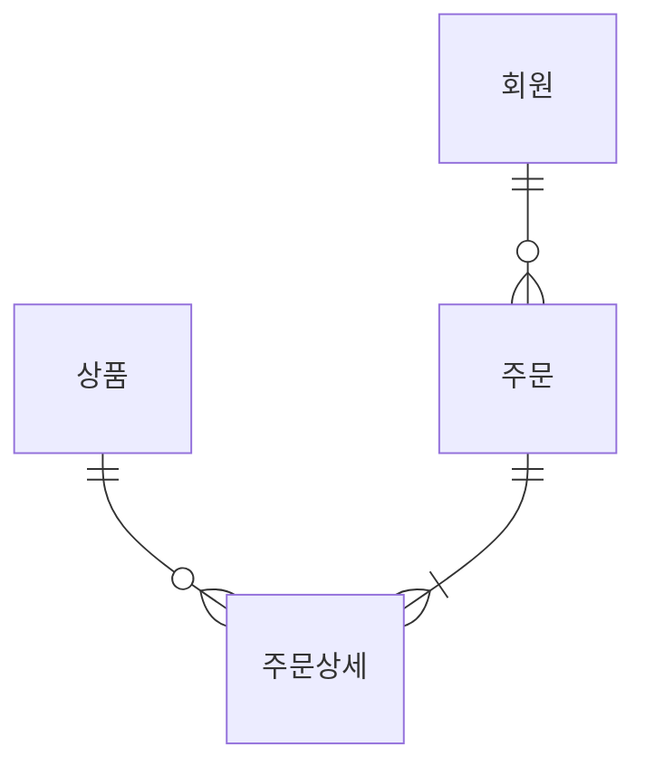

### 2단계 — 논리적 모델 (속성·키·정규화)

엔터티마다 속성을 채우고 PK·FK 를 정함. DBMS 와는 아직 무관한 추상 모델

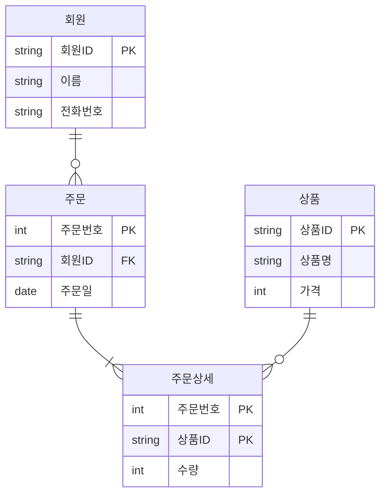

**정규화**(`1-2-1`) (1NF → 2NF → 3NF) 도 여기서

### 3단계 — 물리적 모델 (실제 DBMS 구현)

논리 모델을 실제 DB의 **테이블** 로. 자료형·인덱스·제약조건까지 명시

```sql
CREATE TABLE MEMBER (
    MEMBER_ID  VARCHAR2(10) PRIMARY KEY,
    NAME       VARCHAR2(50) NOT NULL,
    PHONE      VARCHAR2(20)
);

CREATE TABLE PRODUCT (
    PROD_ID    VARCHAR2(10) PRIMARY KEY,
    PROD_NAME  VARCHAR2(100) NOT NULL,
    PRICE      NUMBER(10) NOT NULL
);

CREATE TABLE ORDERS (
    ORDER_ID   NUMBER PRIMARY KEY,
    MEMBER_ID  VARCHAR2(10) REFERENCES MEMBER(MEMBER_ID),
    ORD_DATE   DATE DEFAULT SYSDATE
);

CREATE INDEX IDX_ORDERS_MEMBER ON ORDERS(MEMBER_ID);  -- 성능용 인덱스
```

### 4단계 — 데이터베이스 (운영 중인 실제 데이터)

테이블에 데이터가 **차곡차곡 쌓인 상태**. 사용자는 SQL 로 조회·입력·수정

**MEMBER**

| MEMBER_ID | NAME | PHONE |
|---|---|---|
| M01 | 김철수 | 010-1111 |
| M02 | 이영희 | 010-2222 |

**PRODUCT**

| PROD_ID | PROD_NAME | PRICE |
|---|---|---|
| P01 | 사과 | 1,000 |
| P02 | 배 | 2,000 |

**ORDERS**

| ORDER_ID | MEMBER_ID | ORD_DATE |
|---|---|---|
| 1001 | M01 | 2026-04-01 |
| 1002 | M02 | 2026-04-05 |

### 단계 정리

| 단계 | 이름 | 결과물 | 비유 |
|---|---|---|---|
| 1 | 개념적 모델링 | 핵심 엔터티·관계 ERD (큰 그림) | 손으로 그린 스케치 |
| 2 | 논리적 모델링 | 속성·키 상세 ERD + **정규화** | 정식 건축 도면 |
| 3 | 물리적 모델링 | DBMS 별 CREATE TABLE + 인덱스·파티션 | 시공 계획서 |
| → | 운영 | 데이터가 쌓인 실제 데이터베이스 | 입주 완료된 건물 |

---

## 데이터 모델링의 3가지 관점

| 관점 | 영문 | 모델링 대상 | 핵심 질문 |
|---|---|---|---|
| 데이터 관점 | Data | 업무가 관리하는 데이터 (엔터티·속성) | 무엇을(What) 저장하지 |
| 프로세스 관점 | Process | 업무가 실제 하고 있는 일 (또는 해야 할 일) | 어떻게(How) 처리하지 |
| 데이터·프로세스 상관관계 관점 | Interaction | 프로세스가 데이터에 미치는 영향 (CRUD 매트릭스) | 언제(When) 어떤 데이터가 변하지 |

---

## 좋은 데이터 모델의 특징

| 특징 | 의미 |
|---|---|
| 완전성 | 업무에 필요한 데이터를 빠짐없이 담았는가 |
| 중복 배제 | 같은 데이터가 여러 곳에 흩어져 있지 않은가 |
| 업무 규칙 | 회사의 규칙이 모델에 녹아 있는가 |
| 데이터 재사용 | 다른 업무에서도 활용할 수 있는가 |
| 의사소통 | 보는 사람마다 같은 의미로 읽히는가 |
| 통합성 | 같은 데이터는 한 곳에 정의되어 있는가 |

---

## 3층 스키마 (ANSI/SPARC)

같은 DB도 보는 사람에 따라 전혀 다르게 보임. 외부 / 개념 / 내부, 세 층으로 나눠봄

### 관점 1. 외부 스키마 (External) — 각 사용자/앱이 보는 화면

같은 회원·주문 데이터, 사용자마다 보는 모습이 다름

| 누가 본다 | 화면 (View) | 보이는 컬럼 예시 |
|---|---|---|
| 김철수 (모바일앱) | "내 주문 내역" | 주문번호 · 상품명 · 금액 · 주문일 |
| 이영희 (웹) | "위시리스트" | 상품명 · 가격 · 이미지 |
| 관리자 (백오피스) | "일별 매출" | 날짜 · 총매출 · 주문건수 |

각 화면은 SQL 의 **VIEW** 또는 응용 프로그램 단에서 가공한 데이터

### 관점 2. 개념 스키마 (Conceptual) — 조직 전체가 공유하는 ERD

모든 외부 화면의 원본이 되는 **하나의 통합 설계도**. 회원·상품·주문·주문상세·결제·배송 등 전 엔터티와 관계가 한 ERD 안에

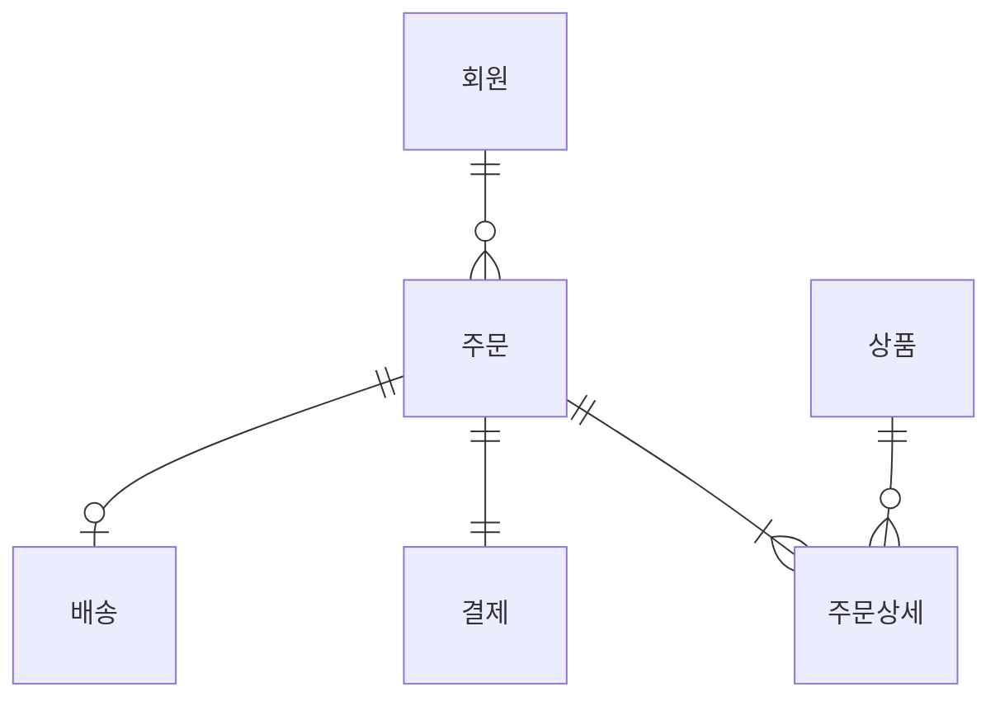

설계자(DA)가 관리하는 **전사 데이터 모델**. DB 하나당 단 하나

### 관점 3. 내부 스키마 (Internal) — 디스크 위 실제 저장 구조

개념 스키마가 **물리적으로 어떻게 저장되는가**. DBA·DBMS 의 영역

| 항목 | 예시 |
|---|---|
| 데이터 파일 | `/oracle/data/SHOP_DATA01.dbf` (8KB 블록 단위) |
| 인덱스 | `IDX_ORDERS_MEMBER` (B-Tree, 회원ID 정렬) |
| 파티션 | ORDERS 테이블을 월별로 분할 (`P_2026_04`, `P_2026_05` ...) |
| 캐시 | 자주 조회되는 회원 데이터 메모리 캐시 |

### 3층이 분리된 이유 — 데이터 독립성

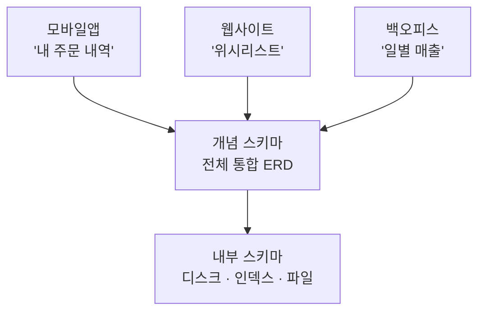

- **논리적 독립성**: 개념 스키마(ERD)가 바뀌어도 외부 스키마(앱 화면)는 영향 없음
- **물리적 독립성**: 내부 스키마(저장 위치·인덱스)가 바뀌어도 개념·외부 스키마는 영향 없음

| 스키마 | 관점 | 개수 | 누가 다룬다 |
|---|---|---|---|
| 외부 (External) | 사용자·응용 프로그램 | **여러 개** | 사용자·개발자 |
| 개념 (Conceptual) | 설계자 통합 | **1개** | DA (Data Architect) |
| 내부 (Internal) | 물리 저장 | **1개** | DBA (DB Administrator) |

### 데이터 독립성 2가지

| 종류 | 의미 |
|---|---|
| 논리적 독립성 | 개념 스키마가 변경돼도 외부 스키마(응용)는 영향 없음 |
| 물리적 독립성 | 내부 스키마가 변경돼도 개념·외부 스키마는 영향 없음 |

---

## [SQL 실전] 모델이 곧 테이블이 된다

논리 모델의 PK는 물리 모델에서 **식별자**(`1-1-5`)(PRIMARY KEY 제약)가 된다.

```sql
-- 논리 모델의 '고객' 엔터티 → 물리 모델의 CUSTOMER 테이블
CREATE TABLE CUSTOMER (
    CUST_ID    VARCHAR2(10) PRIMARY KEY,  -- 식별자
    CUST_NAME  VARCHAR2(50) NOT NULL,     -- 속성
    PHONE      VARCHAR2(20)               -- 속성
);
```

---

## [Before & After] 모델링이 없을 때 vs 있을 때

한 테이블에 다 욱여넣은 모양 vs 고객·주문을 분리한 모양

### Before — 모델링 없이 만든 테이블

| 주문번호 | 고객이름 | 고객전화 | 상품1 | 상품2 | 상품3 |
|---|---|---|---|---|---|
| 1 | 김철수 | 010-1111 | 사과 | 배 | NULL |
| 2 | 김철수 | 010-1111 | 포도 | NULL | NULL |

고객 정보가 중복되고, 상품 칸이 모자라면 더 못 담음

### After — 모델링 후 분리된 테이블

**CUSTOMER**

| CUST_ID | NAME | PHONE |
|---|---|---|
| C001 | 김철수 | 010-1111 |

**ORDER**

| ORD_ID | CUST_ID | PRODUCT |
|---|---|---|
| 1 | C001 | 사과 |
| 2 | C001 | 배 |
| 3 | C001 | 포도 |

중복이 사라지고 상품을 무한히 추가 가능

Before 는 "상품1·상품2·상품3" 같은 컬럼을 미리 박아둬서 주문 개수가 늘면 한계가 분명하다. 고객 정보도 주문마다 반복 저장이라 전화번호 하나 바뀌면 모든 행을 손봐야 한다. 모델링은 이걸 엔터티 분리로 푼다 — 같은 의미는 한 곳에만, 관계는 키로 잇는다.

---

## [시험 출제 포인트]

| 함정 | 정답 |
|---|---|
| 물리적 모델링이 가장 먼저다 | 개념 → 논리 → 물리 순서 |
| 데이터 모델은 코드를 위한 것 | 현실 세계를 추상화한 것 |
| 좋은 모델은 데이터 중복을 일부 허용한다 | 원칙은 중복 배제. 다만 성능을 위해 의도적으로 허용하는 반정규화는 별개 |
| 데이터 모델링 3대 관점 | 데이터 / 프로세스 / 상관관계 |
| 좋은 모델의 6대 특징 | 완전성 / 중복배제 / 업무규칙 / 데이터 재사용 / 의사소통 / 통합성 |

단골 함정: "물리적 모델링 단계에서 정규화를 한다" — 정규화는 **논리** 단계

---

> **30초 시험 직전 정리**
> · 모델링 순서: **개념 → 논리 → 물리** (정규화 = 논리)
> · 3가지 관점: **데이터 / 프로세스 / 데이터·프로세스 상관관계**
> · 좋은 모델 6요소: **완전성 · 중복배제 · 업무규칙 · 재사용성 · 의사소통 · 통합성**
> · 3층 스키마: **외부(View) / 개념(ERD) / 내부(저장)** + **논리적·물리적 독립성** 보장


---

# 1-1-2. 엔터티(Entity)

## [핵심 요약]

> 엔터티(Entity)란 업무에서 관리해야 할 정보의 덩어리(명사)다. 실제 테이블의 후보가 된다.

ex) 쇼핑몰이라면 **회원·상품·주문·배송** 같은 명사 하나하나가 엔터티이며, 각 엔터티의 개별 사례(예: '김철수 회원')를 **인스턴스(Instance, 한 행)** 라고 부른다.

---

## [개념 도식화] 엔터티의 구성

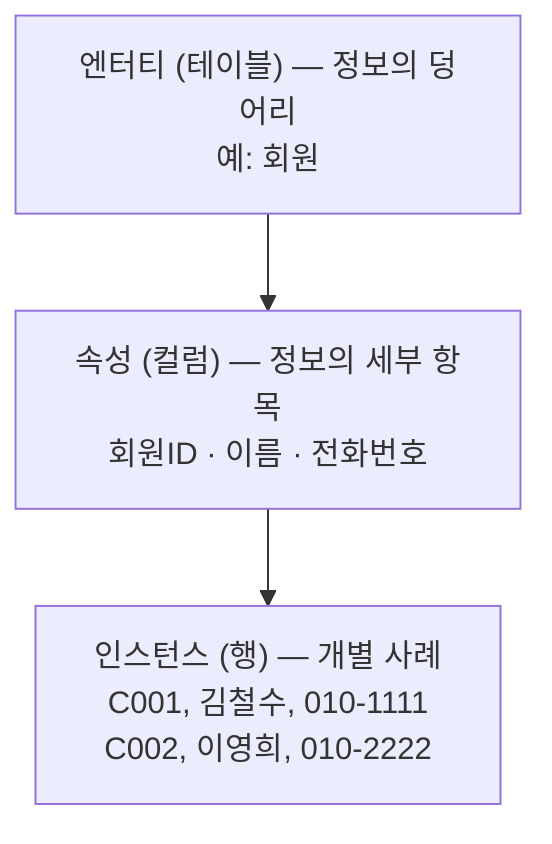

---

## 엔터티의 5가지 특징

| 특징 | 의미 | 예시 |
|---|---|---|
| 업무에서 필요 | 회사가 관리할 가치가 있어야 함 | 쇼핑몰의 '회원'은 필요, 회원의 '발 사이즈'는 불필요 |
| 식별 가능 | 다른 인스턴스와 구분되는 **식별자**(`1-1-5`) 존재 | 회원ID로 구별 |
| 인스턴스 집합 | 2개 이상의 인스턴스 존재 | 회원이 1명만 있으면 엔터티 X |
| 속성 보유 | 2개 이상의 **속성**(`1-1-3`)을 가짐 | 회원ID + 이름 + … |
| 관계 보유 | 다른 엔터티와 **관계**(`1-1-4`)가 있음 | 회원 ─ 주문 |

암기: **업·식·인·속·관**

---

## 엔터티의 분류

### 유무형에 따른 분류

| 종류 | 설명 | 예시 |
|---|---|---|
| 유형 엔터티 | 물리적으로 존재 | 상품, 사원, 매장 |
| 개념 엔터티 | 개념적으로만 존재 | 부서, 조직, 학과 |
| 사건 엔터티 | 행위로 발생 | 주문, 결제, 출입기록 |

### 발생 시점에 따른 분류


| 종류 | 의존성 | 예시 |
|---|---|---|
| 기본(Key) 엔터티 | 독립적 존재 가능 (다른 엔터티 없이도 성립) | 사원, 부서, 고객 |
| 중심(Main) 엔터티 | 기본 엔터티에서 파생 (업무의 주요 결과물) | 주문, 계약, 매출 |
| 행위(Action) 엔터티 | 2개 이상 엔터티의 관계에서 발생 | 주문상세, 출고, 입출금 |

---

## [SQL 실전] 엔터티는 테이블이 된다

```sql
CREATE TABLE MEMBER (
    MEMBER_ID    VARCHAR2(10) PRIMARY KEY,  -- 식별자
    NAME         VARCHAR2(50),
    PHONE        VARCHAR2(20),
    JOIN_DATE    DATE
);
```

---

## [Before & After] 엔터티 도출 전후

"김철수가 2026-04-01에 사과 2개를 주문했다" 같은 한 줄 사건 기록을 그대로 적어두는 방식과, 회원·상품·주문 세 엔터티로 갈라낸 방식 비교

### Before — 엔터티 구분 없이 한 덩어리

| 데이터(혼재) |
|---|
| 김철수가 2026-04-01에 사과 2개 주문 |
| 이영희가 2026-04-02에 배 1개 주문 |

### After — 엔터티 분리

**회원(MEMBER)**

| MEMBER_ID | NAME |
|---|---|
| M01 | 김철수 |
| M02 | 이영희 |

**상품(PRODUCT)**

| PROD_ID | NAME |
|---|---|
| P01 | 사과 |
| P02 | 배 |

**주문(ORDER)**

| ORD_ID | MEMBER_ID | PROD_ID | QTY | ORD_DATE |
|---|---|---|---|---|
| 1 | M01 | P01 | 2 | 2026-04-01 |
| 2 | M02 | P02 | 1 | 2026-04-02 |

한 줄에 "회원·상품·주문"이라는 서로 다른 성질의 정보가 섞여 있으면 회원 전화번호 갱신·상품 단가 변경·주문 취소가 한 행을 동시에 건드린다. 엔터티 단위로 분리하면 각 변경이 그 엔터티 안에서만 끝난다. "사람 얘기인가, 물건 얘기인가, 사건 얘기인가"를 구분해 명사로 뽑아내는 것이 엔터티 도출의 출발점.

---

## [시험 출제 포인트]

| 함정 | 정답 |
|---|---|
| 엔터티는 1개 인스턴스만 있어도 된다 | 2개 이상 필요 |
| 엔터티는 속성이 1개여도 가능하다 | 2개 이상 필요 |
| 행위 엔터티의 예 | 주문, 입출금, 출고 |
| 엔터티 명명 규칙 | 현업 용어 사용, 단수 명사, 약어 지양, 대문자 표기 권장 |

단골 보기: "엔터티는 영속적으로 존재하는 인스턴스의 집합이다" → 옳음. "인스턴스가 1개여도 무방하다" → 틀림

---

> **30초 시험 직전 정리**
> · 엔터티 5대 특징: **업·식·인·속·관** (업무에 필요 / 식별 가능 / 인스턴스 ≥ 2 / 속성 ≥ 2 / 관계 보유)
> · 유무형 분류: **유형 / 개념 / 사건**
> · 발생 시점 분류: **기본 → 중심 → 행위**
> · 명명 규칙: **단수 명사 / 현업 용어 / 약어 지양 / 대문자 권장**


---

# 1-1-3. 속성(Attribute)

## [핵심 요약]

> 속성(Attribute)이란 **엔터티**(`1-1-2`)가 가지는 세부 정보 항목, 곧 컬럼이다. 엔터티를 설명하는 가장 작은 단위다.

ex) 명함 한 장에서 명함 자체는 엔터티(사람), 이름·전화번호·이메일 같은 각 항목이 속성. 이름은 더 이상 쪼개지지 않는 최소 단위

---

## [개념 도식화] 엔터티 / 인스턴스 / 속성 / 속성값

회원(MEMBER) 테이블 예시:

| ID&nbsp;(속성) | 이름&nbsp;(속성) | 전화번호&nbsp;(속성) |
|---|---|---|
| **M01** | **김철수** | **010-1111** ← 속성값(Value) |
| M02 | 이영희 | 010-2222 |

각 행 = **인스턴스(Row)** / 각 칸 = **속성값(Value)** / 각 컬럼 = **속성(Attribute)**.

---

## 속성의 3가지 분류 기준

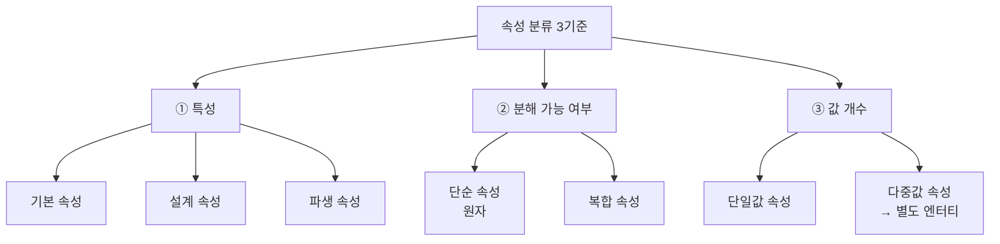

### 특성에 따른 분류

| 종류 | 의미 | 예시 |
|---|---|---|
| 기본 속성 | 업무에서 직접 추출된 본래의 속성 | 이름, 전화번호, 주소 |
| 설계 속성 | 업무 설계 과정에서 새로 만든 속성 | 회원ID, 상품코드 |
| 파생 속성 | 다른 속성에서 계산되어 나온 속성 | 총주문금액(=수량×단가) |

시험 단골: "주민번호로부터 구한 나이" → 파생 속성

### 분해 가능 여부

| 종류 | 의미 | 예시 |
|---|---|---|
| 단순(원자) 속성 | 더 이상 분해 불가 | 이름, 나이 |
| 복합 속성 | 여러 의미가 합쳐진 형태 — 분해해서 저장하면 활용도 ↑ | 주소(시+구+동) |

> **주의** — '복합 속성' (1-1-3) 과 '복합식별자' (1-1-5) 는 **다른 개념**.
> 복합 속성 = 한 속성을 여러 의미로 쪼갤 수 있음.
> 복합식별자 = 여러 속성을 묶어 PK로 씀.

### 속성값의 개수

| 종류 | 의미 | 예시 |
|---|---|---|
| 단일값 속성 | 하나만 가짐 | 주민번호 |
| 다중값 속성 | 여러 개 가능 → 별도 엔터티로 분리 | 전화번호(집, 휴대폰) |

---

## 속성의 명명 규칙

```
[속성 이름 짓기 4원칙]
  1. 현업 용어 사용 — 코드가 아닌 업무 용어로
  2. 명사형 (서술식 X) — '주문수량' O, '주문은얼마인가' X
  3. 약어 자제 — 'qty' 보다 '수량'
  4. 전체 모델에서 유일 — 같은 이름이 여러 엔터티에 흩어지지 않도록
```

| 좋은 예 | 나쁜 예 |
|---|---|
| 회원_등록일 | regdt (약어 남발) |
| 상품_가격 | 상품의가격은얼마인가 (서술식) |
| 주문_수량 | qty (축약형 모호) |

---

## 도메인(Domain) — 속성의 값 범위

도메인은 속성이 가질 수 있는 **값의 종류·범위·제약**. **데이터 타입 + 크기 + 허용값(제약조건)** 세 가지가 모두 포함됨. NOT NULL 여부도 도메인의 일부로, **NULL**(`1-2-4`) 허용 여부는 속성마다 별도 결정

| 속성 | 도메인 (타입 · 크기 · 제약) |
|---|---|
| 성별 | CHAR(1) / { 'M', 'F' } 만 허용 |
| 나이 | NUMBER(3) / 0 ~ 150 사이 정수 |
| 이메일 | VARCHAR2(100) / @ 포함 형식 |

같은 도메인을 가진 속성은 여러 엔터티에 나와도 같은 의미로 다뤄야 함 (통합성)

---

## [SQL 실전] 속성 정의

```sql
CREATE TABLE MEMBER (
    MEMBER_ID    VARCHAR2(10),     -- 설계 속성
    NAME         VARCHAR2(50),      -- 기본 속성
    BIRTH        DATE,              -- 기본 속성
    AGE          NUMBER GENERATED ALWAYS AS  -- 파생 속성
                 (TRUNC(MONTHS_BETWEEN(SYSDATE, BIRTH)/12)) VIRTUAL
);
```

---

## [Before & After] 다중값 속성의 분리

회원 한 명이 휴대폰·집 전화 두 개를 동시에 가진 상황. 한 칸에 "010-1111, 02-333-4444"처럼 쉼표로 이어 붙이는 방식 vs 별도 엔터티로 빼는 방식

### Before — 다중값 속성을 한 칸에

| MEMBER_ID | NAME | PHONE |
|---|---|---|
| M01 | 김철수 | 010-1111, 02-333-4444 |

검색·변경 모두 어려움

### After — 별도 엔터티로 분리

**MEMBER**

| MEMBER_ID | NAME |
|---|---|
| M01 | 김철수 |

**MEMBER_PHONE**

| MEMBER_ID | TYPE | PHONE |
|---|---|---|
| M01 | 휴대폰 | 010-1111 |
| M01 | 집 | 02-333-4444 |

한 칸에 두 값이 들어가면 "휴대폰 번호만 검색"이나 "집 전화 변경" 같은 단순 작업도 문자열 파싱부터 해야 하고, 번호가 셋으로 늘면 컬럼 자체를 늘려야 한다. 한 속성엔 한 값만 — 한 인스턴스가 같은 속성에 여러 값을 갖는 순간 별도 엔터티 후보다. 1NF 의 원자값 원칙도 같은 맥락.

---

## [시험 출제 포인트]

| 함정 | 정답 |
|---|---|
| "주문수량 × 단가 = 주문금액"은 어떤 속성인가 | 파생 속성 |
| "주민등록번호로부터 추출한 성별"은 | 파생 속성 |
| 다중값 속성을 그대로 둔다 | 별도 엔터티로 분리(정규화) |
| 복합 속성과 단순 속성 | 주소(시·구·동) = 복합, 나이 = 단순 |
| 속성은 더 이상 쪼갤 수 없는 단위인가 | 그렇다(최소 단위) |
| 속성과 인스턴스의 관계 | 한 인스턴스는 각 속성에 단 하나의 값을 가짐 |

함정 단골: "파생 속성은 가급적 줄여야 한다" → 옳음 (데이터 일관성). 단, 성능을 위해 의도적으로 둘 수는 있음

---

> **30초 시험 직전 정리**
> · 특성 분류: **기본 / 설계 / 파생** (파생 = 다른 속성에서 계산)
> · 분해 분류: **단순(원자) / 복합** (복합 ≠ 복합식별자)
> · 값 개수 분류: **단일값 / 다중값** (다중값은 별도 엔터티로 분리)
> · 도메인 = **타입 + 크기 + 제약조건**


---

# 1-1-4. 관계(Relationship)

## [핵심 요약]

> 관계(Relationship)란 두 **엔터티**(`1-1-2`)가 서로 어떻게 연결되어 있는지 표현한 것이다.

ex) 가족의 '부모 ─ 자식 : 낳다/자식이다'처럼, 데이터 모델에서도 '회원 ─ 주문 : 주문하다/주문되다', '부서 ─ 사원 : 소속하다/소속되다'와 같이 양방향 동사로 표현

---

## [개념 도식화] 관계의 4요소


회원 1명 → 주문 여러 건 (1:N). 양방향 관계명을 모두 명명

| 요소 | 영문 | 설명 | 예 |
|---|---|---|---|
| 관계명 | Membership | 두 엔터티를 잇는 동사·역할명 | 주문하다 / 주문되다 |
| 관계차수 | Cardinality | 1:1, 1:N, M:N | 회원 1 : N 주문 |
| 관계선택성 | Optionality | 필수(Mandatory) / 선택(Optional) | 주문엔 반드시 회원이 있어야 하는가 |
| 관계의 방향성 | Direction | 양방향 표현 (양쪽 관계명 모두 명명) | 회원→주문 / 주문→회원 |

---

## 관계차수(Cardinality) 3가지

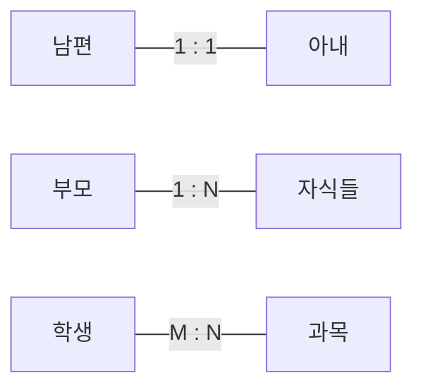

### 1:1 관계

| 예시 | 설명 |
|---|---|
| 사원 ─ 사원증 | 사원 1명당 사원증 1개 |

### 1:N 관계

| 예시 | 설명 |
|---|---|
| 부서 ─ 사원 | 1개 부서에 N명 사원 |
| 회원 ─ 주문 | 회원 1명이 N건 주문 |

### M:N 관계

| 예시 | 설명 |
|---|---|
| 학생 ─ 과목 | 학생 M명, 과목 N개 (서로 여러 개) |

M:N 은 그대로 구현 불가. 중간에 교차 엔터티를 두어 1:N 두 개로 분해

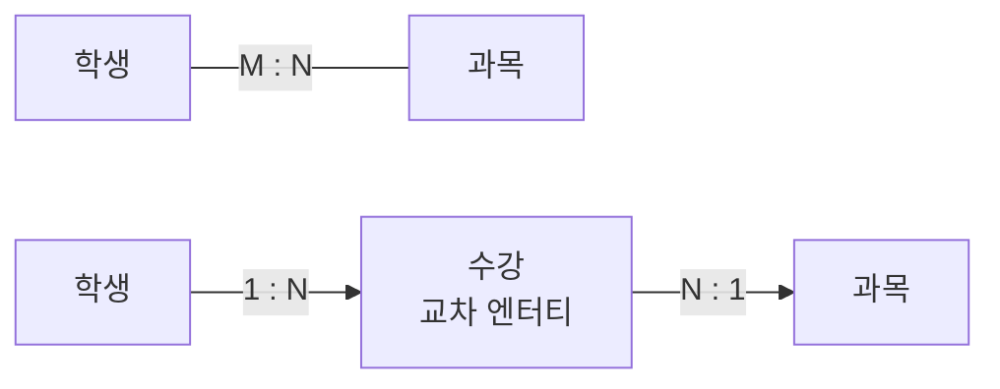

---

## 관계선택성(Optionality)

| 종류 | 표기 | 의미 |
|---|---|---|
| 필수(Mandatory) | ─ | 반드시 있어야 함 |
| 선택(Optional) | ○ | 있을 수도 있고 없을 수도 있음 |

```
[회원] ──── [주문]      :  주문은 반드시 회원이 있어야 함(필수)
[회원] ──○─ [쿠폰]      :  회원이 쿠폰은 없을 수도 있음(선택)
```

---

## 관계의 분류 — 식별 vs 비식별

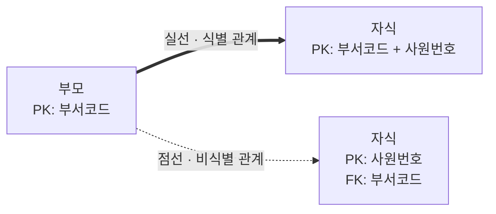

| 종류 | 자식의 PK에 부모 **식별자**(`1-1-5`)가 포함? | 표기 | 비유 |
|---|---|---|---|
| 식별 관계 | 포함됨 (강한 종속) | 실선 | 자식이 부모 없이 존재 불가 (예: 주문 ↔ 주문상세) |
| 비식별 관계 | 포함 안 됨 (약한 종속) | 점선 | 자식이 부모 없이도 존재 가능 (예: 부서 ↔ 사원) |

---

## [SQL 실전] 관계는 외래키(FK)로 구현된다

설계 단계의 관계는 SQL 단계에서 **조인**(`2-1-7`)으로 활용. 관계와 조인의 연결은 **관계와 조인의 이해**(`1-2-2`)에서

```sql
-- 회원(부모) 1 : N 주문(자식)
CREATE TABLE MEMBER (
    MEMBER_ID  VARCHAR2(10) PRIMARY KEY,
    NAME       VARCHAR2(50)
);

CREATE TABLE ORDERS (
    ORDER_ID   NUMBER PRIMARY KEY,
    MEMBER_ID  VARCHAR2(10),  -- 외래키(관계의 구현)
    ORD_DATE   DATE,
    CONSTRAINT FK_ORDER_MEMBER
        FOREIGN KEY(MEMBER_ID) REFERENCES MEMBER(MEMBER_ID)
);
```

---

## [Before & After] M:N 관계의 분해

학생은 여러 과목을 듣고 한 과목엔 여러 학생이 등록 — 양쪽 모두 다(多)인 M:N. 그대로 두는 시도 vs 가운데 '수강' 교차 엔터티를 끼워 1:N 두 개로 쪼갠 형태

### Before — M:N 관계는 그대로 구현 불가

```
[학생] M ────── N [과목]
```

| 학생 | 듣는 과목들 |
|---|---|
| 김철수 | 수학, 영어, 국어 |
| 이영희 | 영어, 과학 |

### After — 1:N + 1:N으로 분해

```
[학생] 1 ── N [수강] N ── 1 [과목]
```

**학생**

| STU_ID | NAME |
|---|---|
| S01 | 김철수 |
| S02 | 이영희 |

**과목**

| SUB_ID | NAME |
|---|---|
| K1 | 수학 |
| K2 | 영어 |
| K3 | 국어 |
| K4 | 과학 |

**수강(교차 엔터티)**

| STU_ID | SUB_ID |
|---|---|
| S01 | K1 |
| S01 | K2 |
| S01 | K3 |
| S02 | K2 |
| S02 | K4 |

M:N 을 그대로 두면 학생 행에 "수학, 영어, 국어" 같은 다중값 컬럼을 넣을 수밖에 없는데, 이는 1NF 위반이고 성적·수강일 같은 관계 속성도 둘 곳이 없어진다. 교차 엔터티를 두면 (S01, K1) 한 줄이 한 수강 사실을 표현하므로 관계 속성도 자연스럽게 거기에 붙는다. 양쪽이 다(多)인 관계를 만나면 반사적으로 교차 엔터티를 끼워 1:N + 1:N 으로 분해하는 것이 안전.

---

## [시험 출제 포인트]

| 함정 | 정답 |
|---|---|
| M:N 관계는 그대로 구현 가능하다 | 교차 엔터티로 1:N 두 개로 분해 |
| 식별 관계 = 점선 | 식별 관계 = 실선, 비식별 = 점선 |
| 관계의 4가지 표기 요소 | 관계명 / 차수 / 선택성 / 방향성 |
| 관계차수 3종류 | 1:1, 1:N, M:N |
| 자식 엔터티에 부모 식별자가 PK로 들어가면 | 식별 관계 |
| 부모 식별자가 일반 속성(FK)으로만 들어가면 | 비식별 관계 |

단골 트릭: "관계의 페어링(pairing)은 인스턴스 간의 개별적 연결" → 관계의 구체적 사례를 가리키는 옳은 설명

---

> **30초 시험 직전 정리**
> · 관계 4요소: **관계명 / 관계차수 / 관계선택성 / 관계방향**
> · 차수 3종: **1:1 · 1:N · M:N** (M:N은 교차 엔터티로 분해)
> · 식별 = **실선**, 비식별 = **점선**
> · 관계는 SQL 에서 **외래키(FK)** 로 구현된다


---

# 1-1-5. 식별자(Identifier)

## [핵심 요약]

> 식별자(Identifier)란 **엔터티**(`1-1-2`) 안의 인스턴스를 서로 구분해 주는 유일한 표식이다. 테이블의 기본키(Primary Key)가 된다.

ex) 같은 이름의 김철수가 100명이어도 주민등록번호는 모두 다름 — 이름은 일반 속성, 주민번호는 식별자(겹치지 않는 유일값)

---

## [개념 도식화] 식별자의 위치

회원(MEMBER) 테이블 — PK 가 모든 행을 유일하게 구분:

| PK&nbsp;(주식별자) | 이름 | 전화번호 |
|---|---|---|
| **M01** | 김철수 | 010-1111 |
| **M02** | 이영희 | 010-2222 |

같은 이름이어도 PK가 다르므로 **100% 구분 가능**.

---

## 식별자의 4가지 분류 기준

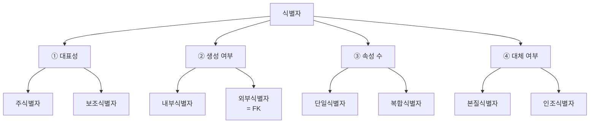

| 기준 | 분류 | 핵심 차이 |
|---|---|---|
| ① 대표성 | **주식별자 / 보조식별자** | 엔터티의 대표 식별자 vs 보조용 |
| ② 생성 여부 | **내부식별자 / 외부식별자** | 자기 엔터티에서 생성 vs 다른 엔터티에서 가져옴 (= FK) |
| ③ 속성 수 | **단일식별자 / 복합식별자** | 1개 속성 vs 2개 이상 결합 |
| ④ 대체 여부 | **본질식별자 / 인조식별자** | 업무 자연 도출 vs 인위적 부여 |

### 대표성

| 종류 | 의미 | 예 |
|---|---|---|
| 주식별자(Primary) | 엔터티 대표 식별자 | 회원ID |
| 보조식별자(Alternate) | 보조적 식별자 | 이메일 |

### 스스로 만든 vs 외부에서 받음

| 종류 | 의미 | 예 |
|---|---|---|
| 내부식별자 | 자기 엔터티 내에서 생성 | MEMBER 테이블의 MEMBER_ID |
| 외부식별자 | 다른 엔터티의 주식별자를 참조해 가져옴 = **외래키(FK)** | 주문 테이블의 MEMBER_ID (← 회원 PK 참조) |

### 속성의 개수

| 종류 | 의미 | 예 |
|---|---|---|
| 단일식별자 | 1개 속성 | 회원ID |
| 복합식별자 | 2개 이상 속성 결합 | (주문ID + 상품ID) → 주문상세 PK |

### 본질 vs 인조

| 종류 | 의미 | 예 |
|---|---|---|
| 본질식별자 | 업무에서 자연스럽게 도출 | 주민번호, 학번 |
| 인조식별자 | 인위적으로 만든 식별자 | 자동증가 ID, UUID |

본질·인조의 트레이드오프는 **본질식별자 vs 인조식별자**(`1-2-5`)에서

---

## 주식별자의 4가지 조건

| 조건 | 의미 |
|---|---|
| 유일성 | 모든 인스턴스를 유일하게 구분 |
| 최소성 | 꼭 필요한 속성만으로 구성 (**정규화**(`1-2-1`)와 직결) |
| 불변성 | 한번 정해지면 거의 변하지 않음 |
| 존재성 | NULL이 될 수 없음 |

암기: **유·최·불·존**

---

## [SQL 실전] PK / FK 정의

```sql
-- 회원: 단일 PK
CREATE TABLE MEMBER (
    MEMBER_ID  VARCHAR2(10) PRIMARY KEY,   -- 주식별자
    EMAIL      VARCHAR2(100) UNIQUE,       -- 보조식별자
    NAME       VARCHAR2(50) NOT NULL
);

-- 주문상세: 복합 PK
CREATE TABLE ORDER_DETAIL (
    ORDER_ID   NUMBER,
    PROD_ID    VARCHAR2(10),
    QTY        NUMBER,
    CONSTRAINT PK_ORD_DTL PRIMARY KEY (ORDER_ID, PROD_ID),  -- 복합 식별자
    CONSTRAINT FK_OD_ORD  FOREIGN KEY (ORDER_ID) REFERENCES ORDERS(ORDER_ID),
    CONSTRAINT FK_OD_PROD FOREIGN KEY (PROD_ID)  REFERENCES PRODUCT(PROD_ID)
);
```

---

## [Before & After] 식별자를 잘못 잡으면

이름이 똑같은 김철수가 두 명 가입한 상황. 이름을 PK로 잡은 경우 vs 회원ID 를 따로 부여한 경우

### Before — 식별자가 '이름'

| NAME (PK?) | PHONE |
|---|---|
| 김철수 | 010-1111 |
| 김철수 | 010-2222 |

동명이인 등록 불가 (유일성 위반)

### After — 식별자가 '회원ID'

| MEMBER_ID (PK) | NAME | PHONE |
|---|---|---|
| M01 | 김철수 | 010-1111 |
| M02 | 김철수 | 010-2222 |

동명이인이라도 ID로 구분 가능

이름은 같은 값이 얼마든지 나올 수 있어 유일성을 보장하지 못한다. 식별자의 4대 조건(유·최·불·존) 중 가장 먼저 깨지는 게 유일성이고, 결혼·개명 등으로 변할 수 있어 불변성도 위태롭다. 업무 속성 중 자연스러운 유일값이 마땅치 않으면 회원ID 같은 인조식별자를 PK 로 두는 것이 안전.

---

## 식별자 표기

ERD 표기 — 회원 엔터티:

| 영역 | 속성 | 비고 |
|---|---|---|
| **PK 영역** | MEMBER_ID | 주식별자 (Primary) |
| 일반 속성 | NAME | |
| 일반 속성 | EMAIL | UNIQUE = 보조식별자 |
| 일반 속성 | PHONE | |

---

## [시험 출제 포인트]

| 함정 | 정답 |
|---|---|
| 주식별자 4대 조건 | 유일성 / 최소성 / 불변성 / 존재성(NOT NULL) |
| 주식별자는 NULL이 가능하다 | 불가 |
| 복합식별자는 PK가 될 수 없다 | 될 수 있다(여러 속성으로 구성된 PK) |
| 외부식별자는 다른 엔터티의 주식별자를 참조 | 옳다(= 외래키, FK) |
| 인조식별자의 단점 | 업무적 의미가 없어 데이터 품질 검증이 어려움 |
| 본질식별자가 너무 길거나 자주 변하면 | 인조식별자(대체키) 도입 고려 |

단골 트릭: "주식별자는 자주 변경되어도 된다" → 불변성 위반

---

> **30초 시험 직전 정리**
> · 4대 조건: **유·최·불·존** (유일성 / 최소성 / 불변성 / 존재성=NOT NULL)
> · 4대 분류: **대표성·생성여부·속성수·대체여부** 4가지 기준 ⟶ 8개 종류
> · 외부식별자 = **외래키(FK)** = 다른 엔터티의 PK 참조
> · 본질식별자가 너무 길거나 자주 변하면 → **인조식별자(대체키)** 도입
> · NULL 가능? → **불가** (존재성 위반)


---

# 1-2-1. 정규화(Normalization)

## [핵심 요약]

> 정규화(Normalization)란 데이터의 중복을 없애고 깔끔하게 정리하는 작업이다. 테이블을 단계적으로 쪼개서 이상현상을 막는다.

ex) 옷장 한 칸에 속옷·양말·셔츠·외투를 다 욱여넣으면 양말 찾기가 어렵고, 셔츠를 빼다가 다른 옷이 떨어진다. 칸을 나눠 종류별로 분리하는 것이 정규화.

---

## [개념 도식화] 정규화 단계

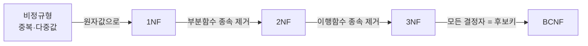

| 단계 | 핵심 규칙 | 한줄 의미 |
|---|---|---|
| 1NF | 모든 속성이 원자값 | 한 칸에 한 값만 |
| 2NF | 부분 함수 종속 제거 | PK 일부에만 종속된 컬럼 분리 |
| 3NF | 이행 함수 종속 제거 | A→B→C 형태 분리 |
| BCNF | 모든 결정자가 후보키 | 더 엄격한 3NF |

---

## 이상현상(Anomaly) 3가지

| 종류 | 무슨 일인가 | 비유 |
|---|---|---|
| 삽입 이상 | 데이터 넣으려는데 다른 정보가 없어 못 넣음 | 학생 등록하려는데 수강과목 칸을 비울 수 없음 |
| 갱신 이상 | 한 곳만 바꿨는데 다른 곳이 안 바뀜 | 회원 주소 1곳만 수정해 데이터 불일치 |
| 삭제 이상 | 데이터 지우려다 필요한 정보까지 사라짐 | 마지막 수강 취소했는데 학생 정보까지 삭제 |

---

## 1NF — 원자값 만들기

### Before(비정규형)

| 학생 | 수강과목 |
|---|---|
| 김철수 | 수학, 영어, 국어 |

### After(1NF)

| 학생 | 수강과목 |
|---|---|
| 김철수 | 수학 |
| 김철수 | 영어 |
| 김철수 | 국어 |

모든 칸이 하나의 값을 가짐

---

## 2NF — 부분 함수 종속 제거

부분 함수 종속이란 **복합 식별자**(`1-1-5`)인 PK (A, B) 중 어떤 컬럼이 A에만 또는 B에만 의존하는 상태

### Before(1NF, 부분종속 존재)

PK = (학생ID, 과목ID)

| 학생ID | 과목ID | 학생이름 | 과목명 | 성적 |
|---|---|---|---|---|
| S01 | K1 | 김철수 | 수학 | 90 |
| S01 | K2 | 김철수 | 영어 | 85 |

학생이름은 학생ID에만, 과목명은 과목ID에만 종속됨

### After(2NF)

**학생**

| 학생ID | 학생이름 |
|---|---|
| S01 | 김철수 |

**과목**

| 과목ID | 과목명 |
|---|---|
| K1 | 수학 |
| K2 | 영어 |

**수강**

| 학생ID | 과목ID | 성적 |
|---|---|---|
| S01 | K1 | 90 |
| S01 | K2 | 85 |

---

## 3NF — 이행 함수 종속 제거

이행 종속이란 A → B → C 형태로, PK가 아닌 B를 통해 C가 결정되는 상태

### Before(2NF, 이행종속)

| 사원ID(PK) | 부서ID | 부서명 |
|---|---|---|
| E01 | D1 | 영업부 |
| E02 | D1 | 영업부 |

사원ID → 부서ID → 부서명 (이행 종속)

### After(3NF)

**사원**

| 사원ID | 부서ID |
|---|---|
| E01 | D1 |
| E02 | D1 |

**부서**

| 부서ID | 부서명 |
|---|---|
| D1 | 영업부 |

---

## BCNF — 더 엄격한 3NF

3NF 까지 정규화해도 일부 비정상 종속이 남는 경우가 있다. **모든 결정자(determinant)가 후보키여야** BCNF.

> **결정자란?** — A → B 일 때 B 를 결정하는 A. 이 A 가 후보키 (PK 또는 UNIQUE) 가 아니면 BCNF 위반.

### 예시 (3NF 만족, BCNF 위반)

PK = (학생, 과목)

| 학생 | 과목 | 강사 |
|---|---|---|
| S01 | 수학 | 김교수 |
| S02 | 수학 | 김교수 |
| S03 | 영어 | 이교수 |

규칙: 한 강사는 한 과목만 가르침 → **강사 → 과목** 종속 존재

문제: '강사' 는 후보키가 아닌데 '과목' 을 결정 → BCNF 위반

### After (BCNF)

**강사_과목**: (강사, 과목)
**학생_강사**: (학생, 강사)

| 단계 | 차이 |
|---|---|
| 3NF | PK가 아닌 컬럼이 PK에 직접 종속 (이행 종속 제거 완료) |
| BCNF | 모든 함수 종속의 **결정자가 후보키** 여야 함 |

비유하면 3NF 는 거의 깔끔, BCNF 는 완벽주의 정리

---

## [SQL 실전] 정규화로 분리

```sql
-- 정규화 전: 한 테이블에 모든 정보
CREATE TABLE BAD_ORDER (
    ORDER_ID NUMBER,
    PROD_ID  VARCHAR2(10),
    PROD_NAME VARCHAR2(50),  -- 상품명이 함께
    QTY      NUMBER,
    CUST_NAME VARCHAR2(50)   -- 고객명이 함께
);

-- 정규화 후: 책임에 따라 분리
CREATE TABLE PRODUCT (PROD_ID VARCHAR2(10) PRIMARY KEY, PROD_NAME VARCHAR2(50));
CREATE TABLE CUSTOMER(CUST_ID VARCHAR2(10) PRIMARY KEY, CUST_NAME VARCHAR2(50));
CREATE TABLE ORDERS  (ORDER_ID NUMBER PRIMARY KEY, CUST_ID VARCHAR2(10));
CREATE TABLE ORDER_DETAIL(ORDER_ID NUMBER, PROD_ID VARCHAR2(10), QTY NUMBER);
```

---

## [Before & After] 정규화 효과

주문 한 건마다 고객 정보·상품 단가까지 한 줄에 다 적어두는 비정규형 테이블. 김철수가 두 번 주문하면 그의 전화번호가 두 번 똑같이 적히고, 사과 단가는 주문될 때마다 반복. 정규화 전후 차이.

### Before

| 주문ID | 고객명 | 고객전화 | 상품명 | 단가 | 수량 |
|---|---|---|---|---|---|
| 1 | 김철수 | 010-1111 | 사과 | 1000 | 2 |
| 2 | 김철수 | 010-1111 | 배 | 2000 | 1 |
| 3 | 이영희 | 010-2222 | 사과 | 1000 | 3 |

고객 정보 중복, 상품 단가 중복, 수정 시 일관성 깨짐

### After (3NF)

고객·상품·주문·주문상세 4개로 분리되어 중복 제거

같은 고객 전화번호가 주문 행마다 반복되는 것은 함수 종속이 한 테이블 안에 섞여 있기 때문(고객명·고객전화는 고객ID 에, 상품명·단가는 상품ID 에 종속). 종속이 다른 데이터끼리 같은 테이블을 공유하면 갱신·삭제·삽입 이상이 한 자리에서 다 터진다. "한 테이블엔 한 가지 의미만"이라는 원칙으로 단계적으로 쪼개면, 김철수의 전화번호는 고객 테이블 한 줄에서만 관리하면 된다.

---

## 정규화의 장단점

| 장점 | 단점 |
|---|---|
| 데이터 중복 제거 | 테이블이 많아짐 |
| 이상현상 방지 | **조인**(`1-2-2`)이 늘어남 |
| 데이터 무결성 | 조회 성능 일부 저하 가능 |
| 변경/유지보수 용이 | — |

성능을 위해 의도적 반정규화(역정규화)도 가능

---

## [시험 출제 포인트]

| 함정 | 정답 |
|---|---|
| 정규화 단계 순서 | 1NF → 2NF → 3NF → BCNF |
| 1NF 핵심 | 원자값 |
| 2NF 핵심 | 부분 함수 종속 제거 |
| 3NF 핵심 | 이행 함수 종속 제거 |
| 정규화의 단점 | 조인 증가로 인한 조회 성능 저하 |
| 이상현상 3종 | 삽입/갱신/삭제 이상 |
| "정규화하면 항상 성능이 좋아진다" | 조회는 느려질 수 있음. 단 데이터 무결성은 향상 |

단골 출제: "복합 PK 중 일부 속성에만 종속되는 컬럼이 있으면 어느 정규형 위반인가" → 2NF

---

> **30초 시험 직전 정리**
> · 단계: **1NF → 2NF → 3NF → BCNF** (순서 함정 단골)
> · 1NF = **원자값** / 2NF = **부분종속 제거** / 3NF = **이행종속 제거** / BCNF = **결정자 = 후보키**
> · 이상현상 3종: **삽입 / 갱신 / 삭제**
> · 정규화 ↔ 반정규화 — 무결성 vs 성능. 조회 성능을 위해 의도적 반정규화 가능


---

# 1-2-2. 관계와 조인의 이해

## [핵심 요약]

> 모델에서의 **관계**(`1-1-4`)는 외래키(FK)로 구현되고, 그 관계를 따라 여러 테이블을 합쳐 보는 작업이 조인(JOIN)이다.

ex) 영수증엔 주문 정보만, 회원카드엔 회원 정보만 있음. 같은 사람의 영수증과 카드를 맞춰 보면 "김철수가 사과 2개 샀구나"가 보인다 — 흩어진 정보를 키로 맞춰 합치는 것이 조인.

---

## [개념 도식화] 관계 → FK → JOIN


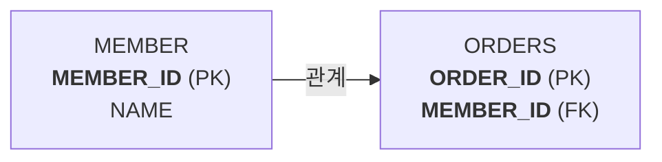

자식 테이블의 **FK = 조인 키**.

---

## 조인의 4가지 종류 — 개념 미리보기

| 종류 | 의미 | 비유 |
|---|---|---|
| INNER JOIN | 양쪽에 다 있는 것만 | 양쪽 카드 모두 가진 사람 |
| LEFT OUTER | 왼쪽 다, 오른쪽은 매칭만 | 왼쪽 기준, 오른쪽 없으면 NULL |
| RIGHT OUTER | 오른쪽 다 | 오른쪽 기준 |
| FULL OUTER | 양쪽 모두 다 | 한쪽만 있어도 표시 |

자세한 구문은 **조인**(`2-1-7`) / **표준 조인**(`2-1-8`)에서

---

## 관계의 종류와 조인 시 주의점

### 1:1 관계 — 단순 매칭

```
[사원] 1 ── 1 [사원증]
```

INNER JOIN 결과: 사원 한 명당 사원증 한 개 → 사원 행 수 그대로 유지 (사원증 없는 사원은 LEFT JOIN 써야 결과에 남음)

### 1:N 관계 — 행이 늘어남

```
[회원] 1 ── N [주문]
```

회원 1명에게 주문 3건이면 조인 후 3행으로 늘어남

### M:N 관계 — 교차 엔터티 필요

```
[학생] M ── N [과목]    →    [학생] 1─N [수강] N─1 [과목]
```

조인은 반드시 수강(교차)을 거쳐 두 번

---

## [SQL 실전] 관계로 연결된 테이블 조인

```sql
-- 1:N 조인: 회원과 주문
SELECT  M.NAME, O.ORDER_ID, O.ORD_DATE
FROM    MEMBER M
        JOIN ORDERS O ON M.MEMBER_ID = O.MEMBER_ID;

-- M:N → 교차 테이블 거쳐 두 번 조인
SELECT  S.NAME AS STUDENT, K.NAME AS SUBJECT, R.GRADE
FROM    STUDENT  S
        JOIN REGISTER R ON S.STU_ID = R.STU_ID
        JOIN SUBJECT  K ON R.SUB_ID = K.SUB_ID;
```

---

## [Before & After] 데이터가 합쳐지는 모습

회원은 2명(김철수·이영희), 주문은 3건(김철수가 2건, 이영희가 1건). MEMBER 와 ORDERS 가 MEMBER_ID 로 1:N 관계일 때, INNER JOIN 결과 행 수가 어떻게 결정되는가

### 입력 테이블

**MEMBER**

| MEMBER_ID | NAME |
|---|---|
| M01 | 김철수 |
| M02 | 이영희 |

**ORDERS**

| ORDER_ID | MEMBER_ID | ORD_DATE |
|---|---|---|
| 1 | M01 | 2026-04-01 |
| 2 | M01 | 2026-04-05 |
| 3 | M02 | 2026-04-10 |

### After — INNER JOIN 결과

| NAME | ORDER_ID | ORD_DATE |
|---|---|---|
| 김철수 | 1 | 2026-04-01 |
| 김철수 | 2 | 2026-04-05 |
| 이영희 | 3 | 2026-04-10 |

회원 2명이지만 주문이 3건이므로 결과는 3행

1:N 조인의 결과 행 수는 부모(1쪽)가 아니라 자식(N쪽)에 맞춰 결정된다 — 부모 한 행이 매칭된 자식 수만큼 복제된다고 보면 됨. 이 사실을 잊고 부모 컬럼(예: 회원 등급별 포인트)을 그대로 SUM 하면 자식 수만큼 부풀려진 합계가 나온다. 1:N 조인 후 부모 쪽 집계가 필요하면 자식 합계를 서브쿼리로 먼저 구해 1:1 로 만들어 붙이는 것이 안전.

---

## 조인 시 자주 하는 실수

| 실수 | 결과 | 해결 |
|---|---|---|
| 조인 조건 빠짐 | 카티션 곱(행 수 폭발) | ON 명시 |
| 1:N 관계인데 합계 계산 | 중복 합산 | DISTINCT 또는 서브쿼리 분리 |
| OUTER JOIN과 WHERE 혼동 | NULL 행이 빠짐 | OUTER JOIN 시 조건은 ON에 둠 |

---

## 조인의 방향성

일반적으로 PK(부모) ← FK(자식) 방향으로 조인

```
[부서] PK ←─── FK [사원]
   조인 키 = 부서.PK = 사원.FK
```

---

## [시험 출제 포인트]

| 함정 | 정답 |
|---|---|
| 관계는 SQL에서 무엇으로 구현되는가 | 외래키(FK) |
| 1:N 관계를 조인하면 행 수는 | 부모 1행에 자식 N개면 결과는 N행 |
| M:N을 조인할 때 | 반드시 교차 엔터티를 거침 |
| 조인 조건 누락 시 | 카티션 곱(Cartesian Product) |
| 외래키는 항상 NOT NULL인가 | 선택 관계면 NULL 허용 |

단골 트릭: 1:N 관계를 조인한 뒤 부모의 합계를 그대로 SUM 하면 자식 수만큼 부풀려짐. 서브쿼리로 자식 합계를 먼저 구한 뒤 조인해야 안전

---

> **30초 시험 직전 정리**
> · 관계 → SQL 에서 **외래키(FK)** → 조회 시 **JOIN** 으로 활용
> · 1:N 조인 → 결과 행 수 = 자식 N (부모 1행이 N행으로 부풀려짐)
> · M:N → **교차 엔터티** 거쳐 두 번 조인 (수강·주문상세 등)
> · 외부 조인 시 추가 조건은 반드시 **ON 절**에 (WHERE 에 두면 INNER 됨)
> · 조인 조건 누락 → **카티션 곱** (행 수 폭발)


---

# 1-2-3. 모델이 표현하는 트랜잭션의 이해

## [핵심 요약]

> 트랜잭션(Transaction)이란 함께 성공하거나 함께 실패해야 하는 데이터 작업의 묶음이다. 모델은 이 묶음을 관계의 필수성과 식별성으로 표현한다.

ex) 계좌 이체에서 A에서 1만원이 빠지고 B에 1만원이 들어와야 정상. A에서만 빠지고 멈추면 돈이 사라지므로, 둘 다 성공하거나 둘 다 취소되어야 함

---

## [개념 도식화] 트랜잭션의 ACID

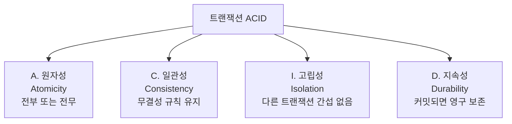

| 성질 | 의미 | 비유 |
|---|---|---|
| 원자성 (Atomicity) | 모두 성공하거나 모두 실패 | 이체는 출금+입금 한 묶음 |
| 일관성 (Consistency) | 트랜잭션 전후 데이터 무결성 규칙 유지 | 잔고 합계는 변하지 않음 |
| 고립성 (Isolation) | 동시 실행이라도 서로 간섭 없음 | 다른 사람 이체와 겹치지 않음 |
| 지속성 (Durability) | 커밋되면 시스템이 죽어도 보존 | 영수증으로 기록됨 |

---

## 모델에서 트랜잭션은 어떻게 보이는가

### 관계의 필수성


주문을 INSERT할 때 주문상세도 함께 INSERT 되어야 정상 트랜잭션

### 관계의 식별성

```
[주문]  ──── [주문상세]   :  식별 관계(실선), 주문 없이 주문상세 존재 불가
```

주문을 DELETE 할 때 주문상세도 함께 DELETE 되거나 막아야 함

---

## 트랜잭션 표현 예시

```
[고객]  ──○──── [주문]  ──────── [주문상세]
              선택              식별(실선)
```

| 표기 | 의미 |
|---|---|
| 고객 ─○─ 주문 | 고객은 주문이 없을 수 있음 (선택, Optional) |
| 주문 ──── 주문상세 (실선) | **식별 관계** — 주문상세는 주문 PK 일부를 자기 PK로 가짐 (주문 없이 존재 불가) |
| 주문 ─ ─ ─ 주문상세 (점선) | **비식별 관계** — 주문 키는 일반 FK 로만 (주문상세가 독자 PK 보유) |

---

## [SQL 실전] 트랜잭션 묶음

INSERT/UPDATE/DELETE 는 **DML**(`2-3-1`), COMMIT/ROLLBACK 은 **TCL**(`2-3-2`) 로 트랜잭션 마감

```sql
-- 시작 (Oracle은 DML 실행 시 자동 시작)
INSERT INTO ORDERS(ORDER_ID, CUST_ID, ORD_DATE)
VALUES (1001, 'C001', SYSDATE);

INSERT INTO ORDER_DETAIL(ORDER_ID, PROD_ID, QTY)
VALUES (1001, 'P01', 2);

INSERT INTO ORDER_DETAIL(ORDER_ID, PROD_ID, QTY)
VALUES (1001, 'P02', 1);

COMMIT;  -- 한 묶음으로 영구 저장

-- 중간에 오류 발생 시
ROLLBACK; -- 모두 취소
```

---

## [Before & After] 트랜잭션이 깨지면

A 계좌에서 B 계좌로 1만원 이체. 출금(A) → 입금(B) 두 작업 사이에서 시스템이 멈춘 상황 vs 두 작업을 한 트랜잭션으로 묶어 ROLLBACK 한 상황의 잔고 비교

### Before — 출금만 성공, 입금 실패

| 계좌 | 잔고 |
|---|---|
| A | 90,000 (10,000 빠짐) |
| B | 50,000 (그대로) |

1만원이 사라짐

### After — 트랜잭션으로 묶었을 때

ROLLBACK 후

| 계좌 | 잔고 |
|---|---|
| A | 100,000 (원상복구) |
| B | 50,000 |

데이터 보존

출금과 입금은 업무적으로 한 사건(이체)이지만 SQL 입장에선 별개 UPDATE 두 개. 묶지 않으면 중간 실패가 곧 데이터 모순(원자성 깨짐). 모델에서 두 엔터티가 식별 관계나 필수 관계로 묶여 있다는 건 곧 "이 INSERT/UPDATE/DELETE 들은 한 트랜잭션 안에서 함께 처리해야 한다"는 신호. 함께 변해야 하는 데이터는 코드에서도 BEGIN ~ COMMIT 으로 한 묶음이 되도록 설계해야 한다.

---

## 트랜잭션 처리 패턴

| 패턴 | 모델 단서 | SQL |
|---|---|---|
| 묶어서 INSERT | 식별 관계 / 필수 관계 | INSERT ... INSERT ... COMMIT |
| 묶어서 UPDATE | 1:1 관계 | UPDATE A ... UPDATE B ... COMMIT |
| 묶어서 DELETE | 식별 관계(CASCADE) | DELETE 부모 → 자식 자동/명시 삭제 |

---

## [시험 출제 포인트]

| 함정 | 정답 |
|---|---|
| ACID 4성질 | 원자성 / 일관성 / 고립성 / 지속성 |
| 모델에서 트랜잭션의 흔적 | 관계의 필수성, 식별성 |
| "원자성은 일부만 반영해도 된다" | 전부 또는 전무 |
| 식별 관계의 의미 | 부모 없이 자식 존재 불가 → 함께 처리 |
| 필수 관계의 의미 | 관계 자체가 반드시 있어야 함(NOT NULL FK) |
| COMMIT의 역할 | 트랜잭션을 영구 반영(지속성) |

단골 출제: "모델은 트랜잭션을 표현할 수 없다" → 틀림. 관계의 필수성·식별성으로 표현 가능

---

> **30초 시험 직전 정리**
> · ACID = **원자성·일관성·고립성·지속성**
> · 모델 단서 = **관계의 필수성** (반드시 있어야) + **관계의 식별성** (실선 = 부모 키가 자식 PK 일부)
> · COMMIT = 영구 반영 (지속성) / ROLLBACK = 트랜잭션 시작 시점으로 복구
> · DDL 은 자동 COMMIT — 따라서 ROLLBACK 불가


---

# 1-2-4. NULL 속성의 이해

## [핵심 요약]

> NULL이란 값이 없거나 아직 모름을 나타내는 특수한 표시다. 0이나 공백과는 전혀 다르다.

ex) 설문지에서 "월 소득: 0원"은 0이라는 값이 적힌 것, "월 소득: ␣"(한 칸 띈 상태)는 공백 문자, "월 소득: 미작성"이 NULL(값 자체가 없음)

---

## [개념 도식화] NULL의 비교

```
   ┌───────┬───────┬───────┐
   │   0   │  ' '  │  NULL  │
   ├───────┼───────┼───────┤
   │ 숫자값  │ 공백문자 │ 값 없음│
   │ 존재O  │ 존재O  │ 존재X  │
   └───────┴───────┴───────┘
```

| 비교 | 0 | 공백 | NULL |
|---|---|---|---|
| 데이터 존재 여부 | 있음 | 있음 | 없음 |
| 비교 가능 여부 | 가능 | 가능 | 불가(`= NULL` 안 됨) |
| 산술연산 | 가능 | — | 불가(결과는 모두 NULL) |

---

## NULL의 4가지 규칙

| 규칙 | 결과 |
|---|---|
| NULL과 산술 연산 | 결과는 NULL (예: 1000 + NULL = NULL) |
| NULL과 비교 연산 | 결과는 **UNKNOWN** — SQL 의 3-값 논리 (TRUE / FALSE / UNKNOWN). **WHERE 절**(`2-1-4`)에서는 행이 제외됨 |
| NULL은 IS NULL / IS NOT NULL로만 비교 | `= NULL`, `!= NULL` 모두 항상 거짓 |
| 집계 함수는 NULL을 무시 | COUNT(*) 만 NULL 포함 카운트 |

> **SQL 3-값 논리** — 일반 프로그래밍은 TRUE/FALSE 2값이지만 SQL 은 NULL 때문에 **TRUE / FALSE / UNKNOWN** 3값. `NULL = NULL` 도 결과가 UNKNOWN.

---

## NULL 처리 함수

NVL/NVL2/NULLIF/COALESCE 의 자세한 동작은 **함수**(`2-1-3`) 챕터에서도

| 함수 | 동작 | 예 |
|---|---|---|
| NVL(A, B) | A가 NULL이면 B로 대체 | NVL(SAL, 0) |
| NVL2(A, B, C) | A가 NULL이 아니면 B, NULL이면 C | NVL2(COMM, '있음', '없음') |
| NULLIF(A, B) | A=B면 NULL, 아니면 A | NULLIF(A, 0) |
| COALESCE(A, B, C, …) | NULL이 아닌 첫 값 반환 | COALESCE(P1, P2, '없음') |

---

## 집계 함수에서의 NULL

| 함수 | NULL 처리 |
|---|---|
| COUNT(*) | NULL 포함 모든 행 카운트 |
| COUNT(컬럼) | NULL 제외 |
| SUM/AVG/MAX/MIN | NULL 무시 |
| AVG(컬럼) | (NULL 제외 합) / (NULL 제외 개수) |

### 예시

| EMP | SAL |
|---|---|
| A | 100 |
| B | NULL |
| C | 200 |

| 쿼리 | 결과 |
|---|---|
| COUNT(*) | 3 |
| COUNT(SAL) | 2 |
| SUM(SAL) | 300 |
| AVG(SAL) | 150 (300/2, 0 포함이 아님에 주의) |

---

## [SQL 실전] NULL 다루기

```sql
-- 잘못된 비교
SELECT * FROM EMP WHERE COMM = NULL;     -- 결과 0건
SELECT * FROM EMP WHERE COMM != NULL;    -- 결과 0건

-- 올바른 비교
SELECT * FROM EMP WHERE COMM IS NULL;
SELECT * FROM EMP WHERE COMM IS NOT NULL;

-- NULL 대체
SELECT NAME, NVL(COMM, 0) AS COMM_FIX FROM EMP;
SELECT NAME, COALESCE(PHONE, EMAIL, '연락처 없음') FROM MEMBER;
```

---

## [Before & After] NULL이 끼면 결과가 달라진다

기본급(SAL)에 커미션(COMM)을 더해 총급여를 구하는 상황. 아래 EMP 에서 B는 커미션이 등록되지 않아 COMM 이 NULL. 단순 합산 vs NVL 처리 결과

### EMP

| NAME | SAL | COMM |
|---|---|---|
| A | 100 | 10 |
| B | 200 | NULL |
| C | 300 | 20 |

### `SELECT NAME, SAL + COMM FROM EMP;`

| NAME | SAL+COMM |
|---|---|
| A | 110 |
| B | NULL |
| C | 320 |

### `SELECT NAME, SAL + NVL(COMM, 0) FROM EMP;`

| NAME | TOTAL |
|---|---|
| A | 110 |
| B | 200 |
| C | 320 |

NULL 은 산술 연산에 들어가면 결과 전체를 NULL 로 만든다. B처럼 커미션이 비어 있을 뿐인 직원의 총급여까지 사라져버린다. NVL(COMM, 0) 으로 "커미션 없음 = 0"으로 안전하게 치환하면 NULL 행도 정상 합산되어 보고서에 누락이 안 생긴다. 합계·평균 같은 집계 전에는 늘 NULL 처리 방식을 정해두는 것이 안전.

---

## NULL과 정렬

| DBMS | 기본 정렬 시 NULL 위치 |
|---|---|
| Oracle | 오름차순(ASC)에서 마지막, 내림차순(DESC)에서 처음 |
| MS-SQL | 오름차순에서 처음 |

직접 지정: `ORDER BY COL NULLS FIRST` / `NULLS LAST` (자세히는 **ORDER BY 절**(`2-1-6`) 에서)

---

## [시험 출제 포인트]

| 함정 | 정답 |
|---|---|
| `WHERE COL = NULL`의 결과 | 결과 없음(0건). IS NULL을 사용 |
| `NULL + 100` | NULL |
| AVG(컬럼) | NULL 제외 평균(분모도 줄어듦) |
| COUNT(*) vs COUNT(컬럼) | `*`는 NULL 포함, 컬럼명은 NULL 제외 |
| `NULL = NULL`의 결과 | FALSE(UNKNOWN) |
| Oracle ORDER BY ASC 기본 NULL 위치 | 마지막(LAST) |
| `NULLIF(10, 10)` | NULL |
| `COALESCE(NULL, NULL, 'X')` | 'X' |

단골 함정: "NULL은 0이다" "NULL은 공백이다" → 둘 다 틀림. NULL = 값 없음

---

> **30초 시험 직전 정리**
> · NULL = **값 없음** (≠ 0, ≠ 공백)
> · 비교는 `IS NULL` / `IS NOT NULL` 만 가능 (`= NULL` 항상 거짓)
> · NULL + 값 = **NULL**
> · COUNT(*) = NULL 포함 / COUNT(컬럼) = NULL 제외 / SUM·AVG·MAX·MIN = NULL **무시**
> · NVL(A, B) = A null 이면 B / NVL2(A, B, C) / NULLIF(A, B) / COALESCE(...)
> · Oracle ASC 기본 NULL 위치 = **마지막 (NULLS LAST)**


---

# 1-2-5. 본질식별자 vs 인조식별자

## [핵심 요약]

> 본질**식별자**(`1-1-5`)는 업무에서 자연스럽게 도출된 식별자, 인조식별자는 인위적으로 만든 식별자다. 둘의 장단점을 알고 상황에 맞게 선택.

ex) 도서관에서 ISBN(출판사 부여 = 본질식별자)과 자체 분류번호 A-001(도서관 임의 부여 = 인조식별자) 두 가지로 책을 구분 가능. ISBN이 길고 형식이 들쑥날쑥해서 도서관은 자체 번호를 더 자주 씀

---

## [개념 도식화] 본질 vs 인조

| 구분 | 본질식별자 | 인조식별자 |
|---|---|---|
| 출처 | 업무에서 자연 발생 | 인위적으로 부여 |
| 예시 | 주민번호 · 사업자번호 · ISBN | 자동증가 ID · UUID · GUID |
| 의미 | 업무적 의미 있음 | 의미 없음 (대체 키) |
| 변경 | 변경되면 큰 영향 | 자유롭게 부여 가능 |

```
[ 식별자 후보 ]
      │
      ▼
업무에서 자연 도출되는가?
      ├─ NO  ─→  [ 인조식별자 ]
      │
      └─ YES ─→  너무 길거나 보안·변경 위험 있는가?
                       ├─ YES ─→ [ 인조식별자 ]
                       └─ NO  ─→ [ 본질식별자 ]
```

---

## 비교표

| 항목 | 본질식별자 | 인조식별자 |
|---|---|---|
| 정의 | 업무에서 자연스럽게 도출 | 인위적으로 부여 |
| 예시 | 주민번호, 사업자번호, ISBN | 자동증가 ID, UUID, GUID |
| 의미 | 업무적 의미 있음 | 의미 없음 (단순 키) |
| 변경 위험 | **존재** — 업무 규칙 변동 시 변할 수 있음 (예: 주민번호 체계 개편) | **없음** — 한 번 부여되면 영구 고정 |
| 길이 | 길 수 있음 | 짧고 일관 |
| 데이터 품질 검증 | 가능 (중복 자연 검출) | 어려움 — 본질키에 별도 UNIQUE 필요 |
| PK 사용 시 장점 | 의미 검증 용이 | JOIN/인덱스/관리 효율 |

---

## 인조식별자의 장단점

| 장점 | 단점 |
|---|---|
| 짧고 일관된 형식 | 업무적 의미 없음 |
| 변경에 자유로움 | 중복 데이터 식별 어려움 |
| JOIN/인덱스 효율 | 추가 UNIQUE 제약 필요 |
| 보안(주민번호 노출 회피) | 모델이 직관적이지 않음 |

---

## 본질식별자의 장단점

| 장점 | 단점 |
|---|---|
| 업무적 의미 명확 | 길거나 복잡 |
| 자연스러운 데이터 검증 | 변경되면 큰 영향 |
| 모델 직관적 | 보안 이슈(개인정보 등) |

---

## 언제 무엇을 쓸까

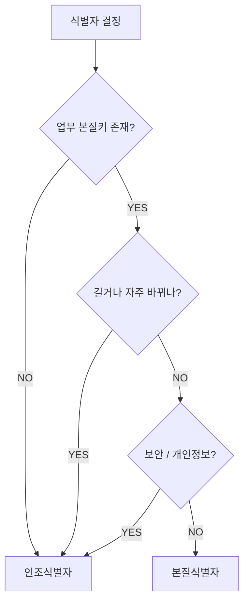

**현업 권장 패턴**: PK 는 인조식별자, 본질키는 UNIQUE 제약으로 별도 보존 → 보안·성능·일관성 모두 만족. 본질키를 PK 로 쓰면 **정규화**(`1-2-1`) 단계의 종속성 분석이 자연스럽지만, 변경 위험이 따름

---

## [SQL 실전]

### 본질식별자 사용

```sql
CREATE TABLE BOOK (
    ISBN     VARCHAR2(20) PRIMARY KEY,  -- 본질식별자
    TITLE    VARCHAR2(200),
    AUTHOR   VARCHAR2(100)
);
```

### 인조식별자 사용

```sql
CREATE TABLE BOOK (
    BOOK_ID  NUMBER GENERATED ALWAYS AS IDENTITY PRIMARY KEY,  -- 인조식별자
    ISBN     VARCHAR2(20) UNIQUE,                              -- 본질키는 UNIQUE로 유지
    TITLE    VARCHAR2(200),
    AUTHOR   VARCHAR2(100)
);
```

권장 패턴: 인조식별자를 PK로, 본질식별자를 UNIQUE 제약으로 함께

---

## [Before & After] 인조식별자 도입의 효과

회원 김철수의 주민번호(800101-1234567)를 회원 PK 로 쓰는 경우 vs 인조식별자(M01)를 PK 로 두고 주민번호는 UNIQUE 로 보존하는 경우. 자식 테이블(주문)에 어떤 값이 흩뿌려지는가

### Before — 본질식별자(주민번호)를 PK로

| 주문 (FK: 주민번호) |
|---|
| 800101-1234567 → 김철수 주문 1 |
| 800101-1234567 → 김철수 주문 2 |

모든 자식 테이블에 주민번호가 흩뿌려져 개인정보 노출 위험 증가

### After — 인조식별자(MEMBER_ID) 도입

**MEMBER**

| MEMBER_ID(PK) | RRN(UQ) | NAME |
|---|---|---|
| M01 | 800101-1234567 | 김철수 |

**ORDER (FK: MEMBER_ID)**

| ORDER_ID | MEMBER_ID |
|---|---|
| 1 | M01 |
| 2 | M01 |

자식 테이블엔 의미 없는 ID만 들어가 보안·JOIN 효율 모두 향상

PK 는 모든 자식 테이블에 FK 로 흩어지므로, 본질식별자가 PK 면 그 값(주민번호)도 함께 흩어진다 — 보안 사고의 표면적이 그대로 늘어남. 본질키는 길거나 형식이 들쑥날쑥해 인덱스·조인 비용도 커진다. 인조식별자(M01 같은 짧은 키)를 PK 로 두고 본질키는 회원 테이블 한 곳에 UNIQUE 로 가둬두면 보안·성능·일관성이 한꺼번에 정리된다. 단, 본질키의 무결성 검증을 위해 UNIQUE 제약을 빼먹지 않는 것이 핵심.

---

## [시험 출제 포인트]

| 함정 | 정답 |
|---|---|
| 인조식별자 단점 | 업무적 의미 없음, 중복 검증 어려움 |
| 본질식별자 단점 | 길거나 변경 위험, 보안 이슈 |
| "인조식별자는 항상 본질식별자보다 좋다" | 상황에 따라 다름 |
| 인조식별자 도입 시 본질키 처리 | UNIQUE 제약으로 무결성 보존 |
| "주민등록번호를 PK로 쓰는 것이 보안상 권장된다" | 보통 인조식별자 권장 |

단골 출제: 인조식별자 도입 시 본질키에 UNIQUE 처리를 안 하면 중복 데이터 발생 가능

---

> **30초 시험 직전 정리**
> · 본질식별자 = 업무 자연 도출 (주민번호·사업자번호·ISBN)
> · 인조식별자 = 인위적 부여 (자동증가 ID·UUID)
> · "주민번호를 PK로 쓰는 것이 권장된다" → **틀림**. 보안·길이·변경 위험 → 인조식별자 권장
> · 인조식별자 도입 시 본질키는 **UNIQUE 제약**으로 무결성 보존
> · 인조식별자 단점 = **업무적 의미 없음**, 중복 데이터 자연 검출 어려움


---
