# SQLD 전 범위 이론 정리 (SQLD양파) — 2과목: SQL 기본 및 활용

> **구성**: 2-1. SQL 기본 (2-1-1 ~ 2-1-8) / 2-2. SQL 활용 (2-2-1 ~ 2-2-8) / 2-3. 관리 구문 (2-3-1 ~ 2-3-4)

---

# 2-1-1. 관계형 데이터베이스 개요

## [핵심 요약]

> 관계형 데이터베이스(RDB)는 데이터를 행과 열로 된 표(테이블)로 저장하고, 표들 사이의 관계로 데이터를 관리하는 시스템이다.

ex) 엑셀 한 권에 여러 시트(=테이블), VLOOKUP 키(=외래키)로 시트끼리 연결되는 구조를 안전·동시 처리까지 가능하게 만든 것이 RDB

---

## [개념 도식화] 데이터베이스의 구조

```
   ┌──────────────────────────────────┐
   │            DBMS                  │
   │  ┌─────────────────────────┐    │
   │  │         Database          │    │
   │  │   ┌───────┐ ┌───────┐   │    │
   │  │   │TABLE A│ │TABLE B│   │    │
   │  │   │       │ │       │   │    │
   │  │   └───┬───┘ └───┬───┘   │    │
   │  │       └────관계──┘        │    │
   │  └─────────────────────────┘    │
   └──────────────────────────────────┘
```

| 용어 | 의미 |
|---|---|
| DBMS | 데이터베이스를 관리하는 SW (Oracle, MySQL 등) |
| Database | 데이터의 저장소 |
| Table | 행과 열로 된 표 |
| Row(Record) | 한 줄(한 인스턴스) |
| Column(Attribute) | 한 칸(속성) |

---

## SQL 명령어 분류

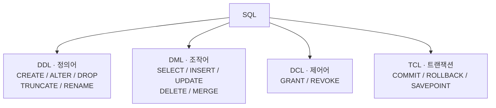

| 분류 | 풀이 | 명령어 | 비유 |
|---|---|---|---|
| **DDL**(`2-3-3`) | Data Definition | CREATE, ALTER, DROP, TRUNCATE, RENAME | 표(설계도) 만들기/바꾸기 |
| **DML**(`2-3-1`) | Data Manipulation | **SELECT**(`2-1-2`), INSERT, UPDATE, DELETE, MERGE | 표 안의 데이터 조작 |
| **DCL**(`2-3-4`) | Data Control | GRANT, REVOKE | 권한 부여/회수 |
| **TCL**(`2-3-2`) | Transaction Control | COMMIT, ROLLBACK, SAVEPOINT | 트랜잭션 묶음 처리 |

헷갈리기 쉬운 점: TRUNCATE 는 DDL, DELETE 는 DML

---

## 주요 데이터 타입

| 타입 | 의미 | 예 |
|---|---|---|
| CHAR(n) | **고정** 길이 문자열 — 모자라면 공백으로 채움 | CHAR(5) 에 'AB' 저장 → 'AB&nbsp;&nbsp;&nbsp;' (공백 3칸) |
| VARCHAR2(n) | **가변** 길이 문자열 — 입력한 만큼만 저장 | VARCHAR2(5) 에 'AB' 저장 → 'AB' |
| NUMBER(p, s) | 숫자 (전체 p자리, 소수 s자리) | NUMBER(7, 2) → 12345.67 |
| DATE | 날짜+시간 | 2026-04-26 13:24:00 |
| TIMESTAMP | 정밀 시간 (소수초까지) | 2026-04-26 13:24:00.123456 |

---

## 트랜잭션의 핵심 약속 — ACID

| 성질 | 의미 |
|---|---|
| Atomicity | 전부 성공 또는 전부 실패 |
| Consistency | 규칙 유지 |
| Isolation | 동시 처리 시 격리 |
| Durability | 커밋 후 영구 저장 |

---

## [SQL 실전] 가장 기본적인 흐름

```sql
-- DDL: 테이블 생성
CREATE TABLE EMP (
    EMP_ID NUMBER PRIMARY KEY,
    NAME   VARCHAR2(50),
    SAL    NUMBER
);

-- DML: 데이터 입력/조회
INSERT INTO EMP VALUES (1, '김철수', 3000);
SELECT * FROM EMP;

-- TCL: 영구 저장
COMMIT;

-- DCL: 권한 부여
GRANT SELECT ON EMP TO USER1;
```

---

## [Before & After] 파일 시스템 vs RDB

직원 데이터(EMP_ID, NAME, SAL) 2건을 보관하고 "급여 2000 초과인 사람"을 찾는 상황. 텍스트 파일 vs RDB 의 EMP 테이블.

### Before — 일반 파일에 저장

```
emp.txt
1, 김철수, 3000
2, 이영희, 4000
```

동시 수정 불가, 검색 느림, 무결성 보장 어려움

### After — RDB 사용

```sql
SELECT * FROM EMP WHERE SAL > 2000;
```

빠른 검색(인덱스), 동시 처리(트랜잭션), 무결성 제약 보장

파일은 의미·타입·관계 정보가 없어 매번 직접 파싱해야 하고, 동시 수정 시 한쪽 변경이 사라짐. RDB 는 스키마·인덱스·트랜잭션을 엔진이 보장하므로 데이터가 많거나 다중 사용자 환경에서는 RDB 가 정답.

---

## RDB의 5대 장점

| 장점 | 설명 |
|---|---|
| 데이터 독립성 | DB 변경이 응용 프로그램에 영향을 덜 줌 |
| 데이터 중복 최소화 | 정규화로 일관성 유지 |
| 무결성 | 제약조건으로 잘못된 데이터 차단 |
| 보안 | DCL로 권한 관리 |
| 동시성 | 트랜잭션 격리로 충돌 방지 |

---

## [시험 출제 포인트]

| 함정 | 정답 |
|---|---|
| TRUNCATE는 DDL인가 DML인가 | DDL(롤백 불가) |
| DELETE는 어디에 속하는가 | DML(롤백 가능) |
| COMMIT은 | TCL |
| GRANT/REVOKE는 | DCL |
| RDB 데이터 저장 단위 | 테이블(행과 열) |
| 한 행을 무엇이라 하는가 | Row, Record, Tuple |
| 한 열을 무엇이라 하는가 | Column, Attribute, Field |

단골 함정: "INSERT/UPDATE/DELETE/SELECT 모두 DML" 은 옳음. MERGE 도 DML.

---

> **30초 시험 직전 정리**
> · DDL: **CREATE / ALTER / DROP / TRUNCATE / RENAME** (자동 COMMIT, 롤백 불가)
> · DML: **SELECT / INSERT / UPDATE / DELETE / MERGE**
> · DCL: **GRANT / REVOKE** (권한)
> · TCL: **COMMIT / ROLLBACK / SAVEPOINT** (트랜잭션)
> · 함정: **TRUNCATE = DDL** (롤백 X), **DELETE = DML** (롤백 O)
> · 행/열 동의어: Row=Record=Tuple / Column=Attribute=Field


---

# 2-1-2. SELECT 문

## [핵심 요약]

> SELECT 문은 데이터베이스에서 원하는 데이터를 골라서 뽑아내는 가장 기본적인 명령어다.

ex) 식당 주문처럼 "어느 식당(FROM)·어떤 음식(SELECT)·조건(WHERE)·그룹별(GROUP BY)·정렬(ORDER BY)" 을 차례로 지정

---

## [개념 도식화] SELECT 문의 6대 절

```
SELECT    컬럼1, 컬럼2, ...      ← ② 어떤 컬럼? (함수 활용)
FROM      테이블                   ← ① 어디서? (조인 가능)
WHERE     조건                     ← ③ 어떤 행?
GROUP BY  그룹기준                 ← ④ 어떻게 묶을지?
HAVING    그룹조건                 ← ⑤ 묶은 후 조건?
ORDER BY  정렬기준;                ← ⑥ 어떻게 정렬?
```

각 절의 자세한 사용은 **WHERE**(`2-1-4`), **GROUP BY/HAVING**(`2-1-5`), **ORDER BY**(`2-1-6`), **함수**(`2-1-3`), **조인**(`2-1-7`) 챕터 참고

### 작성 순서 vs 실행 순서


| 작성 순서 | 실행 순서 |
|---|---|
| 1. SELECT | 5. SELECT |
| 2. FROM | 1. FROM |
| 3. WHERE | 2. WHERE |
| 4. GROUP BY | 3. GROUP BY |
| 5. HAVING | 4. HAVING |
| 6. ORDER BY | 6. ORDER BY |

암기: FROM → WHERE → GROUP → HAVING → SELECT → ORDER (FWGHSO)

---

## SELECT 절의 다양한 표현

| 형태 | 의미 |
|---|---|
| `SELECT *` | 모든 컬럼 |
| `SELECT col1, col2` | 특정 컬럼 |
| `SELECT DISTINCT col` | 중복 제거 |
| `SELECT col AS 별명` | 별칭 부여 |
| <code>SELECT col &#124;&#124; '문자'</code> | 문자열 연결(Oracle) |
| `SELECT 1+1 FROM DUAL` | 계산식 |

---

## [SQL 실전]

```sql
-- 1. 모든 컬럼
SELECT * FROM EMP;

-- 2. 특정 컬럼
SELECT EMP_ID, NAME, SAL FROM EMP;

-- 3. 별칭(AS 생략 가능, 한글 별칭은 "")
SELECT NAME AS 사원명, SAL*12 "연봉" FROM EMP;

-- 4. 중복 제거
SELECT DISTINCT DEPT_ID FROM EMP;

-- 5. 문자열 연결
SELECT NAME || '님' AS GREETING FROM EMP;
```

---

## [Before & After]

EMP 4명 중 동명이인 김철수가 D1·D2 부서에 한 명씩 있는 상황. 컬럼 지정·DISTINCT·연봉 계산 별칭에 따라 결과가 달라지는 양상 비교.

### EMP

| EMP_ID | NAME | DEPT_ID | SAL |
|---|---|---|---|
| 1 | 김철수 | D1 | 3000 |
| 2 | 이영희 | D1 | 4000 |
| 3 | 박민수 | D2 | 3500 |
| 4 | 김철수 | D2 | 3200 |

### `SELECT NAME, SAL FROM EMP;`

| NAME | SAL |
|---|---|
| 김철수 | 3000 |
| 이영희 | 4000 |
| 박민수 | 3500 |
| 김철수 | 3200 |

### `SELECT DISTINCT NAME FROM EMP;`

| NAME |
|---|
| 김철수 |
| 이영희 |
| 박민수 |

### `SELECT NAME, SAL*12 AS "연봉" FROM EMP;`

| NAME | 연봉 |
|---|---|
| 김철수 | 36000 |
| 이영희 | 48000 |
| 박민수 | 42000 |
| 김철수 | 38400 |

DISTINCT 는 SELECT 절 전체(여러 컬럼이면 조합) 단위로 중복 제거 → NAME 만 보면 동명이인 김철수도 한 줄로 합쳐짐. SAL*12 같은 표현은 행 단위 계산이라 같은 이름이라도 별개 행. 원본 그대로면 컬럼 나열, 값 종류만이면 DISTINCT, 가공값에 의미있는 이름이면 별칭.

---

## 별칭(Alias) 규칙

| 규칙 | 예 |
|---|---|
| AS 생략 가능 | `SELECT NAME 사원명` |
| 공백/한글/특수문자 포함 시 `""` 사용 | `"사원 이름"` |
| 테이블 별칭은 AS 사용 불가(Oracle) | `FROM EMP E` |
| WHERE/GROUP/HAVING에서 SELECT의 별칭 사용 | 불가(실행 순서 때문) |
| ORDER BY에서 별칭 사용 | 가능 |

---

## DUAL 테이블 (Oracle)

시스템 내장 가짜 테이블. 1행 1컬럼. 계산이나 함수 결과 확인용.

```sql
SELECT 1+1 FROM DUAL;        -- 2
SELECT SYSDATE FROM DUAL;    -- 현재 시각
SELECT USER FROM DUAL;       -- 접속 계정
```

---

## [시험 출제 포인트]

| 함정 | 정답 |
|---|---|
| SELECT 실행 순서 | FROM → WHERE → GROUP BY → HAVING → SELECT → ORDER BY |
| WHERE에서 SELECT 별칭 사용 가능? | 불가(SELECT가 나중에 실행됨) |
| ORDER BY에서 SELECT 별칭 사용 가능? | 가능 |
| DISTINCT 적용 범위 | SELECT 절 전체(여러 컬럼이면 조합 단위) |
| Oracle 테이블 별칭에 AS | 사용 불가 |
| `SELECT * FROM DUAL`의 결과 | 1행 1컬럼('X') |

자주 출제: WHERE 절에서 SELECT 별칭 사용 시 에러. 실행 순서상 WHERE 가 먼저 처리되기 때문.

---

> **30초 시험 직전 정리**
> · 작성: SELECT → FROM → WHERE → GROUP → HAVING → ORDER
> · 실행: **FROM → WHERE → GROUP → HAVING → SELECT → ORDER (FWGHSO)**
> · 별칭 사용: **ORDER BY 만 가능**, WHERE/GROUP/HAVING 은 불가 (SELECT 가 더 늦게 실행됨)
> · DISTINCT = SELECT 절 전체에 적용 (여러 컬럼이면 컬럼 조합 단위로 중복 제거)
> · Oracle 테이블 별칭 = AS 사용 **불가** / 컬럼 별칭 = AS 사용 **가능 (생략도 가능)**
> · DUAL = Oracle 시스템 내장 1행 1컬럼 가짜 테이블 (계산·함수 테스트용)


---

# 2-1-3. 함수(Function)

## [핵심 요약]

> 함수는 데이터를 입력받아 가공된 결과를 돌려주는 도구다. 문자, 숫자, 날짜, **NULL**(`1-2-4`)을 가공할 수 있다.

---

## [개념 도식화] 함수의 분류

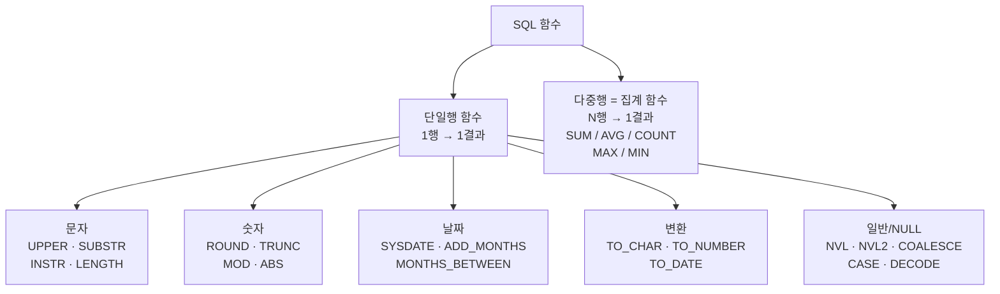

---

## 문자 함수

| 함수 | 설명 | 예 | 결과 |
|---|---|---|---|
| UPPER(s) | 대문자 | UPPER('abc') | ABC |
| LOWER(s) | 소문자 | LOWER('ABC') | abc |
| INITCAP(s) | 첫글자만 대문자 | INITCAP('hi sql') | Hi Sql |
| LENGTH(s) | 문자열 길이 | LENGTH('한글') | 2 |
| SUBSTR(s, m, n) | n글자 추출 | SUBSTR('ABCDE', 2, 3) | BCD |
| INSTR(s, sub) | 위치 찾기 | INSTR('ABCDE', 'C') | 3 |
| LPAD/RPAD | 자리 채우기 | LPAD('1', 3, '0') | 001 |
| LTRIM/RTRIM/TRIM | 공백 제거 | TRIM(' ABC ') | ABC |
| REPLACE(s, a, b) | 문자열 교체 | REPLACE('A-B', '-', '+') | A+B |
| CONCAT(a, b) 또는 `||` | 문자열 연결 | 'A' \|\| 'B' | AB |

---

## 숫자 함수

| 함수 | 설명 | 예 | 결과 |
|---|---|---|---|
| ABS(n) | 절댓값 | ABS(-5) | 5 |
| ROUND(n, m) | 반올림 | ROUND(3.456, 1) | 3.5 |
| TRUNC(n, m) | 버림 | TRUNC(3.456, 1) | 3.4 |
| MOD(a, b) | 나머지 | MOD(10, 3) | 1 |
| CEIL(n) | 올림 | CEIL(3.1) | 4 |
| FLOOR(n) | 내림 | FLOOR(3.9) | 3 |
| POWER(a, b) | 거듭제곱 | POWER(2, 3) | 8 |
| SIGN(n) | 부호(-1/0/1) | SIGN(-5) | -1 |

---

## 날짜 함수

| 함수 | 설명 |
|---|---|
| SYSDATE | 현재 날짜+시간 |
| CURRENT_DATE | 세션 기준 현재 |
| ADD_MONTHS(d, n) | 개월 더하기 |
| MONTHS_BETWEEN(d1, d2) | 개월 차이 |
| LAST_DAY(d) | 그 달의 마지막 날 |
| NEXT_DAY(d, '월') | 다음 월요일 |
| EXTRACT(YEAR FROM d) | 연도 추출 |
| TRUNC(d, 'MM') | 월 단위 자름 |

날짜 - 날짜 = 일수(숫자), 날짜 + 숫자 = 날짜

---

## 변환 함수

```
        TO_CHAR
[숫자] ────────→ [문자] ←────────  [날짜]
   ↑              │                  │
   └─ TO_NUMBER ──┘                  │
                  │                  │
                  └──── TO_DATE ────→┘
```

| 함수 | 변환 | 예 |
|---|---|---|
| TO_CHAR(d, 'YYYY-MM-DD') | 날짜 → 문자 | 2026-04-26 |
| TO_CHAR(n, '999,999') | 숫자 → 문자 | 1,000 |
| TO_NUMBER('1234') | 문자 → 숫자 | 1234 |
| TO_DATE('20260426', 'YYYYMMDD') | 문자 → 날짜 | 2026-04-26 |

| 종류 | 의미 |
|---|---|
| 명시적 형변환 | TO_CHAR, TO_NUMBER, TO_DATE 직접 호출 |
| 암시적 형변환 | DBMS가 자동 변환(의도치 않은 결과 위험) |

---

## NULL 관련 함수

| 함수 | 설명 |
|---|---|
| NVL(A, B) | A가 NULL이면 B |
| NVL2(A, B, C) | A가 NULL 아니면 B, NULL이면 C |
| NULLIF(A, B) | A=B면 NULL 반환 |
| COALESCE(A, B, C, …) | NULL 아닌 첫 번째 값 |

---

## [SQL 실전]

### 조건 함수 — CASE / DECODE

```sql
-- DECODE (Oracle 전용, 동등비교만 가능)
SELECT NAME,
       DECODE(GENDER, 'M', '남자', 'F', '여자', '기타') AS GENDER_KOR
FROM   MEMBER;

-- CASE (표준, 모든 비교 가능)
SELECT NAME,
       CASE WHEN SAL >= 5000 THEN '고급'
            WHEN SAL >= 3000 THEN '중급'
            ELSE '초급'
       END AS LEVEL
FROM   EMP;
```

| 함수 | 동등비교 | 범위비교 |
|---|---|---|
| DECODE | 가능 | 불가 |
| CASE | 가능 | 가능 |

---

## 다중행(집계) 함수

여러 행을 묶어 하나의 결과로 요약. 자세한 분석은 **그룹함수**(`2-2-3`) 챕터 참고. 보통 **WHERE**(`2-1-4`) 이후의 GROUP BY 와 함께 사용.

| 함수 | 의미 | NULL 처리 |
|---|---|---|
| COUNT(*) | 모든 행 수 | NULL 포함 |
| COUNT(col) | 컬럼 NULL 제외 | NULL 제외 |
| SUM(col) | 합 | NULL 무시 |
| AVG(col) | 평균 | NULL 무시 |
| MAX(col) | 최대 | NULL 무시 |
| MIN(col) | 최소 | NULL 무시 |

---

## [Before & After] 함수 활용

EMP 의 NAME(소문자), HIRE_DATE(날짜형), SAL+COMM(NULL 가능)을 한 번에 가공해야 하는 상황. 김철수는 COMM 이 NULL, 이영희는 200. 문자·날짜·NULL 함수를 결합해 "대문자 이름 / 입사연도 / 총급여" 를 동시에 뽑음.

### EMP

| NAME | HIRE_DATE | SAL | COMM |
|---|---|---|---|
| 김철수 | 2020-03-15 | 3000 | NULL |
| 이영희 | 2022-08-20 | 4000 | 200 |

### 쿼리

```sql
SELECT  UPPER(NAME)              AS UPPER_NAME,
        TO_CHAR(HIRE_DATE,'YYYY')   AS HIRE_YEAR,
        SAL + NVL(COMM, 0)         AS TOTAL
FROM    EMP;
```

| UPPER_NAME | HIRE_YEAR | TOTAL |
|---|---|---|
| 김철수 | 2020 | 3000 |
| 이영희 | 2022 | 4200 |

UPPER 는 문자형, TO_CHAR(HIRE_DATE,'YYYY') 는 날짜→문자, NVL(COMM,0) 은 NULL 안전 산술 — 함수마다 다루는 도메인이 다름. NVL 을 빼면 김철수의 TOTAL 이 NULL 로 사라지는 사고 발생. 출력 형식·표시 단위·NULL 처리를 모두 함수 단계에서 정리해 SELECT 결과를 화면에 바로 쓸 수 있는 형태로 만드는 것이 안전

---

## [시험 출제 포인트]

| 함정 | 정답 |
|---|---|
| `SUBSTR('ABCDE', 2, 3)` | 'BCD' (2번째부터 3글자) |
| Oracle `LENGTH('한글')` | 2(글자수). LENGTHB는 바이트수 |
| `MOD(10, 3)` | 1 |
| `ROUND(3.456, 2)` | 3.46 |
| `TRUNC(3.456, 2)` | 3.45 |
| DECODE로 범위비교 가능? | 불가 |
| 날짜 - 날짜 결과 | 숫자(일수) |
| `NVL2(NULL, 'A', 'B')` | 'B' |
| 암시적 형변환 권장? | 명시적이 안전 |

단골: COUNT(*) vs COUNT(컬럼) 차이를 묻는 문제. NULL 처리 주의

---

> **30초 시험 직전 정리**
> · 함수 = **단일행** (1행 → 1결과) vs **다중행 = 집계** (여러 행 → 1결과)
> · SUBSTR 인덱스 = **1부터** 시작 (Oracle)
> · LENGTH = 글자 수 / LENGTHB = 바이트 수 (한글 1자 = 3바이트)
> · ROUND vs TRUNC = 반올림 vs 버림
> · DECODE = **동등 비교만** / CASE = **모든 비교 (범위 가능)**
> · NVL(A, B) / NVL2(A, B, C) / NULLIF(A, B) / COALESCE(A, B, ...)
> · 집계 함수는 **NULL 무시** (단 COUNT(*) 만 NULL 포함)
> · 명시적 형변환 (TO_*) 권장 — 암시적은 의도치 않은 결과 위험


---

# 2-1-4. WHERE 절

## [핵심 요약]

> WHERE 절은 어떤 행만 가져올지 조건을 거는 필터다. 테이블 전체에서 원하는 행만 골라낸다.

ex) 옷가게에서 "검은색(`= '검정'`)·5만원 이하(`<= 50000`)·M 또는 L 사이즈(`IN ('M','L')`)" 라고 조건을 거는 것과 같음

---

## [개념 도식화] WHERE의 위치

**SELECT 문**(`2-1-2`) 의 6대 절 중 행 단위 필터 역할


---

## WHERE 절의 연산자

### 비교 연산자

| 연산자 | 의미 |
|---|---|
| `=` | 같다 |
| `!=`, `<>`, `^=` | 다르다 |
| `>`, `>=`, `<`, `<=` | 크다/작다 |

### 논리 연산자

| 연산자 | 의미 | 비유 |
|---|---|---|
| AND | 둘 다 | 검정색 그리고 5만원 이하 |
| OR | 둘 중 하나 | 검정색 또는 흰색 |
| NOT | 부정 | 검정색이 아닌 |

### SQL 연산자

| 연산자 | 의미 | 예 |
|---|---|---|
| BETWEEN A AND B | A ≤ x ≤ B | `BETWEEN 100 AND 200` |
| IN (a, b, c) | 그 안에 있으면 (값 목록 또는 **서브쿼리**(`2-2-1`) 가능) | `IN ('M', 'F')` |
| LIKE '패턴' | 문자 패턴 매칭 | `LIKE '김%'` |
| IS NULL | NULL인지 | `IS NULL` |

### 부정형

NOT BETWEEN, NOT IN, NOT LIKE, IS NOT NULL

---

## LIKE 연산자의 와일드카드

| 기호 | 의미 | 예 |
|---|---|---|
| `%` | 0개 이상의 문자 | `'김%'` → '김', '김철수', '김OO' |
| `_` | 정확히 1개 문자 | `'김_수'` → '김철수', '김영수' |

```sql
-- 김으로 시작
SELECT * FROM EMP WHERE NAME LIKE '김%';

-- 정확히 3글자, 가운데가 '철'
SELECT * FROM EMP WHERE NAME LIKE '_철_';

-- 와일드카드 자체를 검색하려면 ESCAPE
SELECT * FROM ITEM WHERE NAME LIKE '%50\%%' ESCAPE '\';
```

---

## NULL 비교

| 잘못된 표현 | 올바른 표현 |
|---|---|
| `WHERE COL = NULL` | `WHERE COL IS NULL` |
| `WHERE COL != NULL` | `WHERE COL IS NOT NULL` |

NULL 과의 비교는 항상 UNKNOWN → 결과가 비어버림

---

## 연산자 우선순위

```
1. 산술 ( *, /, +, - )
2. 연결 ( || )
3. 비교 ( =, <, > 등)
4. NOT
5. AND
6. OR
```

AND 가 OR 보다 먼저 처리됨. `A OR B AND C` = `A OR (B AND C)`

```sql
-- 의도: 부서가 D1이거나 D2 이면서 급여 3000 이상
-- 잘못된 예
WHERE DEPT = 'D1' OR DEPT = 'D2' AND SAL >= 3000
-- AND 먼저 해석되어 D1 또는 (D2 AND SAL>=3000)이 됨

-- 올바른 예
WHERE (DEPT = 'D1' OR DEPT = 'D2') AND SAL >= 3000
```

---

## [SQL 실전]

```sql
-- 비교
SELECT * FROM EMP WHERE SAL >= 3000;

-- BETWEEN
SELECT * FROM EMP WHERE SAL BETWEEN 3000 AND 5000;

-- IN
SELECT * FROM EMP WHERE DEPT_ID IN ('D1', 'D2', 'D3');

-- LIKE
SELECT * FROM EMP WHERE NAME LIKE '김%';

-- IS NULL
SELECT * FROM EMP WHERE COMM IS NULL;

-- AND/OR
SELECT * FROM EMP WHERE DEPT_ID = 'D1' AND SAL >= 3000;
```

---

## [Before & After]

EMP 4명에서 부서·급여·이름·커미션 조건을 조합해 행을 골라내는 상황. IN·LIKE·IS NULL 결합 방식에 따라 결과 행이 어떻게 달라지는지 비교.

### EMP

| EMP_ID | NAME | DEPT_ID | SAL | COMM |
|---|---|---|---|---|
| 1 | 김철수 | D1 | 3000 | NULL |
| 2 | 이영희 | D1 | 4500 | 200 |
| 3 | 박민수 | D2 | 2500 | NULL |
| 4 | 김영수 | D3 | 5000 | 500 |

### `WHERE DEPT_ID IN ('D1', 'D3') AND SAL >= 3000`

| EMP_ID | NAME | DEPT_ID | SAL |
|---|---|---|---|
| 1 | 김철수 | D1 | 3000 |
| 2 | 이영희 | D1 | 4500 |
| 4 | 김영수 | D3 | 5000 |

### `WHERE NAME LIKE '김%' AND COMM IS NULL`

| EMP_ID | NAME |
|---|---|
| 1 | 김철수 |

WHERE 는 행을 하나씩 검사해 조건이 TRUE 인 행만 통과 → 조건 표현이 곧 결과 집합. NULL 비교는 항상 UNKNOWN 이라 `=`·`!=` 로는 잡히지 않으니 IS NULL 사용. IN 으로 다중 선택과 비교 연산자를 AND 로 묶어 조건 세분화. "정확히 어떤 행이 필요한가" 를 먼저 말로 풀어 쓴 뒤 그대로 연산자로 옮기면 실수가 줄어듦

---

## [시험 출제 포인트]

| 함정 | 정답 |
|---|---|
| `WHERE COMM = NULL`의 결과 | 0건. IS NULL을 사용 |
| `BETWEEN 100 AND 200` | 100, 200 포함(양 끝 포함) |
| `LIKE '_김%'` | 두 번째 글자가 '김'으로 시작 |
| `IN (a, b, c)`은 OR과 같음 | 옳음 |
| AND와 OR 우선순위 | AND가 먼저 |
| `NOT IN` 사용 시 NULL 주의 | NULL이 포함되면 결과가 비어버릴 수 있음 |
| `_`와 `%` 차이 | `_`은 1글자, `%`은 0개 이상 |

단골 함정: `WHERE A NOT IN (1, 2, NULL)` 은 항상 거짓 → 결과 0건

---

> **30초 시험 직전 정리**
> · BETWEEN A AND B = **A·B 양 끝 포함** (A ≤ x ≤ B)
> · IN(a,b,c) = OR 의 단축형 / NOT IN + NULL = **항상 거짓** (결과 0건)
> · LIKE: `%` = 0개 이상 / `_` = 정확히 1개. 자체 검색은 ESCAPE
> · NULL 비교는 **IS NULL / IS NOT NULL** 만 가능 (`= NULL` 항상 거짓)
> · 우선순위: 산술 > 연결(||) > 비교 > NOT > AND > OR
> · 함정: `A=1 OR B=2 AND C=3` = `A=1 OR (B=2 AND C=3)` (AND 가 먼저)


---

# 2-1-5. GROUP BY, HAVING 절

## [핵심 요약]

> GROUP BY는 데이터를 그룹별로 묶는 절, HAVING은 묶인 그룹에 조건을 거는 절이다.

ex) 영수증 50장을 "분류별로 묶어 합계(GROUP BY 분류)" → "합계 10만원 넘는 분류만(HAVING 합계 > 10만)" 으로 거르는 것과 같음

---

## [개념 도식화] WHERE vs HAVING의 위치


실행 순서: **FROM → WHERE → GROUP BY → HAVING → SELECT → ORDER BY**

---

## GROUP BY의 핵심 규칙

GROUP BY 에 명시되지 않은 컬럼은 SELECT 절에 그대로 사용 불가. 집계함수로만 사용 가능

```sql
-- 잘못된 쿼리
SELECT DEPT_ID, NAME, AVG(SAL)   -- NAME이 GROUP BY에 없음
FROM   EMP
GROUP BY DEPT_ID;

-- 옳은 쿼리
SELECT DEPT_ID, AVG(SAL)
FROM   EMP
GROUP BY DEPT_ID;
```

---

## 집계 함수 복습

GROUP BY 와 함께 쓰이는 **그룹함수**(`2-2-3`) 의 기본형. 행 단위 분석이 필요하면 **윈도우함수**(`2-2-4`) 로 확장

| 함수 | 설명 |
|---|---|
| COUNT(*) | 행 수(NULL 포함) |
| COUNT(컬럼) | NULL 제외 행 수 |
| SUM(컬럼) | 합 |
| AVG(컬럼) | 평균 |
| MAX/MIN(컬럼) | 최대/최소 |

---

## WHERE vs HAVING

**WHERE 절**(`2-1-4`) 이 행 단위 필터라면, HAVING 은 그룹 단위 필터

| 비교 | WHERE | HAVING |
|---|---|---|
| 적용 시점 | 그룹화 전(행 단위) | 그룹화 후(그룹 단위) |
| 집계함수 사용 | 불가 | 가능 |
| 예 | `WHERE SAL > 3000` | `HAVING AVG(SAL) > 3000` |

```sql
-- 잘못된 예: WHERE에 집계함수
SELECT DEPT_ID, AVG(SAL)
FROM   EMP
WHERE  AVG(SAL) > 3000;     -- 에러

-- 옳은 예: HAVING에 집계함수
SELECT DEPT_ID, AVG(SAL)
FROM   EMP
GROUP BY DEPT_ID
HAVING AVG(SAL) > 3000;
```

---

## [SQL 실전]

```sql
-- 부서별 인원수와 평균급여
SELECT  DEPT_ID,
        COUNT(*)    AS CNT,
        AVG(SAL)    AS AVG_SAL
FROM    EMP
GROUP BY DEPT_ID;

-- 부서별 평균급여가 3500 이상인 부서만
SELECT  DEPT_ID, AVG(SAL)
FROM    EMP
GROUP BY DEPT_ID
HAVING  AVG(SAL) >= 3500;

-- WHERE + GROUP BY + HAVING 조합
SELECT  DEPT_ID, AVG(SAL)
FROM    EMP
WHERE   HIRE_DATE >= DATE '2020-01-01'   -- 2020년 이후 입사자만
GROUP BY DEPT_ID
HAVING  COUNT(*) >= 3;                   -- 3명 이상인 부서
```

---

## [Before & After]

EMP 5명을 D1·D2·D3 세 부서로 묶어 부서별 인원수·평균급여를 구하고, 그중 평균급여 3500 이상 부서만 남기는 상황. GROUP BY 로 그룹화한 단계와 HAVING 으로 거른 단계의 결과를 단계별로 비교.

### EMP

| NAME | DEPT_ID | SAL |
|---|---|---|
| 김 | D1 | 3000 |
| 이 | D1 | 4000 |
| 박 | D2 | 2500 |
| 최 | D2 | 3500 |
| 홍 | D3 | 5000 |

### `GROUP BY DEPT_ID`

| DEPT_ID | COUNT(*) | AVG(SAL) |
|---|---|---|
| D1 | 2 | 3500 |
| D2 | 2 | 3000 |
| D3 | 1 | 5000 |

### `HAVING AVG(SAL) >= 3500`

| DEPT_ID | AVG(SAL) |
|---|---|
| D1 | 3500 |
| D3 | 5000 |

GROUP BY 는 행을 키 단위로 접어 한 그룹당 한 행으로 만들고, 그 위에서 집계 함수 동작. 평균급여 같은 집계 결과를 조건으로 걸려면 행 단위 WHERE 가 아니라 그룹 단위 HAVING 사용. "어떤 행을 걸러야 하나" 는 WHERE, "묶은 결과 중 어떤 그룹을 남기나" 는 HAVING — 필터를 어느 단계에 둘지 먼저 정하고 쿼리를 짜는 것이 안전

---

## 다중 컬럼 그룹화

```sql
SELECT  DEPT_ID, JOB, COUNT(*)
FROM    EMP
GROUP BY DEPT_ID, JOB;
```

| DEPT_ID | JOB | COUNT(*) |
|---|---|---|
| D1 | MGR | 1 |
| D1 | CLERK | 1 |
| D2 | CLERK | 2 |

---

## SELECT - GROUP BY 매칭 규칙

| SELECT 절에 쓸 수 있는 것 | 가능 여부 |
|---|---|
| GROUP BY 컬럼 | 가능 |
| 집계 함수(SUM, AVG 등) | 가능 |
| 상수, 함수, 표현식 | 가능 |
| 그 외 일반 컬럼 | 불가 |

---

## [시험 출제 포인트]

| 함정 | 정답 |
|---|---|
| WHERE에 집계함수 사용 | 불가 → HAVING에서 사용 |
| GROUP BY에 없는 일반 컬럼을 SELECT에 사용 | 불가 |
| HAVING은 GROUP BY 없이 쓸 수 있는가 | 가능(전체를 1개 그룹으로 봄) |
| 실행 순서 | FROM → WHERE → GROUP BY → HAVING → SELECT → ORDER BY |
| COUNT(*) vs COUNT(컬럼) | NULL 포함 여부의 차이 |
| GROUP BY (A, B) 결과 행 수 | A, B 조합 개수 |

단골 함정: SELECT 에 그룹화되지 않은 컬럼이 끼어 있는 쿼리를 에러로 판별하라는 문제

---

> **30초 시험 직전 정리**
> · WHERE = **행 단위 필터** / HAVING = **그룹 단위 필터** (실행 순서상 GROUP BY 후 적용)
> · WHERE 에 집계 함수 = **불가** / HAVING 에 집계 함수 = **가능**
> · GROUP BY 에 없는 일반 컬럼을 SELECT 에 그대로 사용 = **불가**
> · GROUP BY 없이 HAVING 단독 = **가능** (전체를 1개 그룹으로 봄)
> · 결과 행 수 = GROUP BY 컬럼 조합의 개수


---

# 2-1-6. ORDER BY 절

## [핵심 요약]

> ORDER BY는 결과를 어떤 순서로 보여줄지 정렬하는 절이다. SELECT 문에서 가장 마지막에 실행된다.

ex) 책장 정리처럼 "가나다순(`ASC`)·최신순(`DESC`)·분야별 → 분야 내 가나다순(`ORDER BY 분야, 책이름`)" 식으로 1차·2차 정렬 가능

---

## [개념 도식화] ORDER BY의 위치

```
SELECT  ...
FROM    ...
WHERE   ...
GROUP BY ...
HAVING  ...
ORDER BY ...   ← 항상 맨 마지막
```


---

## ASC vs DESC

| 키워드 | 의미 | 기본값 |
|---|---|---|
| ASC | 오름차순(작→큰, ㄱ→ㅎ) | 기본 |
| DESC | 내림차순(큰→작) | — |

```sql
ORDER BY SAL          -- ASC(기본)
ORDER BY SAL ASC      -- 명시
ORDER BY SAL DESC     -- 내림차순
```

---

## 정렬 기준 작성 방법 3가지

```sql
SELECT NAME, SAL FROM EMP
-- 방법 1: 컬럼명
ORDER BY SAL DESC;

-- 방법 2: SELECT 별칭(Alias)
SELECT NAME, SAL*12 AS ANNUAL_SAL FROM EMP
ORDER BY ANNUAL_SAL DESC;

-- 방법 3: SELECT의 N번째 컬럼(정수)
SELECT NAME, SAL FROM EMP
ORDER BY 2 DESC;        -- 2번째 컬럼 = SAL
```

ORDER BY 는 SELECT 다음에 실행되므로 별칭 사용 가능(WHERE, GROUP BY 는 불가)

---

## 다중 정렬

```sql
-- 부서별로 묶고, 같은 부서 안에서는 급여 높은 순
SELECT NAME, DEPT_ID, SAL
FROM   EMP
ORDER BY DEPT_ID ASC, SAL DESC;
```

```
DEPT_ID 오름차순
   └ SAL 내림차순으로 2차 정렬
```

---

## NULL의 정렬 순서

**NULL**(`1-2-4`) 은 비교 불가 값이므로 정렬에서도 DBMS 마다 다르게 처리

| DBMS | ASC 기본 | DESC 기본 |
|---|---|---|
| Oracle | NULL이 마지막 | NULL이 처음 |
| MS-SQL Server | NULL이 처음 | NULL이 마지막 |

명시적 지정:

```sql
ORDER BY COMM ASC NULLS FIRST   -- NULL 먼저
ORDER BY COMM ASC NULLS LAST    -- NULL 마지막
```

---

## [SQL 실전]

```sql
-- 단일 컬럼
SELECT NAME, SAL FROM EMP
ORDER BY SAL DESC;

-- 다중 컬럼
SELECT NAME, DEPT_ID, SAL FROM EMP
ORDER BY DEPT_ID, SAL DESC;

-- 별칭으로
SELECT NAME, SAL*12 AS YEAR_SAL FROM EMP
ORDER BY YEAR_SAL DESC;

-- 컬럼 번호로
SELECT NAME, DEPT_ID, SAL FROM EMP
ORDER BY 3 DESC, 2 ASC;
```

---

## [Before & After]

EMP 5명을 부서별로 묶고, 같은 부서 안에서는 급여가 높은 사람이 먼저 보이도록 정렬하는 상황. DEPT_ID(오름차순)와 SAL(내림차순)을 한 ORDER BY 절에 섞었을 때 결과 순서가 어떻게 결정되는지 확인.

### EMP

| NAME | DEPT_ID | SAL |
|---|---|---|
| 김 | D1 | 3000 |
| 이 | D2 | 4000 |
| 박 | D1 | 2500 |
| 최 | D2 | 4500 |
| 홍 | D1 | 4000 |

### `ORDER BY DEPT_ID ASC, SAL DESC`

| NAME | DEPT_ID | SAL |
|---|---|---|
| 홍 | D1 | 4000 |
| 김 | D1 | 3000 |
| 박 | D1 | 2500 |
| 최 | D2 | 4500 |
| 이 | D2 | 4000 |

부서 오름차순 → 부서 내 급여 내림차순으로 정렬됨

ORDER BY 는 나열된 컬럼 순서대로 1차·2차·3차 정렬을 적용하고, ASC/DESC 는 컬럼별로 따로 지정됨. "DEPT_ID 는 오름차순, SAL 은 내림차순" 처럼 키마다 방향이 달라도 한 줄에 함께 쓸 수 있음. 결과 순서를 사람 눈에 보일 형태로 확정해야 하는 보고서·페이지네이션·TopN 쿼리에서는 정렬 키를 의도대로 명시해두는 것이 안전

---

## ORDER BY 주의사항

ORDER BY 는 정렬된 상위 N 개만 추출하는 **TopN 쿼리**(`2-2-5`) 의 기반

| 주의 | 설명 |
|---|---|
| 항상 맨 끝 | UNION 등 집합연산자 사용 시도 마지막에 한 번만 |
| 숫자 정렬 | 1, 2, 10... 숫자 그대로 |
| 문자 정렬 | '1', '10', '2'... 사전순 → 1, 10, 2 |
| NULL 위치 | DBMS별로 다름. 명시 권장 |
| 인덱스 활용 | 정렬 작업에 인덱스가 활용될 수 있음 |

---

## SELECT 실행 순서

| 순서 | 절 |
|---|---|
| 1 | FROM |
| 2 | WHERE |
| 3 | GROUP BY |
| 4 | HAVING |
| 5 | SELECT |
| 6 | ORDER BY |

ORDER BY 가 마지막이라 별칭과 컬럼번호 사용 가능

---

## [시험 출제 포인트]

| 함정 | 정답 |
|---|---|
| ORDER BY 기본값 | ASC(오름차순) |
| ORDER BY에서 SELECT 별칭 사용 | 가능 |
| ORDER BY에서 컬럼 번호(숫자) 사용 | 가능 |
| Oracle ORDER BY ASC, NULL의 위치 | 마지막 |
| MS-SQL ORDER BY ASC, NULL의 위치 | 처음 |
| `ORDER BY DEPT, SAL DESC`의 의미 | DEPT는 ASC(생략값), SAL만 DESC |
| 집합연산자(UNION) 후 ORDER BY 위치 | 맨 마지막에 한 번만 |

단골 함정: 문자형 컬럼에 숫자값이 들어 있을 때 정렬 순서. 예) '1', '10', '2' 를 정렬하면 사전순으로 '1', '10', '2'

---

> **30초 시험 직전 정리**
> · 기본값 = **ASC** (오름차순). DESC 명시 필수
> · ORDER BY 에는 **컬럼명 / 별칭 / 컬럼 번호** 모두 사용 가능 (가장 마지막 실행이라)
> · `ORDER BY DEPT, SAL DESC` = DEPT ASC + SAL DESC (정렬 옵션은 컬럼별 개별 적용)
> · NULL 위치: Oracle ASC = **마지막** / MS-SQL ASC = **처음**. 명시는 `NULLS FIRST/LAST`
> · 문자형 정렬 = **사전순** ('1', '10', '2' 순). 숫자 정렬 원하면 TO_NUMBER 후
> · UNION 등 집합연산 후 ORDER BY = **맨 마지막에 한 번만**


---

# 2-1-7. 조인(JOIN)

## [핵심 요약]

> 조인은 두 개 이상의 테이블을 키로 연결해 한 결과로 합치는 작업이다.

ex) 영화관 티켓(영화 정보)과 회원증(회원 정보)을 회원번호라는 공통 키로 매칭해 "누가 어떤 영화를 봤는지" 알아내는 것과 같음

---

## [개념 도식화] 조인의 기본 원리

조인은 모델링 단계의 **관계**(`1-1-4`) 가 SQL 단에서 실제로 사용되는 방식. 이론적 배경은 **관계와 조인의 이해**(`1-2-2`) 참고

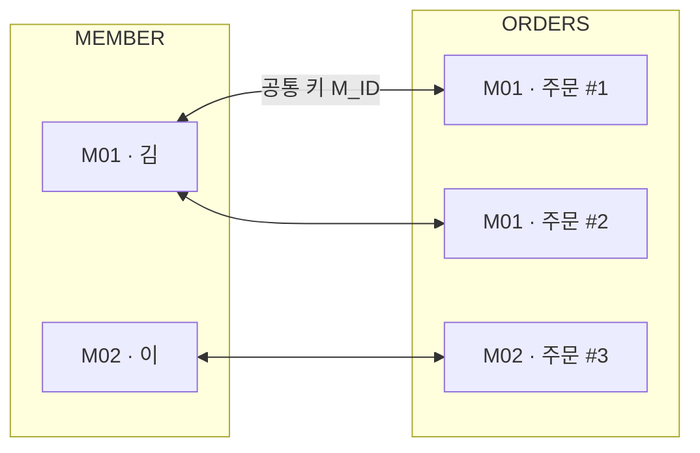

---

## 조인의 종류

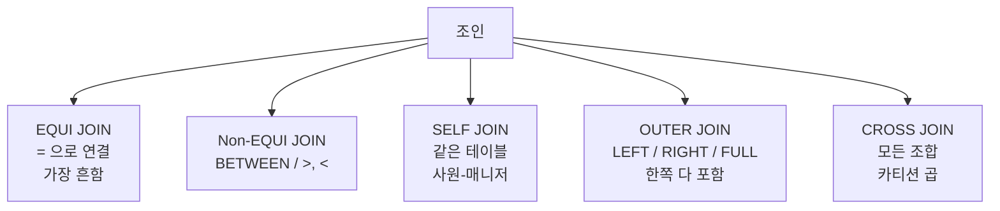

| 종류 | 의미 | 예 |
|---|---|---|
| EQUI 조인 | `=`으로 연결(가장 흔함) | `A.ID = B.ID` |
| Non-EQUI | `=` 외(BETWEEN 등) | `SAL BETWEEN LO AND HI` |
| SELF JOIN | 같은 테이블끼리 | 사원-매니저(같은 EMP) |
| OUTER JOIN | 매칭 안 돼도 한쪽 다 포함 | LEFT/RIGHT/FULL |
| CROSS JOIN | 모든 조합(카티션) | 두 테이블의 곱 |

---

## EQUI JOIN — 가장 기본

### 전통적 방식 (Oracle)

```sql
SELECT  E.NAME, D.DEPT_NAME
FROM    EMP E, DEPT D
WHERE   E.DEPT_ID = D.DEPT_ID;     -- 조인 조건
```

### 표준 ANSI 방식

```sql
SELECT  E.NAME, D.DEPT_NAME
FROM    EMP  E
        JOIN DEPT D ON E.DEPT_ID = D.DEPT_ID;
```

자세한 **표준 조인**(`2-1-8`) 은 다음 챕터 참고

---

## Non-EQUI JOIN — 범위 매칭

```sql
-- 급여 등급표를 조인
SELECT  E.NAME, E.SAL, S.GRADE
FROM    EMP E, SALGRADE S
WHERE   E.SAL BETWEEN S.LOSAL AND S.HISAL;
```

| EMP | SALGRADE |
|---|---|
| (사원, 급여) | (등급, 하한, 상한) |

---

## SELF JOIN — 자기 자신

한 테이블에 부모-자식 관계가 들어있을 때 사용(예: 사원-매니저). 계층 구조 조회와 함께 **계층형 질의와 셀프조인**(`2-2-6`) 챕터에서 심화.

```sql
SELECT  E.NAME    AS 사원,
        M.NAME    AS 매니저
FROM    EMP E, EMP M
WHERE   E.MGR_ID = M.EMP_ID;
```

| EMP | EMP_ID |
|---|---|
| 김(매니저: 이) | E1 |
| 이(매니저: 박) | E2 |
| 박 | E3 |

---

## OUTER JOIN — 한쪽 다 포함

```
LEFT  OUTER : A 모두 + 매칭되는 B    (A 에 없으면 결과에서 빠짐, B 에 없으면 NULL)
RIGHT OUTER : B 모두 + 매칭되는 A    (B 에 없으면 결과에서 빠짐, A 에 없으면 NULL)
FULL  OUTER : A·B 모두                (한쪽이라도 있으면 결과에 포함, 없는 쪽은 NULL)
```

```sql
-- LEFT OUTER (왼쪽 다)
SELECT M.NAME, O.ORDER_ID
FROM   MEMBER M LEFT OUTER JOIN ORDERS O
       ON M.MEMBER_ID = O.MEMBER_ID;

-- Oracle 전통 방식 (+) 기호
SELECT M.NAME, O.ORDER_ID
FROM   MEMBER M, ORDERS O
WHERE  M.MEMBER_ID = O.MEMBER_ID(+);   -- (+)는 NULL 채워질 쪽
```

---

## CROSS JOIN — 모든 조합(카티션 곱)

```sql
SELECT * FROM A CROSS JOIN B;
-- A 3행, B 2행 → 6행 (3×2)
```

조인 조건을 빼먹어도 발생 → 의도치 않으면 위험

---

## [SQL 실전] 다양한 조인

```sql
-- INNER JOIN
SELECT E.NAME, D.DEPT_NAME
FROM   EMP E JOIN DEPT D ON E.DEPT_ID = D.DEPT_ID;

-- 3개 테이블 조인
SELECT E.NAME, D.DEPT_NAME, L.CITY
FROM   EMP E
       JOIN DEPT D     ON E.DEPT_ID = D.DEPT_ID
       JOIN LOCATION L ON D.LOC_ID  = L.LOC_ID;

-- LEFT OUTER JOIN
SELECT M.NAME, O.ORDER_ID
FROM   MEMBER M LEFT JOIN ORDERS O ON M.MEMBER_ID = O.MEMBER_ID;
```

---

## [Before & After]

EMP 에는 부서가 없는 박, DEPT 에는 아무도 속하지 않은 D3(개발부)가 있는 상황. 같은 두 테이블에 INNER / LEFT / RIGHT / FULL OUTER 조인을 차례로 적용해 결과 행이 늘었다 줄었다 하는 양상 비교.

### EMP

| EMP_ID | NAME | DEPT_ID |
|---|---|---|
| 1 | 김 | D1 |
| 2 | 이 | D2 |
| 3 | 박 | NULL |

### DEPT

| DEPT_ID | DEPT_NAME |
|---|---|
| D1 | 영업부 |
| D2 | 인사부 |
| D3 | 개발부 |

### INNER JOIN

| NAME | DEPT_NAME |
|---|---|
| 김 | 영업부 |
| 이 | 인사부 |

### LEFT OUTER (EMP 기준)

| NAME | DEPT_NAME |
|---|---|
| 김 | 영업부 |
| 이 | 인사부 |
| 박 | NULL |

### RIGHT OUTER (DEPT 기준)

| NAME | DEPT_NAME |
|---|---|
| 김 | 영업부 |
| 이 | 인사부 |
| NULL | 개발부 |

### FULL OUTER

| NAME | DEPT_NAME |
|---|---|
| 김 | 영업부 |
| 이 | 인사부 |
| 박 | NULL |
| NULL | 개발부 |

INNER 조인은 양쪽 모두 매칭되는 행만 남기므로 박과 개발부가 동시에 사라짐. LEFT/RIGHT OUTER 는 기준 쪽을 다 살리고 반대쪽이 비면 NULL 을 채움. FULL OUTER 는 양쪽 모두 살림. "어느 쪽에 매칭이 없는 데이터까지 보고 싶은가" 가 INNER vs OUTER 선택 기준. OUTER 조인 후 WHERE 에 비기준 컬럼 조건을 걸면 NULL 행이 도로 빠지므로 추가 조건은 ON 절에 두는 것이 안전

---

## 조인 시 주의사항

| 함정 | 결과 | 해결 |
|---|---|---|
| 조인 조건 누락 | 카티션 곱(행수 폭발) | ON 또는 WHERE 명시 |
| OUTER JOIN과 WHERE 혼용 | NULL 행 사라짐 | 조건은 ON에 |
| N+1 테이블 조인 | N개 조인 조건 필요 | 잘 매핑 |

---

## [시험 출제 포인트]

| 함정 | 정답 |
|---|---|
| 조인 조건이 빠지면 | 카티션 곱(Cartesian Product) |
| Oracle 외부조인 표기 | `(+)` 기호(NULL 보충될 쪽에 붙임) |
| N개 테이블 조인 시 조인 조건 수 | 최소 N-1개 |
| Non-EQUI 조인 예 | BETWEEN, >, < 등 |
| SELF 조인은 같은 테이블을 두 번 사용? | 그렇다(별칭 필수) |
| INNER vs OUTER 차이 | OUTER는 매칭 안 되는 행도 NULL과 함께 포함 |

단골 함정: Oracle 의 `(+)` 위치는 NULL 을 채울 쪽(없을 수 있는 쪽)에 붙임

---

> **30초 시험 직전 정리**
> · 5종류: **EQUI / Non-EQUI / SELF / OUTER / CROSS**
> · 조인 조건 누락 = **카티션 곱** (행 수 폭발: A행 × B행)
> · N개 테이블 조인 = 조인 조건 **최소 N-1 개**
> · SELF 조인 = **별칭 필수** (같은 테이블을 두 번 사용)
> · Oracle `(+)` 표기 = **NULL 채울 쪽** (없을 수 있는 쪽)에 붙임
> · OUTER JOIN 추가 조건 = **ON 절에** (WHERE 두면 NULL 행 빠져 INNER 와 같아짐)


---

# 2-1-8. 표준 조인 (ANSI Standard Join)

## [핵심 요약]

> 표준 조인은 ANSI/ISO에서 정의한, 모든 DBMS에서 통하는 조인 문법이다. `JOIN ... ON` 키워드를 사용한다. 앞 챕터의 **조인**(`2-1-7`) 종류를 표준 문법으로 정리.

---

## [개념 도식화] 표준 조인의 종류

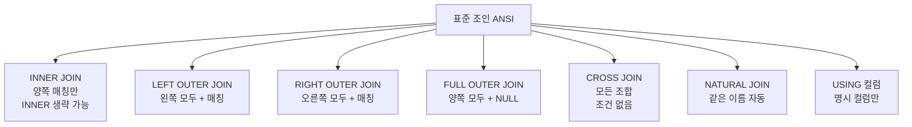

---

## [SQL 실전]

### INNER JOIN — 양쪽 매칭만

```sql
SELECT  E.NAME, D.DEPT_NAME
FROM    EMP E
        INNER JOIN DEPT D ON E.DEPT_ID = D.DEPT_ID;
        -- INNER 생략 가능: JOIN ... ON
```

```
   EMP    DEPT
   ┌──┐  ┌──┐
   │  ╲╱  │      ← 교집합만
   └──┘  └──┘
```

---

### LEFT OUTER JOIN — 왼쪽 다, 오른쪽 매칭

```sql
SELECT  E.NAME, D.DEPT_NAME
FROM    EMP E
        LEFT OUTER JOIN DEPT D ON E.DEPT_ID = D.DEPT_ID;
        -- OUTER 생략 가능: LEFT JOIN
```

```
   EMP    DEPT
   ┌──┐  ┌──┐
   │██╲╱  │      ← 왼쪽 모두 + 매칭된 오른쪽
   └──┘  └──┘
```

---

### RIGHT OUTER JOIN — 오른쪽 다, 왼쪽 매칭

```sql
SELECT  E.NAME, D.DEPT_NAME
FROM    EMP E
        RIGHT OUTER JOIN DEPT D ON E.DEPT_ID = D.DEPT_ID;
```

---

### FULL OUTER JOIN — 양쪽 다

```sql
SELECT  E.NAME, D.DEPT_NAME
FROM    EMP E
        FULL OUTER JOIN DEPT D ON E.DEPT_ID = D.DEPT_ID;
```

```
   EMP    DEPT
   ┌──┐  ┌──┐
   │██╲╱██│      ← 양쪽 모두(한쪽만 있어도 NULL 채워서)
   └──┘  └──┘
```

---

### CROSS JOIN — 모든 조합

```sql
SELECT  *
FROM    EMP E CROSS JOIN DEPT D;
```

조인 조건 없음. 결과는 A행수 × B행수

---

### NATURAL JOIN — 같은 이름 컬럼 자동 조인

```sql
SELECT  *
FROM    EMP NATURAL JOIN DEPT;     -- DEPT_ID로 자동 조인
```

| 특징 | 설명 |
|---|---|
| 자동 매칭 | 이름이 같은 컬럼으로 매칭 |
| 별칭 사용 X | 같은 이름 컬럼에 별칭 사용 불가 |
| 같은 이름 컬럼은 한 번만 등장 | 중복 제거 |

의도치 않은 컬럼이 매칭될 수 있어 실무에서는 잘 안 씀

---

### USING 절 — 명시적 컬럼 매칭

```sql
SELECT  NAME, DEPT_NAME, DEPT_ID
FROM    EMP JOIN DEPT USING (DEPT_ID);
```

| NATURAL vs USING | 차이 |
|---|---|
| NATURAL | 자동(모든 같은 이름) |
| USING | 지정한 컬럼만 |

USING 으로 조인된 컬럼은 테이블 별칭 사용 불가(예: `E.DEPT_ID` 불가)

---

### ON 절 vs WHERE 절 (OUTER JOIN 핵심)

```sql
-- 잘못된 예: OUTER JOIN인데 WHERE로 필터하면 NULL 행이 빠짐
SELECT M.NAME, O.ORDER_ID
FROM   MEMBER M LEFT JOIN ORDERS O ON M.MEMBER_ID = O.MEMBER_ID
WHERE  O.AMOUNT > 1000;     -- 주문 없는 회원이 사라짐

-- 올바른 예: 조인 조건에 함께
SELECT M.NAME, O.ORDER_ID
FROM   MEMBER M LEFT JOIN ORDERS O
       ON M.MEMBER_ID = O.MEMBER_ID
       AND O.AMOUNT > 1000;
```

---

## [Before & After] 표준 조인 결과 비교

EMP 3행(박은 부서 미지정)과 DEPT 3행(D3 개발은 소속 사원 없음)을 같은 키 DEPT_ID 로 조인하는 상황. 동일한 두 테이블에 INNER / LEFT / RIGHT / FULL / CROSS 를 차례로 적용해 ANSI 표준 문법별 결과 행 수가 어떻게 달라지는지 비교.

### 입력

**EMP**

| EMP_ID | NAME | DEPT_ID |
|---|---|---|
| 1 | 김 | D1 |
| 2 | 이 | D2 |
| 3 | 박 | NULL |

**DEPT**

| DEPT_ID | DEPT_NAME |
|---|---|
| D1 | 영업 |
| D2 | 인사 |
| D3 | 개발 |

### INNER JOIN

| NAME | DEPT_NAME |
|---|---|
| 김 | 영업 |
| 이 | 인사 |

### LEFT JOIN

| NAME | DEPT_NAME |
|---|---|
| 김 | 영업 |
| 이 | 인사 |
| 박 | NULL |

### RIGHT JOIN

| NAME | DEPT_NAME |
|---|---|
| 김 | 영업 |
| 이 | 인사 |
| NULL | 개발 |

### FULL JOIN

| NAME | DEPT_NAME |
|---|---|
| 김 | 영업 |
| 이 | 인사 |
| 박 | NULL |
| NULL | 개발 |

### CROSS JOIN

3 × 3 = 9행

ANSI 표준은 결과 집합을 키워드 한 단어로 명확히 구분 — INNER 는 매칭만, LEFT/RIGHT 는 한쪽 기준 모두, FULL 은 양쪽 모두, CROSS 는 카티션 곱. "어느 쪽에 매칭이 없는 데이터까지 살릴 것인가" 를 먼저 정한 뒤 그에 맞는 키워드 선택. OUTER 조인의 추가 조건은 반드시 ON 절에 두어야 매칭 안 되는 NULL 행이 그대로 살아남음

---

## 정리표

| 종류 | 매칭 안 되는 왼쪽 | 매칭 안 되는 오른쪽 |
|---|---|---|
| INNER | 제외 | 제외 |
| LEFT | 포함(NULL) | 제외 |
| RIGHT | 제외 | 포함(NULL) |
| FULL | 포함 | 포함 |
| CROSS | 모든 조합 | 모든 조합 |

---

## [시험 출제 포인트]

| 함정 | 정답 |
|---|---|
| INNER JOIN 키워드 생략 가능? | 가능. `JOIN ... ON`이 INNER JOIN |
| OUTER 키워드 생략 가능? | 가능. `LEFT JOIN` = `LEFT OUTER JOIN` |
| NATURAL JOIN의 매칭 기준 | 이름이 같은 모든 컬럼 |
| NATURAL JOIN에서 같은 이름 컬럼에 별칭 | 사용 불가 |
| USING 절의 컬럼에 테이블 별칭 | 사용 불가 |
| OUTER JOIN의 조건은 ON vs WHERE | ON에 둬야 NULL 행이 살아남음 |
| FULL OUTER 결과 | 양쪽 매칭 안 되는 것까지 모두 |
| CROSS JOIN 행수 | A × B |

단골 함정: LEFT JOIN 인데 WHERE 에 오른쪽 조건을 거는 케이스 → 결과적으로 INNER JOIN 과 같아짐

---

> **30초 시험 직전 정리**
> · `JOIN ... ON` = 표준 ANSI 문법 (어느 DBMS 든 통함)
> · INNER 키워드 생략 가능 / OUTER 키워드 생략 가능 (`LEFT JOIN` = `LEFT OUTER JOIN`)
> · NATURAL JOIN = 같은 이름 컬럼 **자동 전부** 매칭. 별칭 사용 **불가**
> · USING (컬럼) = **지정한 컬럼만** 매칭. USING 컬럼에 테이블 별칭 **불가**
> · OUTER JOIN 추가 조건은 반드시 **ON** 에 (WHERE 두면 INNER 효과)
> · 결과 행: INNER ≤ LEFT/RIGHT ≤ FULL, CROSS = A × B


---

# 2-2-1. 서브쿼리(Sub Query)

## [핵심 요약]

> 서브쿼리는 쿼리 안에 들어 있는 또 다른 쿼리다. 메인쿼리가 사용할 값을 미리 계산해 알려주는 보조 쿼리다.

ex) "평균 가격보다 비싼 상품"을 찾을 때, 평균을 먼저 계산(서브쿼리)한 뒤 그 값보다 큰 상품을 찾는(메인쿼리) 두 단계 작업.

---

## [개념 도식화] 서브쿼리의 위치

```sql
SELECT  컬럼들                    ← SELECT 서브쿼리(스칼라)
FROM    (서브쿼리)                 ← FROM 서브쿼리(인라인 뷰)
WHERE   컬럼 = (서브쿼리);         ← WHERE 서브쿼리(대표적)
```

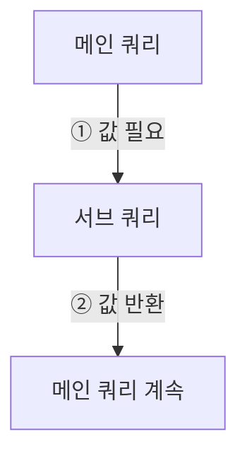

---

## 서브쿼리의 분류

### 결과 행수에 따른 분류

| 종류 | 결과 행수 | 사용 연산자 |
|---|---|---|
| 단일행 서브쿼리 | 1행 | `=`, `>`, `<`, `>=`, `<=`, `<>` |
| 다중행 서브쿼리 | 여러 행 | IN, ANY, ALL, EXISTS |
| 다중컬럼 서브쿼리 | 여러 컬럼 | `(A, B) IN (...)` |

### 위치에 따른 분류

| 위치 | 이름 | 예 |
|---|---|---|
| SELECT 절 | 스칼라 서브쿼리 | `SELECT (SELECT MAX(SAL) FROM EMP) FROM ...` |
| FROM 절 | 인라인 뷰 | `FROM (SELECT ...) X` |
| **WHERE**(`2-1-4`) 절 | 중첩 서브쿼리 | `WHERE SAL > (SELECT AVG(SAL)...)` |

### 메인쿼리와의 관계

| 종류 | 의미 | 특징 |
|---|---|---|
| 비연관 서브쿼리 | 메인쿼리 컬럼 사용 안 함 | 한 번만 실행 |
| 연관 서브쿼리 | 메인쿼리 컬럼 참조 | 메인의 각 행마다 반복 실행 |

---

## [SQL 실전]

### 단일행 서브쿼리

```sql
-- 평균 급여보다 많이 받는 사원
SELECT  NAME, SAL
FROM    EMP
WHERE   SAL > (SELECT AVG(SAL) FROM EMP);
```

서브쿼리 결과가 1행 1값이므로 `>` 같은 단순 연산자 사용 가능

---

### 다중행 서브쿼리 — IN / ANY / ALL

| 연산자 | 의미 |
|---|---|
| IN (...) | 값 중 하나와 같으면 |
| > ANY(...) | 하나 이상보다 크면 → 최솟값보다 크면 됨 |
| > ALL(...) | 모두보다 크면 → 최댓값보다 커야 함 |
| EXISTS (...) | 존재하면 참 |

```sql
-- IN
SELECT  *
FROM    EMP
WHERE   DEPT_ID IN (SELECT DEPT_ID FROM DEPT WHERE LOC = 'SEOUL');

-- > ANY: 어느 한 값보다 크면 → 최솟값보다만 크면 됨
SELECT  *
FROM    EMP
WHERE   SAL > ANY (SELECT SAL FROM EMP WHERE DEPT_ID = 'D1');

-- > ALL: 모든 값보다 커야 함 → 최댓값보다 커야 함
SELECT  *
FROM    EMP
WHERE   SAL > ALL (SELECT SAL FROM EMP WHERE DEPT_ID = 'D1');
```

---

### EXISTS 서브쿼리

```sql
-- 주문 내역이 있는 회원만
SELECT  *
FROM    MEMBER M
WHERE   EXISTS (SELECT 1 FROM ORDERS O WHERE O.MEMBER_ID = M.MEMBER_ID);
```

| 특징 | 설명 |
|---|---|
| 결과가 존재하기만 하면 TRUE | 1건이라도 있으면 통과 |
| IN보다 효율적일 수 있음 | 존재 확인만 하면 됨 |

---

### 스칼라 서브쿼리 (SELECT 절)

```sql
SELECT  E.NAME,
        E.SAL,
        (SELECT AVG(SAL) FROM EMP) AS 전체평균
FROM    EMP E;
```

반드시 1행 1값 반환. 여러 행 반환 시 에러

---

### 인라인 뷰 (FROM 절)

```sql
-- 부서별 평균 중 평균 4000 이상인 부서
SELECT  *
FROM    (SELECT DEPT_ID, AVG(SAL) AS AVG_SAL
         FROM   EMP
         GROUP BY DEPT_ID) X
WHERE   X.AVG_SAL >= 4000;
```

임시 테이블처럼 사용. 별칭 필수

---

### 연관 서브쿼리

```sql
-- 자기 부서 평균보다 많이 받는 사원
SELECT  E.NAME, E.SAL, E.DEPT_ID
FROM    EMP E
WHERE   E.SAL > (SELECT AVG(SAL)
                 FROM   EMP
                 WHERE  DEPT_ID = E.DEPT_ID);   -- E.DEPT_ID는 메인쿼리 참조
```

| 특징 | 설명 |
|---|---|
| 메인쿼리의 각 행마다 서브쿼리 실행 | 행 수만큼 반복 |
| 성능 영향 | 큼. 필요시 **조인**(`2-1-7`)으로 변환 |

---

## [Before & After]

같은 EMP 4명 데이터에 같은 비교(자기보다 평균이 큰 사람)를 적용해도, 비교 기준이 "회사 전체 평균"이냐 "자기 부서 평균"이냐에 따라 결과가 갈린다. 단일행 서브쿼리(전체 평균 1개) vs 연관 서브쿼리(부서별 평균 2개).

### EMP

| NAME | DEPT_ID | SAL |
|---|---|---|
| 김 | D1 | 3000 |
| 이 | D1 | 5000 |
| 박 | D2 | 4000 |
| 최 | D2 | 4500 |

### 단일행 서브쿼리

```sql
SELECT NAME, SAL FROM EMP WHERE SAL > (SELECT AVG(SAL) FROM EMP);
```

전체 평균 = 4125

| NAME | SAL |
|---|---|
| 이 | 5000 |
| 최 | 4500 |

### 연관 서브쿼리

```sql
SELECT NAME, SAL FROM EMP E
WHERE  SAL > (SELECT AVG(SAL) FROM EMP WHERE DEPT_ID = E.DEPT_ID);
```

부서별 평균: D1=4000, D2=4250

| NAME | SAL |
|---|---|
| 이 | 5000 |
| 최 | 4500 |

비연관(단일행) 서브쿼리는 메인쿼리와 무관하게 한 번만 실행되어 4125라는 한 값을 만들고, 모든 행이 그 값과 비교된다. 반면 연관 서브쿼리는 바깥의 E.DEPT_ID를 참조하므로 행마다 평균이 다시 계산된다(D1행은 4000, D2행은 4250 기준). 결과 행 집합이 우연히 같아 보여도 비교 기준은 행마다 다르다. "전체 기준"이면 단일행, "그룹 기준"이면 연관.

---

## [시험 출제 포인트]

| 함정 | 정답 |
|---|---|
| 다중행에 `=` 사용 | 에러 → IN 사용 |
| `> ANY` 의미 | 최솟값보다 크면 통과 |
| `> ALL` 의미 | 최댓값보다 커야 통과 |
| 스칼라 서브쿼리 결과 | 1행 1값 |
| 인라인 뷰의 위치 | FROM 절 |
| EXISTS는 결과를 사용? | 존재 여부만 확인 |
| 연관 서브쿼리 특징 | 메인쿼리 컬럼 참조 |

단골 함정: `SAL > ANY(...)`를 "모두보다 큰"으로 잘못 해석하는 보기. ANY=최소 기준, ALL=최대 기준. 두 SELECT 결과를 합치는 도구는 서브쿼리가 아니라 **집합 연산자**(`2-2-2`)(혼동 주의).

---

> **30초 시험 직전 정리**
> · 행수 분류: **단일행** (`=`,`>`,…) / **다중행** (IN, ANY, ALL, EXISTS) / **다중컬럼**
> · 위치 분류: **스칼라** (SELECT) / **인라인뷰** (FROM) / **중첩** (WHERE)
> · `> ANY` = **최솟값보다 크면** 통과 (헐거움) / `> ALL` = **최댓값보다 커야** 통과 (엄격)
> · EXISTS = 존재 여부만 확인 (1건이라도 있으면 TRUE)
> · 연관 서브쿼리 = 메인쿼리 컬럼 참조, **각 행마다 반복 실행** (성능 주의)
> · 인라인뷰 = **별칭 필수** (FROM 절 서브쿼리)


---

# 2-2-2. 집합 연산자(Set Operators)

## [핵심 요약]

> 집합 연산자는 두 개 이상의 SELECT 결과를 합치거나 비교하는 도구다. 합집합(UNION), 교집합(INTERSECT), 차집합(MINUS).

ex) 도시락 A={김밥,사과,우유}와 B={사과,빵,우유} → UNION={김밥,사과,우유,빵}, INTERSECT={사과,우유}, MINUS(A-B)={김밥}.

---

## [개념 도식화]

```
A = { 김, 이, 박 }      B = { 이, 박, 최 }

UNION       (A ∪ B, 중복 제거)  →  { 김, 이, 박, 최 }
UNION ALL   (A + B, 중복 유지)  →  { 김, 이, 박, 이, 박, 최 }
INTERSECT   (A ∩ B, 교집합)     →  { 이, 박 }
MINUS       (A − B, 차집합)     →  { 김 }       (A 에만 있는 것)
```

---

## 4가지 집합 연산자

| 연산자 | 의미 | 중복 처리 |
|---|---|---|
| UNION | 합집합 | 중복 제거 |
| UNION ALL | 합집합 | 중복 유지(가장 빠름) |
| INTERSECT | 교집합 | 중복 제거 |
| MINUS(Oracle) / EXCEPT(표준) | 차집합 | 중복 제거 |

---

## 사용 조건

```
[ 집합 연산자 사용 4조건 ]
  ① 양쪽 SELECT 의 컬럼 개수 동일
  ② 같은 자리 컬럼은 데이터 타입 호환
  ③ 결과의 컬럼명은 첫 SELECT 기준
  ④ ORDER BY 는 맨 마지막에 한 번만
```

| 조건 | 설명 |
|---|---|
| 컬럼 개수 | 두 SELECT의 컬럼 수가 같아야 함 |
| 데이터 타입 | 같은 자리의 컬럼은 호환되는 타입 |
| 컬럼명 | 결과의 컬럼명은 첫 SELECT 기준 |
| ORDER BY | 맨 마지막에 한 번만 |

---

## [SQL 실전]

```sql
-- UNION (중복 제거)
SELECT NAME FROM EMP_A
UNION
SELECT NAME FROM EMP_B;

-- UNION ALL (중복 유지)
SELECT NAME FROM EMP_A
UNION ALL
SELECT NAME FROM EMP_B;

-- INTERSECT (교집합)
SELECT NAME FROM EMP_A
INTERSECT
SELECT NAME FROM EMP_B;

-- MINUS (차집합, A에만 있는 것)
SELECT NAME FROM EMP_A
MINUS
SELECT NAME FROM EMP_B;

-- ORDER BY는 마지막에
SELECT NAME FROM EMP_A
UNION
SELECT NAME FROM EMP_B
ORDER BY NAME;
```

---

## [Before & After]

본사(EMP_A)와 지사(EMP_B) 두 명단을 합치거나 비교. 두 표에 "이"와 "박"이 양쪽 모두 있고, "김"은 A에만, "최"는 B에만 있다. 같은 데이터를 네 가지 집합 연산자(UNION/UNION ALL/INTERSECT/MINUS)에 넣었을 때 결과가 어떻게 갈라지는지.

### EMP_A

| NAME |
|---|
| 김 |
| 이 |
| 박 |

### EMP_B

| NAME |
|---|
| 이 |
| 박 |
| 최 |

### UNION

| NAME |
|---|
| 김 |
| 이 |
| 박 |
| 최 |

(중복 제거, 4행)

### UNION ALL

| NAME |
|---|
| 김 |
| 이 |
| 박 |
| 이 |
| 박 |
| 최 |

(중복 그대로, 6행)

### INTERSECT

| NAME |
|---|
| 이 |
| 박 |

### MINUS

| NAME |
|---|
| 김 |

같은 두 입력에서 4가지 결과가 갈라지는 이유는 "중복을 어떻게 다루느냐"와 "어느 쪽 기준으로 비교하느냐"가 연산마다 다르기 때문이다. UNION은 중복 제거를 위해 정렬을 한 번 더 거치므로 행 수가 줄고, UNION ALL은 그 단계를 건너뛰어 그대로 이어붙인다. INTERSECT는 양쪽 모두에 있는 값만, MINUS는 A에만 있는 값만 남긴다. "합칠 때 중복이 의미가 있는가", "두 집합의 공통 부분만 보고 싶은가", "한쪽에만 있는 것을 추리는가"를 먼저 묻고 연산자를 고를 것.

---

## UNION vs UNION ALL 성능 차이

| 비교 | UNION | UNION ALL |
|---|---|---|
| 중복 제거 | 함 | 안 함 |
| 정렬 작업 | 일어남(중복 제거 위해) | 안 일어남 |
| 성능 | 느림 | 빠름 |
| 권장 | 중복 가능성이 있을 때 | 중복 없거나 그대로 둬도 될 때 |

중복이 절대 없다고 확신하면 UNION ALL로 성능을 높인다. 두 결과를 "행 단위로 이어붙이는" 집합 연산자와 달리 **조인**(`2-1-7`)은 컬럼을 옆으로 붙이고, **서브쿼리**(`2-2-1`)는 메인쿼리에 값 하나를 공급. 역할이 다르다.

---

## 다중 컬럼 집합 연산

```sql
SELECT NAME, DEPT_ID, SAL FROM EMP_A
UNION
SELECT NAME, DEPT_ID, SAL FROM EMP_B;
```

모든 컬럼 값이 일치할 때만 중복으로 간주

---

## NULL과 집합 연산

집합 연산에서 NULL = NULL 로 취급되어 중복 처리(일반 비교 `=` 와 다름)

| EMP_A.COL | EMP_B.COL |
|---|---|
| NULL | NULL |

UNION 시 1행만 남음

---

## [시험 출제 포인트]

| 함정 | 정답 |
|---|---|
| 컬럼 개수가 다르면 | 에러 |
| UNION vs UNION ALL | UNION은 중복 제거, ALL은 그대로 |
| 결과 컬럼명 기준 | 첫 SELECT |
| ORDER BY 위치 | 마지막에 한 번 |
| 정렬 발생 여부 | UNION/INTERSECT/MINUS는 정렬 발생(중복 제거 위해) |
| MINUS는 표준인가 | Oracle 전용. 표준은 EXCEPT |
| NULL의 처리 | NULL = NULL로 간주(중복) |

단골 함정: 컬럼 데이터 타입이 다른데 합치려는 케이스는 에러

---

> **30초 시험 직전 정리**
> · UNION = **중복 제거** (정렬 발생, 느림) / UNION ALL = **중복 유지** (정렬 없음, 빠름)
> · INTERSECT = 교집합 (중복 제거) / MINUS(Oracle) = EXCEPT(표준) = A − B (중복 제거)
> · 사용 조건: **컬럼 개수 동일** + **타입 호환** + 컬럼명은 첫 SELECT
> · ORDER BY = **맨 마지막에 한 번만**
> · NULL 처리 = `NULL = NULL` 로 간주 (중복 제거 대상)
> · 중복 없다고 확신 → **UNION ALL** 로 성능 ↑


---

# 2-2-3. 그룹 함수(Group Functions)

## [핵심 요약]

> 그룹 함수는 다양한 단위의 소계와 합계를 한 쿼리로 한꺼번에 뽑아주는 확장 **GROUP BY**(`2-1-5`) 도구다(ROLLUP, CUBE, GROUPING SETS).

ex) 매장 매출 보고서에서 "부서별 / 부서+상품별 / 전체 합계"를 따로따로 SELECT하지 않고 한 번에 뽑는 도구.

---

## [개념 도식화] 그룹 함수의 종류

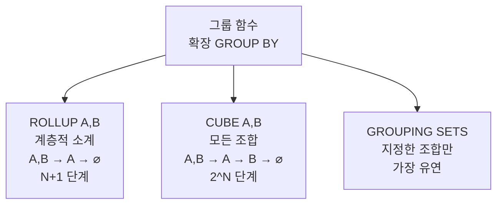

| 함수 | 의미 | 비유 |
|---|---|---|
| ROLLUP(A, B) | A별, A+B별, 전체 합계 | 단계적 소계 |
| CUBE(A, B) | 모든 조합(A별, B별, A+B별, 전체) | 큐브의 모든 면 |
| GROUPING SETS((A), (B)) | 특정 조합만 | 골라서 보기 |

---

## [SQL 실전]

### ROLLUP — 계층적 소계

```sql
SELECT  DEPT_ID, JOB, SUM(SAL)
FROM    EMP
GROUP BY ROLLUP(DEPT_ID, JOB);
```

### 결과 — 4단계(부서+직무, 부서, 전체)

| DEPT_ID | JOB | SUM(SAL) |
|---|---|---|
| D1 | MGR | 5000 |
| D1 | CLERK | 2000 |
| D1 | NULL | 7000 (D1 소계) |
| D2 | MGR | 4500 |
| D2 | NULL | 4500 (D2 소계) |
| NULL | NULL | 11500 (전체 합계) |

ROLLUP(A, B): A → A+B 로 갈수록 세분화, 위로 갈수록 소계

---

### CUBE — 모든 조합

```sql
SELECT  DEPT_ID, JOB, SUM(SAL)
FROM    EMP
GROUP BY CUBE(DEPT_ID, JOB);
```

### 결과 — ROLLUP 결과 + JOB별 합계까지

| DEPT_ID | JOB | SUM(SAL) |
|---|---|---|
| D1 | MGR | 5000 |
| D1 | CLERK | 2000 |
| D1 | NULL | 7000 |
| D2 | MGR | 4500 |
| D2 | NULL | 4500 |
| NULL | MGR | 9500 (MGR 합계, CUBE만 추가) |
| NULL | CLERK | 2000 (CLERK 합계) |
| NULL | NULL | 11500 |

N 개 컬럼 CUBE = 2^N 가지 조합

---

### GROUPING SETS — 골라 보기

```sql
SELECT  DEPT_ID, JOB, SUM(SAL)
FROM    EMP
GROUP BY GROUPING SETS((DEPT_ID), (JOB), ());
```

### 결과 — 부서별, 직무별, 전체

| DEPT_ID | JOB | SUM(SAL) |
|---|---|---|
| D1 | NULL | 7000 |
| D2 | NULL | 4500 |
| NULL | MGR | 9500 |
| NULL | CLERK | 2000 |
| NULL | NULL | 11500 |

---

## 정리표

| 함수 | 결과 |
|---|---|
| GROUP BY (A, B) | A, B 조합 |
| GROUP BY ROLLUP(A, B) | (A, B), (A), () |
| GROUP BY CUBE(A, B) | (A, B), (A), (B), () |
| GROUP BY GROUPING SETS((A, B), (A)) | 지정한 조합만 |

---

### GROUPING 함수 — 소계 행 구분

결과에 NULL이 보일 때, 원래 NULL 인지 소계로 인한 NULL 인지 구분하는 함수

| 결과 | 의미 |
|---|---|
| GROUPING(컬럼) = 0 | 일반 행(실제 그룹) |
| GROUPING(컬럼) = 1 | 소계 행 |

```sql
SELECT  DEPT_ID, JOB, SUM(SAL),
        GROUPING(DEPT_ID) AS G_DEPT,
        GROUPING(JOB)     AS G_JOB
FROM    EMP
GROUP BY ROLLUP(DEPT_ID, JOB);
```

| DEPT_ID | JOB | SUM | G_DEPT | G_JOB |
|---|---|---|---|---|
| D1 | MGR | 5000 | 0 | 0 |
| D1 | NULL | 7000 | 0 | 1 (소계) |
| NULL | NULL | 11500 | 1 | 1 (전체 합계) |

---

## [Before & After] ROLLUP vs CUBE 비교

EMP 3행(D1·D2 부서, A·B 직무)을 부서/직무로 집계. 같은 데이터를 일반 GROUP BY, ROLLUP, CUBE에 차례로 넣어 어디까지 소계가 추가되는지 비교. 핵심은 "부서 소계만 필요한가, 직무 소계까지 필요한가".

### EMP

| DEPT_ID | JOB | SAL |
|---|---|---|
| D1 | A | 1000 |
| D1 | B | 2000 |
| D2 | A | 3000 |

### `GROUP BY (DEPT, JOB)` — 기본

| D | J | SUM |
|---|---|---|
| D1 | A | 1000 |
| D1 | B | 2000 |
| D2 | A | 3000 |

### `ROLLUP(DEPT, JOB)`

| D | J | SUM |
|---|---|---|
| D1 | A | 1000 |
| D1 | B | 2000 |
| D1 | NULL | 3000 |
| D2 | A | 3000 |
| D2 | NULL | 3000 |
| NULL | NULL | 6000 |

### `CUBE(DEPT, JOB)` 추가 행

| NULL | A | 4000 |
| NULL | B | 2000 |

기본 GROUP BY는 (DEPT, JOB) 조합 1단계만, ROLLUP(DEPT, JOB)은 (DEPT, JOB) → (DEPT) → ()로 왼쪽부터 한 칸씩 떼어내며 소계를 쌓는다(N+1단계). CUBE(DEPT, JOB)는 거기에 더해 (JOB) 단독 소계까지 만들어 모든 조합 2^N단계를 채운다. 부서 단위 소계만 필요하면 ROLLUP으로 충분하지만, 직무별 가로 합계까지 한 번에 보고 싶다면 CUBE가 정답. 특정 조합만 골라 뽑고 싶다면 GROUPING SETS.

---

## [시험 출제 포인트]

| 함정 | 정답 |
|---|---|
| ROLLUP(A, B) 결과 단계 | (A, B), (A), () |
| CUBE(A, B) 결과 단계 | (A, B), (A), (B), () |
| 그룹함수에서 NULL 행의 의미 | 소계 행 또는 원래 NULL |
| GROUPING 함수 결과가 1이면 | 소계 행 |
| CUBE의 조합 수 | 2^N (N=컬럼수) |
| 소계 NULL과 데이터 NULL 구분 | GROUPING 함수 사용 |

단골 함정: ROLLUP(A, B, C) 의 단계 수는 N+1 = 4단계, CUBE 는 2^N = 8단계. 행을 합치는 그룹 함수와 달리, 행을 그대로 두고 옆에 통계를 붙이는 도구는 **윈도우 함수**(`2-2-4`), 행을 컬럼으로 펼치는 도구는 **PIVOT**(`2-2-7`).

---

> **30초 시험 직전 정리**
> · ROLLUP(A, B) = (A,B) → (A) → () — **N+1 단계** (계층적 소계)
> · CUBE(A, B) = (A,B) → (A) → (B) → () — **2^N 단계** (모든 조합)
> · GROUPING SETS = 원하는 조합만 골라 (유연)
> · GROUPING(컬럼) = **1 이면 소계 행** / 0 이면 일반 행
> · 결과의 NULL 이 데이터인지 소계인지 → **GROUPING 함수로 구분**
> · "ROLLUP 시작 위치만 다름" 함정 — `ROLLUP(A,B)` ≠ `ROLLUP(B,A)` (단계 다름)


---

# 2-2-4. 윈도우 함수(Window Function)

## [핵심 요약]

> 윈도우 함수는 행을 합치지 않으면서, 행마다 **그룹**(`2-2-3`)별 통계나 순위를 옆에 붙여주는 함수다(분석 함수라고도 한다).

ex) 학생 명단을 GROUP BY로 묶으면 학년 평균만 남아 개별 정보가 사라지지만, 윈도우 함수는 학생 행은 그대로 두고 옆에 학년 평균/등수를 추가한다.

---

## [개념 도식화] 일반 집계 vs 윈도우 함수

| 일반 집계 (GROUP BY) | 윈도우 함수 (OVER) |
|---|---|
| 행이 그룹별로 **합쳐짐** | 행은 **그대로 유지** + 옆에 분석값 |
| 결과 1행 | 결과 N행 (원본과 같음) |
| AVG = 4000 | NAME · SAL · RANK · AVG 모두 보임 |

윈도우 함수 결과 예시 (`AVG(SAL) OVER ()` + `RANK()`):

| NAME | SAL | RANK | AVG |
|---|---|---|---|
| 김 | 3000 | 3 | 4000 |
| 이 | 5000 | 1 | 4000 |
| 박 | 4000 | 2 | 4000 |

```
[원본 행]  ──OVER 절로 윈도우 정의──→  [행 그대로 유지 + 옆에 분석값 추가]
```

---

## 기본 문법

```sql
함수명(컬럼) OVER (
    PARTITION BY 그룹기준        -- 어떻게 묶을지
    ORDER BY 정렬기준              -- 어떻게 정렬할지
    ROWS BETWEEN ... AND ...       -- 어디부터 어디까지(윈도우)
)
```

| 구성 | 의미 |
|---|---|
| PARTITION BY | 그룹 기준(생략 시 전체) |
| **ORDER BY**(`2-1-6`) | 그룹 내 정렬 |
| ROWS/RANGE | 윈도우 프레임 범위 |

---

## 윈도우 함수의 분류

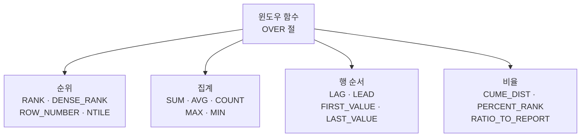

## [SQL 실전]

### 순위 함수

| 함수 | 동점 처리 | 다음 순위 |
|---|---|---|
| RANK() | 같은 등수 | 건너뜀 (1, 1, 3) |
| DENSE_RANK() | 같은 등수 | 연속 (1, 1, 2) |
| ROW_NUMBER() | 무조건 다른 등수 | (1, 2, 3) |

```sql
SELECT  NAME, SAL,
        RANK()       OVER (ORDER BY SAL DESC) AS R,
        DENSE_RANK() OVER (ORDER BY SAL DESC) AS DR,
        ROW_NUMBER() OVER (ORDER BY SAL DESC) AS RN
FROM    EMP;
```

| NAME | SAL | R | DR | RN |
|---|---|---|---|---|
| 이 | 5000 | 1 | 1 | 1 |
| 박 | 5000 | 1 | 1 | 2 |
| 최 | 4500 | 3 | 2 | 3 |
| 김 | 3000 | 4 | 3 | 4 |

---

### 집계 윈도우 함수

| 함수 | 의미 |
|---|---|
| SUM/AVG/MAX/MIN/COUNT | 행 옆에 그룹 통계 |

```sql
-- 부서별 평균 급여를 옆에 붙임
SELECT  NAME, DEPT_ID, SAL,
        AVG(SAL) OVER (PARTITION BY DEPT_ID) AS DEPT_AVG
FROM    EMP;
```

| NAME | DEPT_ID | SAL | DEPT_AVG |
|---|---|---|---|
| 김 | D1 | 3000 | 4000 |
| 이 | D1 | 5000 | 4000 |
| 박 | D2 | 4000 | 4000 |
| 최 | D2 | 4000 | 4000 |

---

### 행 순서 함수

| 함수 | 의미 |
|---|---|
| LAG(col, n) | n행 전 값(앞 행) |
| LEAD(col, n) | n행 후 값(뒷 행) |
| FIRST_VALUE(col) | 윈도우의 첫 값 |
| LAST_VALUE(col) | 윈도우의 마지막 값 |

```sql
SELECT  NAME, HIRE_DATE,
        LAG(NAME)  OVER (ORDER BY HIRE_DATE) AS PREV_EMP,
        LEAD(NAME) OVER (ORDER BY HIRE_DATE) AS NEXT_EMP
FROM    EMP;
```

---

### 비율 함수

| 함수 | 의미 |
|---|---|
| CUME_DIST() | 누적 비율 |
| PERCENT_RANK() | 백분위 순위 |
| NTILE(N) | N등분 그룹 |
| RATIO_TO_REPORT(col) | 전체 합 대비 비율(Oracle) |

```sql
-- 4등분으로 나눠서 그룹 번호 부여
SELECT NAME, SAL, NTILE(4) OVER (ORDER BY SAL DESC) AS QUARTILE FROM EMP;
```

---

### 윈도우 프레임 — ROWS / RANGE

```sql
ROWS BETWEEN UNBOUNDED PRECEDING AND CURRENT ROW   -- 처음~현재
ROWS BETWEEN 1 PRECEDING AND 1 FOLLOWING           -- 앞1, 자신, 뒤1
RANGE BETWEEN UNBOUNDED PRECEDING AND UNBOUNDED FOLLOWING  -- 전체
```

| 키워드 | 의미 |
|---|---|
| UNBOUNDED PRECEDING | 그룹의 처음부터 |
| n PRECEDING | 앞 n번째부터 |
| CURRENT ROW | 현재 행 |
| n FOLLOWING | 뒤 n번째까지 |
| UNBOUNDED FOLLOWING | 그룹의 끝까지 |

```sql
-- 누적 합(running total)
SELECT  NAME, HIRE_DATE, SAL,
        SUM(SAL) OVER (ORDER BY HIRE_DATE
                       ROWS BETWEEN UNBOUNDED PRECEDING AND CURRENT ROW) AS RUN_TOT
FROM    EMP;
```

---

## [Before & After]

D1·D2 두 부서 4명에 대해 "부서 안에서의 등수"와 "부서 평균"을 동시에 한 표에 보여줘야 하는 상황. GROUP BY로 묶으면 4행이 2행으로 줄어 개별 이름이 사라지지만, 윈도우 함수는 4행을 그대로 유지하면서 옆에 부서별 RANK와 부서 AVG를 붙인다. D2의 박·최가 4500으로 동률일 때 RANK가 어떻게 매겨지는지도 함께.

### EMP

| NAME | DEPT_ID | SAL |
|---|---|---|
| 김 | D1 | 3000 |
| 이 | D1 | 5000 |
| 박 | D2 | 4500 |
| 최 | D2 | 4500 |

### 쿼리

```sql
SELECT  NAME, DEPT_ID, SAL,
        RANK() OVER (PARTITION BY DEPT_ID ORDER BY SAL DESC) AS DEPT_RANK,
        AVG(SAL) OVER (PARTITION BY DEPT_ID) AS DEPT_AVG
FROM    EMP;
```

| NAME | DEPT_ID | SAL | DEPT_RANK | DEPT_AVG |
|---|---|---|---|---|
| 이 | D1 | 5000 | 1 | 4000 |
| 김 | D1 | 3000 | 2 | 4000 |
| 박 | D2 | 4500 | 1 | 4500 |
| 최 | D2 | 4500 | 1 | 4500 |

PARTITION BY DEPT_ID가 D1·D2를 각각 독립된 윈도우로 나누기 때문에 RANK와 AVG가 부서별로 따로 계산된다. D2의 박·최가 둘 다 RANK 1을 받는 이유는 RANK()가 동률을 같은 등수로 처리하기 때문이고(다음 등수는 3으로 건너뜀), AVG도 부서 안 두 명만으로 계산해 4500이 된다. 행을 합치지 않고 옆에 통계를 붙이는 윈도우 함수의 본질 — 같은 부서 두 명의 SAL이 그대로 보이면서 평균·등수가 함께 따라붙는다.

---

## 윈도우 함수 vs GROUP BY

| 항목 | GROUP BY | 윈도우 함수 |
|---|---|---|
| 결과 행수 | 줄어듦(그룹별 1행) | 유지(원본 그대로) |
| 개별 데이터 | 사라짐 | 남음 |
| 사용 목적 | 집계 결과만 | 개별 + 집계 |

---

## [시험 출제 포인트]

| 함정 | 정답 |
|---|---|
| RANK vs DENSE_RANK vs ROW_NUMBER | RANK 건너뜀 / DENSE_RANK 연속 / ROW_NUMBER 모두 다름 |
| `OVER ()` 빈 괄호 | 전체를 한 윈도우로 |
| PARTITION BY 생략 | 전체 행을 하나의 그룹으로 |
| 윈도우 함수에 WHERE 절 사용 | WHERE에 직접 못 씀 → 인라인뷰 사용 |
| LAG/LEAD 기본 오프셋 | 1 |
| 윈도우 함수 결과 행 수 | 원본과 동일 |

단골 함정: `RANK() OVER(...)` 결과를 WHERE 에 직접 사용 불가. 서브쿼리/인라인뷰로 감싸야 함(부서별 **Top N 쿼리**(`2-2-5`)도 같은 패턴).

---

> **30초 시험 직전 정리**
> · 결과 행 수 = **원본과 동일** (GROUP BY 처럼 합치지 않음)
> · 순위: **RANK** (동점 후 건너뜀: 1,1,3) / **DENSE_RANK** (연속: 1,1,2) / **ROW_NUMBER** (모두 다름)
> · 문법: `함수() OVER (PARTITION BY ... ORDER BY ... ROWS BETWEEN ...)`
> · PARTITION BY 생략 = **전체를 한 그룹**
> · LAG = 앞 / LEAD = 뒤 / FIRST_VALUE / LAST_VALUE / NTILE(N)
> · 윈도우 결과를 **WHERE 에서 직접 사용 불가** → 서브쿼리·인라인뷰로 감쌈
> · 누적합 = `SUM(...) OVER (ORDER BY ... ROWS BETWEEN UNBOUNDED PRECEDING AND CURRENT ROW)`


---

# 2-2-5. Top N 쿼리

## [핵심 요약]

> Top N 쿼리는 상위 N개 행만 뽑는 쿼리다(예: 매출 상위 10개 상품, 최신 5건의 주문).

---

## [개념 도식화] Top N의 4가지 방법

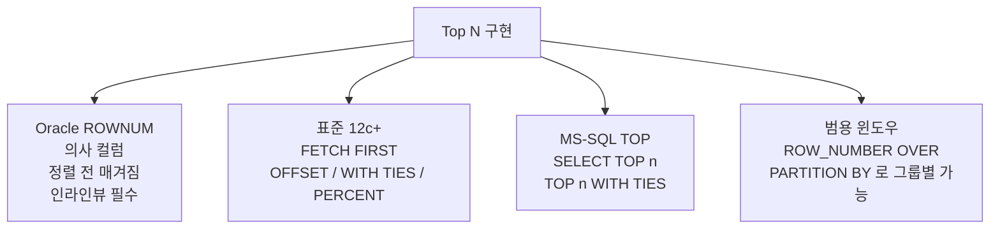

---

## [SQL 실전]

### Oracle ROWNUM

ROWNUM = 행이 만들어진 순서대로 1, 2, 3... 이 매겨지는 의사 컬럼

```sql
SELECT  *
FROM    EMP
WHERE   ROWNUM <= 5;
```

#### ROWNUM의 함정

ROWNUM 은 **ORDER BY**(`2-1-6`) 적용 전에 매겨지므로 정렬을 먼저 한 인라인 뷰를 감싸야 함

```sql
-- 잘못된 예: 정렬 전에 ROWNUM이 매겨짐
SELECT *
FROM   EMP
WHERE  ROWNUM <= 5
ORDER BY SAL DESC;     -- 5개 추출 후 정렬되어 의도와 다름

-- 올바른 예: 인라인 뷰로 정렬 먼저
SELECT *
FROM   (SELECT * FROM EMP ORDER BY SAL DESC)
WHERE  ROWNUM <= 5;
```

| 조건 | 결과 |
|---|---|
| `ROWNUM = 1` | 가능 |
| `ROWNUM <= 5` | 가능 |
| `ROWNUM = 5` | 결과 없음 |
| `ROWNUM > 5` | 결과 없음 |

ROWNUM 은 1부터 시작하므로 "5번째만"을 ROWNUM = 5 로 표현 불가

---

### 표준 FETCH FIRST (Oracle 12c+)

```sql
-- 상위 5개
SELECT *
FROM   EMP
ORDER BY SAL DESC
FETCH FIRST 5 ROWS ONLY;

-- 상위 10%(백분율)
SELECT *
FROM   EMP
ORDER BY SAL DESC
FETCH FIRST 10 PERCENT ROWS ONLY;

-- 동률 포함
SELECT *
FROM   EMP
ORDER BY SAL DESC
FETCH FIRST 5 ROWS WITH TIES;     -- 5등 동률은 모두 포함
```

| 옵션 | 의미 |
|---|---|
| FETCH FIRST n ROWS ONLY | 정확히 n개 |
| FETCH FIRST n ROWS WITH TIES | n등 동률은 모두 포함 |
| OFFSET n ROWS | n개 건너뛰고 |

---

### MS-SQL TOP

```sql
SELECT TOP 5 *
FROM   EMP
ORDER BY SAL DESC;

-- 동률 포함
SELECT TOP 5 WITH TIES *
FROM   EMP
ORDER BY SAL DESC;
```

---

### **윈도우 함수**(`2-2-4`) — 가장 안전·범용

```sql
-- 부서별 급여 상위 3명
SELECT *
FROM   (SELECT NAME, DEPT_ID, SAL,
               ROW_NUMBER() OVER (PARTITION BY DEPT_ID ORDER BY SAL DESC) AS RN
        FROM   EMP)
WHERE  RN <= 3;
```

| 함수 | 동률 처리 |
|---|---|
| ROW_NUMBER() | 무조건 다른 번호 → 정확히 N개 |
| RANK() | 동률 같은 등수, 건너뜀 |
| DENSE_RANK() | 동률 같은 등수, 연속 |

---

### 페이징(Pagination)

"1페이지: 1-10번째, 2페이지: 11-20번째..."

### Oracle

```sql
-- 11~20번째
SELECT *
FROM   (SELECT ROWNUM RN, X.*
        FROM   (SELECT * FROM EMP ORDER BY SAL DESC) X
        WHERE  ROWNUM <= 20)
WHERE  RN >= 11;
```

### 표준 (Oracle 12c+)

```sql
SELECT *
FROM   EMP
ORDER BY SAL DESC
OFFSET 10 ROWS FETCH NEXT 10 ROWS ONLY;
```

---

## [Before & After]

EMP 5명에서 급여 상위 3명을 뽑는 상황. 박·최가 4500으로 동률이라는 점이 핵심 차이를 만든다. 같은 "Top 3" 요구라도 ROWNUM 기반(정확히 3명)과 WITH TIES(동률 모두 포함)가 어떻게 갈라지는지.

### EMP

| NAME | SAL |
|---|---|
| 김 | 3000 |
| 이 | 5000 |
| 박 | 4500 |
| 최 | 4500 |
| 홍 | 2000 |

### 급여 상위 3명

```sql
SELECT *
FROM   (SELECT * FROM EMP ORDER BY SAL DESC)
WHERE  ROWNUM <= 3;
```

| NAME | SAL |
|---|---|
| 이 | 5000 |
| 박 | 4500 |
| 최 | 4500 |

### `WITH TIES` 사용 시

| NAME | SAL |
|---|---|
| 이 | 5000 |
| 박 | 4500 |
| 최 | 4500 |

4500이 더 있으면 4명 이상 가능

이 예에서는 박·최 두 명이 4500이라 마침 정확히 3명이 떨어졌지만, 만약 4500이 한 명 더 있었다면 ROWNUM 방식은 그중 임의의 3명만, WITH TIES는 동률 전원을 포함해 4명 이상을 반환한다. "정확한 N개"가 필요하면 ROW_NUMBER()/ROWNUM, "공평하게 동률 포함"이 원칙이면 WITH TIES 나 RANK(). 결과 행 수가 입력 데이터에 따라 달라질 수 있다는 점이 Top N 쿼리의 단골 함정.

---

## ROWNUM vs ROW_NUMBER()

| 항목 | ROWNUM | ROW_NUMBER() |
|---|---|---|
| 정렬 적용 시점 | WHERE보다 먼저(정렬 전) | OVER에 ORDER BY 명시 |
| 그룹별 번호 | 불가 | 가능(PARTITION BY) |
| `=N` 사용 | 안 됨(1만 가능) | 가능 |

---

## [시험 출제 포인트]

| 함정 | 정답 |
|---|---|
| `WHERE ROWNUM = 5` | 결과 없음(1만 매칭) |
| ROWNUM과 ORDER BY 조합 | 인라인 뷰로 정렬 먼저, ROWNUM은 나중에 |
| 동률 포함하려면 | WITH TIES 또는 RANK() |
| 부서별 Top N | 윈도우 함수(ROW_NUMBER + PARTITION BY) |
| 페이징 표준 문법 | OFFSET ... FETCH NEXT ... |

단골 함정: ROWNUM 은 `=1` 만 의미 있음. `>n` 은 항상 거짓.

---

> **30초 시험 직전 정리**
> · ROWNUM 함정 = **`=1`만 가능**, **`>n` 항상 거짓**, **정렬 전에 매겨짐** → 인라인뷰로 정렬 먼저
> · 표준: `FETCH FIRST n ROWS ONLY` (Oracle 12c+) / `WITH TIES` 면 동률 포함
> · MS-SQL: `SELECT TOP n` / `TOP n WITH TIES`
> · 부서별 Top N = **ROW_NUMBER() OVER (PARTITION BY ... ORDER BY ...)** + 인라인뷰
> · 페이징 표준 = `OFFSET n ROWS FETCH NEXT m ROWS ONLY`


---

# 2-2-6. 계층형 질의와 셀프 조인

## [핵심 요약]

> 계층형 질의는 트리 구조 데이터(예: 조직도)를 위에서 아래로 펼치는 쿼리다. 셀프 조인은 같은 테이블을 자기 자신과 조인하는 것이다.

ex) 가족 족보를 "사람ID, 부모ID" 한 테이블에 저장한 뒤 CONNECT BY로 할아버지 → 아버지 → 나 순으로 펼쳐 보는 쿼리.

---

## [개념 도식화] 계층형 데이터의 모양

```
       사장(E1)
       /    \
   매니저A(E2) 매니저B(E3)
     /
  사원(E4)
```

| EMP_ID | NAME | MGR_ID |
|---|---|---|
| E1 | 사장 | NULL |
| E2 | 매니저A | E1 |
| E3 | 매니저B | E1 |
| E4 | 사원 | E2 |

---

## CONNECT BY (Oracle 계층형 질의)

```sql
SELECT  LEVEL,
        EMP_ID, NAME, MGR_ID
FROM    EMP
START WITH MGR_ID IS NULL          -- 시작점(루트)
CONNECT BY PRIOR EMP_ID = MGR_ID;  -- 부모-자식 관계
```

| 키워드 | 의미 |
|---|---|
| START WITH | 루트 행 조건 |
| CONNECT BY PRIOR | 부모-자식 연결 |
| LEVEL | 깊이(1=루트) |
| CONNECT_BY_ROOT | 루트의 컬럼값 |
| CONNECT_BY_ISLEAF | 리프(잎)이면 1 |
| SYS_CONNECT_BY_PATH(col, '/') | 경로 표시 |

### PRIOR 위치

| 표현 | 의미 |
|---|---|
| `PRIOR EMP_ID = MGR_ID` | 순방향: 부모→자식 |
| `PRIOR MGR_ID = EMP_ID` | 역방향: 자식→부모 |

---

## [SQL 실전] 계층형 질의

```sql
SELECT  LEVEL,
        LPAD(' ', (LEVEL-1)*4) || NAME AS TREE,
        SYS_CONNECT_BY_PATH(NAME, '/') AS PATH
FROM    EMP
START WITH MGR_ID IS NULL
CONNECT BY PRIOR EMP_ID = MGR_ID;
```

### 결과

| LEVEL | TREE | PATH |
|---|---|---|
| 1 | 사장 | /사장 |
| 2 | &nbsp;&nbsp;&nbsp;&nbsp;매니저A | /사장/매니저A |
| 3 | &nbsp;&nbsp;&nbsp;&nbsp;&nbsp;&nbsp;&nbsp;&nbsp;사원 | /사장/매니저A/사원 |
| 2 | &nbsp;&nbsp;&nbsp;&nbsp;매니저B | /사장/매니저B |

---

## ORDER SIBLINGS BY — 형제 정렬

```sql
SELECT  LEVEL, NAME
FROM    EMP
START WITH MGR_ID IS NULL
CONNECT BY PRIOR EMP_ID = MGR_ID
ORDER SIBLINGS BY NAME;     -- 형제(같은 LEVEL)끼리만 정렬
```

일반 ORDER BY 는 계층 구조를 망가뜨리므로 ORDER SIBLINGS BY 사용

---

## SELF JOIN

같은 테이블을 두 번 사용해 **조인**(`2-1-7`). 별칭으로 구분.

```sql
SELECT  E.NAME    AS 사원,
        M.NAME    AS 매니저
FROM    EMP E,  EMP M
WHERE   E.MGR_ID = M.EMP_ID;
```

표준 방식

```sql
SELECT  E.NAME    AS 사원,
        M.NAME    AS 매니저
FROM    EMP E LEFT JOIN EMP M ON E.MGR_ID = M.EMP_ID;
```

| 사원 | 매니저 |
|---|---|
| 사장 | NULL |
| 매니저A | 사장 |
| 매니저B | 사장 |
| 사원 | 매니저A |

---

## 계층형 질의 vs 셀프 조인

| 비교 | 계층형 질의 | 셀프 조인 |
|---|---|---|
| 구조 | 여러 단계 트리 | 보통 1단계(직속만) |
| 사용 함수 | LEVEL, PATH 등 | 일반 SQL |
| 표준 여부 | Oracle 전용(CONNECT BY) | 표준 |
| 깊이 제한 | 무제한 | 1단계 |

---

## 표준 재귀 쿼리 (참고)

```sql
-- ANSI 표준: 재귀 CTE(Common Table Expression)
WITH RECURSIVE EMP_TREE(EMP_ID, NAME, MGR_ID, LV) AS (
    SELECT EMP_ID, NAME, MGR_ID, 1
    FROM   EMP
    WHERE  MGR_ID IS NULL
    UNION ALL
    SELECT E.EMP_ID, E.NAME, E.MGR_ID, T.LV + 1
    FROM   EMP E JOIN EMP_TREE T ON E.MGR_ID = T.EMP_ID
)
SELECT * FROM EMP_TREE;
```

Oracle 12c 이상 및 다른 DBMS 도 지원

---

## [Before & After]

평면 테이블 EMP는 4행이 단순히 나열돼 있을 뿐, 사장-매니저-사원의 위계가 보이지 않는다. CONNECT BY로 MGR_ID 컬럼을 따라 부모-자식 관계를 펼치면 같은 4행이 트리 순서로 재배열되고 LEVEL 이 1·2·3으로 매겨진다.

### EMP

| EMP_ID | NAME | MGR_ID |
|---|---|---|
| E1 | 사장 | NULL |
| E2 | 매니저A | E1 |
| E3 | 매니저B | E1 |
| E4 | 사원 | E2 |

### 쿼리

```sql
SELECT LEVEL, NAME, EMP_ID, MGR_ID
FROM   EMP
START WITH MGR_ID IS NULL
CONNECT BY PRIOR EMP_ID = MGR_ID;
```

| LEVEL | NAME | EMP_ID | MGR_ID |
|---|---|---|---|
| 1 | 사장 | E1 | NULL |
| 2 | 매니저A | E2 | E1 |
| 3 | 사원 | E4 | E2 |
| 2 | 매니저B | E3 | E1 |

START WITH MGR_ID IS NULL 이 사장(E1)을 루트로 잡고, CONNECT BY PRIOR EMP_ID = MGR_ID 가 "현재 행의 EMP_ID = 다음 행의 MGR_ID"라는 부모-자식 규칙을 정의해 깊이 우선으로 트리를 펼친다. 그래서 매니저A 다음에 그 자식인 사원이 먼저 따라붙고, 그다음에야 매니저B가 출력된다(매니저B 자식이 없으면 거기서 가지 끝). 셀프 조인이라면 "사원-매니저" 1단계만 가능하지만, 계층형 질의는 깊이가 깊어져도 LEVEL 과 SYS_CONNECT_BY_PATH 로 재귀 추적이 가능 — 결정적 차이.

---

## [시험 출제 포인트]

| 함정 | 정답 |
|---|---|
| START WITH의 의미 | 루트(최상위) 조건 |
| `CONNECT BY PRIOR EMP_ID = MGR_ID` | 순방향(부모→자식) |
| LEVEL의 시작 값 | 1(루트) |
| 형제 정렬 | ORDER SIBLINGS BY |
| SYS_CONNECT_BY_PATH | 경로 문자열 |
| 셀프 조인 시 별칭 | 필수 |
| 계층형 질의는 표준인가 | Oracle 전용. 표준은 재귀 CTE |

단골 함정: PRIOR 의 위치를 바꾸면 순방향과 역방향이 뒤바뀜

---

> **30초 시험 직전 정리**
> · `START WITH` = **루트 조건** (보통 MGR_ID IS NULL)
> · `CONNECT BY PRIOR EMP_ID = MGR_ID` = **순방향** (부모 → 자식, 위에서 아래로)
> · `CONNECT BY PRIOR MGR_ID = EMP_ID` = **역방향** (자식 → 부모)
> · LEVEL = **1부터** (루트가 1) / SYS_CONNECT_BY_PATH = 경로 표시
> · 형제 정렬 = **ORDER SIBLINGS BY** (일반 ORDER BY 는 트리 깨짐)
> · 표준 재귀 쿼리 = **WITH RECURSIVE ... UNION ALL** (CTE)
> · SELF JOIN = 같은 테이블 두 번 사용, **별칭 필수** (1단계 관계만)


---

# 2-2-7. PIVOT 절과 UNPIVOT 절

## [핵심 요약]

> PIVOT은 세로 데이터를 가로 데이터로, UNPIVOT은 가로 데이터를 세로 데이터로 바꾼다. 데이터 모양 변환 도구다.

ex) "(김철수, 수학, 3) / (김철수, 영어, 2)" 같은 세로 카드 형태를 "김철수 | 수학3 | 영어2"의 가로 엑셀 표로 펼치는 작업이 PIVOT.

---

## [개념 도식화] PIVOT vs UNPIVOT

**세로형 (Long) — 원본**

| 회원 | 과목 | 수 |
|---|---|---|
| 김 | 수학 | 3 |
| 김 | 영어 | 2 |
| 김 | 과학 | 1 |

**↓ PIVOT (세로 → 가로) / ↑ UNPIVOT (가로 → 세로)**

**가로형 (Wide) — 변환**

| 회원 | 수학 | 영어 | 과학 |
|---|---|---|---|
| 김 | 3 | 2 | 1 |

---

## PIVOT 절 — 세로 → 가로

### 문법

```sql
SELECT  *
FROM    원본테이블
        PIVOT (
            집계함수(값컬럼)
            FOR  변환대상컬럼 IN (값1 AS 별칭1, 값2 AS 별칭2, ...)
        );
```

### 예시

```sql
SELECT *
FROM   SCORE
       PIVOT (
           SUM(POINT)
           FOR SUBJECT IN ('수학' AS 수학, '영어' AS 영어, '과학' AS 과학)
       );
```

### Before

| MEMBER | SUBJECT | POINT |
|---|---|---|
| 김 | 수학 | 90 |
| 김 | 영어 | 80 |
| 김 | 과학 | 70 |
| 이 | 수학 | 100 |

### After (PIVOT 결과)

| MEMBER | 수학 | 영어 | 과학 |
|---|---|---|---|
| 김 | 90 | 80 | 70 |
| 이 | 100 | NULL | NULL |

---

## UNPIVOT 절 — 가로 → 세로

### 문법

```sql
SELECT  *
FROM    가로테이블
        UNPIVOT (
            값컬럼
            FOR 새컬럼명 IN (가로컬럼1 AS '값1', 가로컬럼2 AS '값2', ...)
        );
```

### 예시

```sql
SELECT *
FROM   SCORE_WIDE
       UNPIVOT (
           POINT
           FOR SUBJECT IN (수학 AS '수학', 영어 AS '영어', 과학 AS '과학')
       );
```

### Before (가로형)

| MEMBER | 수학 | 영어 | 과학 |
|---|---|---|---|
| 김 | 90 | 80 | 70 |

### After (UNPIVOT 결과)

| MEMBER | SUBJECT | POINT |
|---|---|---|
| 김 | 수학 | 90 |
| 김 | 영어 | 80 |
| 김 | 과학 | 70 |

---

## CASE WHEN으로 PIVOT 흉내내기 (전통 방식)

PIVOT 절 없이도 같은 결과 가능

```sql
SELECT  MEMBER,
        SUM(CASE WHEN SUBJECT = '수학' THEN POINT END) AS 수학,
        SUM(CASE WHEN SUBJECT = '영어' THEN POINT END) AS 영어,
        SUM(CASE WHEN SUBJECT = '과학' THEN POINT END) AS 과학
FROM    SCORE
GROUP BY MEMBER;
```

시험 단골: PIVOT 절을 몰라도 CASE + GROUP BY 로 같은 효과 가능(소계까지 함께 뽑고 싶으면 **그룹 함수**(`2-2-3`)의 ROLLUP/CUBE 결합).

---

## NULL 처리

| 상황 | 결과 |
|---|---|
| PIVOT 후 매칭 없는 칸 | NULL |
| UNPIVOT 시 NULL 값 | 기본 제외 |
| INCLUDE NULLS 옵션 | NULL 값도 포함 |

```sql
-- NULL도 포함시켜 UNPIVOT
... UNPIVOT INCLUDE NULLS (POINT FOR SUBJECT IN (...));
```

---

## [SQL 실전] 추가 예시

```sql
-- 부서별, 직무별 인원수를 가로로
SELECT *
FROM   EMP
       PIVOT (
           COUNT(*)
           FOR JOB IN ('MGR' AS 매니저, 'CLERK' AS 사무직, 'SALES' AS 영업)
       );
```

| DEPT_ID | 매니저 | 사무직 | 영업 |
|---|---|---|---|
| D1 | 1 | 2 | 0 |
| D2 | 1 | 0 | 3 |

---

## [Before & After] CASE 방식과 PIVOT 절 비교

분기·카테고리·매출이 세로로 쌓인 SALES 표를 분기별 가로 보고서로 변환. Q2에는 카테고리 B 매출이 없어 결과에서 NULL 처리. 같은 변환을 Oracle PIVOT 절과 전통적인 CASE WHEN + GROUP BY 방식으로 동시에 표현해 비교.

### 원본

| 분기 | 카테고리 | 매출 |
|---|---|---|
| Q1 | A | 100 |
| Q1 | B | 200 |
| Q2 | A | 150 |

### 결과 (PIVOT)

| 분기 | A | B |
|---|---|---|
| Q1 | 100 | 200 |
| Q2 | 150 | NULL |

```sql
-- PIVOT
SELECT * FROM SALES
PIVOT (SUM(매출) FOR 카테고리 IN ('A' AS A, 'B' AS B));

-- CASE WHEN 방식
SELECT 분기,
       SUM(CASE WHEN 카테고리='A' THEN 매출 END) AS A,
       SUM(CASE WHEN 카테고리='B' THEN 매출 END) AS B
FROM   SALES
GROUP BY 분기;
```

두 방식의 결과가 같은 이유는 PIVOT 절이 사실상 "카테고리별 SUM(CASE WHEN ...)"을 분기 GROUP BY 로 묶는 동작을 문법적으로 단순화한 것이기 때문이다. Q2의 B 칸이 NULL 이 되는 것도 같은 메커니즘으로, 매칭되는 원본 행이 없어 SUM 의 입력이 비어 있기 때문. PIVOT 은 IN 절에 변환할 값을 명시적으로 나열해야 하므로 "어떤 컬럼이 만들어질지"를 미리 알아야 하고, CASE 방식은 분기 컬럼을 동적으로 조립할 수 있어 더 유연. 표현력의 차이.

---

## [시험 출제 포인트]

| 함정 | 정답 |
|---|---|
| PIVOT의 결과 모양 | 행 → 컬럼으로 변환 |
| UNPIVOT의 결과 모양 | 컬럼 → 행으로 변환 |
| PIVOT의 IN 절 | 변환할 값들 나열 |
| 매칭 안 되는 칸 | NULL |
| UNPIVOT 기본 NULL 처리 | 제외(INCLUDE NULLS로 포함 가능) |
| CASE WHEN으로 PIVOT 가능? | 가능(PIVOT 절 없이) |

단골 함정: PIVOT 은 SUM/COUNT 같은 집계함수 필수. 단순 변환만 하려고 해도 집계함수가 들어가야 함. UNPIVOT 결과를 다른 SELECT 결과와 합치려면 **집합 연산자**(`2-2-2`)(UNION ALL 등)를 함께 사용.

---

> **30초 시험 직전 정리**
> · PIVOT = **세로 → 가로** (행을 컬럼으로)
> · UNPIVOT = **가로 → 세로** (컬럼을 행으로)
> · PIVOT 은 **집계 함수 필수** (SUM/COUNT/MAX 등) — 단순 변환에도 형식상 필요
> · 매칭 안 되는 칸 → **NULL**
> · UNPIVOT 기본 = **NULL 제외**, `INCLUDE NULLS` 로 포함
> · PIVOT 절 없이 = **CASE WHEN + GROUP BY** 로 흉내 가능 (시험 단골)


---

# 2-2-8. 정규 표현식(Regular Expression)

## [핵심 요약]

> 정규 표현식은 문자 패턴을 표현하는 짧은 식이다. LIKE보다 훨씬 강력하게 문자열을 검색·추출·교체할 수 있다.

ex) LIKE는 "'김%'로 시작" 정도지만, 정규식은 "010-숫자4자리-숫자4자리" / "한글 3글자 이름" / "이메일 형식" 같은 정밀 패턴을 표현한다.

---

## [개념 도식화] LIKE vs REGEXP 비교

```
LIKE       │ % (0개 이상), _ (1개)               │  단순·기본 검색
REGEXP     │ . * + ? [ ] ^ $ | { } \d \w \s …    │  정밀·고급 검색
```

| 비교 | LIKE | REGEXP |
|---|---|---|
| 표현력 | 약함 | 강함 |
| 와일드카드 | `%`, `_` | `.`, `*`, `+`, `[]`, `^`, `$` 등 다수 |
| 성능 | 빠름 | 약간 느림 |

---

## Oracle 정규식 **함수**(`2-1-3`)

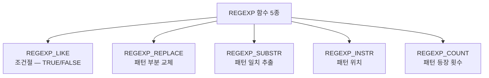

| 함수 | 의미 |
|---|---|
| REGEXP_LIKE(s, pattern) | LIKE의 정규식 버전(조건절용) |
| REGEXP_REPLACE(s, pattern, replace) | 패턴 매칭 부분을 교체 |
| REGEXP_SUBSTR(s, pattern) | 패턴 일치 부분 추출 |
| REGEXP_INSTR(s, pattern) | 패턴이 처음 나타나는 위치 |
| REGEXP_COUNT(s, pattern) | 패턴 등장 횟수 |

---

## 자주 쓰는 메타문자

| 기호 | 의미 | 예 |
|---|---|---|
| `.` | 임의의 한 글자 | `'a.c'` → 'abc', 'aXc' |
| `*` | 0개 이상 반복 | `'ab*'` → 'a', 'ab', 'abb' |
| `+` | 1개 이상 반복 | `'ab+'` → 'ab', 'abb' (a 안 됨) |
| `?` | 0 또는 1 | `'colou?r'` → 'color', 'colour' |
| `[abc]` | a, b, c 중 하나 | `'[Aa]pple'` |
| `[^abc]` | a, b, c가 아닌 것 | |
| `[0-9]` | 숫자 한 글자 | |
| `[a-z]` | 영소문자 | |
| `^` | 문자열 시작 | `^010` (010으로 시작) |
| `$` | 문자열 끝 | `\.com$` |
| <code>&#124;</code> | 또는 | `(cat\|dog)` |
| `{n}` | 정확히 n번 | `\d{4}` |
| `{n,m}` | n~m번 | `\d{2,4}` |
| `\d` | 숫자 [0-9] | |
| `\w` | 단어문자 [A-Za-z0-9_] | |
| `\s` | 공백 | |

---

## [SQL 실전]

### REGEXP_LIKE (**WHERE**(`2-1-4`) 조건절)

```sql
-- 휴대폰 번호 형식 (010으로 시작, 3-4-4 자리)
SELECT *
FROM   MEMBER
WHERE  REGEXP_LIKE(PHONE, '^010-\d{3,4}-\d{4}$');

-- 이메일 형식
SELECT *
FROM   MEMBER
WHERE  REGEXP_LIKE(EMAIL, '^[A-Za-z0-9._%+-]+@[A-Za-z0-9.-]+\.[A-Za-z]{2,}$');

-- 한글 3글자 이름
SELECT *
FROM   MEMBER
WHERE  REGEXP_LIKE(NAME, '^[가-힣]{3}$');
```

### REGEXP_REPLACE (교체)

```sql
-- 모든 공백 제거
SELECT REGEXP_REPLACE('Hello   World', '\s+', '') FROM DUAL;
-- 결과: 'HelloWorld'

-- 전화번호 가운데를 마스킹
SELECT REGEXP_REPLACE('010-1234-5678', '(\d{3})-(\d{4})-(\d{4})', '\1-****-\3') FROM DUAL;
-- 결과: '010-****-5678'
```

### REGEXP_SUBSTR (추출)

```sql
-- 첫 번째 숫자 묶음 추출
SELECT REGEXP_SUBSTR('주문번호 12345 입니다', '\d+') FROM DUAL;
-- 결과: '12345'
```

### REGEXP_INSTR / REGEXP_COUNT

```sql
-- 처음 숫자가 나타나는 위치
SELECT REGEXP_INSTR('abc123def', '\d') FROM DUAL;  -- 4

-- 단어 개수
SELECT REGEXP_COUNT('one two three', '\w+') FROM DUAL;  -- 3
```

---

## [Before & After]

MEMBER 3건에서 "한글 이름 + 010 휴대폰 번호" 회원만 골라내야 하는 상황. 2번은 휴대폰이 02 지역번호라 탈락, 3번은 이름이 영문이라 탈락. LIKE 두 개로는 표현하기 까다로운 두 조건을 REGEXP_LIKE 로 정밀하게 거른다.

### MEMBER

| ID | NAME | PHONE |
|---|---|---|
| 1 | 김철수 | 010-1234-5678 |
| 2 | 이영희 | 02-1234-5678 |
| 3 | Jane | 010-9999-1234 |

### 한글 이름 + 010 휴대폰만

```sql
SELECT *
FROM   MEMBER
WHERE  REGEXP_LIKE(NAME, '^[가-힣]+$')
  AND  REGEXP_LIKE(PHONE, '^010-');
```

| ID | NAME | PHONE |
|---|---|---|
| 1 | 김철수 | 010-1234-5678 |

`^[가-힣]+$` 는 문자열 처음(`^`)부터 끝(`$`)까지가 모두 한글 한 글자(`[가-힣]`)의 1회 이상 반복으로만 채워질 때만 매칭하므로, "Jane"은 영문이라 즉시 탈락하고 김철수·이영희는 통과한다. 다음 조건 `^010-` 은 PHONE 이 정확히 "010-"으로 시작할 때만 통과시키므로 02 지역번호인 이영희가 떨어진다. 두 정규식 조건을 AND 로 조합해 "한글 이름 + 010 휴대폰" 교집합만 남는다. LIKE 의 `%`·`_` 로는 "글자 종류(한글)"를 표현할 수 없으니, 문자 종류·길이·위치를 동시에 검사해야 할 때는 정규식이 자연스러운 선택.

---

## 정규식 옵션 (4번째 인자)

```sql
REGEXP_LIKE('ABC', 'abc', 'i')   -- 대소문자 무시
```

| 옵션 | 의미 |
|---|---|
| i | 대소문자 무시 |
| c | 대소문자 구분(기본) |
| m | 멀티라인 |
| n | `.`이 줄바꿈도 매칭 |
| x | 공백 무시 |

---

## [시험 출제 포인트]

| 함정 | 정답 |
|---|---|
| `^`의 의미 | 문자열의 시작(`[]` 안에선 부정) |
| `$`의 의미 | 문자열의 끝 |
| `*` vs `+` | `*`은 0개 이상, `+`은 1개 이상 |
| `.`의 의미 | 임의의 한 글자(LIKE의 `_`와 같음) |
| `\d`의 의미 | 숫자 [0-9] |
| `[가-힣]` | 한글 한 글자 |
| LIKE와 REGEXP_LIKE 차이 | LIKE는 `%`와 `_`만, REGEXP는 다양한 메타문자 사용 |

단골 함정: `^` 이 `[]` 안과 밖에서 의미가 다름. 밖에서 `^` 은 시작, `[^abc]` 안에서는 부정.

---

> **30초 시험 직전 정리**
> · 5개 함수: **REGEXP_LIKE** (조건) / **REGEXP_REPLACE** (교체) / **REGEXP_SUBSTR** (추출) / **REGEXP_INSTR** (위치) / **REGEXP_COUNT** (횟수)
> · 자주 쓰는 메타: `.` (1글자), `*` (0+), `+` (1+), `?` (0/1), `[abc]`, `[^abc]`, `^` (시작), `$` (끝)
> · `\d` = 숫자 / `\w` = 영숫자_  / `\s` = 공백 / `[가-힣]` = 한글 1자
> · `^` 함정 = `[]` 밖이면 **시작** / `[]` 안이면 **부정**
> · 옵션 4번째 인자: `i` 대소문자 무시 / `m` 멀티라인
> · LIKE 와 차이 = 표현력 ↑, **성능 약간 ↓**


---

# 2-3-1. DML (Data Manipulation Language)

## [핵심 요약]

> DML은 테이블 안의 데이터를 입력·수정·삭제·조회하는 명령어들이다(INSERT, UPDATE, DELETE, MERGE, SELECT).

ex) 노트에 비유하면 INSERT는 새 줄 적기, UPDATE는 줄 고치기, DELETE는 줄 지우기, MERGE는 있으면 고치고 없으면 적기, SELECT는 읽기다.

---

## [개념 도식화] DML의 분류

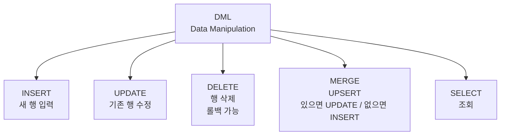

| 명령 | 용도 |
|---|---|
| INSERT | 새 행 입력 |
| UPDATE | 기존 행 수정 |
| DELETE | 행 삭제 |
| MERGE | UPSERT(있으면 UPDATE, 없으면 INSERT) |
| SELECT | 조회 |

---

## [SQL 실전]

## INSERT — 데이터 입력

### 기본 문법

```sql
-- 모든 컬럼에 입력
INSERT INTO EMP VALUES (1, '김철수', 'D1', 3000);
-- 1 row inserted.

-- 특정 컬럼만
INSERT INTO EMP (EMP_ID, NAME) VALUES (2, '이영희');
-- 1 row inserted. (DEPT_ID, SAL은 NULL 또는 DEFAULT)
```

### 다른 테이블에서 가져오기

```sql
INSERT INTO EMP_BACKUP
SELECT * FROM EMP WHERE DEPT_ID = 'D1';
```

### Multi-Insert (Oracle)

```sql
INSERT ALL
    INTO TBL_A VALUES (1, 'A')
    INTO TBL_B VALUES (2, 'B')
SELECT * FROM DUAL;
```

---

## UPDATE — 데이터 수정

```sql
-- 모든 행 수정 (위험)
UPDATE EMP SET SAL = SAL * 1.1;

-- 조건부 수정
UPDATE EMP
SET    SAL = SAL * 1.1
WHERE  DEPT_ID = 'D1';

-- 여러 컬럼 동시 수정
UPDATE EMP
SET    SAL = 5000, DEPT_ID = 'D2'
WHERE  EMP_ID = 1;

-- 서브쿼리로 수정
UPDATE EMP
SET    SAL = (SELECT AVG(SAL) FROM EMP)
WHERE  EMP_ID = 1;
```

WHERE를 빼먹으면 모든 행이 수정된다. 항상 WHERE를 확인한다.

---

## DELETE — 데이터 삭제

```sql
-- 조건부 삭제
DELETE FROM EMP WHERE DEPT_ID = 'D9';

-- 모든 행 삭제(구조는 유지)
DELETE FROM EMP;
```

### DELETE vs TRUNCATE vs DROP

| 명령 | 분류 | 데이터 | 테이블 구조 | 롤백 | 속도 |
|---|---|---|---|---|---|
| DELETE | DML | 삭제 | 유지 | 가능 | 느림 |
| TRUNCATE | **DDL**(`2-3-3`) | 모두 삭제 | 유지 | 불가 | 빠름 |
| DROP | DDL | 삭제 | 삭제 | 불가 | 매우 빠름 |

```sql
DELETE FROM EMP;       -- 데이터만, 롤백 가능
TRUNCATE TABLE EMP;    -- 데이터만, 롤백 불가
DROP TABLE EMP;        -- 테이블 자체 삭제
```

---

## MERGE — 있으면 UPDATE, 없으면 INSERT (UPSERT)

```sql
MERGE INTO EMP E
USING NEW_EMP N
   ON (E.EMP_ID = N.EMP_ID)
WHEN MATCHED THEN
    UPDATE SET E.SAL = N.SAL
WHEN NOT MATCHED THEN
    INSERT (EMP_ID, NAME, SAL) VALUES (N.EMP_ID, N.NAME, N.SAL);
```

### 시각화

```
     NEW_EMP의 행
        │
   E.EMP_ID 매칭?
   ├ 있음 → UPDATE
   └ 없음 → INSERT
```

---

## DML과 트랜잭션

```sql
INSERT INTO EMP ...;
UPDATE EMP ...;
DELETE FROM EMP ...;
COMMIT;        -- 영구 반영
-- 또는
ROLLBACK;      -- 취소
```

DML은 **트랜잭션**(`1-2-3`)의 대상이며 COMMIT 전까지 메모리에만 있다. COMMIT/ROLLBACK 같은 트랜잭션 제어 명령은 **TCL**(`2-3-2`)에서 다룬다.

---

## [Before & After]

3행짜리 EMP 테이블에 INSERT → UPDATE → DELETE를 순서대로 적용한다. D1 부서 직원(김·이) 두 명에게만 10% 인상이 들어가고, 새로 추가했던 4번 직원(최)은 마지막에 다시 삭제되는 흐름이다.

### EMP

| EMP_ID | NAME | DEPT_ID | SAL |
|---|---|---|---|
| 1 | 김 | D1 | 3000 |
| 2 | 이 | D1 | 4000 |
| 3 | 박 | D2 | 3500 |

### `INSERT INTO EMP VALUES (4, '최', 'D2', 4500);`

| EMP_ID | NAME | DEPT_ID | SAL |
|---|---|---|---|
| 1 | 김 | D1 | 3000 |
| 2 | 이 | D1 | 4000 |
| 3 | 박 | D2 | 3500 |
| 4 | 최 | D2 | 4500 |

### `UPDATE EMP SET SAL = SAL * 1.1 WHERE DEPT_ID = 'D1';`

| EMP_ID | NAME | DEPT_ID | SAL |
|---|---|---|---|
| 1 | 김 | D1 | 3300 |
| 2 | 이 | D1 | 4400 |
| 3 | 박 | D2 | 3500 |
| 4 | 최 | D2 | 4500 |

### `DELETE FROM EMP WHERE EMP_ID = 4;`

| EMP_ID | NAME | DEPT_ID | SAL |
|---|---|---|---|
| 1 | 김 | D1 | 3300 |
| 2 | 이 | D1 | 4400 |
| 3 | 박 | D2 | 3500 |

DML은 행 단위로 데이터를 바꾸지만 테이블 구조는 건드리지 않는다. 위 작업은 모두 COMMIT 전까지 메모리에만 머무르므로, 잘못 친 UPDATE·DELETE는 ROLLBACK으로 되돌릴 수 있다. 반대로 같은 "삭제"라도 TRUNCATE·DROP은 DDL이라 자동 COMMIT되며 되돌릴 수 없다. 데이터만 비울지·구조까지 없앨지·되돌릴 여지를 둘지를 의식해서 명령을 고른다.

---

## [시험 출제 포인트]

| 함정 | 정답 |
|---|---|
| TRUNCATE는 DDL인가 DML인가 | DDL(롤백 불가) |
| DELETE 후 ROLLBACK 가능? | 가능(DML) |
| `INSERT INTO ... VALUES`는 한 번에 한 행만? | 일반 INSERT는 1행. INSERT ALL 또는 `INSERT INTO ... SELECT`로 다중행 |
| `UPDATE ... WHERE` 누락 시 | 모든 행 수정 |
| MERGE의 두 가지 절 | WHEN MATCHED / WHEN NOT MATCHED |
| DML 후 자동 커밋? | Oracle은 명시적 COMMIT 필요 |

단골 함정: TRUNCATE와 DELETE의 차이. TRUNCATE는 롤백 불가, AUTO_COMMIT, 빠름.

---

> **30초 시험 직전 정리**
> · DML 5종: **INSERT / UPDATE / DELETE / MERGE / SELECT**
> · DELETE = **DML** (롤백 O) / TRUNCATE = **DDL** (롤백 X, 자동 COMMIT) / DROP = 테이블 자체 삭제
> · UPDATE 에 WHERE 누락 = **모든 행 수정** (위험)
> · MERGE = `WHEN MATCHED THEN UPDATE` + `WHEN NOT MATCHED THEN INSERT` (UPSERT)
> · INSERT 다중행 = **`INSERT ALL`** 또는 **`INSERT INTO ... SELECT`**
> · DML 후 Oracle 은 **명시적 COMMIT 필요** (DDL 은 자동)


---

# 2-3-2. TCL (Transaction Control Language)

## [핵심 요약]

> TCL은 트랜잭션을 제어하는 명령어들이다(COMMIT, ROLLBACK, SAVEPOINT).

ex) 워드(Word)에서 작성 중인 내용은 메모리에만 있고, 저장 버튼이 COMMIT(영구 반영), CTRL+Z가 ROLLBACK(취소), 임시 저장 지점이 SAVEPOINT(부분 취소)에 해당한다.

---

## [개념 도식화] 트랜잭션의 흐름

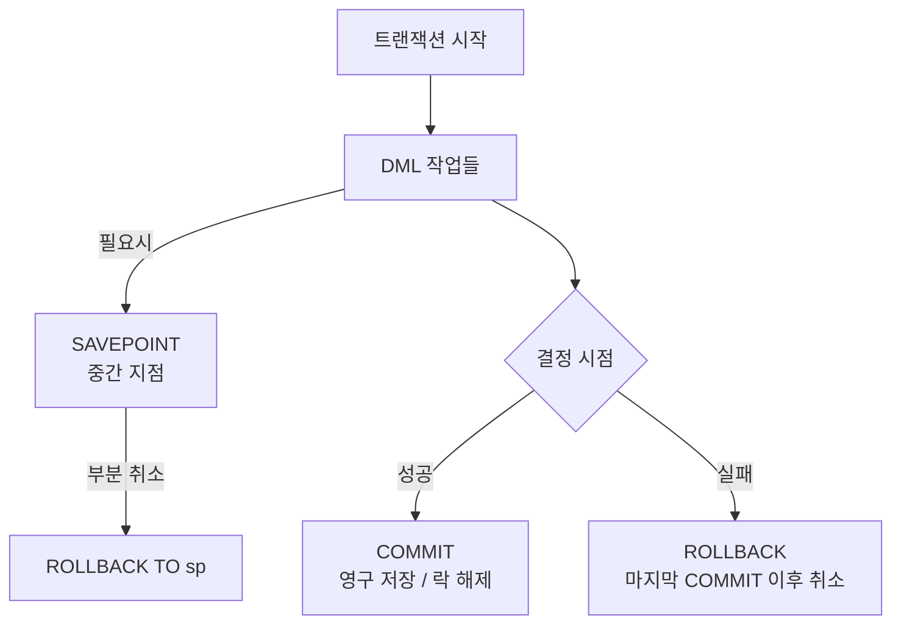

---

## COMMIT — 영구 반영

**DML**(`2-3-1`) 작업을 묶어서 영구 반영한다.

```sql
INSERT INTO EMP VALUES (1, '김', 3000);
UPDATE EMP SET SAL = 4000 WHERE EMP_ID = 1;
COMMIT;     -- 위 두 작업을 영구 반영
```

| COMMIT 후 | 결과 |
|---|---|
| 다른 사용자도 변경 사항을 볼 수 있음 | 가능 |
| ROLLBACK | 불가 |
| 락(Lock) 해제 | 됨 |

---

## ROLLBACK — 취소

```sql
INSERT INTO EMP VALUES (1, '김', 3000);
DELETE FROM EMP WHERE EMP_ID = 999;
ROLLBACK;   -- 위 두 작업 모두 취소
```

마지막 COMMIT 이후의 모든 DML이 취소된다.

---

## SAVEPOINT — 임시 저장 지점

```sql
INSERT INTO EMP VALUES (1, '김', 3000);
SAVEPOINT SP1;

INSERT INTO EMP VALUES (2, '이', 4000);
SAVEPOINT SP2;

INSERT INTO EMP VALUES (3, '박', 5000);

-- SP2 시점으로 되돌리기 (3번 INSERT만 취소)
ROLLBACK TO SP2;
```

| 시점 | 상태 |
|---|---|
| 시작 | EMP 비어있음 |
| SP1 | 김 |
| SP2 | 김, 이 |
| 마지막 INSERT 후 | 김, 이, 박 |
| ROLLBACK TO SP2 | 김, 이 |

---

## **트랜잭션**(`1-2-3`)의 ACID

| 성질 | 의미 |
|---|---|
| Atomicity (원자성) | 전부 또는 전무 |
| Consistency (일관성) | 규칙 유지 |
| Isolation (고립성) | 동시 처리 격리 |
| Durability (지속성) | COMMIT 후 영구 |

---

## 자동 커밋 vs 명시적 커밋

| 상황 | Oracle | MS-SQL |
|---|---|---|
| DML 후 | 수동 COMMIT 필요 | 자동 커밋(설정 따라) |
| DDL 후 | 자동 COMMIT | 트랜잭션 가능 |
| 정상 종료 | 자동 COMMIT | — |
| 비정상 종료 | 자동 ROLLBACK | — |

Oracle에서 CREATE, DROP 같은 DDL은 자동 COMMIT된다.

---

## [SQL 실전]

```sql
-- 트랜잭션 1: 정상 처리
INSERT INTO ACCOUNT VALUES (101, 'A', 10000);
INSERT INTO ACCOUNT VALUES (102, 'B', 5000);
COMMIT;     -- 둘 다 저장

-- 트랜잭션 2: 중간 오류
UPDATE ACCOUNT SET BALANCE = BALANCE - 1000 WHERE ID = 101;
SAVEPOINT BEFORE_DEPOSIT;

UPDATE ACCOUNT SET BALANCE = BALANCE + 1000 WHERE ID = 999;  -- 존재 X

-- 부분 취소 후 다른 처리
ROLLBACK TO BEFORE_DEPOSIT;
UPDATE ACCOUNT SET BALANCE = BALANCE + 1000 WHERE ID = 102;
COMMIT;
```

---

## [Before & After] SAVEPOINT 동작

비어있는 EMP에 김·이·박을 차례로 INSERT하면서 SP1, SP2 두 지점을 찍어 둔다. 마지막에 `ROLLBACK TO SP1`을 걸면 어디까지 살아남는지, 그 뒤 COMMIT까지 어떻게 이어지는지를 시점별로 추적한다.

### EMP

| EMP_ID | NAME |
|---|---|
| (비어있음) | |

### 작업 시나리오

```sql
INSERT INTO EMP VALUES (1, '김');
SAVEPOINT SP1;
INSERT INTO EMP VALUES (2, '이');
SAVEPOINT SP2;
INSERT INTO EMP VALUES (3, '박');
ROLLBACK TO SP1;
COMMIT;
```

### 시점별 상태

| 시점 | 데이터 |
|---|---|
| 첫 INSERT 후 | 김 |
| SP1 | 김 |
| 둘째 INSERT 후 | 김, 이 |
| SP2 | 김, 이 |
| 셋째 INSERT 후 | 김, 이, 박 |
| ROLLBACK TO SP1 | 김 |
| COMMIT | 김 |

`ROLLBACK TO SP1`은 SP1 이후의 DML(이·박 INSERT)만 취소하고 그 이전 작업은 그대로 둔다. 그래서 최종 COMMIT 시점에는 김 한 행만 남는다. 트랜잭션 도중 일부만 되돌리고 싶을 때는 SAVEPOINT로 안전 지점을 찍어둔다. 단, 전체 ROLLBACK이나 COMMIT이 일어나면 SAVEPOINT는 모두 사라진다.

---

## 트랜잭션 격리 수준 (참고)

| 수준 | 설명 |
|---|---|
| READ UNCOMMITTED | 커밋 안 된 것도 읽음 |
| READ COMMITTED | 커밋된 것만(Oracle 기본) |
| REPEATABLE READ | 같은 쿼리는 같은 결과 |
| SERIALIZABLE | 완전 격리(가장 엄격) |

---

## [시험 출제 포인트]

| 함정 | 정답 |
|---|---|
| TCL 명령어 종류 | COMMIT / ROLLBACK / SAVEPOINT |
| DDL 실행 후 | Oracle은 자동 COMMIT |
| ROLLBACK의 범위 | 마지막 COMMIT 이후 모든 DML |
| SAVEPOINT의 의미 | 부분 ROLLBACK 가능 지점 |
| ROLLBACK TO SP1 후 SP1 이전 작업 | 유지 |
| ROLLBACK 후 SAVEPOINT는 | 모두 사라짐 |
| 비정상 종료 시 | 자동 ROLLBACK |

단골 함정: "DDL 실행 후 ROLLBACK으로 취소 가능"은 틀렸다. Oracle에서 DDL은 자동 COMMIT이다.

---

> **30초 시험 직전 정리**
> · TCL 3종: **COMMIT / ROLLBACK / SAVEPOINT**
> · COMMIT = 영구 반영 + 락 해제 + 다른 사용자도 변경 사항 조회 가능
> · ROLLBACK = **마지막 COMMIT 이후** 모든 DML 취소 (SAVEPOINT 도 함께 사라짐)
> · ROLLBACK TO sp = **부분 취소** (sp 이전 작업은 유지)
> · DDL 실행 = **자동 COMMIT** (롤백 불가)
> · 비정상 종료 = **자동 ROLLBACK** / 정상 종료 = 자동 COMMIT
> · Oracle 기본 격리 수준 = **READ COMMITTED**


---

# 2-3-3. DDL (Data Definition Language)

## [핵심 요약]

> DDL은 테이블·뷰·인덱스 같은 객체를 만들고 바꾸고 지우는 명령어들이다(CREATE, ALTER, DROP, TRUNCATE, RENAME).

---

## [개념 도식화] DDL 명령 5종

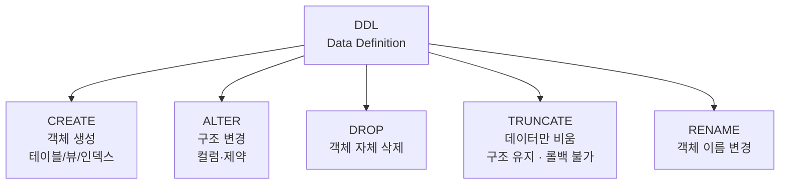

| 명령 | 의미 |
|---|---|
| CREATE | 객체(테이블/뷰/인덱스) 생성 |
| ALTER | 객체 구조 변경 |
| DROP | 객체 삭제 |
| TRUNCATE | 데이터만 비움(구조 유지) |
| RENAME | 이름 변경 |

DDL은 자동 COMMIT된다. 실행 즉시 영구 반영되며 ROLLBACK 불가.

---

## [SQL 실전]

## CREATE — 객체 생성

```sql
CREATE TABLE EMP (
    EMP_ID    NUMBER       PRIMARY KEY,
    NAME      VARCHAR2(50) NOT NULL,
    SAL       NUMBER       DEFAULT 0,
    DEPT_ID   VARCHAR2(10),
    HIRE_DATE DATE         DEFAULT SYSDATE,
    CONSTRAINT FK_EMP_DEPT FOREIGN KEY (DEPT_ID) REFERENCES DEPT(DEPT_ID)
);
-- Table created.
```

### 테이블 명명 규칙

| 규칙 | 설명 |
|---|---|
| 영문/숫자/`_`만 | 한글, 특수문자 불가 |
| 첫 글자는 영문 | 숫자로 시작 불가 |
| 예약어 사용 불가 | SELECT, FROM 등 |
| 길이 30바이트 이내 | (Oracle 기준) |
| 동일 사용자 내 중복 불가 | — |

---

## 제약조건(Constraints)

| 제약 | 의미 | 예 |
|---|---|---|
| PRIMARY KEY | 기본키(UNIQUE + NOT NULL), **식별자**(`1-1-5`) 역할 | EMP_ID |
| FOREIGN KEY | 외래키 | DEPT_ID 참조 |
| UNIQUE | 중복 불가(**NULL**(`1-2-4`) 허용) | EMAIL |
| NOT NULL | NULL 불가 | NAME |
| CHECK | 조건 만족 | CHECK (SAL > 0) |
| DEFAULT | 기본값 | DEFAULT 0 |

### PK vs UNIQUE

| 비교 | PRIMARY KEY | UNIQUE |
|---|---|---|
| 중복 | 불가 | 불가 |
| NULL | 불가 | 허용 |
| 테이블당 개수 | 1개 | 여러 개 |

### FK 옵션

```sql
FOREIGN KEY (DEPT_ID) REFERENCES DEPT(DEPT_ID)
    ON DELETE CASCADE       -- 부모 삭제 시 자식도 삭제
    ON DELETE SET NULL      -- 부모 삭제 시 자식 FK NULL
```

---

## ALTER — 구조 변경

```sql
-- 컬럼 추가
ALTER TABLE EMP ADD (PHONE VARCHAR2(20));
-- Table altered.

-- 컬럼 변경
ALTER TABLE EMP MODIFY (PHONE VARCHAR2(30));
-- Table altered.

-- 컬럼 이름 변경
ALTER TABLE EMP RENAME COLUMN PHONE TO MOBILE;
-- Table altered.

-- 컬럼 삭제
ALTER TABLE EMP DROP COLUMN MOBILE;
-- Table altered.

-- 제약조건 추가/삭제
ALTER TABLE EMP ADD CONSTRAINT UQ_NAME UNIQUE (NAME);
ALTER TABLE EMP DROP CONSTRAINT UQ_NAME;
-- Table altered.
```

---

## DROP — 객체 삭제

```sql
DROP TABLE EMP;                  -- 테이블 자체 삭제
DROP TABLE EMP CASCADE CONSTRAINTS;  -- 참조 제약까지 함께
DROP TABLE EMP PURGE;            -- 휴지통도 비움(복구 불가)
-- Table dropped.
```

---

## TRUNCATE — 데이터만 비우기

```sql
TRUNCATE TABLE EMP;
-- Table truncated.
```

| TRUNCATE 특징 | 설명 |
|---|---|
| 데이터 모두 삭제 | 됨 |
| 테이블 구조 | 유지 |
| 롤백 | 불가 |
| 속도 | 매우 빠름 |

---

## RENAME — 이름 변경

```sql
RENAME EMP TO EMPLOYEE;
ALTER TABLE EMP RENAME TO EMPLOYEE;  -- 동일
-- Table renamed.
```

---

## DELETE vs TRUNCATE vs DROP

| 비교 | DELETE | TRUNCATE | DROP |
|---|---|---|---|
| 분류 | **DML**(`2-3-1`) | DDL | DDL |
| 데이터 | 삭제 | 모두 삭제 | 삭제 |
| 구조 | 유지 | 유지 | 삭제 |
| ROLLBACK | 가능 | 불가 | 불가 |
| WHERE | 가능 | 불가 | — |
| 속도 | 느림 | 빠름 | 매우 빠름 |
| 자동 COMMIT | 없음 | 있음 | 있음 |

---

## VIEW (뷰)

```sql
CREATE VIEW V_EMP_HIGH AS
SELECT NAME, SAL FROM EMP WHERE SAL > 5000;

SELECT * FROM V_EMP_HIGH;     -- 사용
DROP VIEW V_EMP_HIGH;
```

| 뷰의 장점 | |
|---|---|
| 복잡한 쿼리를 간단한 이름으로 | 됨 |
| 보안(특정 컬럼/행만 노출 — **DCL**(`2-3-4`)과 함께 권한 통제) | 됨 |
| 실제 테이블 아님(가상) | 됨 |

---

## 인덱스(INDEX)

```sql
CREATE INDEX IDX_EMP_NAME ON EMP(NAME);
-- Index created.
DROP INDEX IDX_EMP_NAME;
-- Index dropped.
```

도서관의 목차 같은 역할이다. 검색 속도는 빨라지지만 입력·수정 속도는 느려질 수 있다.

---

## [Before & After]

EMP_ID(PK)·NAME(NOT NULL)·SAL(DEFAULT 0)을 가진 EMP 테이블을 만들고, PHONE 컬럼을 더한 뒤, 같은 테이블에 TRUNCATE와 DROP을 차례로 적용한다. 데이터·구조·테이블 자체가 어느 명령에서 사라지는지를 비교한다.

### CREATE 후

```
EMP
─────────
EMP_ID (PK)
NAME (NOT NULL)
SAL (DEFAULT 0)
```

### `ALTER TABLE EMP ADD (PHONE VARCHAR2(20))` 후

```
EMP
─────────
EMP_ID (PK)
NAME (NOT NULL)
SAL (DEFAULT 0)
PHONE      (추가됨)
```

### `TRUNCATE TABLE EMP` 후

```
EMP (구조 유지, 데이터 0행)
─────────
EMP_ID (PK)
NAME
SAL
PHONE
```

### `DROP TABLE EMP` 후

```
(테이블 자체가 사라짐)
```

ALTER는 컬럼을 추가해 구조를 키우고, TRUNCATE는 데이터만 비우되 컬럼 정의(EMP_ID·NAME·SAL·PHONE)는 그대로 남기며, DROP은 테이블 객체 자체를 지운다. 셋 다 DDL이라 실행 즉시 자동 COMMIT되어 ROLLBACK으로 되돌릴 수 없다. "데이터만 비우고 싶다 → TRUNCATE", "테이블 자체가 필요 없다 → DROP", "구조만 바꾼다 → ALTER" 식으로 의도와 명령을 정확히 매칭한다.

---

## [시험 출제 포인트]

| 함정 | 정답 |
|---|---|
| TRUNCATE 분류 | DDL |
| DDL 실행 후 ROLLBACK 가능? | 불가(자동 COMMIT) |
| PRIMARY KEY는 NULL 허용? | 불허 |
| UNIQUE는 NULL 허용? | 허용 |
| 한 테이블에 PK는 몇 개? | 1개 |
| FK가 참조하는 컬럼 조건 | PK 또는 UNIQUE |
| CHECK 제약 예 | `CHECK (SAL > 0)` |
| ON DELETE CASCADE | 부모 삭제 시 자식도 삭제 |
| `ALTER TABLE ... DROP COLUMN`은 ROLLBACK 가능? | 불가 |

단골 함정: TRUNCATE는 DDL이지만 데이터만 삭제(구조 유지)된다. DROP은 테이블 자체를 삭제한다.

---

> **30초 시험 직전 정리**
> · DDL 5종: **CREATE / ALTER / DROP / TRUNCATE / RENAME** — 모두 **자동 COMMIT** (롤백 불가)
> · 제약 6종: **PK / FK / UNIQUE / NOT NULL / CHECK / DEFAULT**
> · PK = **UNIQUE + NOT NULL** / 테이블당 1개 / FK 가 참조하는 컬럼은 PK 또는 UNIQUE
> · UNIQUE = **NULL 허용** (중복만 막음)
> · DELETE / TRUNCATE / DROP — **데이터·구조·롤백** 차이 (가장 단골 함정)
> · ON DELETE CASCADE = 부모 삭제 시 자식도 자동 삭제
> · 컬럼 추가 = `ALTER TABLE ADD` / 변경 = `MODIFY` / 삭제 = `DROP COLUMN`


---

# 2-3-4. DCL (Data Control Language)

## [핵심 요약]

> DCL은 사용자에게 권한을 주거나 회수하는 명령어들이다(GRANT, REVOKE).

ex) 사무실 출입카드처럼 신입에게 발급(GRANT)·퇴사자 회수(REVOKE)·부서별 묶음(ROLE)으로 누가 어떤 테이블을 SELECT/INSERT/UPDATE 할 수 있는지를 통제한다.

---

## [개념 도식화] DCL 흐름

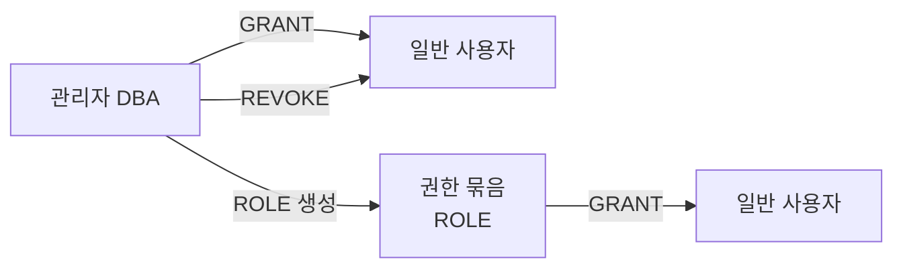

---

## 권한의 종류

### 시스템 권한 (System Privilege)

| 권한 | 의미 |
|---|---|
| CREATE SESSION | 접속 권한 |
| CREATE TABLE | 테이블 생성 권한 |
| CREATE VIEW | 뷰 생성 권한 |
| CREATE USER | 사용자 생성 권한 |
| DROP ANY TABLE | 모든 테이블 삭제 권한 |

### 객체 권한 (Object Privilege)

| 권한 | 의미 |
|---|---|
| SELECT | 조회 |
| INSERT | 입력 |
| UPDATE | 수정 |
| DELETE | 삭제 |
| ALTER | 변경 |
| EXECUTE | 프로시저/함수 실행 |
| REFERENCES | FK로 참조 |

---

## GRANT — 권한 부여

```sql
-- 시스템 권한
GRANT CREATE SESSION TO USER1;
GRANT CREATE TABLE   TO USER1;

-- 객체 권한
GRANT SELECT ON EMP TO USER1;
GRANT SELECT, INSERT, UPDATE ON EMP TO USER1;

-- 모든 사용자에게
GRANT SELECT ON EMP TO PUBLIC;

-- 권한 부여 가능 권한도 함께(재부여 가능)
GRANT SELECT ON EMP TO USER1 WITH GRANT OPTION;
```

| 옵션 | 의미 |
|---|---|
| WITH GRANT OPTION | 객체 권한: 받은 사람이 다른 사람에게 다시 줄 수 있음 |
| WITH ADMIN OPTION | 시스템 권한: 관리자처럼 다시 부여 가능 |

---

## REVOKE — 권한 회수

```sql
REVOKE SELECT ON EMP FROM USER1;
REVOKE CREATE TABLE FROM USER1;
```

### 연쇄 회수

WITH GRANT OPTION으로 다른 사람에게 부여된 권한도 함께 회수된다.

```
관리자 → USER1 (WITH GRANT OPTION) → USER2
        REVOKE 시 USER2 권한도 함께 사라짐
```

---

## ROLE — 권한 묶음

```sql
-- 1. 역할 만들기
CREATE ROLE DEV_ROLE;

-- 2. 역할에 권한 부여
GRANT SELECT, INSERT, UPDATE ON EMP TO DEV_ROLE;
GRANT SELECT ON DEPT                TO DEV_ROLE;

-- 3. 사용자에게 역할 부여
GRANT DEV_ROLE TO USER1;
GRANT DEV_ROLE TO USER2;

-- 회수
REVOKE DEV_ROLE FROM USER1;
```

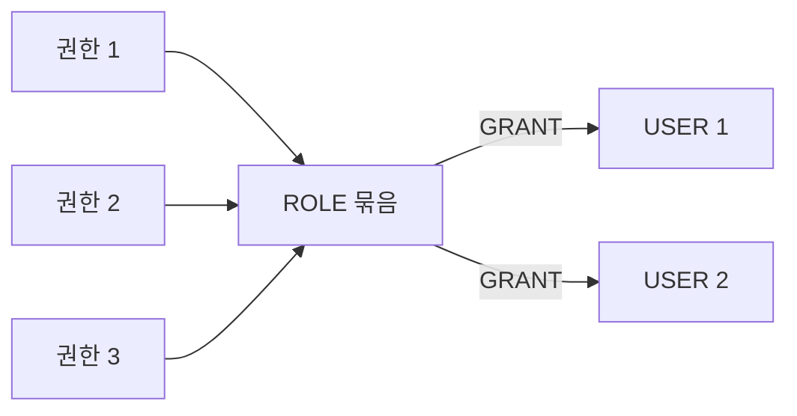

---

## 사용자 관리 (참고)

CREATE USER, ALTER USER, DROP USER 자체는 **DDL**(`2-3-3`)이지만 권한 관리와 짝을 이룬다.

```sql
-- 사용자 생성
CREATE USER USER1 IDENTIFIED BY password123;

-- 비밀번호 변경
ALTER USER USER1 IDENTIFIED BY newpass;

-- 사용자 삭제
DROP USER USER1;
DROP USER USER1 CASCADE;     -- 소유 객체까지 모두 삭제
```

Oracle에서 사용자 = 스키마(객체 모음). 사용자 생성 권한은 DBA가 가진다.

---

## [SQL 실전] 권한 흐름

```sql
-- 관리자(DBA)로 접속
CREATE USER STAFF IDENTIFIED BY pw1234;

GRANT CREATE SESSION TO STAFF;       -- 접속 권한
GRANT SELECT ON HR.EMP TO STAFF;     -- HR 스키마 EMP 조회 권한

-- STAFF로 접속
SELECT * FROM HR.EMP;     -- 가능

-- 권한 회수
REVOKE SELECT ON HR.EMP FROM STAFF;

SELECT * FROM HR.EMP;     -- 권한 부족 에러
```

---

## [Before & After]

방금 만들어진 USER1 계정에 권한을 한 단계씩 부여하다가 마지막에 SELECT 한 가지만 회수한다. 시스템 권한(CREATE SESSION)이 먼저 있어야 접속이 되고, 그 위에 객체 권한(SELECT/INSERT)이 올라가는 순서를 따라간다.

### USER1의 권한 변화

| 시점 | 가능한 작업 |
|---|---|
| 초기 | 접속도 불가 |
| GRANT CREATE SESSION 후 | 접속 가능 |
| GRANT SELECT ON EMP 후 | EMP 조회 가능 |
| GRANT INSERT ON EMP 후 | EMP 입력 가능 |
| REVOKE SELECT ON EMP 후 | EMP 조회 불가 |

권한은 "접속(시스템 권한) → 개별 객체 작업(객체 권한)" 순으로 쌓인다. CREATE SESSION이 없으면 SELECT 권한이 있어도 접속이 안 되고, REVOKE는 해당 권한만 떼어내므로 INSERT 권한은 그대로 남는다. WITH GRANT OPTION으로 재부여된 권한이라면 REVOKE 한 번에 연쇄적으로 회수된다.

---

## DBA의 대표 ROLE

| ROLE | 설명 |
|---|---|
| CONNECT | 접속 권한(CREATE SESSION 포함) |
| RESOURCE | 객체 생성 권한(테이블, 시퀀스 등) |
| DBA | 모든 권한 |

```sql
GRANT CONNECT, RESOURCE TO USER1;
```

---

## DCL vs 다른 명령어 분류

```
DDL: CREATE, ALTER, DROP, TRUNCATE, RENAME       (객체)
DML: INSERT, UPDATE, DELETE, MERGE, SELECT       (데이터)
TCL: COMMIT, ROLLBACK, SAVEPOINT                 (트랜잭션)
DCL: GRANT, REVOKE                               (권한)
```

---

## [시험 출제 포인트]

| 함정 | 정답 |
|---|---|
| DCL 명령어 | GRANT, REVOKE |
| 시스템 권한 부여 시 옵션 | WITH ADMIN OPTION |
| 객체 권한 부여 시 옵션 | WITH GRANT OPTION |
| ROLE의 목적 | 권한 묶음을 한 번에 관리 |
| `GRANT DEV_ROLE TO USER1`의 분류 | DCL |
| 모든 사용자에게 권한 | TO PUBLIC |
| WITH GRANT OPTION 회수 영향 | 연쇄 회수(다시 부여한 사용자도) |

단골 함정: GRANT/REVOKE를 DDL이나 DML로 잘못 분류하는 보기. DCL이 정답이다.

---

> **30초 시험 직전 정리**
> · DCL 명령: **GRANT / REVOKE** (ROLE 부여도 GRANT 로 함)
> · 권한 종류: **시스템 권한** (CREATE SESSION/TABLE 등) + **객체 권한** (SELECT/INSERT/UPDATE 등)
> · 옵션: **WITH GRANT OPTION** (객체 권한 재부여) / **WITH ADMIN OPTION** (시스템 권한 재부여)
> · ROLE = 권한 묶음 → 여러 사용자에 한 번에 부여 (CONNECT / RESOURCE / DBA 가 대표)
> · `TO PUBLIC` = 모든 사용자에게
> · WITH GRANT OPTION 으로 재부여한 권한 = REVOKE 시 **연쇄 회수**
> · 4대 분류 한 줄 정리: **DDL=객체 / DML=데이터 / TCL=트랜잭션 / DCL=권한**


---
